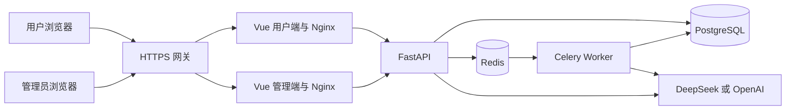

# 职启智评 AI Interview

面向求职准备场景的 AI 模拟面试与能力评估项目，包含用户端、管理端和后端服务。项目围绕简历分析、岗位匹配、模拟面试、报告生成和学习复盘组织求职训练流程，支持用户配置自己的 DeepSeek 或 OpenAI API Key。

> 当前版本已完成单机部署、HTTPS 接入及管理员登录检查，用户已反馈 DeepSeek 连接测试成功。全部业务功能将在准备工作完成后统一验收，本文不将待验收功能标记为已通过。

## 在线访问

腾讯云上已部署的预览站点，请直接使用以下 HTTPS 地址：

| 入口 | 公网地址 |
| --- | --- |
| 用户端 | https://ai-interview.43-132-227-52.sslip.io |
| 管理端 | https://ai-interview-admin.43-132-227-52.sslip.io |

后文的 `127.0.0.1:8080` 和 `127.0.0.1:8081` 用于本地部署或 SSH 隧道访问，不是上述云端站点的公网地址。在自己的电脑上直接打开 `127.0.0.1`，访问的是自己的电脑。

## 团队信息

| 项目 | 内容 |
| --- | --- |
| 学校 | [待填写] |
| 队伍名称 | [待填写] |
| 参赛赛道及组别 | [待核对并填写] |
| 成员及分工 | [待填写成员姓名、负责模块和实际工作] |
| 指导教师 | [待填写，如适用] |
| 联系方式 | [待填写适合公开的联系邮箱] |
| 提交版本 | [统一验收通过后填写 Git 提交哈希] |

## 项目目标

求职者往往需要分别整理简历、分析岗位要求、练习面试并复盘问题。本项目将这些步骤放入同一条训练流程，使用户能够结合自己的经历和目标岗位进行练习，并通过报告和学习任务继续改进。

核心使用流程为：

```text
注册与登录 → 隐私确认 → 配置模型 → 上传简历
    → 简历诊断与岗位匹配 → 多轮模拟面试
    → 报告生成 → 学习任务与训练复盘
```

## 功能范围

以下为当前代码包含的主要模块，实际可用性以最终验收结果为准。

| 范围 | 主要模块 |
| --- | --- |
| 账号与个人设置 | 注册登录、隐私同意、个人资料、个人模型凭据配置与连接测试 |
| 简历分析 | 简历上传、解析、能力诊断和简历润色 |
| 岗位与知识资料 | 岗位画像、岗位匹配、岗位知识库及面试追问资料 |
| 模拟面试 | 围绕简历和目标岗位开展多轮问答与追问 |
| 结果与训练 | 面试报告、历史记录、学习任务、学习路线和训练复盘 |
| 后台管理 | 用户与管理员管理、公共岗位画像、面试经验、资料包预检、案例标注、评测样本及面试记录 |

部分 Agent、Eval 和 SFT 模块包含预览逻辑。预览数据、规则评分和真实模型实验需分别说明；当前不将 SFT 预览表述为已完成真实微调。

## 技术架构



| 层次 | 技术 |
| --- | --- |
| 用户端与管理端 | Vue 3、Vite、Vue Router、Pinia、Axios |
| API 服务 | Python 3.12、FastAPI、SQLAlchemy、Alembic |
| 数据与任务 | PostgreSQL 16、Redis 7、Celery |
| 模型接入 | OpenAI 兼容接口、用户个人模型配置 |
| 部署 | Docker Compose、Nginx；已有 Caddy 可用于 HTTPS 网关接入 |

单机预览配置默认使用一个 API 进程和一个 Celery solo Worker，适用于低并发验证。真实容量和并发能力尚需测试。

## 目录结构

```text
.
├── ai-interview-frontend/       # 用户端
├── ai-interview-admin/          # 管理端
├── ai-interview-backend/        # 后端、迁移、任务和测试
├── portal/                     # 项目入口静态页面
├── docs/                       # 部署与开发文档
├── scripts/                    # 初始化、部署、健康检查和备份工具
├── artifacts/                  # 评测与预览等项目产物
├── .env.example                # 单机预览环境模板
├── compose.single-host.yml     # 独立单机预览编排
├── compose.gateway.yml.example # 已有网关网络接入模板
└── docker-compose.yml          # 原有共享网关部署编排
```

## 快速启动

以下步骤用于 Linux 单机预览。服务器需已安装 Docker Engine、Docker Compose 插件、Python 3 和 Bash。Python 后端镜像使用 3.12。

### 1 获取代码

```bash
git clone https://github.com/rswdgvjii4609876-afk/ai-interview.git
cd ai-interview
```

仓库当前为私有仓库，克隆需要相应访问权限。不要将访问令牌写进仓库或部署脚本。

### 2 生成运行配置

将下方邮箱替换为自己的管理员邮箱后执行：

```bash
python3 scripts/init_runtime_env.py --admin-email you@example.com
```

工具从 `.env.example` 生成根目录 `.env`，自动生成数据库密码、Redis 密码、JWT 密钥及个人模型凭据加密密钥，并拒绝覆盖已有配置。

真实 `.env` 必须私下保存并随备份保管。不要反复生成或替换其中的加密密钥，否则可能无法解密此前保存的用户模型凭据。根目录配置用于 Compose，不要直接复制到后端目录作为开发配置。

### 3 构建并启动

```bash
bash scripts/run_single_host.sh
```

脚本串行构建后端和双前端，等待数据库、Redis、迁移与 API 就绪，再检查运行状态。若项目目录已有 `compose.gateway.yml`，启动时会自动合并该网关配置。

以下是服务在部署主机上的本地监听地址。如果服务部署在腾讯云服务器，这些地址只能在服务器本机访问，或通过下方 SSH 隧道从自己的电脑访问。直接体验现有云端站点请使用本文“在线访问”中的 HTTPS 地址。

| 入口 | 部署主机本地地址 |
| --- | --- |
| 用户端 | http://127.0.0.1:8080 |
| 管理端 | http://127.0.0.1:8081 |

这两个端口默认仅绑定部署主机的回环地址；PostgreSQL 和 Redis 不发布主机端口。需要通过隧道访问远程实例时，在自己的电脑执行以下命令，替换用户名和服务器 IP：

```bash
ssh -N -L 8080:127.0.0.1:8080 -L 8081:127.0.0.1:8081 USER@SERVER_IP
```

确认 SSH 连接成功并保持连接开启后，再通过自己电脑的浏览器访问 `http://127.0.0.1:8080` 和 `http://127.0.0.1:8081`。没有建立隧道时，这两个地址不会转发到服务器。

### 4 创建首个管理员

在项目根目录执行：

```bash
docker compose -f compose.single-host.yml exec app python scripts/bootstrap_admin.py
```

按提示输入两次初始密码，至少 12 位且包含字母、数字和特殊字符。管理员邮箱取自生成配置中的 `ROOT_ADMIN_EMAIL`。已有同邮箱账号不会被此工具覆盖或重置密码。

管理员账号与用户端账号分别管理。体验求职训练流程时，需另行注册普通用户账号。

### 5 配置个人模型

1. 在用户端注册、阅读隐私说明并登录。
2. 进入个人中心，选择 DeepSeek 或 OpenAI。
3. 填写自己的 API Key、可用模型和对应 Base URL，保存资料。
4. 点击“测试当前连接”，确认模型服务可用后再使用 AI 功能。

DeepSeek 官方 Base URL 为 `https://api.deepseek.com`。可用模型、账号资格和额度以服务商控制台为准。当前主要 AI 业务要求个人模型 Key，普通账号登录成功不代表已经具备模型调用能力。

## 配置说明

| 变量 | 用途 |
| --- | --- |
| `COMPOSE_PROJECT_NAME` | Compose 项目名，用于区分实例 |
| `ENV` | 默认 `preview`，生产模式另有配置校验 |
| `HTTP_BIND` | 双前端监听地址，默认 `127.0.0.1` |
| `FRONTEND_HTTP_PORT` / `ADMIN_HTTP_PORT` | 双前端本机端口，默认 8080 / 8081 |
| `ROOT_ADMIN_EMAIL` | 根管理员邮箱 |
| `FRONTEND_URL` / `BACKEND_CORS_ORIGINS` | 前端地址与允许来源 |
| `POSTGRES_PASSWORD` / `REDIS_PASSWORD` | 内部数据服务密码 |
| `SECRET_KEY` | 应用认证密钥 |
| `USER_LLM_CREDENTIAL_SECRET` | 用户模型凭据加密密钥 |
| `DEEPSEEK_API_KEY` | 服务端模型配置项，预览模板可留空；现有生产校验要求真实值 |

切换 `ENV=production` 前需按现有校验补齐真实站点 URL、显式 CORS、强密钥及服务端模型配置。仅修改环境名称不会完成生产部署。

## 云端部署

完整步骤见 [腾讯云单机运行指南](docs/deployment/tencent-single-host.md)。Ubuntu 24.04 也可使用仓库中的交互式安装脚本：

```bash
sudo bash scripts/deploy_ubuntu24.sh
```

如服务器已有 Caddy，可使用 `scripts/configure_gateway.py` 接入两个独立域名。该工具备份现有配置，校验并热加载网关，再检查可信 HTTPS；失败时恢复原配置。使用前需确认自己的域名、Caddy 容器名和 Docker 网络，具体参数见部署指南。

截至 2026 年 11 月 6 日的预览入口：

- 用户端：https://ai-interview.43-132-227-52.sslip.io
- 管理端：https://ai-interview-admin.43-132-227-52.sslip.io

以上使用临时 DNS。提交前需重新核对地址可用性、演示账号、模型额度和评委访问方式。不要在 README 中公开管理密码或模型 Key。

## 运行维护

检查就绪状态：

```bash
python3 scripts/check_runtime.py
```

查看基础实例的状态和日志：

```bash
docker compose -f compose.single-host.yml ps
docker compose -f compose.single-host.yml logs --tail=100 app migrate celery-worker
```

若已接入网关，在上述 Compose 命令中一并加入 `-f compose.gateway.yml`。

在低写入时段创建私有备份：

```bash
bash scripts/backup_single_host.sh
```

备份覆盖数据库、上传文件、运行环境配置和源码版本记录，保存在 `backups/`。另行保管网关配置及后续补丁版本记录。备份中含个人数据和密钥，不得提交 Git。

更新前先备份并记录版本；数据库迁移是否支持回退需要单独确认。不要执行 `docker compose down -v` 清理实例，该选项会删除持久化数据卷。

## 构建与检查

在两个前端目录分别执行：

```bash
npm ci --ignore-scripts --no-audit --no-fund
npm run build
```

后端使用独立的 Python 3.12 虚拟环境，在 `ai-interview-backend/` 目录执行：

```bash
python -m pip install -r requirements-test.txt
python -m pytest -q
```

历史检查记录：两个前端构建通过，后端 287 项测试通过。这些结果来自 2026 年 11 月 5 日的开发检查，不能替代当前提交版本的复测，也不能证明真实模型效果或完整业务流程已经通过。

## 当前验收状态

| 检查项 | 状态 |
| --- | --- |
| 单机服务及数据库迁移就绪检查 | 已通过 |
| 两端 HTTPS 和静态入口资源 | 已通过 |
| 管理员登录与 root 身份显示 | 已通过基础检查 |
| 用户个人 DeepSeek 配置 | 已保存，用户反馈连接测试成功 |
| 全部业务功能和权限隔离 | 待统一验收 |
| 真实简历到面试报告的完整流程 | 待统一验收 |
| AI 效果对比和人工评分 | 待补充实测证据 |
| 备份恢复与全新环境复现 | 待验收 |

最终验收将覆盖注册登录、隐私与模型配置、简历处理、岗位与知识资料、面试、报告、学习复盘、后台管理、权限及异常处理。准备工作完成后统一执行，验收通过后更新本表并记录对应提交版本。

## 参赛材料

- 技术说明 PDF：[验收通过后填写文件或链接]
- 演示视频：[验收通过后填写文件或链接]
- 真实评测与人工评分记录：[待补充]
- 评审访问说明：[待补充仓库权限和体验方式，不填写公开管理密码]

学校、队伍、赛道、提交要求和截止时间以已报名个人中心及学校通知为准。所有技术和效果表述应与最终提交版本及真实证据一致。
