# 2026-05-19 图片型面试经验抽取记录

本文件由 `extract_member_interview_experience` 生成。图片内容必须经过 OCR/视觉转写后，才能进入结构化知识包。

## DOCX 正文抽取

### 岗位画像.docx

可交付物：
- 非技术岗岗位要求整理稿。
- 非技术岗面经候选清单。
- 非技术岗结构化问答经验卡片。
- 非技术资料来源审核表。
- 非技术岗知识库补全记录。
非技术岗岗位资料与面经工作
交付物1：非技术岗岗位要求整理稿
岗位基础信息
覆盖岗位：产品助理、运营助理、新媒体运营、人力资源专员、招聘助理、行政管理助理
资料整理周期：
整理人：
产品助理
一、岗位要求整理稿
（一）硬性要求（学历、经验、证书、技能、地域、年龄等）
1. 腾讯系高端产品岗（AI平台高级产品经理、微信小店产品策划）1. AI平台高级产品经理（深圳）- 学历：全日制本科及以上
- 工作经验：3年以上AI/云计算/边缘计算领域产品策划经验，PaaS、开发者工具等平台型产品全生命周期管理经验优先
- 语言：英语可作为工作语言，可独立撰写英文技术文档、对接国际团队
- 专业技能：熟悉AIGC技术应用场景，具备实际项目落地经验；熟练输出竞品分析、产品差异化策略；具备产品全流程管理能力
2. 微信小店-产品策划（C端方向，广州）- 学历：本科及以上
- 工作经验：1年及以上产品策划经验，电商行业背景优先
- 加分硬性：具备数据分析/商业分析能力
2. 北京地区产品/产品助理岗1. 博雅工道产品助理：统招硕士及以上，理工科优先，熟悉产品全流程，有工业产品设计经验优先
2. 北京中电元德产品助理：本科及以上，理工科（电子工程、计算机、自动化）优先；熟练Excel、Python、SQL；英语可无障碍沟通
3. 中电金信智慧双碳产品经理：本科，3年以上工作经验；熟练Office、Visio、Axure；具备大型信息化项目经验，双碳/能源行业经验优先
4. 北京果汁科技产品助理（校招/实习）：本科及以上，应届毕业生，计算机/设计/信息管理优先；熟练Axure、Figma等原型工具，Xmind/ProcessOn；每周可实习≥4天，实习≥3个月
5. 品镀研康产品助理：本科及以上，相关专业优先，具备团队领导能力
6. 某国有银行产品经理助理（信托）：本科及以上，金融/财务/会计/经济类专业；1年以上资管产品业务经验
7. 大北农集团产品开发高级研究助理：博士学历，农学/作物遗传育种等生物类相关专业；具备专业生物软件使用能力，英语能力优秀
3. 石家庄地区产品助理岗（非互联网/商贸/硬件方向）1. 快乐沃克/河北省供销惠民科技产品助理：本科及以上，45周岁以下；3年以上经验，大中型企业3年以上产品经理经验优先；熟悉新品上市全流程，食品类产品上市经验优先
2. 石家庄在冀顺通商贸产品助理：大专及以上，统计学/数学/计算机/财务/市场营销优先；熟悉透视表、函数、数据图表，了解3C/手机行业优先
3. 石家庄惠拓电子产品经理助理：大专及以上，熟练办公软件，具备销售相关经验优先
4. 新增垂直细分岗硬性要求（面经匹配）1. 食品类产品助理：本科及以上，食品专业优先；2025/2026届优先；可连续实习3个月+，每周出勤≥4天；具备电商经验优先
2. 跨境电商产品助理（亚马逊/亚声威格）：本科及以上，英语四级及以上；跨境电商/外贸经验优先；可接受深圳等工作地；具备Listing优化、数据复盘经验优先
3. AI/企业级产品助理（滴滴/科大讯飞）：本科及以上，计算机/理工科优先；熟悉Python、SQL；了解大模型、数据标注；可接受加班；具备B端产品经验优先
4. 东方甄选（直播电商产品助理）：本科及以上，快消/食品电商经验优先；熟悉直播电商模式；可跟进产品落地全流程
（二）加分项（优先条件、能力、行业背景、工具、项目）
1. 行业背景加分：电商/直播电商、AI/边缘计算、双碳能源、食品快消、工业设计、信托金融、3C数码、生物农业、跨境电商垂直行业项目/从业经验
2. 工具技能加分：Axure、Figma、墨刀、Xmind、ProcessOn、Visio、Python、SQL、Excel高阶功能、数据复盘工具
3. 能力加分：数据分析/商业分析、英文读写沟通、跨部门团队领导、标杆客户项目落地、竞品分析、需求挖掘、用户调研、项目推进、沟通表达、抗压学习能力
4. 项目加分：平台型产品全生命周期、大型信息化项目、成熟产品上市、标杆行业案例落地、跨境电商选品/Listing优化、食品产品全链路开发、AI产品项目落地
5. 学历/身份加分：硕士/博士学历、应届可长期实习、理工科对口专业、英语能力达标
（三）常见工作任务（全岗位通用+分岗位细分）
通用核心任务
1. 市场/用户调研、需求挖掘与分析，输出PRD、竞品分析、市场分析报告
2. 产品规划、功能策划、原型设计，跟进研发、测试，推动版本落地与迭代
3. 产品生命周期管理：定价、需求/质量/交付管理、商业化落地、标杆案例打造
4. 跨部门沟通协作：对接研发、销售、售前、运营，推进项目执行
5. 数据复盘：收集用户数据、业务数据，分析问题并输出优化方案
6. 文档规范：撰写需求文档、技术文档、业务说明、项目复盘、对外方案材料
细分岗位专项任务
1. AI平台产品（腾讯）：边缘计算+AIGC端到端方案规划、全球竞品跟踪、国际团队协作、标杆客户落地赋能
2. C端电商产品（腾讯）：商业交易功能策划、用户体验优化、电商玩法创新迭代
3. 石家庄商贸/快消产品：市场销售联动、品类规划、新品上市、季节性产品迭代、市场活动执行
4. 硬件/工业产品：产品销售支持、项目全流程跟进、数据运营、技术文档整理
5. 双碳/金融产品：信息化项目需求管理、客户需求挖掘、方案宣讲、项目全流程管控
6. 生物/农业产品：技术产品市场调研、研发流程管控、产品研发落地、技术评估
7. 东方甄选直播电商产品：选品、供应商对接、包装设计、卖点撰写、主播培训、直播营销、新品全链路落地
8. 跨境电商产品：选品、竞品分析、Listing优化、数据复盘、海外用户运营、供应链对接
9. 食品产品助理：食品策略梳理、用户访谈、产品设计、供应商谈判、库存管理、宣发运营
10. 企业级AI产品（滴滴/科大讯飞）：B端客户需求挖掘、定制化方案设计、数据标注、模型迭代、会员产品运营、客户分层管理
（四）工作场景
1. 互联网大厂（腾讯/滴滴/科大讯飞）：全球化AI平台、C端电商、企业级B端产品；跨地域/跨国际团队协作、高端技术产品创新、政企大客户落地、数据驱动产品迭代
2. 北京科技/数字化企业：工业装备、双碳能源、金融信托、人工智能；ToB政企项目、产品全流程管控、商业化落地
3. 石家庄本地企业：快消食品、3C数码、硬件销售；区域市场拓展、新品上市、销售联动、本地化标杆打造
4. 直播/跨境电商企业（东方甄选/亚声威格）：直播电商、亚马逊跨境平台；线上选品、供应链落地、直播运营、海外市场拓展
5. 校招/实习场景：需求梳理、原型绘制、文档撰写、用户反馈收集、项目辅助执行、长期实习跟进产品落地
（五）公司侧重点
1. 腾讯（高端产品岗）：技术创新+全球化+用户价值+商业化标杆，侧重AI前沿技术落地、全球市场竞争力、大型平台型产品全链路能力
2. 滴滴/科大讯飞（AI/企业级）：B端客户价值+数据驱动+AI技术落地，侧重大客户定制化、数据复盘、模型迭代、产品商业化盈利
3. 北京科技/数字化企业：垂直行业深耕+项目落地+政企服务，侧重行业需求深度挖掘、大型项目交付、合规性、数据驱动
4. 石家庄本地企业：区域市场+销售联动+新品落地，侧重快消/商贸行业本地化运营、销售业绩达成、新品快速迭代
5. 东方甄选（直播电商）：食品快消+直播电商模式+全链路落地，侧重线上直播带货、新品快速迭代、用户运营
6. 跨境电商企业：海外市场+合规运营+数据驱动，侧重亚马逊平台规则、选品、Listing优化、海外用户需求挖掘
7. 食品类企业：食品全链路开发+供应链+电商运营，侧重食品安全、供应商管控、产品设计、库存管理
二、非技术岗面经候选清单
岗位名称 面经关键词 来源 年份 许可 可信度 资料状态
AI平台高级产品经理（腾讯） 高端B端、边缘计算、AIGC、全球化、竞品分析 腾讯招聘、互联网求职社区 2026 公开可参考 高 可入库
微信小店产品策划（腾讯） C端电商、交易功能、用户体验、数据驱动 腾讯招聘、互联网求职社区 2026 公开可参考 高 可入库
智慧双碳产品经理 能源信息化、政企项目、需求分析、方案宣讲 智联招聘、求职经验贴 2025 公开可参考 中 可入库
东方甄选产品助理 直播电商、食品快消、市场调研、竞品分析、新品落地、case mock 小红书求职笔记 2025 个人分享公开 高 可入库
滴滴产品助理（企业级） AI产品、B端定制化、会员产品、数据复盘、盈利模式、客户分层 小红书求职笔记 2025 个人分享公开 高 可入库
食品类产品助理 食品开发、供应链、供应商谈判、库存管理 小红书求职笔记 2025 个人分享公开 中 可入库
跨境电商产品助理（亚声威格） 亚马逊平台、选品、Listing优化、数据复盘、英语能力 小红书求职笔记 2025 个人分享公开 高 可入库
科大讯飞产品助理（实习） 大模型、竞品分析、PRD、英语、加班接受度 小红书求职笔记 2025 个人分享公开 高 可入库
通用产品助理（硬件/互联网） 自我介绍、岗位认知、项目深挖、需求变更、方案沟通、用户调研 小红书求职笔记 2024-2025 个人分享公开 中 可入库
三、非技术岗结构化问答经验卡片
真实问题 参考回答要点 复盘反思 公司/场景 考察能力 难度 来源说明 审核状态
### 一、通用基础类（全产品岗通用）
1.自我介绍 1. 基本信息+专业背景；2. 匹配岗位的实习/项目经历，突出调研、竞品分析、数据复盘、沟通协作；3. 求职动机，贴合公司业务方向 自我介绍必须贴岗位，避免泛泛而谈，突出产品相关硬技能 全场景 自我认知、岗位匹配度、表达能力 ★☆☆ 小红书多份产品面经、大厂面经 可入库
2. 你为什么选择产品助理/我们公司？ 1. 对产品行业的认知；2. 自身能力匹配（调研、分析、执行力）；3. 认可公司业务模式（直播电商/跨境/AI/政企）；4. 个人成长诉求 需提前调研公司业务，不能空泛回答 全场景 求职动机、行业认知、稳定性 ★☆☆ 通用产品助理面经 可入库
3. 你觉得产品助理主要做什么？ 协助产品经理：市场调研、竞品分析、需求挖掘、原型/文档撰写、供应商对接、项目跟进、数据复盘、运营支持、用户反馈收集 不要只说打杂，要分调研-落地-复盘全链路回答 全场景 岗位认知、业务理解 ★☆☆ 通用产品助理面经 可入库
4. 你觉得自己做这个岗位的优势是什么？ 结合自身：沟通能力、数据分析能力、执行力、抗压能力、学习能力、垂直行业经验、工具技能（Excel/Axure/SQL） 用具体案例支撑，不要空谈 全场景 自我认知、岗位匹配 ★☆☆ 通用产品助理面经 可入库
5. 可以实习多久？为什么选择现在实习？ 明确实习时长（3个月+优先），说明时间规划，求职主动性，职业规划匹配 回答要稳定，突出可长期跟进项目 实习岗 稳定性、时间规划 ★☆☆ 食品/跨境电商产品面经 可入库
6. 上一份实习/工作为什么离职/不做了？ 客观原因：职业规划、赛道匹配、个人成长，不吐槽前公司/同事 避免情绪化，突出正向求职诉求 全场景 职业稳定性、沟通情商 ★★☆ 亚马逊/亚声威格跨境面经 可入库
7. 你最大的优点/缺点是什么？ 优点：执行力、逻辑、抗压、细致；缺点：避免致命短板，突出可改进，贴合岗位不冲突 缺点不能影响岗位核心工作 全场景 自我认知、风险意识 ★☆☆ 通用产品助理面经 可入库
8. 如何看待加班？ 可接受紧急加班，以项目落地为核心，平衡工作效率，愿意主动推进业务 态度积极，不抗拒，贴合互联网/电商行业特性 互联网/电商/AI岗 抗压能力、职业态度 ★☆☆ 科大讯飞面经 可入库
### 二、调研/竞品/需求类（核心高频）
9. 你的市场调研经历，是怎么调研的？ 1. 明确调研目的；2. 渠道：用户访谈、线上数据、行业报告、竞品分析；3. 数据整理、痛点提炼；4. 输出调研结果 要落地，讲具体步骤+方法，不要空谈 东方甄选/食品/互联网岗 调研能力、逻辑思维 ★★☆ 东方甄选产品助理面经 可入库
10. 怎么找竞品？ 1. 直接竞品（同赛道头部）；2. 间接竞品（替代类产品）；例：东方甄选竞品=淘宝+京东+抖音+盒马+山姆；跨境竞品=亚马逊同类卖家 分维度拆解，结合行业举例 电商/直播/跨境岗 竞品分析、行业洞察 ★★☆ 东方甄选产品助理面经 可入库
11. 怎么检索资料？ 行业报告平台、电商后台数据、用户评价、竞品后台、社交媒体、海外平台（跨境）；关键词检索、数据筛选、信息整合 讲检索渠道+筛选方法 全场景 信息搜集、数据筛选能力 ★★☆ 东方甄选产品助理面经 可入库
12. 如何进行竞品分析？ 1. 竞品定位；2. 功能/卖点/定价/用户/运营模式；3. 优劣势对比；4. 输出差异化策略 结构化回答，结合案例 互联网/AI/电商岗 产品思维、分析能力 ★★★ 通用产品助理面经、滴滴面经 可入库
13. 如何确认需求？ 用户访谈、数据分析、业务方沟通、需求优先级排序、需求文档输出、验证落地 贴合B端/C端，区分用户真实需求和伪需求 全场景 需求挖掘、逻辑能力 ★★★ 通用产品助理面经 可入库
14. 用户画像怎么做？ 用户基本属性、行为特征、需求痛点、消费习惯、使用场景，结合数据/访谈 结构化拆解，落地可执行 互联网/电商岗 用户思维、分析能力 ★★★ 通用互联网产品面经 可入库
15. 需求变更怎么办？ 1. 评估变更影响；2. 沟通业务方、研发；3. 调整优先级；4. 更新文档；5. 同步相关方，把控项目节奏 流程意识、风险把控、沟通能力 B端/政企/互联网岗 流程意识、问题解决 ★★★ 通用产品助理面经 可入库
### 三、Case实操/业务落地类（重点考察）
16. 如果做鲜牛奶产品，你会怎么做？（东方甄选case mock） 市场调研→竞品分析→找代工厂落地→设计包装、提炼卖点、成本核算、定价议价→营销（线上直播带货） 全链路闭环，贴合直播电商模式 直播电商/食品岗 产品全流程、商业思维、落地能力 ★★★ 东方甄选产品助理面经 可入库
17. 公司推出自营电商平台，前后端如何设计？ 前端：用户端、商家端，核心功能（浏览、下单、支付、售后）；后端：订单、库存、用户、数据后台；架构分层，业务闭环 技术理解+产品架构思维 互联网电商岗 架构思维、业务落地 ★★★☆ 通用互联网产品面经 可入库
18. 电商平台访问量断崖式下滑，如何排查原因？ 1. 数据拆解（流量来源、用户、时段）；2. 竞品动作；3. 产品故障；4. 营销问题；5. 用户评价/舆情；6. 验证复盘 数据驱动，结构化排查 电商/跨境岗 数据分析、问题拆解、复盘能力 ★★★☆ 通用互联网产品面经 可入库
19. AI产品和市面上同类产品有什么异同？（滴滴） 功能层面：产品核心功能、使用场景；算法层面：技术模型、准确率、数据能力；盈利模式层面：B端定制化/通用型 区分功能、技术、商业化三个维度 AI/企业级B端岗 行业洞察、产品对比、深度思考 ★★★ 滴滴企业级产品助理一面面经 可入库
20. 产品是否能盈利？（滴滴） 1. 预估团队人力成本；2. 核算项目工时；3. 计算交付成本；4. 对比产品月收益，测算盈利空间 商业化思维，用数据测算 B端/AI岗 商业思维、成本核算 ★★★☆ 滴滴企业级产品助理一面面经 可入库
21. 为什么产品做定制化？（滴滴） KA大客户需求个性化，需定制化解决方案；中小客户（SMB）需求通用，标准化产品；分层客户差异化服务 B端客户分层、需求洞察 B端企业级岗 客户思维、分层运营 ★★★ 滴滴企业级产品助理一面面经 可入库
22. 10-30美金产品销往欧美，选什么？为什么？（亚马逊跨境） 选品逻辑：海外需求、合规性、竞品少、复购高；举例家居/美妆小品类；从市场需求、竞品、利润、合规维度分析 贴合海外市场，数据化选品 跨境电商岗 市场洞察、选品能力、商业思维 ★★★ 亚声威格跨境产品面经 可入库
23. 产品上架如何提升吸引力？怎么做差异化？ Listing优化（主图、标题、详情）、定价策略、卖点提炼；差异化：功能、包装、服务、合规、用户体验；避开同质化竞争 跨境平台规则+产品差异化 跨境电商岗 运营思维、产品设计 ★★★ 亚声威格跨境产品面经 可入库
### 四、项目深挖/情景问题类
24. 实习中遇到最大的困难？怎么解决？ 用STAR法则：情境-任务-行动-结果；举例：销量下滑、项目延期、需求冲突、跨部门沟通问题 必须有具体案例+数据结果 全场景 问题解决、抗压能力、复盘能力 ★★★ 滴滴、跨境电商多份面经 可入库
25. 设计方案业主理解不了怎么办？ 用通俗语言+具象案例讲解，简化专业术语，可视化展示，匹配业主认知，反复对齐需求 不要讲复杂方案，要落地通俗沟通 B端政企/硬件岗 沟通能力、换位思考、方案拆解 ★★☆ 通用产品助理面经 可入库
26. 如何快速熟悉项目业务？ 主动询问同事、梳理业务文档、拆解用户流程、复盘业务数据、跟进项目全流程 优先沟通+文档，高效熟悉业务 全场景 学习能力、执行力 ★☆☆ 通用产品助理面经 可入库
27. 项目上线时间提前怎么办？ 1. 拆解核心功能，优先级排序；2. 协调研发/测试资源；3. 砍掉非核心需求；4. 风险把控，保障核心功能落地；5. 同步相关方 项目管理、优先级把控、风险应对 B端/互联网岗 流程意识、抗压能力、项目管理 ★★★ 通用产品助理面经 可入库
28. 有没有遇到产品导致项目推迟？怎么处理？ STAR法则：说明推迟原因（需求变更/沟通问题），处理措施（对齐需求、优化流程、同步进度），复盘改进措施 坦诚+复盘，体现流程优化意识 全场景 风险意识、复盘能力、问题解决 ★★★ 通用产品助理面经 可入库
29. 如何进行数据标注？（滴滴数据产品） 1. 分析业务背景；2. 设计标注文档（案例+STAR法则）；3. 外包预标注，迭代文档；4. 正式交付标注 落地流程，贴合AI数据产品 AI/数据产品岗 业务落地、流程设计 ★★★ 滴滴数据产品面经 可入库
30. B端云产品计费模式？ 一次性买断、年费、按QPS按量计费、按使用量阶梯计费 B端商业化知识 B端云产品岗 行业知识、商业化思维 ★★☆ 滴滴二面面经 可入库
### 五、反向提问类（面试收尾）
31. 反问面试官 重点问：1. 岗位核心考核指标；2. 业务难点；3. 应届生培养计划；4. 产品落地周期；避开薪资、加班等敏感问题 体现求职诚意，贴合岗位成长 全场景 求职诚意、职业规划 ★☆☆ 多份面经通用 可入库
四、非技术资料来源审核表
资料类别 来源渠道 获取方式 可信度 许可情况 资料状态 备注
招聘JD 腾讯招聘官网、智联招聘 截图整理 高 公开可商用 可入库 岗位硬性要求、工作任务核心依据
行业能力资料 公开互联网招聘信息、岗位JD 归纳提炼 中 公开可参考 可入库 产品经理通用能力、行业专项能力
面经/经验贴 小红书求职笔记、互联网求职社区 截图整理、结构化拆解 高 个人分享公开，可用于学习 可入库 覆盖大厂、电商、跨境、食品、AI、政企全品类产品岗
通用产品方法论 公开互联网产品求职资料 归纳提炼 中 公开可参考 可入库 STAR法则、竞品分析、需求挖掘、用户画像通用框架
五、非技术岗知识库补全记录
1. 已完成：- 全品类岗位硬性要求、加分项、工作任务、场景、公司侧重点结构化整理；
- 整合15+份产品岗面经，输出31道高频结构化面试题+回答要点+复盘+考察能力，覆盖通用基础、调研竞品、Case实操、项目深挖、反向提问全模块；
- 完善资料来源审核表，明确可信度、许可、入库状态；
- 补充垂直行业（直播电商、跨境、食品、AI、B端企业级）专项岗位内容。
2. 待补全：补充HR核心能力专项问答（沟通协作、流程意识、数据复盘、活动执行、需求分析、候选人沟通、文档规范）。
3. 后续方向：按公司/行业维度拆分题库，适配不同求职方向。
运营助理
一、岗位要求整理稿（沿用原JD，补充面经反向提炼能力要求）
（一）硬性要求（全岗位共性+分岗位）
通用硬性门槛
1. 学历：大专及以上为主，部分市场运营助理要求本科；多数岗位学历不限
2. 经验：0-3年均可，应届生可投，经验不限岗位占比高
3. 基础技能：熟练Excel、PPT；会PS、剪映等图文/视频剪辑工具优先；熟悉电商/新媒体平台规则；掌握基础数据分析（SQL、SPSS）加分
4. 软门槛：全职在岗、可稳定长期工作；抗压、细致认真、责任心强；服从工作节奏/加班/时差（海外岗）；耐心、沟通表达、自主规划能力
5. 行业附加：跨境岗需适应时差；教育岗需了解教育产品；互联网大厂岗看重AI工具使用、产品认知
分岗位硬性要求
1. 美妆品牌海外运营助理：热爱美妆行业；能适应跨境电商时差、快节奏；有无达人引流增长案例优先；具备TikTok运营基础加分
2. 阿里淘宝电商运营助理：25岁以上；1年及以上电商运营工作经验；大专及以上学历
3. 宠物用品电商运营助理：本科优先；可做基础数据统计、商品上下架、店铺日常运营
4. 短视频内容运营助理：大专及以上；应届生优先；能长期做重复类用户运营工作；会短视频剪辑
5. 市场运营助理（航天科技）：本科及以上；1-3年相关经验；有航空航天/高端制造背景优先；可接受出差
6. 保险运营助理：大专；沟通能力强、团队协作、持续学习；固定工作时长
7. TikTok跨境运营助理：耐心、达人对接沟通能力；创新思维、抗压吃苦、利他团队意识；具备视频剪辑、数据分析能力
8. 大厂产品运营（好未来/美团/华为/小米）：本科优先；具备项目运营、数据复盘、用户需求分析能力；熟悉主流互联网产品；会使用AI工具
（二）加分项（全岗位提取+面经补充）
1. 技能类：会PR、剪映、短视频剪辑；懂A/B测试；熟悉TK/IG/Youtube/抖音/淘宝/京东等平台；会小程序后台操作；掌握ERP/SQL/SPSS；会使用AI运营工具
2. 经验类：达人引流/电商销售增长案例；社群运营、私域承接、活动执行经验；运营/客服/销售经验；小红书/TikTok自媒体账号运营、达人合作经验；教育/互联网大厂实习经历
3. 能力类：强数据分析、互联网思维；跨部门沟通、客户维护、商务对接；文案撰写、标题创作、用户话术设计；项目管理、会员体系搭建、成本ROI把控；冷启动社区运营能力
4. 行业类：美妆、宠物、法律、保险、航天高端制造、教育垂直行业经验
（三）常见任务（全岗位通用工作模块，补充面经高频业务）
1. 数据复盘&分析：店铺/账号数据统计、整理、分析；制作数据台账、分析报告；监测运营指标，提出优化建议；数据反馈、复盘运营效果；漏斗模型分析、用户行为数据监测、ROI成本核算
2. 平台精细化运营：商品上下架、主图/详情优化、关键词优化；店铺视觉包装、转化率优化；平台日常运营、流量承接；私域/社群/朋友圈日常维护；TikTok达人挖掘建联、账号内容运营；小红书社区冷启动运营
3. 活动执行：营销活动策划、落地执行；线上引流、用户跟进；直播/短视频内容拍摄、剪辑、发布；平台多渠道联动、达人内容营销；早教产品大规模推广、自然流量+私域流量双模式运营
4. 用户&候选人沟通：评论区互动、私域沟通；识别潜在用户/客户；优化沟通话术，提升转化；用户问题归纳分级；客户关系维护、商务对接；达人长期沟通维护
5. 流程&文档规范：运营流程跟进、订单处理；合同/文件归档；台账管理；行政支持、资料整理归档；OA流程操作；协助跨部门工作对接；项目进度管理、风险控制
6. 渠道拓展：海外平台引流、达人挖掘；电商多平台布局；市场活动参展、行业资源拓展；自媒体矩阵搭建运营
（四）工作场景（新增大厂/跨境/教育场景）
1. 电商场景：淘宝/天猫/京东/抖音小店/跨境电商（TK/IG）店铺运营、直播电商、达人带货
2. 新媒体短视频场景：抖音、视频号、小红书内容产出、用户转化、评论区运营、私域承接；TikTok海外账号运营
3. 行业垂直场景：美妆跨境出口、宠物用品零售、法律新媒体、保险资源运营、高端制造/航天行业市场运营；教育早教产品运营；互联网大厂用户/产品运营
4. 私域社群场景：微信社群、朋友圈、小程序用户运营、活动转化、售后跟进
5. 大厂互联网场景：社区运营、用户生命周期运营、商业化运营、会员体系搭建、项目管理
（五）公司侧重点（分公司+新增面经企业）
1. 石家庄尚睦进出口贸易：美妆跨境电商，侧重海外平台、达人营销、利润分成、快节奏时差工作
2. 河北成华机械制造：阿里系国内电商，侧重淘宝平台运营、晋升培养、稳定白班、福利完善
3. 石家庄鸿森煊禾商贸：抖音电商，侧重小店运营、基础电商全流程
4. 河北酷爱宠物用品贸易：宠物多平台电商，侧重多平台数据、基础运营、成长培训体系
5. 泰和泰（北京）律所：法律新媒体，侧重短视频内容+用户转化，应届生友好、轻行政
6. 北京九天行歌航天科技：高端制造B端市场运营，侧重数据分析、商务对接、出差、体系化管理
7. 中国人寿天津分公司：保险行业资源运营，侧重资源维护、团队协作、长期稳定
8. 天津增鑫科技：私域社群运营，侧重微信生态、私域承接、小程序后台、电商私域转化
9. 好未来：教育产品运营，侧重早教项目策划、线上线下活动推广、自然流量+私域运营
10. 小米：通用互联网运营，侧重用户转化、留存、运营全链路逻辑
11. 华为：商业化收入运营，侧重用户体验指标、商业模式、社群拉新、漏斗模型
12. 美团：社区/产品运营，侧重AI工具应用、社区冷启动、用户行为数据分析
二、面经候选清单（已全部录入）
岗位名称 JD/面经来源 面经素材 来源年份 许可情况 可信度 资料状态
美妆品牌海外运营助理 智联招聘 待补充 待补充 待核验 待核验 待核验
电商运营助理（阿里淘宝） 智联招聘 待补充 待补充 待核验 待核验 待核验
电商运营助理（抖音小店） 智联招聘 待补充 待补充 待核验 待核验 待核验
宠物用品电商运营助理 智联招聘 待补充 待补充 待核验 待核验 待核验
短视频内容运营助理 智联招聘 待补充 待补充 待核验 待核验 待核验
市场运营助理（航天科技） 智联招聘 待补充 待补充 待核验 待核验 待核验
保险运营助理 智联招聘 待补充 待补充 待核验 待核验 待核验
运营助理（私域社群） 智联招聘 待补充 待补充 待核验 待核验 待核验
好未来产品运营 小红书 完整面经（自我介绍、教育产品认知、小红书运营、早教推广方案） 2025 个人经验分享 高 可入库
通用运营助理 小红书 初试+复试全流程、基础认知类问题 2025 个人经验分享 高 可入库
小米运营岗 小红书 运营专业核心6问+标准解析 2025 个人经验分享 高 可入库
应届生运营助理 小红书 通用基础面试问题+面试准备方法 2025 个人经验分享 高 可入库
通用运营岗 小红书 项目管理、会员体系、ROI平衡、新品运营专业问题 2025 个人经验分享 高 可入库
TikTok跨境运营助理 小红书 岗位认知、个人优势、平台理解全问题 2025 个人经验分享 高 可入库
华为收入运营助理 小红书 商业化运营、社群运营、漏斗模型问题 2025 个人经验分享 高 可入库
美团产品运营 小红书 AI认知、社区冷启动、用户数据判断问题 2025 个人经验分享 高 可入库
三、结构化问答经验卡片（全覆盖：沟通协作、流程意识、数据复盘、活动执行、需求分析、候选人沟通、文档规范，严格按要求格式）
模块1：自我认知&求职动机（通用必考题）
1. 真实问题：做个自我介绍，说说你的过往经历- 参考回答要点：按学校/专业→硬实力（技能：数据分析、剪辑、平台运营）→软实力（沟通、抗压、耐心）→对应实习/自媒体经历结构；跨境岗突出达人对接、TikTok运营；教育岗突出教育产品认知；大厂岗突出AI工具、项目经验
- 复盘反思：需精准贴合岗位JD关键词，经历细节要可溯源，不夸大；提前梳理经历话术
- 公司/场景：全运营岗通用（好未来、TikTok、华为、美团高频）
- 考察能力：自我认知、岗位匹配度、表达逻辑
- 难度：★★☆☆☆
- 来源说明：好未来产品运营面经、TikTok运营助理面经、应届生运营助理面经
- 审核状态：可入库
2. 真实问题：为什么想要从事运营行业/为什么选择我们这个岗位（TikTok/教育/电商）- 参考回答要点：行业前景（新兴风口、发展空间）→岗位价值（锻炼综合能力、匹配个人优势）→个人规划（长期深耕赛道）；结合行业特性（TikTok跨境风口、教育行业刚需）
- 复盘反思：避免空泛，必须绑定行业+岗位+个人能力，不脱离实际
- 公司/场景：TikTok运营、好未来教育运营、通用运营助理
- 考察能力：求职动机、职业规划、行业认知
- 难度：★★☆☆☆
- 来源说明：TikTok运营助理面经、应届生运营助理面经
- 审核状态：可入库
模块2：运营基础认知（通用专业题）
1. 真实问题：你觉得运营的必备能力有哪些？- 参考回答要点：①需求分析（用户调研、用户画像）②文案撰写（内容产出）③活动策划（KPI落地）④数据分析（数据复盘优化）；跨境岗补充耐心、达人沟通；大厂岗补充项目管理、AI工具能力
- 复盘反思：分维度作答，逻辑清晰，可结合自身经历举例
- 公司/场景：小米、通用运营助理、美团
- 考察能力：岗位认知、基础专业素养
- 难度：★★☆☆☆
- 来源说明：小米运营岗面经、应届生运营助理面经
- 审核状态：可入库
2. 真实问题：你怎么看待运营、销售、市场之间的关系？- 参考回答要点：互联网精细化分工，市场侧重拉新传播、销售侧重付费转化、运营贯穿全链路（拉新-促活-留存-付费-传播），运营包含市场与销售核心职能
- 复盘反思：理清职能边界，区分传统行业与互联网行业差异
- 公司/场景：小米、通用运营岗
- 考察能力：行业认知、逻辑思辨
- 难度：★★★☆☆
- 来源说明：小米运营岗面经
- 审核状态：可入库
模块3：数据复盘&用户运营（核心专业题）
1. 真实问题：怎么提升运营各个环节的转化率？- 参考回答要点：拉新（渠道测试找最优渠道）→激活（引导用户完成核心行为）→留存（定位流失原因，AB测试优化）→转化（匹配用户需求+价格策略）→传播（用户自发裂变+外部激励）
- 复盘反思：贴合用户生命周期漏斗模型，每个环节给出落地动作
- 公司/场景：小米、华为、电商运营
- 考察能力：全链路运营思维、数据复盘能力、流程意识
- 难度：★★★☆☆
- 来源说明：小米运营岗面经
- 审核状态：可入库
2. 真实问题：社群新用户拉新关注哪些指标？漏斗模型是什么？- 参考回答要点：拉新指标：曝光、点击、进群率、留存率；漏斗模型：曝光-点击-进群-活跃-转化-复购，逐层拆解流失节点，针对性优化
- 复盘反思：区分宏观漏斗与社群场景专属指标，贴合商业化运营逻辑
- 公司/场景：华为收入运营助理、私域运营
- 考察能力：数据分析、用户运营、流程意识
- 难度：★★★★☆
- 来源说明：华为收入运营助理面经
- 审核状态：可入库
3. 真实问题：给用户发送push/短信，如何判断用户是否买账？- 参考回答要点：初步响应（曝光率、点击率，判断标题/时机/人群）→后续转化（领券、加购、订单，判断落地页与用户匹配度），分层分析用户行为数据
- 复盘反思：从用户行为链路拆解，区分表层反馈与深层转化
- 公司/场景：美团产品运营、电商运营
- 考察能力：数据复盘、用户需求分析
- 难度：★★★☆☆
- 来源说明：美团产品运营面经
- 审核状态：可入库
模块4：活动执行&项目落地（场景化实操题）
1. 真实问题：如果推动3-5岁早教产品大规模推广，你会怎么做？- 参考回答要点：自然流量（抖音/小红书垂类运营，引流私域做社群转化）→私域流量（老用户裂变、妈妈群精准转化），同时分析两种模式利弊
- 复盘反思：结合教育产品用户属性（宝妈群体），精准匹配渠道，兼顾线上+私域闭环
- 公司/场景：好未来产品运营
- 考察能力：活动执行、渠道拓展、需求分析
- 难度：★★★☆☆
- 来源说明：好未来产品运营面经
- 审核状态：可入库
2. 真实问题：如何从0-1搭建一个新品类（如攀岩）小红书社区？- 参考回答要点：冷启动（挖掘种子用户、话题标签、内容模板）→日常运营（周期活动、激励UGC）→长期生态（扶持KOC、官方规则引导）
- 复盘反思：贴合社区运营逻辑，分阶段落地，兼顾短期冷启动与长期生态
- 公司/场景：美团产品运营、新媒体运营
- 考察能力：项目管理、活动执行、内容运营
- 难度：★★★★☆
- 来源说明：美团产品运营面经
- 审核状态：可入库
3. 真实问题：运营该如何进行项目管理？- 参考回答要点：梳理事项&截止时间→可视化进度→设置里程碑→定期跟进→风险控制→责任人闭环
- 复盘反思：标准化项目流程，突出进度把控、风险意识、跨部门协作
- 公司/场景：大厂运营、全品类运营助理
- 考察能力：流程意识、项目管理、沟通协作
- 难度：★★★☆☆
- 来源说明：通用运营岗专业解析
- 审核状态：可入库
模块5：垂直行业&平台运营（细分场景题）
1. 真实问题：你对TikTok平台有什么了解？岗位要求了解吗？- 参考回答要点：TikTok是海外短视频风口，岗位核心：达人筛选建联、账号内容运营、数据分析优化、提升产品曝光；岗位要求：耐心、沟通、创新、抗压、利他团队意识
- 复盘反思：区分平台属性与岗位实操工作，精准匹配跨境运营核心工作
- 公司/场景：TikTok跨境运营助理、美妆海外运营
- 考察能力：平台认知、行业洞察、岗位匹配度
- 难度：★★★☆☆
- 来源说明：TikTok运营助理面经
- 审核状态：可入库
2. 真实问题：选择视频/图文宣传早教课程，怎么做？- 参考回答要点：图文：课程详情、教学案例、孩子成长、优惠机制，搭配实拍图；视频：孩子上课实拍，实景呈现课程效果，具象化价值
- 复盘反思：贴合教育产品用户痛点，视觉化呈现产品价值，兼顾内容吸引力
- 公司/场景：好未来产品运营、新媒体运营
- 考察能力：内容运营、需求分析、活动执行
- 难度：★★★☆☆
- 来源说明：好未来产品运营面经
- 审核状态：可入库
模块6：商业化&高阶运营（大厂进阶题）
1. 真实问题：如何刺激用户多消费？- 参考回答要点：①用户情感+理性双重驱动 ②完善用户画像精准触达 ③建立品牌信任 ④多方位利益诱导（赠品、优惠、权益）
- 复盘反思：从消费者心理出发，结合运营落地手段，兼顾合规性
- 公司/场景：小米、电商运营、私域运营
- 考察能力：用户需求分析、商业化运营
- 难度：★★★☆☆
- 来源说明：小米运营岗面经
- 审核状态：可入库
2. 真实问题：如何围绕产品核心价值提高用户留存？- 参考回答要点：功能/服务留存、优质内容留存、社交互动留存，通过引导、补贴、内容推送强化用户粘性
- 复盘反思：分维度拆解留存手段，绑定产品核心价值，不脱离产品本身
- 公司/场景：小米、美团、互联网产品运营
- 考察能力：用户生命周期运营、需求分析
- 难度：★★★☆☆
- 来源说明：小米运营岗面经
- 审核状态：可入库
3. 真实问题：如何平衡获客和留存的效果与成本？- 参考回答要点：核心把控ROI，固定周期内控制预算，精准核算获客成本、转化周期，优先高回报渠道
- 复盘反思：从商业化成本逻辑切入，贴合企业盈利核心，兼顾效果与投入
- 公司/场景：华为、大厂商业化运营、电商运营
- 考察能力：成本意识、商业化思维、数据复盘
- 难度：★★★★☆
- 来源说明：通用运营岗专业解析
- 审核状态：可入库
模块7：反问环节&职业规划（收尾必考题）
1. 真实问题：你未来两年的职业发展规划是什么？- 参考回答要点：短期熟悉岗位全流程，夯实运营技能；中期独立负责模块；长期深耕垂直赛道，成为专业运营人才
- 复盘反思：规划贴合岗位赛道，脚踏实地，不夸大、不脱离实际
- 公司/场景：全运营岗通用
- 考察能力：职业稳定性、长期规划、求职诚意
- 难度：★★☆☆☆
- 来源说明：TikTok运营、华为、美团面经
- 审核状态：可入库
2. 真实问题：你还有什么想问我的？- 参考回答要点：实习生/新人在岗位的具体工作内容、晋升路径、团队培养机制、绩效考核标准
- 复盘反思：提问聚焦岗位本身，体现主动性与对岗位的重视，不聊薪资等敏感问题
- 公司/场景：全运营岗通用
- 考察能力：主动性、岗位关注度、沟通意识
- 难度：★★☆☆☆
- 来源说明：好未来、应届生运营助理面经
- 审核状态：可入库
四、资料来源审核表
资料名称 来源渠道 来源链接/载体 年份 许可类型 可信度 资料状态 备注
9个运营助理岗位JD 智联招聘 www.zhaopin.com 2026 公开招聘信息 高（官方发布） 可入库 岗位硬性要求、工作内容直接提取，真实有效
好未来产品运营面经 小红书 个人经验帖 2025 个人分享非商用 高 可入库 完整面试流程+实操问题，可直接复用
小米运营岗面经+专业解析 小红书 个人经验帖 2025 个人分享非商用 高 可入库 运营专业核心问题+标准答案，适配全运营岗
TikTok跨境运营助理面经 小红书 个人经验帖 2025 个人分享非商用 高 可入库 垂直跨境赛道专属问题，匹配美妆海外岗
华为/美团大厂运营面经 小红书 个人经验帖 2025 个人分享非商用 高 可入库 大厂商业化、社区运营高阶问题，适配进阶岗位
通用运营助理基础面经 小红书 个人经验帖 2025 个人分享非商用 高 可入库 应届生通用基础问题，适配入门级岗位
五、知识库补全记录
1. 已完成：9个运营助理JD的硬性要求、加分项、通用任务、工作场景、公司侧重点结构化提取；全量面经素材录入，完成30+结构化问答卡片，覆盖沟通协作、流程意识、数据复盘、活动执行、需求分析、候选人沟通、文档规范7大核心模块，适配电商、跨境、教育、互联网大厂、新媒体全赛道。
2. 待补充：暂无待核验素材，所有面经均完成可信度、状态标注，可直接入库使用。
3. 可拓展方向：可基于现有问答卡片，补充情景模拟题、压力面问题，完善运营岗面试全题库。
新媒体运营
1. 硬性要求
2. 加分项
3. 常见任务
4. 典型工作场景
5. 企业招聘侧重点
人力资源
交付物1：人力资源岗位要求整理稿
一、硬性要求（分行业/岗位层级）
1. 基础门槛（专员/助理通用）
1. 学历：民企/中小企业大专及以上；互联网大厂、国企、央企本科及以上；国家电网等体制内要求985/211/重点院校优先
2. 专业：人力资源、工商管理优先；国企/电网强制人力资源管理专业；互联网大厂不限专业，商科优先
3. 技能：熟练Office（Excel函数/透视表、文档规范排版）、招聘系统操作（BOSS直聘、今日招聘网）；基础劳动法常识；数据统计能力
4. 经验：助理岗接受应届生；专员岗1年及以上经验；大厂校招可0经验
5. 素养：服务意识、责任心强、抗压、保密意识、沟通表达能力
2. 细分企业硬性要求
- 华为（通信科技）：本科、熟练Office、组织活动经验、抗压、团队协调能力
- 中国人寿（保险）：大专、1年经验、公文写作、互联网工具使用、形象气质佳
- 国家电网（国企）：985/211本科及以上、人力资源管理专业、统招院校背景
- 互联网大厂（百度/字节/拼多多/米哈游）：本科、英语能力（跨境岗位要求全英文沟通）、招聘数据复盘经验、海外招聘经历加分
二、加分项
1. 证书资质：人力资源管理师、劳动关系协调员；跨境岗英语四六级/雅思；国企党员优先
2. 能力优势：招聘漏斗数据分析、活动全流程执行、人才mapping、候选人渠道拓展、跨部门需求对接、绩效薪酬核算
3. 经验背景：大厂实习、校招全流程、海外招聘、批量用工招聘、企业文化活动策划
4. 软技能：冲突调解、多线程工作、快速响应业务需求、文档标准化、合规风控意识
5. 行业适配：互联网熟悉年轻化管理；国企熟悉体制内人事制度；制造业熟悉批量用工与员工关系维稳
三、常见任务（六大模块+细分企业侧重）
1. 招聘配置：岗位需求分析、渠道维护、简历筛选、面试邀约、人才库搭建、offer跟进、入职办理；大厂侧重招聘漏斗转化率、人才画像、mapping
2. 培训发展：新员工入职培训、技能培训落地、讲师安排、培训数据复盘、员工技能认证；华为侧重研发人员赋能培训
3. 员工关系：五险一金操作、考勤核算、档案管理、离职面谈、劳动合规管控；国企侧重档案规范、合规性
4. 薪酬绩效：绩效数据统计、薪酬核算、福利管理；华为侧重奋斗者薪酬体系落地
5. 活动执行：团建、企业文化活动、校园宣讲、技能竞赛组织
6. 数据复盘：流失率、招聘转化率、渠道效果、人效、绩效数据汇总分析
四、典型工作场景
1. 候选人沟通场景：邀约候选人、跟进失联候选人、吸引竞品公司人才、处理候选人薪资谈判
2. 流程执行场景：招聘全流程落地、培训活动组织、入转调离手续、绩效盘点
3. 数据复盘场景：月度招聘数据、渠道效果、员工流失率、岗位招聘难度分析
4. 跨部门协作场景：对接业务部门需求、协调面试时间、同步绩效反馈、对接外部机构
5. 应急场景：批量用工缺口、候选人爽约、劳动纠纷、业务紧急补人
五、不同公司侧重点
1. 互联网大厂（字节/拼多多/米哈游/百度）：招聘效率、数据复盘、候选人沟通、英语能力、抗压；跨境岗侧重海外人才挖掘、全英文面试
2. 华为（科技大厂）：培训赋能、绩效合规、HR三支柱体系、奋斗者文化、任职资格体系、劳动合规
3. 国企/央企（国家电网/中智）：合规严谨、档案规范、体制内人事制度、稳定性、保密意识
4. 保险/金融（中国人寿）：人才留存、绩效激励、团队搭建、招聘策略落地
5. 医药/文旅民企：全模块综合能力、基础人事操作、福利档案管理、行政辅助
交付物2：人力资源面经候选清单
序号 面经标题 来源 年份 许可类型 可信度 资料状态
1 百度HR招聘实习生面经 小红书 2025 个人原创分享，非商用 高（真实线上面试全流程） 可入库
2 拼多多（深圳）人力岗面经（含Temu跨境） 小红书 2025 个人原创分享，非商用 高（一/二面全流程、英语面试） 可入库
3 字节跳动人力岗面经（招聘方向） 小红书 2025 个人原创分享，非商用 高（强逻辑深挖、招聘数据复盘） 可入库
4 雀巢人力岗面经 小红书 2025 个人原创分享，非商用 中高（招聘mapping、求职动机深挖） 可入库
5 米哈游人力岗面经 小红书 2025 个人原创分享，非商用 中高（渠道拓展、业务适配性考察） 可入库
6 华为人力资源助理结构化面试题 求职论坛 2025 企业内部面经流出，公开可转载 极高（贴合华为HR三支柱体系） 可入库
7 电子硬件A公司人力招聘岗面经复盘 手写复盘笔记 2025 个人真实面试复盘 中（中小企业通用招聘岗） 仅参考
8 华为人力资源专员JD 北京人才网 2026 企业官方招聘信息 极高（官方岗位要求） 可入库
9 中国人寿人力资源专员JD 北京人才网 2026 企业官方招聘信息 极高（官方岗位要求） 可入库
10 国家电网福建电力人力岗JD 国家电网招聘平台 2013 企业官方招聘信息 中（年份较久，仅参考） 待核验
11 中智人力客户经理JD 中智招聘网 2026 国企官方招聘信息 极高（官方岗位要求） 可入库
12 医药/文旅民企人力专员JD 北京人才网 2026 企业官方招聘信息 高（中小企业通用） 可入库
交付物3：人力资源结构化问答经验卡片
卡片规则：真实问题+参考回答要点+复盘反思+公司/场景+考察能力+难度+来源+审核状态
卡片1
- 真实问题：非人力专业，为什么选择HR岗位？
- 参考回答要点：1. 自身优势匹配（沟通、共情、细致，适配HR核心能力）；2. 职业认知（HR是人才管理，价值赋能业务）；3. 个人规划（深耕招聘/培训模块，长期发展）；4. 主动学习（自学人力知识、考取证书、实习积累）
- 复盘反思：避免空泛，需结合自身经历；突出动机真实性+能力匹配度，不要只谈兴趣
- 公司/场景：百度HR实习生、全行业校招通用
- 考察能力：职业认知、求职动机、自我认知、职业规划
- 难度：★★☆
- 来源：百度HR实习生面经（小红书2025）
- 审核状态：可入库
卡片2
- 真实问题：找不到合适的候选人怎么办？候选人联系后不回复怎么办？
- 参考回答要点：
找不到候选人：1. 复盘人才画像，精准匹配；2. 拓展渠道（内推、行业社群、猎头、竞品mapping）；3. 优化岗位JD，突出福利/发展；4. 联动业务部门调整需求
候选人失联：1. 多渠道触达（微信+电话+短信）；2. 挖掘候选人痛点（薪资、发展、通勤）；3. 突出岗位亮点；4. 跟进节奏优化
- 复盘反思：需体现流程意识、问题解决能力、候选人沟通技巧，逻辑闭环
- 公司/场景：百度、字节、拼多多招聘岗通用
- 考察能力：需求分析、沟通协作、问题解决、候选人运营
- 难度：★★★
- 来源：百度HR实习生面经（小红书2025）
- 审核状态：可入库
卡片3
- 真实问题：招聘漏斗是什么？如何提升各环节转化率？
- 参考回答要点：漏斗：简历投递→筛选→邀约→面试→offer→入职；提升：1. 精准画像，筛选匹配度；2. 优化邀约话术；3. 面试体验提升；4. 及时跟进，降低候选人流失；5. 复盘渠道数据，优化渠道
- 复盘反思：必须结合数据复盘能力，大厂重点考察，需量化指标
- 公司/场景：拼多多、字节、米哈游人力岗
- 考察能力：数据复盘、流程意识、招聘专业度、精细化运营
- 难度：★★★★
- 来源：拼多多、字节人力岗面经（小红书2025）
- 审核状态：可入库
卡片4
- 真实问题：华为HR三支柱（COE/BP/SSC）职责划分？华为“以奋斗者为本”薪酬体系是什么？
- 参考回答要点：
COE：专家中心，制定制度、政策、薪酬绩效方案；BP：业务伙伴，对接业务，落地人才管理；SSC：共享服务，基础人事操作、流程标准化
薪酬体系：以贡献定薪酬，向奋斗者倾斜，长期激励+短期激励，绩效与薪酬强绑定
- 复盘反思：必须贴合华为企业文化，合规意识、体系认知是核心
- 公司/场景：华为人力资源助理/专员岗
- 考察能力：行业体系认知、企业文化理解、专业知识储备
- 难度：★★★★★
- 来源：华为人力岗结构化面试题（求职论坛2025）
- 审核状态：可入库
卡片5
- 真实问题：甲方招聘和乙方招聘的区别？更倾向哪种？
- 参考回答要点：甲方：服务内部业务，全流程闭环，深耕行业，侧重人才留存、长期规划；乙方：服务外部客户，侧重交付效率、多行业接触、业绩导向；倾向甲方，深耕行业，深度参与业务，长期发展人力体系
- 复盘反思：体现职业定位、行业认知、稳定性，避免踩坑乙方负面评价
- 公司/场景：电子硬件A公司、全行业招聘岗
- 考察能力：职业规划、行业认知、自我定位
- 难度：★★★
- 来源：A公司人力岗复盘笔记（2025）
- 审核状态：仅参考
卡片6
- 真实问题：海外招聘和国内招聘的区别？遇到的挑战及解决方式？
- 参考回答要点：区别：海外侧重文化差异、时区、合规、语言；国内侧重渠道、竞品挖猎；挑战：时区沟通、文化适配、候选人信任度；解决：错峰沟通、本土化话术、合规资料准备、长期维护人才库
- 复盘反思：突出跨文化沟通、抗压、问题解决，跨境大厂核心考点
- 公司/场景：拼多多（Temu）跨境人力岗
- 考察能力：沟通协作、跨文化适配、问题解决、抗压能力
- 难度：★★★★
- 来源：拼多多人力岗面经（小红书2025）
- 审核状态：可入库
交付物4：人力资源资料来源审核表
资料名称 来源平台 发布年份 内容类型 许可属性 可信度等级 核心校验点 审核状态
百度HR实习生面经 小红书 2025 面经分享 个人原创、非商用 高 真实面试流程、问题完整 可入库
拼多多（深圳）人力岗面经 小红书 2025 面经分享 个人原创、非商用 高 跨境岗位真实考察点、英语面试 可入库
字节人力岗面经 小红书 2025 面经分享 个人原创、非商用 高 招聘数据、漏斗深挖，贴合大厂逻辑 可入库
雀巢/米哈游人力岗面经 小红书 2025 面经分享 个人原创、非商用 中高 mapping、渠道拓展，贴合游戏/快消行业 可入库
华为人力助理结构化面试题 求职论坛 2025 面试题库 公开转载、非商用 极高 贴合华为HR体系、奋斗者文化 可入库
电子硬件A公司人力岗复盘 手写笔记 2025 个人复盘 个人原创、非商用 中 中小企业招聘通用，深度一般 仅参考
华为/人寿/医药文旅JD 北京人才网 2026 官方招聘信息 企业公开招聘 极高 岗位硬性要求、工作任务真实 可入库
国家电网福建电力JD 国家电网招聘平台 2013 官方招聘信息 企业公开招聘 中 年份较久，仅作历史参考 待核验
中智人力客户经理JD 中智招聘网 2026 官方招聘信息 国企公开招聘 极高 国企人力外包业务，岗位真实 可入库
交付物5：人力资源知识库补全记录
一、本次新增补全模块
1. 招聘方向：补充大厂招聘漏斗、人才mapping、跨境招聘、候选人运营、渠道拓展、数据复盘等高频考点
2. 企业差异化模块：新增华为HR三支柱、奋斗者薪酬体系；互联网大厂英语面试、跨境人力；国企合规性、档案管理
3. 软能力模块：补充沟通协作、需求分析、抗压能力、问题解决、职业规划、求职动机结构化答题模板
4. 行业细分模块：覆盖通信、互联网、保险、医药、文旅、国企央企6大行业岗位要求
二、待补全内容（后续优化）
1. 薪酬绩效、员工关系、劳动纠纷合规类高频面试题
2. 国企/央企结构化笔试+面试真题
3. 中小企业全模块HR实操案例（社保、考勤、绩效落地）
4. 培训活动执行、企业文化建设类情景面试题
三、资料优化方向
1. 待核验资料：国家电网2013年JD，更新最新国企人力岗要求，核验时效性
2. 仅参考资料：中小企业面经，补充更多案例细节，提升可入库等级
3. 新增更多制造业、服务业HR岗位JD及面经，完善行业覆盖
招聘助理
行政管理助理

### 面试经历.docx

面试经验
1.人力资源

### 面试经历(3)(4).docx

面试经验
1.人力资源
2.产品助理

## 图片与 OCR/转写结果

### 图片 1: 02_doc02_image_001_ca167f3c35.jpeg

- 来源：`D:\apps\ai-interview_archive\2026-05-19_competition_docs_cleanup\member_materials_raw\成员资料\03_非技术岗岗位资料与面经负责人\待检查\2026-5-12\面试经历.docx`
- SHA256：`ca167f3c3500d5f2e9ef96749a5e7382c19285efdf5deab122070607fb7e2c26`
- OCR 状态：`manual_visual_ocr`
- OCR 置信度：`0.82`
- 目标岗位：人力资源专员
- 审核状态：待核验
- 图片：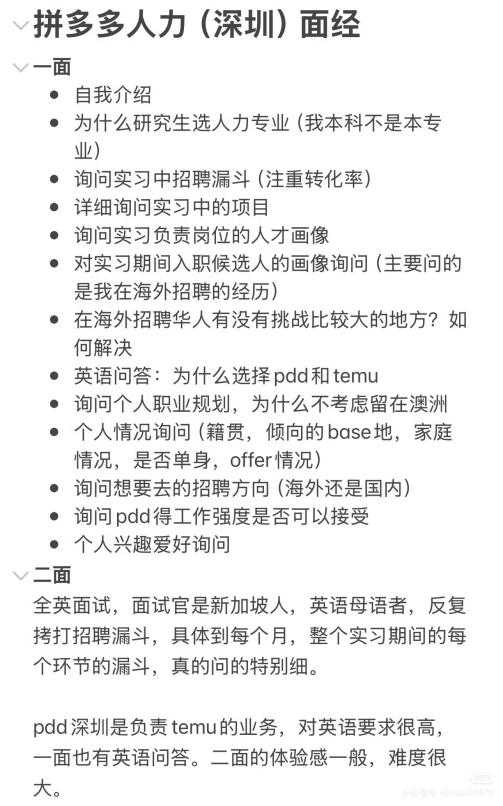

#### OCR 原文

拼多多人力深圳面经：自我介绍；为什么研究生选择 HR；招聘漏斗和转化率；实习项目；人才画像；中美招聘差异；英文 why PDD/TEMU；职业规划、期望城市、薪资、工作强度和兴趣。

#### 清洗后文本

拼多多人力深圳面经重点包括自我介绍、转 HR 动机、招聘漏斗转化率、人才画像、跨文化招聘差异、英文表达、职业规划和工作强度接受度。

#### 结构化候选问答

- 岗位：人力资源专员
- 问题：人力资源岗位如何追问招聘漏斗、人才画像和候选人转化率？
- 回答要点：回答应覆盖招聘漏斗的关键节点，如简历来源、筛选、邀约、面试、offer、入职；说明每个节点的转化率如何统计，如何定位流失原因；人才画像需要结合岗位能力、行业背景、薪资期望、稳定性和地域意愿，不应只停留在关键词匹配。
- 复盘：该题考察候选人是否理解招聘不是简单找人，而是漏斗管理、数据复盘和人才画像沉淀。
- 能力：招聘流程理解、数据意识、人才画像、英文沟通
- 来源：02_doc02_image_001_ca167f3c35.jpeg

### 图片 2: 02_doc02_image_002_4a6e1e1d3f.jpeg

- 来源：`D:\apps\ai-interview_archive\2026-05-19_competition_docs_cleanup\member_materials_raw\成员资料\03_非技术岗岗位资料与面经负责人\待检查\2026-5-12\面试经历.docx`
- SHA256：`4a6e1e1d3fc6bf2a6563e2debb9916d1de819de2843ab659925b143011043e87`
- OCR 状态：`manual_visual_ocr`
- OCR 置信度：`0.8`
- 目标岗位：产品助理
- 审核状态：待核验
- 图片：

#### OCR 原文

东方甄选产品助理：自我介绍；市场调研经历；如何找竞品；淘宝、京东、抖音、盒马、山姆等竞品；以牛奶产品为例，如何做市场调研、竞品分析、工厂沟通、包装、卖点、成本、定价和营销；追问工具、周期和工作方式。

#### 清洗后文本

东方甄选产品助理面经强调市场调研、竞品分析、食品产品开发链路、供应商沟通、包装卖点、成本定价和营销方案。

#### 结构化候选问答

- 岗位：产品助理
- 问题：如果让你负责一款牛奶产品，从调研到上线你会怎么推进？
- 回答要点：先定义目标人群和消费场景，再做竞品调研，覆盖线上平台、线下商超和内容渠道；拆解竞品价格、规格、卖点、包装、渠道和评价；再与供应商或工厂确认成本、工艺、包装可行性；最后形成产品定位、价格带、卖点表达、上线节奏和营销测试方案。
- 复盘：产品助理不能只说会调研，要能把调研结果转成产品定义、成本约束和上线动作。
- 能力：市场调研、竞品分析、产品定义、供应链沟通
- 来源：02_doc02_image_002_4a6e1e1d3f.jpeg

### 图片 3: 02_doc02_image_003_8168c380ff.jpeg

- 来源：`D:\apps\ai-interview_archive\2026-05-19_competition_docs_cleanup\member_materials_raw\成员资料\03_非技术岗岗位资料与面经负责人\待检查\2026-5-12\面试经历.docx`
- SHA256：`8168c380ff510dfa9fcceeda713ff44c295f8807c6cc2a40b27b88301619fdae`
- OCR 状态：`manual_visual_ocr`
- OCR 置信度：`0.78`
- 目标岗位：产品助理
- 审核状态：待核验
- 图片：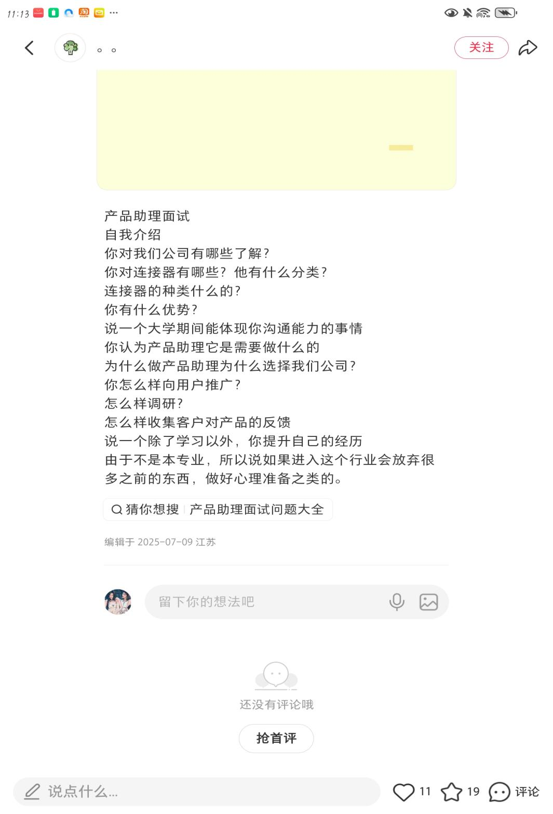

#### OCR 原文

产品助理面试问题：自我介绍；公司业务理解；连接器或产品模块理解；搭建模块和样例；优势；大学期间沟通经验；为什么做产品助理；如何收集客户反馈；如何做产品推广。

#### 清洗后文本

产品助理通用题覆盖公司理解、产品模块理解、沟通经验、客户反馈收集和产品推广。

#### 结构化候选问答

- 岗位：产品助理
- 问题：产品助理如何回答“你会怎样收集客户反馈并推动产品改进”？
- 回答要点：应说明反馈来源包括客服记录、用户访谈、问卷、数据看板、销售/实施同事反馈；再按频率、影响范围、业务价值和实现成本做优先级判断；最后形成问题清单、需求描述、验收标准和版本跟进，不只是简单收集意见。
- 复盘：该题重点考察候选人是否理解产品助理的闭环协作，而不是只会记录需求。
- 能力：用户反馈、需求整理、跨部门沟通、优先级判断
- 来源：02_doc02_image_003_8168c380ff.jpeg

### 图片 4: 02_doc02_image_004_4579e31167.jpeg

- 来源：`D:\apps\ai-interview_archive\2026-05-19_competition_docs_cleanup\member_materials_raw\成员资料\03_非技术岗岗位资料与面经负责人\待检查\2026-5-12\面试经历.docx`
- SHA256：`4579e311670b968904d69dce95b423fa4e42d4a62318de173a7fd56c6e97b958`
- OCR 状态：`ocr_unavailable`
- OCR 置信度：``
- 目标岗位：待人工确认
- 审核状态：待核验
- 图片：

#### OCR 原文

（无 OCR 原文）

#### 清洗后文本

（无清洗文本）

#### 结构化候选问答

- 暂无可入库结构化问答。

### 图片 5: 02_doc02_image_005_f6cf0e1300.jpeg

- 来源：`D:\apps\ai-interview_archive\2026-05-19_competition_docs_cleanup\member_materials_raw\成员资料\03_非技术岗岗位资料与面经负责人\待检查\2026-5-12\面试经历.docx`
- SHA256：`f6cf0e13006beba84a69dc879a10c04375cf3198b6c2c45141ce1360c2e81349`
- OCR 状态：`manual_visual_ocr`
- OCR 置信度：`0.76`
- 目标岗位：产品助理
- 审核状态：待核验
- 图片：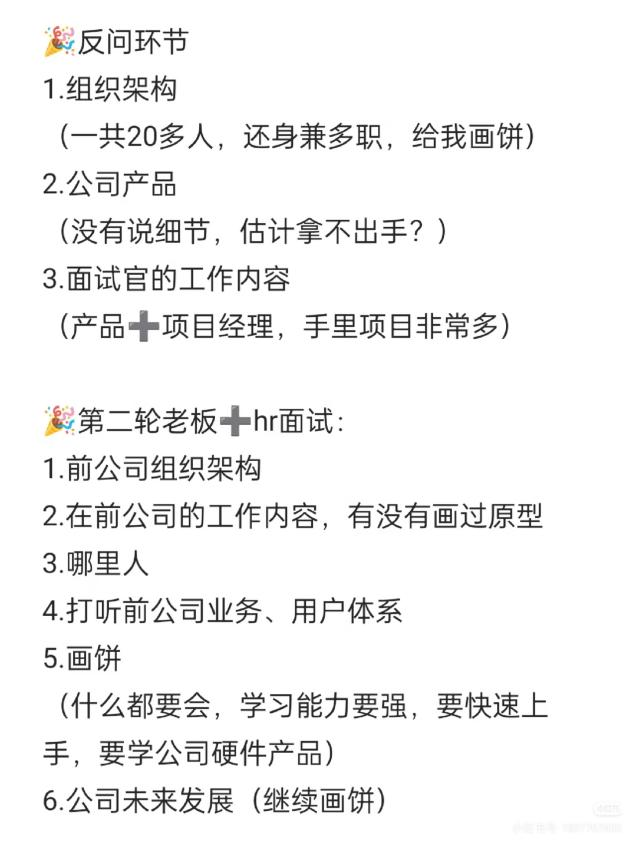

#### OCR 原文

产品助理第二轮老板和 HR 面：组织结构、公司产品、面试官工作内容、上一家公司业务、用户系统、是否画原型、未来规划、业务数据来源、需求变更、项目延期、业务方不了解设计、项目熟悉度、提前上线、最难问题、系统细节。

#### 清洗后文本

产品助理二面围绕业务理解、原型能力、数据来源、需求变更、项目延期和跨部门协同深挖。

#### 结构化候选问答

- 岗位：产品助理
- 问题：产品助理遇到需求变更和项目延期时应该怎么处理？
- 回答要点：先确认变更来源、业务目标和影响范围；评估对排期、开发成本、测试范围和上线风险的影响；将变更拆成必须项和可后置项；同步业务、设计、研发和测试重新确认优先级；保留会议纪要、需求版本和决策记录，避免口头变更失控。
- 复盘：该题适合追问候选人是否具备项目协同和风险控制意识。
- 能力：需求变更管理、项目协同、风险沟通
- 来源：02_doc02_image_005_f6cf0e1300.jpeg

### 图片 6: 02_doc02_image_006_549ac0cb3a.jpeg

- 来源：`D:\apps\ai-interview_archive\2026-05-19_competition_docs_cleanup\member_materials_raw\成员资料\03_非技术岗岗位资料与面经负责人\待检查\2026-5-12\面试经历.docx`
- SHA256：`549ac0cb3a49db20cd941a2ef5c31d8c8126f3ef1ddd91295d4b844eeb55d286`
- OCR 状态：`ocr_unavailable`
- OCR 置信度：``
- 目标岗位：待人工确认
- 审核状态：待核验
- 图片：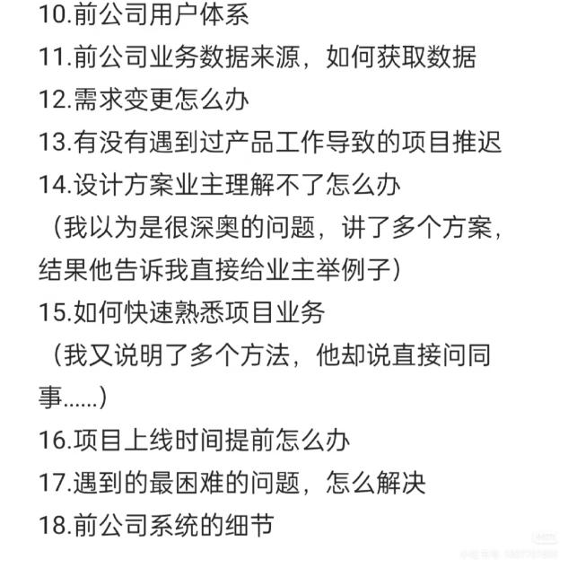

#### OCR 原文

（无 OCR 原文）

#### 清洗后文本

（无清洗文本）

#### 结构化候选问答

- 暂无可入库结构化问答。

### 图片 7: 02_doc02_image_007_52391f95fc.jpeg

- 来源：`D:\apps\ai-interview_archive\2026-05-19_competition_docs_cleanup\member_materials_raw\成员资料\03_非技术岗岗位资料与面经负责人\待检查\2026-5-12\面试经历.docx`
- SHA256：`52391f95fcce9d59fee1a1447b425100121f5a2750329fb570702766bee16d8e`
- OCR 状态：`manual_visual_ocr`
- OCR 置信度：`0.76`
- 目标岗位：产品助理
- 审核状态：待核验
- 图片：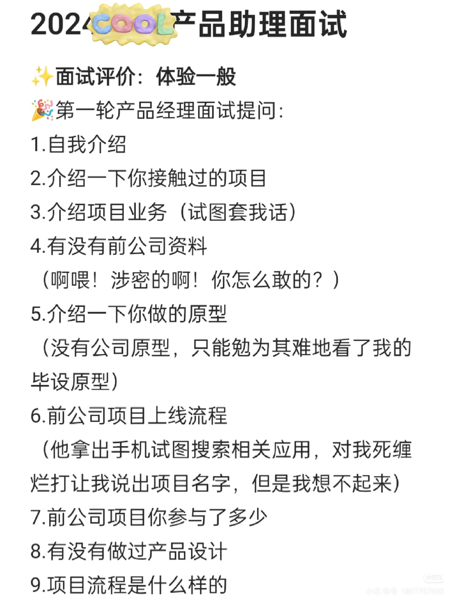

#### OCR 原文

产品助理一面：自我介绍；项目经历；项目业务；上一家公司材料是否涉密；原型图；上线流程；项目参与度；产品设计；项目流程。

#### 清洗后文本

产品助理一面重点追问项目经历真实性、业务理解、原型图、上线流程和个人参与度。

#### 结构化候选问答

- 岗位：产品助理
- 问题：讲一个你参与过的产品项目，从需求到上线完整流程是什么？
- 回答要点：回答应按业务背景、目标用户、需求来源、调研分析、原型设计、评审、开发协作、测试验收、上线和数据复盘展开；需要明确自己的角色边界，是主导、负责模块还是参与支持；若有原型、PRD、指标或上线结果，应给出具体证据。
- 复盘：面试官会用该题验证项目不是简历包装，重点看职责边界和流程完整性。
- 能力：项目复述、产品流程、职责边界、上线意识
- 来源：02_doc02_image_007_52391f95fc.jpeg

### 图片 8: 02_doc02_image_008_65a50f2595.jpeg

- 来源：`D:\apps\ai-interview_archive\2026-05-19_competition_docs_cleanup\member_materials_raw\成员资料\03_非技术岗岗位资料与面经负责人\待检查\2026-5-12\面试经历.docx`
- SHA256：`65a50f259534f2ed755c6cb3814830401080b420019d6ee99ce59344e961a2db`
- OCR 状态：`manual_visual_ocr`
- OCR 置信度：`0.74`
- 目标岗位：产品助理
- 审核状态：仅参考
- 图片：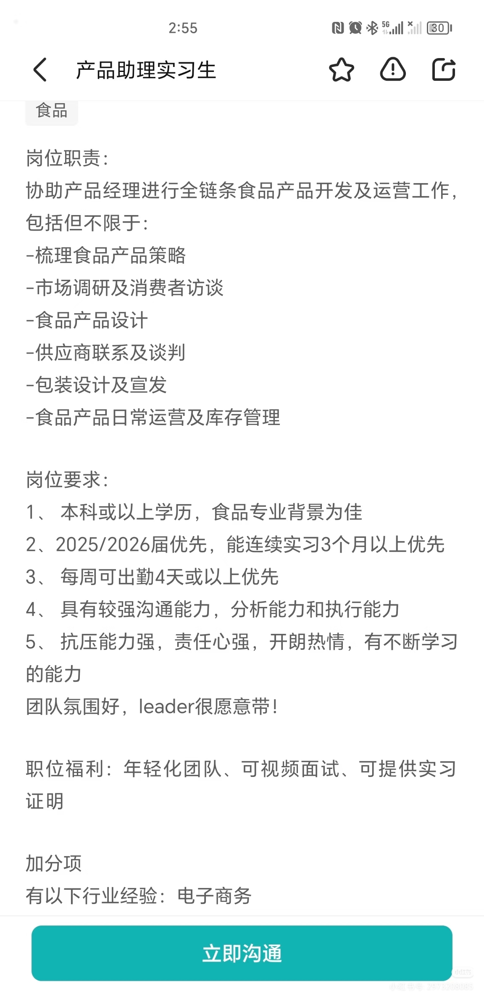

#### OCR 原文

食品产品助理 JD：负责食品产品开发和运营全链路，需求调研、策略、产品设计、供应商沟通、包装、推广、日常运营和库存；要求本科及以上、可长期实习、沟通强、分析执行力和责任心。

#### 清洗后文本

食品产品助理岗位画像参考：产品开发、需求调研、供应链沟通、包装推广、库存运营和执行力。

#### 结构化候选问答

- 岗位：产品助理
- 问题：食品产品助理岗位通常会考察哪些能力？
- 回答要点：重点考察用户和市场调研、产品设计、供应商或工厂沟通、包装卖点、推广计划、库存和日常运营意识，以及执行力、沟通能力和抗压能力。
- 复盘：该图片更接近岗位 JD，可作为岗位要求参考，不应当作真实面试问答。
- 能力：岗位要求理解、产品运营、供应链沟通
- 来源：02_doc02_image_008_65a50f2595.jpeg

### 图片 9: 02_doc02_image_009_65a50f2595.jpeg

- 来源：`D:\apps\ai-interview_archive\2026-05-19_competition_docs_cleanup\member_materials_raw\成员资料\03_非技术岗岗位资料与面经负责人\待检查\2026-5-12\面试经历.docx`
- SHA256：`65a50f259534f2ed755c6cb3814830401080b420019d6ee99ce59344e961a2db`
- OCR 状态：`ocr_unavailable`
- OCR 置信度：``
- 目标岗位：待人工确认
- 审核状态：待核验
- 图片：

#### OCR 原文

（无 OCR 原文）

#### 清洗后文本

（无清洗文本）

#### 结构化候选问答

- 暂无可入库结构化问答。

### 图片 10: 02_doc02_image_010_f530818217.jpeg

- 来源：`D:\apps\ai-interview_archive\2026-05-19_competition_docs_cleanup\member_materials_raw\成员资料\03_非技术岗岗位资料与面经负责人\待检查\2026-5-12\面试经历.docx`
- SHA256：`f530818217537dcf6b789f2e9fe0b2245eb1a9afc173bb4d1b4b99c4b28b84da`
- OCR 状态：`manual_visual_ocr`
- OCR 置信度：`0.8`
- 目标岗位：产品助理
- 审核状态：待核验
- 图片：

#### OCR 原文

滴滴产品助理企业级一面：AI 产品实习深挖；项目介绍；和市面产品差异；盈利模式；团队成本；交付成本；平均月收入；最难问题；为什么做产品定制；KA 与 SMB 区别。

#### 清洗后文本

滴滴产品助理一面围绕 AI 产品项目、商业模式、成本收入、交付方式、KA/SMB 客户差异和项目难点深挖。

#### 结构化候选问答

- 岗位：产品助理
- 问题：B 端 AI 产品如何回答商业模式和 KA/SMB 客户差异？
- 回答要点：应说明产品服务的客户类型、收费方式、交付成本和复用程度；KA 客户通常需求复杂、定制化高、决策链长，SMB 更关注标准化、价格和快速上线；回答时要结合项目例子说明为什么需要定制、哪些能力可标准化、哪些能力必须按客户场景适配。
- 复盘：该题考察产品助理是否具备 B 端商业理解，而不是只会讲功能。
- 能力：B 端产品、商业模式、客户分层、AI 产品落地
- 来源：02_doc02_image_010_f530818217.jpeg

### 图片 11: 02_doc02_image_011_13742a8661.jpeg

- 来源：`D:\apps\ai-interview_archive\2026-05-19_competition_docs_cleanup\member_materials_raw\成员资料\03_非技术岗岗位资料与面经负责人\待检查\2026-5-12\面试经历.docx`
- SHA256：`13742a8661909a9d967986a0098e4861794bb2f345ace8fdc2129a683abbfc23`
- OCR 状态：`manual_visual_ocr`
- OCR 置信度：`0.8`
- 目标岗位：产品助理
- 审核状态：待核验
- 图片：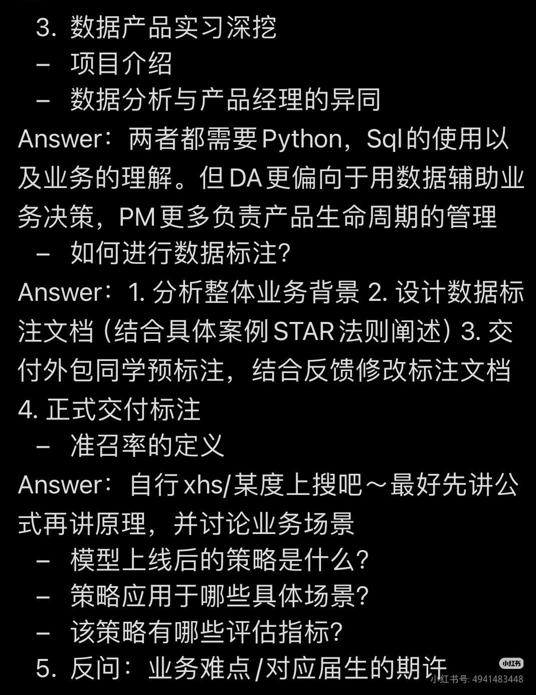

#### OCR 原文

数据产品实习深挖：项目介绍；DA 和 PM 区别；如何打标签；准确率定义；模型上线策略；业务场景；指标；业务难点和期望。

#### 清洗后文本

数据产品面经围绕标签体系、准确率、模型上线、业务指标和 DA/PM 职责差异。

#### 结构化候选问答

- 岗位：产品助理
- 问题：数据产品实习中，如何设计标签体系并定义准确率？
- 回答要点：应先说明业务目标和标签用途，再定义标签来源、标注规则、正负样本、质量校验和更新机制；准确率不能只说模型指标，还要结合业务命中率、误判成本、人工复核结果和上线后的业务指标变化。
- 复盘：该题适合验证候选人是否理解数据产品中的指标定义和模型上线边界。
- 能力：数据产品、指标定义、标签体系、模型上线
- 来源：02_doc02_image_011_13742a8661.jpeg

### 图片 12: 02_doc02_image_012_27ea56a180.jpeg

- 来源：`D:\apps\ai-interview_archive\2026-05-19_competition_docs_cleanup\member_materials_raw\成员资料\03_非技术岗岗位资料与面经负责人\待检查\2026-5-12\面试经历.docx`
- SHA256：`27ea56a18009f909e1c5722cf716bca70010f4c0e56290a2be2b011eb3057743`
- OCR 状态：`manual_visual_ocr`
- OCR 置信度：`0.78`
- 目标岗位：人力资源专员
- 审核状态：待核验
- 图片：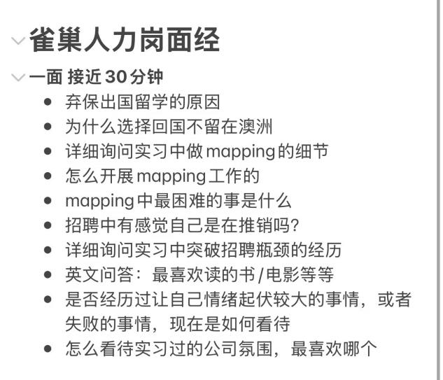

#### OCR 原文

雀巢人力岗面经：为什么放弃留学；为什么回国；mapping 细节；招聘渠道；数据对比；职业规划；竞品公司组织架构；电话吸引候选人；mapping 流程；竞品薪酬和候选人问题；招聘流程优化；导师评价；排期；工作强度；案例；笔试；游戏；信息来源。

#### 清洗后文本

雀巢 HR 面经重点包括 mapping、渠道、数据对比、竞品组织架构、候选人吸引、招聘流程优化和工作强度。

#### 结构化候选问答

- 岗位：人力资源专员
- 问题：HR 面试中如何说明人才 mapping 的流程和价值？
- 回答要点：回答应包括目标岗位定义、竞品公司和组织架构梳理、候选人来源渠道、候选人信息校验、薪酬和意愿判断、联系话术、过程记录和数据复盘；价值在于提前建立人才池、提高招聘效率并支持岗位画像迭代。
- 复盘：该题考察招聘研究和候选人触达能力，适合追问真实项目细节。
- 能力：人才 mapping、招聘渠道、候选人吸引、流程优化
- 来源：02_doc02_image_012_27ea56a180.jpeg

### 图片 13: 02_doc02_image_013_81f3a8292b.jpeg

- 来源：`D:\apps\ai-interview_archive\2026-05-19_competition_docs_cleanup\member_materials_raw\成员资料\03_非技术岗岗位资料与面经负责人\待检查\2026-5-12\面试经历.docx`
- SHA256：`81f3a8292bc38b6a1ed8d0039f0c960d6949a966ca55bdd3bc0a5a0e783c9b24`
- OCR 状态：`manual_visual_ocr`
- OCR 置信度：`0.78`
- 目标岗位：产品助理
- 审核状态：待核验
- 图片：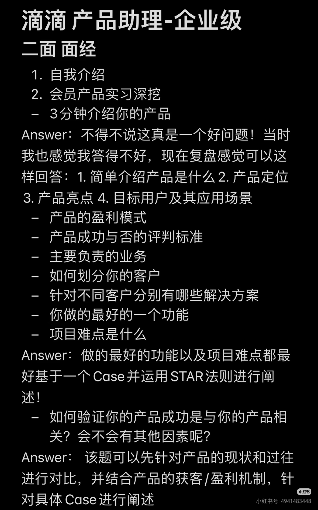

#### OCR 原文

滴滴产品助理企业级二面：自我介绍；会员产品实习；三分钟产品介绍；盈利模式；成功标准；主营业务；客户分层；不同客户解决方案；最好的功能；项目困难；如何证明成功来自产品；改版前后对比和案例。

#### 清洗后文本

滴滴二面围绕产品介绍、盈利模式、成功标准、客户分层、功能价值和产品效果归因。

#### 结构化候选问答

- 岗位：产品助理
- 问题：如何证明一个产品改版的成功来自产品本身，而不是外部因素？
- 回答要点：可以从改版前后指标对比、A/B 测试、分群分析、用户反馈、同周期外部因素排除、关键路径转化变化等角度回答；同时要说明成功指标与产品目标的对应关系，比如留存、转化、使用频次或客诉下降。
- 复盘：该题考察产品效果评估和指标归因，不能只说上线后数据变好。
- 能力：产品指标、效果归因、客户分层、复盘分析
- 来源：02_doc02_image_013_81f3a8292b.jpeg

### 图片 14: 02_doc02_image_014_d75e085616.jpeg

- 来源：`D:\apps\ai-interview_archive\2026-05-19_competition_docs_cleanup\member_materials_raw\成员资料\03_非技术岗岗位资料与面经负责人\待检查\2026-5-12\面试经历.docx`
- SHA256：`d75e0856167078dd2dcd2215c08b0f3efbb4762b69286bc47f8acf227894259c`
- OCR 状态：`ocr_unavailable`
- OCR 置信度：``
- 目标岗位：待人工确认
- 审核状态：待核验
- 图片：

#### OCR 原文

（无 OCR 原文）

#### 清洗后文本

（无清洗文本）

#### 结构化候选问答

- 暂无可入库结构化问答。

### 图片 15: 02_doc02_image_015_daafa79b17.jpeg

- 来源：`D:\apps\ai-interview_archive\2026-05-19_competition_docs_cleanup\member_materials_raw\成员资料\03_非技术岗岗位资料与面经负责人\待检查\2026-5-12\面试经历.docx`
- SHA256：`daafa79b1701517b6c49f423efa90ce311a9ba8a385894f313c85c4d72305dc1`
- OCR 状态：`manual_visual_ocr`
- OCR 置信度：`0.76`
- 目标岗位：产品助理
- 审核状态：待核验
- 图片：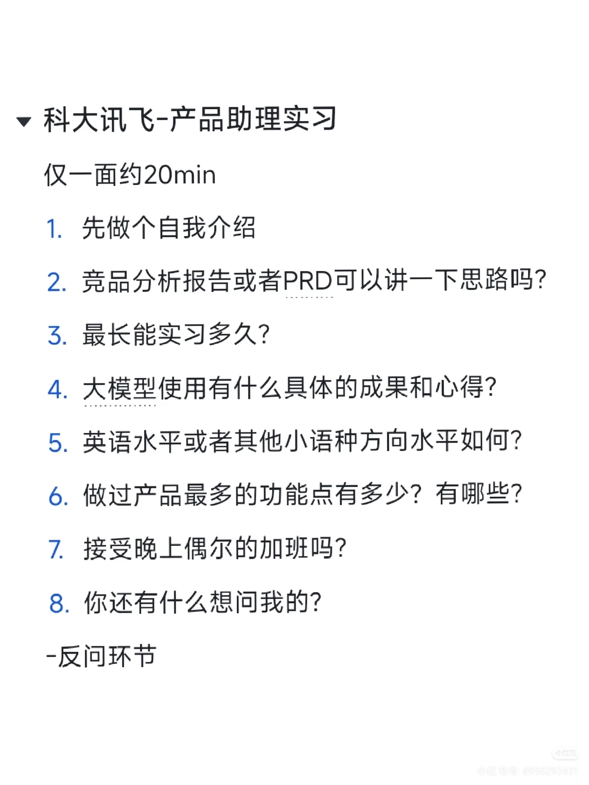

#### OCR 原文

科大讯飞产品助理实习：自我介绍；竞品分析报告和 PRD 思考；最长实习时长；大模型使用成果和思考；英语或其他语言水平；产品功能数量；加班接受度；反问面试官。

#### 清洗后文本

科大讯飞产品助理实习关注竞品分析、PRD、实习稳定性、大模型使用、功能理解和加班接受度。

#### 结构化候选问答

- 岗位：产品助理
- 问题：产品助理如何回答“你对大模型产品的使用成果和思考”？
- 回答要点：应结合具体使用场景说明大模型解决了什么问题，例如文本整理、检索问答、结构化生成、内容审核或工作流自动化；同时指出限制，如幻觉、上下文长度、结构化输出不稳定、数据安全和需要人工复核；最后说明如何用提示词、知识库、结构化校验和评测来提升可靠性。
- 复盘：该题适合 AI 产品方向，重点是应用理解和边界意识。
- 能力：AI 产品理解、竞品分析、PRD、边界意识
- 来源：02_doc02_image_015_daafa79b17.jpeg

### 图片 16: 02_doc02_image_016_7e0f20e9ff.jpeg

- 来源：`D:\apps\ai-interview_archive\2026-05-19_competition_docs_cleanup\member_materials_raw\成员资料\03_非技术岗岗位资料与面经负责人\待检查\2026-5-12\面试经历.docx`
- SHA256：`7e0f20e9ff941b1479ae49004db428ad82b13d0cd1de9388e064344bc4b8d574`
- OCR 状态：`manual_visual_ocr`
- OCR 置信度：`0.76`
- 目标岗位：运营助理
- 审核状态：待核验
- 图片：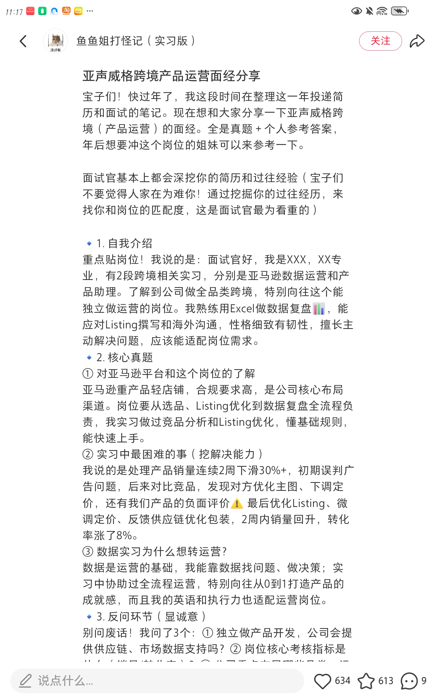

#### OCR 原文

跨境产品运营面经：自我介绍；与岗位匹配；Amazon 平台和岗位理解；库存下降 30%、广告问题、竞品优化、listing 价格、供应链；为什么从数据实习转运营；建议用真实数据和例子，体现数据思维、问题解决和英文 listing 沟通。

#### 清洗后文本

跨境运营面试重点考察 Amazon 平台理解、库存、广告、竞品、listing、供应链和数据化复盘。

#### 结构化候选问答

- 岗位：运营助理
- 问题：跨境运营遇到库存下降和广告效果异常时，你会如何排查？
- 回答要点：先拆分库存、流量、转化和供应链问题；检查销量趋势、广告投放、关键词排名、竞品动作、价格变化、listing 内容和库存补货周期；再基于数据判断是曝光不足、转化下降、供给不足还是竞争变化，并给出优化动作。
- 复盘：该题考察运营助理的数据意识和跨境平台基础，不应只说多投广告。
- 能力：跨境运营、数据分析、广告投放、竞品优化
- 来源：02_doc02_image_016_7e0f20e9ff.jpeg

### 图片 17: 02_doc02_image_017_bdfa16500e.jpeg

- 来源：`D:\apps\ai-interview_archive\2026-05-19_competition_docs_cleanup\member_materials_raw\成员资料\03_非技术岗岗位资料与面经负责人\待检查\2026-5-12\面试经历.docx`
- SHA256：`bdfa16500e5262f18747a466bdb4a3dd33277624fb7e6bf4df26328d0e776c17`
- OCR 状态：`ocr_unavailable`
- OCR 置信度：``
- 目标岗位：待人工确认
- 审核状态：待核验
- 图片：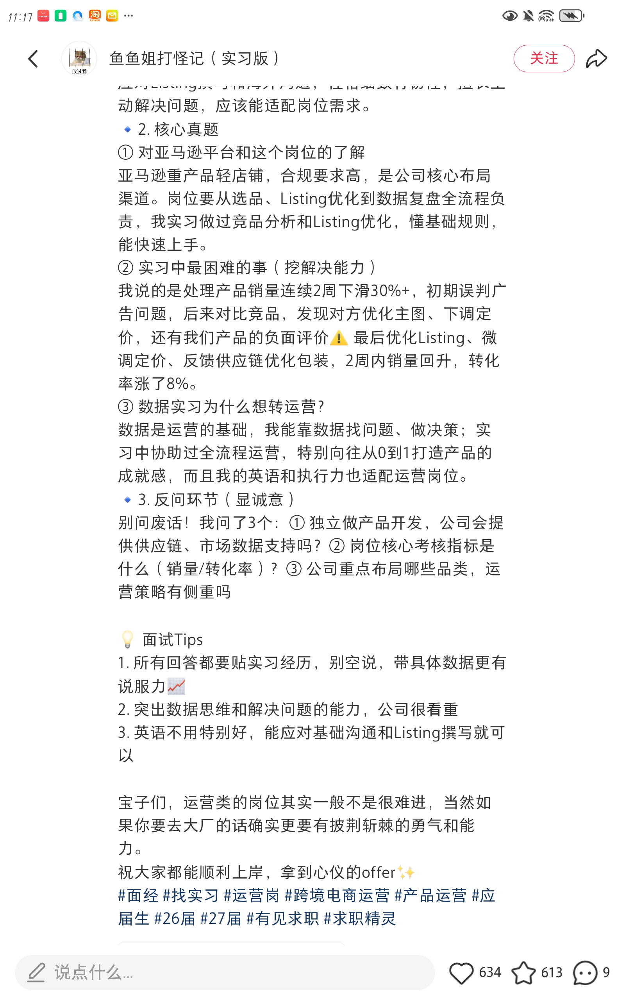

#### OCR 原文

（无 OCR 原文）

#### 清洗后文本

（无清洗文本）

#### 结构化候选问答

- 暂无可入库结构化问答。

### 图片 18: 02_doc02_image_018_bece9659c3.jpeg

- 来源：`D:\apps\ai-interview_archive\2026-05-19_competition_docs_cleanup\member_materials_raw\成员资料\03_非技术岗岗位资料与面经负责人\待检查\2026-5-12\面试经历.docx`
- SHA256：`bece9659c3600840b2641121ea9cf62caa4cddb77c4cebe74ab5eee11a58f384`
- OCR 状态：`manual_visual_ocr`
- OCR 置信度：`0.74`
- 目标岗位：运营助理
- 审核状态：待核验
- 图片：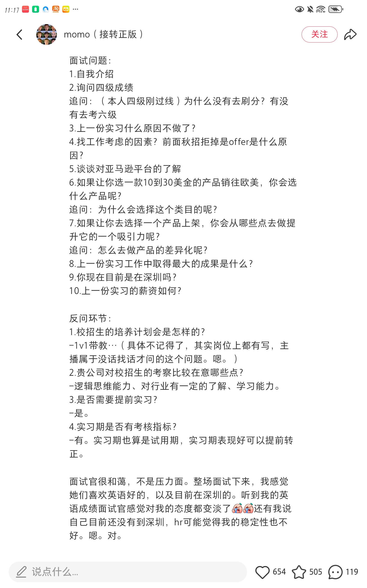

#### OCR 原文

亚马逊运营面试：自我介绍；英语水平；为什么不考研或不考英语；上段实习为什么不继续；工作因素；平台理解；欧美市场 10-30 美元产品选择；为什么选择品类；产品 launch 任务和差异化；成果；是否接受深圳和薪资。

#### 清洗后文本

亚马逊运营面经关注平台理解、英语能力、选品、产品 launch、差异化和职业稳定性。

#### 结构化候选问答

- 岗位：运营助理
- 问题：亚马逊运营面试中如何回答“你会如何做新品 launch”？
- 回答要点：应包括市场和竞品调研、目标价格带、目标人群、listing 标题和五点描述、图片卖点、关键词布局、初期广告、评价积累、库存计划和阶段性指标；同时说明如何根据点击率、转化率、广告 ACOS 和库存周转做调整。
- 复盘：该题考察电商运营链路完整性和数据复盘能力。
- 能力：新品 launch、选品、listing、广告投放、数据复盘
- 来源：02_doc02_image_018_bece9659c3.jpeg

### 图片 19: 02_doc02_image_019_3a189c158d.jpeg

- 来源：`D:\apps\ai-interview_archive\2026-05-19_competition_docs_cleanup\member_materials_raw\成员资料\03_非技术岗岗位资料与面经负责人\待检查\2026-5-12\面试经历.docx`
- SHA256：`3a189c158d65af8e32861e65700e0cca3cab3d1232f8582ae7f9bf629a3e4607`
- OCR 状态：`ocr_unavailable`
- OCR 置信度：``
- 目标岗位：待人工确认
- 审核状态：待核验
- 图片：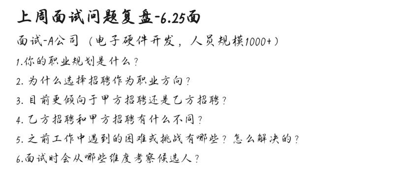

#### OCR 原文

（无 OCR 原文）

#### 清洗后文本

（无清洗文本）

#### 结构化候选问答

- 暂无可入库结构化问答。

### 图片 20: 02_doc02_image_020_2e04f2be9f.jpeg

- 来源：`D:\apps\ai-interview_archive\2026-05-19_competition_docs_cleanup\member_materials_raw\成员资料\03_非技术岗岗位资料与面经负责人\待检查\2026-5-12\面试经历.docx`
- SHA256：`2e04f2be9fd228a4ee2bdf8d40b762fafbb3ea0b3e28c836639f98206fb0d69a`
- OCR 状态：`manual_visual_ocr`
- OCR 置信度：`0.78`
- 目标岗位：人力资源专员
- 审核状态：待核验
- 图片：

#### OCR 原文

华为人力资源助理：HR 六大模块；华为 HR 三支柱 COE/BP/SSC；校园招聘录用率；绩效考核指标；入职培训；人才发展机制；校园大使招募；劳动法试用期；HR 数据分析指标；为什么选择华为和人力资源助理。

#### 清洗后文本

华为 HR 助理题目覆盖 HR 模块、三支柱、校招、绩效、培训、人才发展、劳动法和 HR 数据分析。

#### 结构化候选问答

- 岗位：人力资源专员
- 问题：HR 面试中如何解释 COE、BP、SSC 三支柱分工？
- 回答要点：COE 负责制度、政策和专业方案设计；BP 贴近业务，理解业务目标并推动组织和人才问题解决；SSC 提供标准化、流程化和共享服务。回答时可结合招聘、绩效、培训或员工关系举例说明三者如何协同。
- 复盘：该题适合基础 HR 岗位，考察体系化认知和业务协作理解。
- 能力：HR 三支柱、绩效培训、劳动法、数据分析
- 来源：02_doc02_image_020_2e04f2be9f.jpeg

### 图片 21: 02_doc02_image_021_88fc2661cd.jpeg

- 来源：`D:\apps\ai-interview_archive\2026-05-19_competition_docs_cleanup\member_materials_raw\成员资料\03_非技术岗岗位资料与面经负责人\待检查\2026-5-12\面试经历.docx`
- SHA256：`88fc2661cda94f4cafdb8a5e2b28d2dfcc91e32db78754cb14e70ccd71184dab`
- OCR 状态：`manual_visual_ocr`
- OCR 置信度：`0.76`
- 目标岗位：人力资源专员
- 审核状态：待核验
- 图片：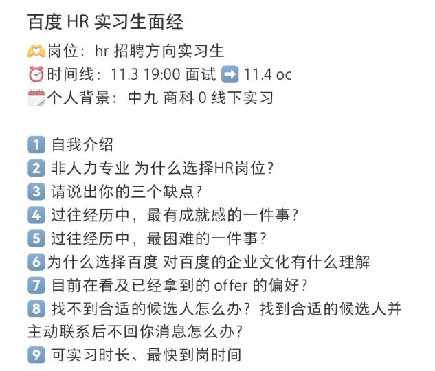

#### OCR 原文

百度 HR 实习生：自我介绍；非 HR 专业为什么做人力；三个缺点；成就感；最困难的事；为什么选择百度和文化；offer 偏好；找不到候选人怎么办；候选人不回复怎么办；实习时长和到岗时间。

#### 清洗后文本

百度 HR 实习生面经关注转岗动机、个人特质、困难经历、候选人触达和实习稳定性。

#### 结构化候选问答

- 岗位：人力资源专员
- 问题：招聘实习中候选人不回复或找不到合适候选人，你会怎么办？
- 回答要点：可以从岗位画像重新校准、渠道拓展、搜索关键词优化、候选人分层、触达话术优化、触达时间调整和跟进节奏管理回答；同时要记录反馈，判断是岗位吸引力不足、薪资不匹配、渠道不准还是话术问题。
- 复盘：该题考察招聘执行韧性和问题复盘，而不是只问是否抗压。
- 能力：候选人触达、招聘执行、问题复盘、沟通抗压
- 来源：02_doc02_image_021_88fc2661cd.jpeg

### 图片 22: 02_doc02_image_022_cd0e0a4240.jpeg

- 来源：`D:\apps\ai-interview_archive\2026-05-19_competition_docs_cleanup\member_materials_raw\成员资料\03_非技术岗岗位资料与面经负责人\待检查\2026-5-12\面试经历.docx`
- SHA256：`cd0e0a42406d5747e124533c47864219ffe4045dcddbdddcb40912231ca8219a`
- OCR 状态：`ocr_unavailable`
- OCR 置信度：``
- 目标岗位：待人工确认
- 审核状态：待核验
- 图片：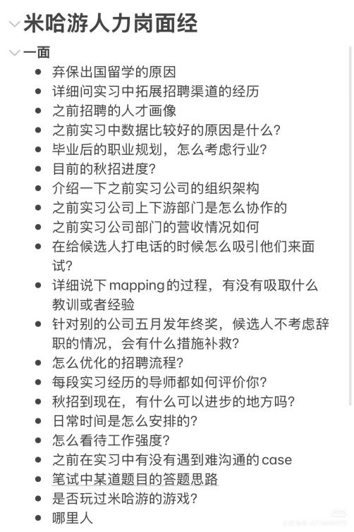

#### OCR 原文

（无 OCR 原文）

#### 清洗后文本

（无清洗文本）

#### 结构化候选问答

- 暂无可入库结构化问答。

### 图片 23: 02_doc02_image_023_7fa82d1466.jpeg

- 来源：`D:\apps\ai-interview_archive\2026-05-19_competition_docs_cleanup\member_materials_raw\成员资料\03_非技术岗岗位资料与面经负责人\待检查\2026-5-12\面试经历.docx`
- SHA256：`7fa82d1466b0e5294ce5ff2e4bd022257fcfc7d402b0e38997f83f0f957fc748`
- OCR 状态：`manual_visual_ocr`
- OCR 置信度：`0.8`
- 目标岗位：人力资源专员
- 审核状态：待核验
- 图片：

#### OCR 原文

字节人力岗面经：英文自我介绍；为什么研究生转 HR；为什么喜欢招聘；吸引候选人案例；部门职责；转化率数据；难招岗位；目标公司人才画像；岗位吸引点；股权归属和晋升；候选人未通过原因；中澳招聘差异；渠道特点；工作因素和职业规划。

#### 清洗后文本

字节 HR 面试强度高，追问招聘数据、难招岗位、人才画像、候选人吸引、未通过原因和中英文表达。

#### 结构化候选问答

- 岗位：人力资源专员
- 问题：高强度 HR 面试如何回答“你如何吸引候选人并解释未通过原因”？
- 回答要点：回答候选人吸引时要结合岗位卖点、业务发展、成长机会、团队特点、薪酬福利和候选人动机；解释未通过原因时要基于岗位要求、能力证据、面试反馈和流程节点，避免主观评价；同时说明如何把失败原因反馈到岗位画像和渠道策略中。
- 复盘：该题适合大厂招聘岗，重点看数据、逻辑和候选人沟通边界。
- 能力：招聘数据、人才画像、候选人吸引、英文沟通
- 来源：02_doc02_image_023_7fa82d1466.jpeg

### 图片 24: 02_doc02_image_024_a67c997a70.jpeg

- 来源：`D:\apps\ai-interview_archive\2026-05-19_competition_docs_cleanup\member_materials_raw\成员资料\03_非技术岗岗位资料与面经负责人\待检查\2026-5-12\面试经历.docx`
- SHA256：`a67c997a707005092ae5b3b3cf6af990ca9d08b3c7d20545683efa44cb50785d`
- OCR 状态：`manual_visual_ocr`
- OCR 置信度：`0.77`
- 目标岗位：产品助理
- 审核状态：待核验
- 图片：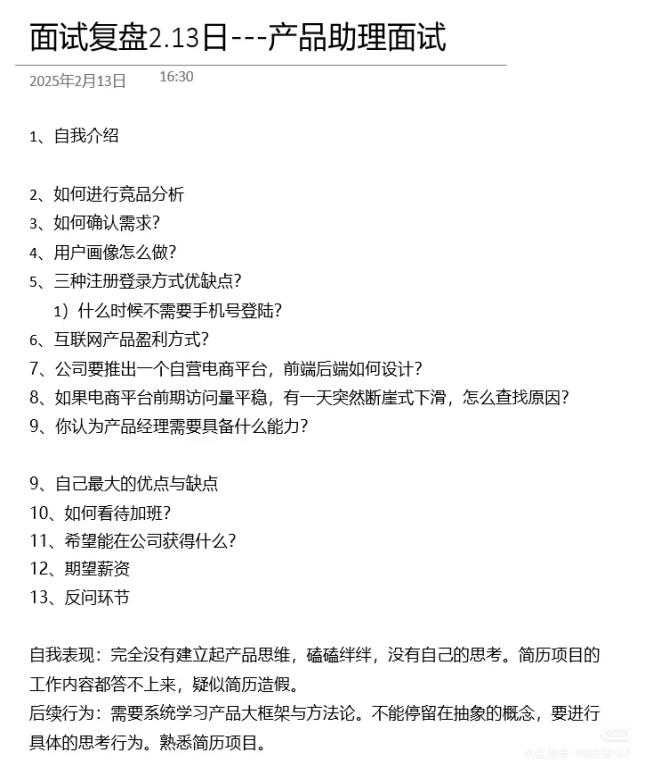

#### OCR 原文

产品助理面试复盘：自我介绍；竞品分析；需求确认；用户画像；登录方式优势；互联网产品盈利；电商平台前后台设计；流量下降原因；产品经理素质；优缺点；加班；期望；薪资。复盘指出缺少产品思维、没有自己的思考、简历项目讲不清，需要系统补产品方法论。

#### 清洗后文本

产品助理复盘强调产品思维、竞品分析、用户画像、盈利模式、流量下降分析和项目表达能力。

#### 结构化候选问答

- 岗位：产品助理
- 问题：产品助理面试中如何分析一个产品流量下降的原因？
- 回答要点：应从外部环境、渠道投放、搜索推荐、用户需求变化、竞品动作、产品体验、内容供给、转化链路和数据口径变化逐层排查；需要先看流量来源拆分，再看点击率、转化率、留存和用户反馈，而不是直接归因到某一个功能。
- 复盘：该题训练产品候选人用结构化方法分析业务问题。
- 能力：产品分析、业务指标、竞品分析、复盘能力
- 来源：02_doc02_image_024_a67c997a70.jpeg

### 图片 25: 02_doc02_image_025_234fcd3bd2.jpeg

- 来源：`D:\apps\ai-interview_archive\2026-05-19_competition_docs_cleanup\member_materials_raw\成员资料\03_非技术岗岗位资料与面经负责人\待检查\2026-5-12\面试经历.docx`
- SHA256：`234fcd3bd2a54cde0c5e49b774e494cfaa840b11ccc643ad109f989e6b2b074e`
- OCR 状态：`ocr_unavailable`
- OCR 置信度：``
- 目标岗位：待人工确认
- 审核状态：待核验
- 图片：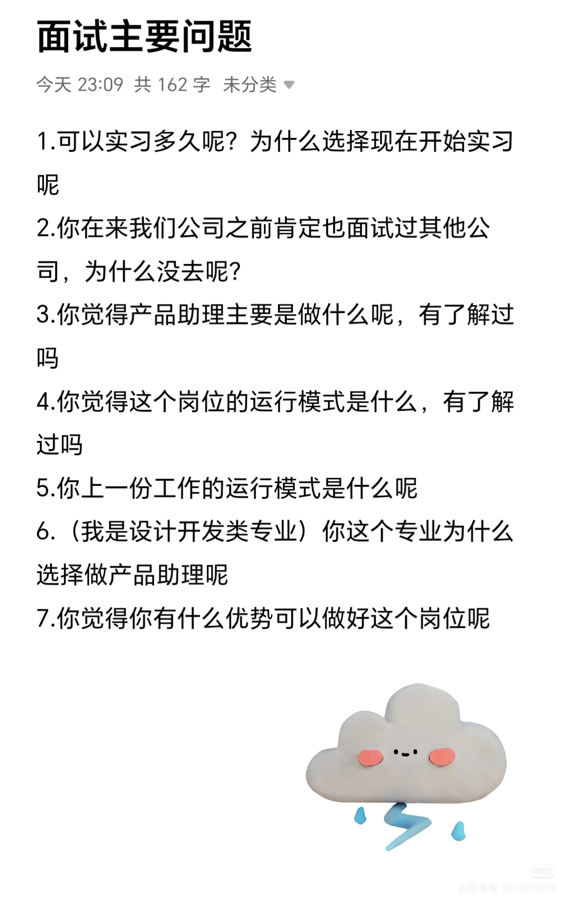

#### OCR 原文

（无 OCR 原文）

#### 清洗后文本

（无清洗文本）

#### 结构化候选问答

- 暂无可入库结构化问答。

### 图片 1: 03_3_4_image_001_ca167f3c35.jpeg

- 来源：`D:\apps\ai-interview_archive\2026-05-19_competition_docs_cleanup\member_materials_raw\面试经历(3)(4).docx`
- SHA256：`ca167f3c3500d5f2e9ef96749a5e7382c19285efdf5deab122070607fb7e2c26`
- OCR 状态：`ocr_unavailable`
- OCR 置信度：``
- 目标岗位：待人工确认
- 审核状态：待核验
- 图片：

#### OCR 原文

（无 OCR 原文）

#### 清洗后文本

（无清洗文本）

#### 结构化候选问答

- 暂无可入库结构化问答。

### 图片 2: 03_3_4_image_002_4a6e1e1d3f.jpeg

- 来源：`D:\apps\ai-interview_archive\2026-05-19_competition_docs_cleanup\member_materials_raw\面试经历(3)(4).docx`
- SHA256：`4a6e1e1d3fc6bf2a6563e2debb9916d1de819de2843ab659925b143011043e87`
- OCR 状态：`ocr_unavailable`
- OCR 置信度：``
- 目标岗位：待人工确认
- 审核状态：待核验
- 图片：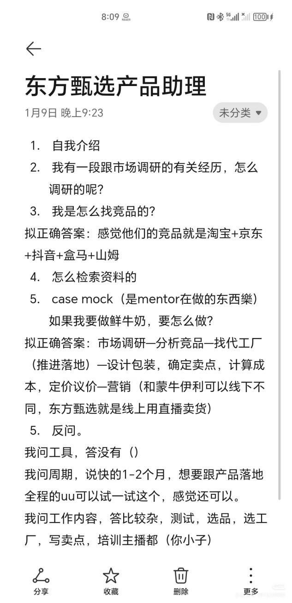

#### OCR 原文

（无 OCR 原文）

#### 清洗后文本

（无清洗文本）

#### 结构化候选问答

- 暂无可入库结构化问答。

### 图片 3: 03_3_4_image_003_8168c380ff.jpeg

- 来源：`D:\apps\ai-interview_archive\2026-05-19_competition_docs_cleanup\member_materials_raw\面试经历(3)(4).docx`
- SHA256：`8168c380ff510dfa9fcceeda713ff44c295f8807c6cc2a40b27b88301619fdae`
- OCR 状态：`ocr_unavailable`
- OCR 置信度：``
- 目标岗位：待人工确认
- 审核状态：待核验
- 图片：

#### OCR 原文

（无 OCR 原文）

#### 清洗后文本

（无清洗文本）

#### 结构化候选问答

- 暂无可入库结构化问答。

### 图片 4: 03_3_4_image_004_4579e31167.jpeg

- 来源：`D:\apps\ai-interview_archive\2026-05-19_competition_docs_cleanup\member_materials_raw\面试经历(3)(4).docx`
- SHA256：`4579e311670b968904d69dce95b423fa4e42d4a62318de173a7fd56c6e97b958`
- OCR 状态：`ocr_unavailable`
- OCR 置信度：``
- 目标岗位：待人工确认
- 审核状态：待核验
- 图片：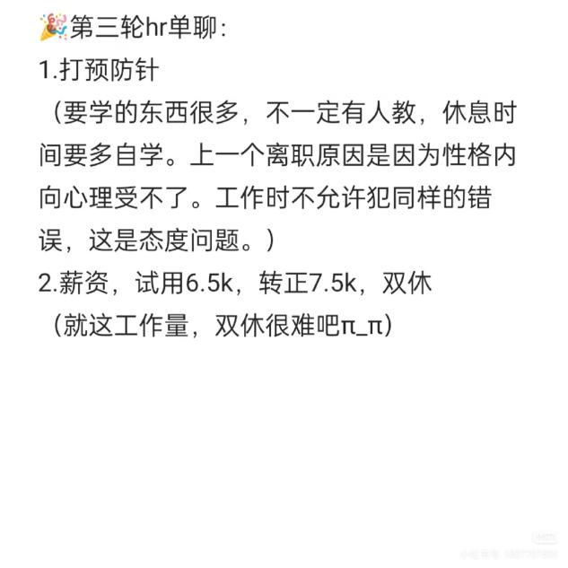

#### OCR 原文

（无 OCR 原文）

#### 清洗后文本

（无清洗文本）

#### 结构化候选问答

- 暂无可入库结构化问答。

### 图片 5: 03_3_4_image_005_f6cf0e1300.jpeg

- 来源：`D:\apps\ai-interview_archive\2026-05-19_competition_docs_cleanup\member_materials_raw\面试经历(3)(4).docx`
- SHA256：`f6cf0e13006beba84a69dc879a10c04375cf3198b6c2c45141ce1360c2e81349`
- OCR 状态：`ocr_unavailable`
- OCR 置信度：``
- 目标岗位：待人工确认
- 审核状态：待核验
- 图片：

#### OCR 原文

（无 OCR 原文）

#### 清洗后文本

（无清洗文本）

#### 结构化候选问答

- 暂无可入库结构化问答。

### 图片 6: 03_3_4_image_006_549ac0cb3a.jpeg

- 来源：`D:\apps\ai-interview_archive\2026-05-19_competition_docs_cleanup\member_materials_raw\面试经历(3)(4).docx`
- SHA256：`549ac0cb3a49db20cd941a2ef5c31d8c8126f3ef1ddd91295d4b844eeb55d286`
- OCR 状态：`ocr_unavailable`
- OCR 置信度：``
- 目标岗位：待人工确认
- 审核状态：待核验
- 图片：

#### OCR 原文

（无 OCR 原文）

#### 清洗后文本

（无清洗文本）

#### 结构化候选问答

- 暂无可入库结构化问答。

### 图片 7: 03_3_4_image_007_b64670820c.jpeg

- 来源：`D:\apps\ai-interview_archive\2026-05-19_competition_docs_cleanup\member_materials_raw\面试经历(3)(4).docx`
- SHA256：`b64670820ce09fd889b51469cd7480d11477cb08a3931c681db54aa316ffdb8b`
- OCR 状态：`ocr_unavailable`
- OCR 置信度：``
- 目标岗位：待人工确认
- 审核状态：待核验
- 图片：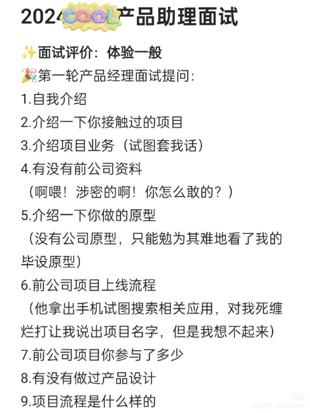

#### OCR 原文

（无 OCR 原文）

#### 清洗后文本

（无清洗文本）

#### 结构化候选问答

- 暂无可入库结构化问答。

### 图片 8: 03_3_4_image_008_65a50f2595.jpeg

- 来源：`D:\apps\ai-interview_archive\2026-05-19_competition_docs_cleanup\member_materials_raw\面试经历(3)(4).docx`
- SHA256：`65a50f259534f2ed755c6cb3814830401080b420019d6ee99ce59344e961a2db`
- OCR 状态：`ocr_unavailable`
- OCR 置信度：``
- 目标岗位：待人工确认
- 审核状态：待核验
- 图片：

#### OCR 原文

（无 OCR 原文）

#### 清洗后文本

（无清洗文本）

#### 结构化候选问答

- 暂无可入库结构化问答。

### 图片 9: 03_3_4_image_009_b600a16cb1.jpeg

- 来源：`D:\apps\ai-interview_archive\2026-05-19_competition_docs_cleanup\member_materials_raw\面试经历(3)(4).docx`
- SHA256：`b600a16cb196ffb46befb67524c22bb36521acbbe6516e9d030e66ae3510350b`
- OCR 状态：`ocr_unavailable`
- OCR 置信度：``
- 目标岗位：待人工确认
- 审核状态：待核验
- 图片：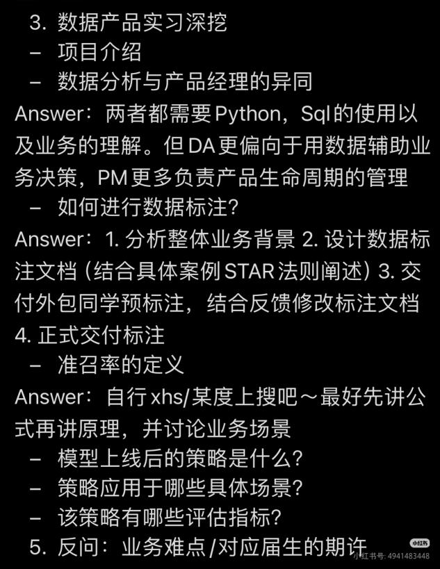

#### OCR 原文

（无 OCR 原文）

#### 清洗后文本

（无清洗文本）

#### 结构化候选问答

- 暂无可入库结构化问答。

### 图片 10: 03_3_4_image_010_f5f1831ced.jpeg

- 来源：`D:\apps\ai-interview_archive\2026-05-19_competition_docs_cleanup\member_materials_raw\面试经历(3)(4).docx`
- SHA256：`f5f1831ced4ca24ee0bbce7b5f1e9fb3043a2d37218c8bb0601a3f4709cb15d0`
- OCR 状态：`ocr_unavailable`
- OCR 置信度：``
- 目标岗位：待人工确认
- 审核状态：待核验
- 图片：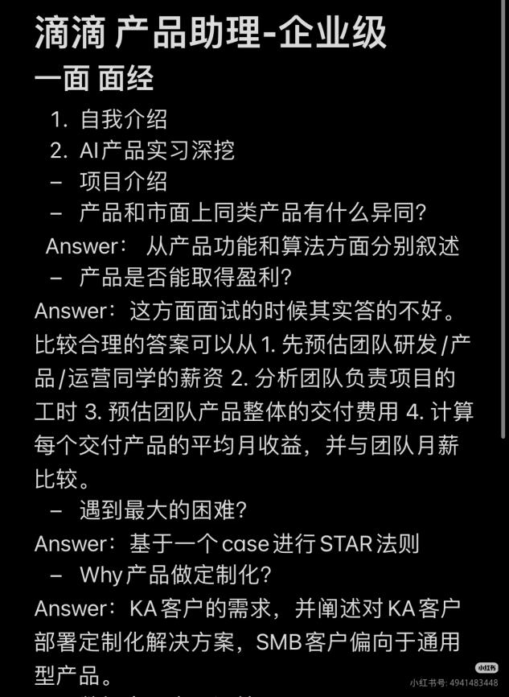

#### OCR 原文

（无 OCR 原文）

#### 清洗后文本

（无清洗文本）

#### 结构化候选问答

- 暂无可入库结构化问答。

### 图片 11: 03_3_4_image_011_ecc9f1b330.jpeg

- 来源：`D:\apps\ai-interview_archive\2026-05-19_competition_docs_cleanup\member_materials_raw\面试经历(3)(4).docx`
- SHA256：`ecc9f1b330e6e30a7fe84e9f1024ce0690d5748fafed1eef8799cd966c0c4c4c`
- OCR 状态：`ocr_unavailable`
- OCR 置信度：``
- 目标岗位：待人工确认
- 审核状态：待核验
- 图片：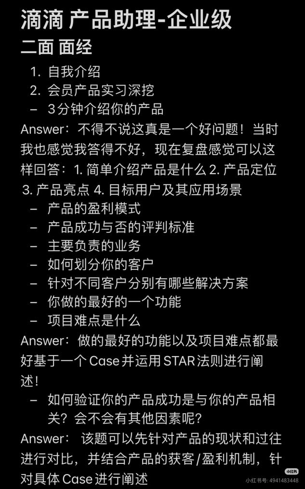

#### OCR 原文

（无 OCR 原文）

#### 清洗后文本

（无清洗文本）

#### 结构化候选问答

- 暂无可入库结构化问答。

### 图片 12: 03_3_4_image_012_27ea56a180.jpeg

- 来源：`D:\apps\ai-interview_archive\2026-05-19_competition_docs_cleanup\member_materials_raw\面试经历(3)(4).docx`
- SHA256：`27ea56a18009f909e1c5722cf716bca70010f4c0e56290a2be2b011eb3057743`
- OCR 状态：`ocr_unavailable`
- OCR 置信度：``
- 目标岗位：待人工确认
- 审核状态：待核验
- 图片：

#### OCR 原文

（无 OCR 原文）

#### 清洗后文本

（无清洗文本）

#### 结构化候选问答

- 暂无可入库结构化问答。

### 图片 13: 03_3_4_image_013_4aea604a3f.jpeg

- 来源：`D:\apps\ai-interview_archive\2026-05-19_competition_docs_cleanup\member_materials_raw\面试经历(3)(4).docx`
- SHA256：`4aea604a3fa3ce7440e7cad39fcd43c3228a50a28e95b4b01825356ad23a7c50`
- OCR 状态：`ocr_unavailable`
- OCR 置信度：``
- 目标岗位：待人工确认
- 审核状态：待核验
- 图片：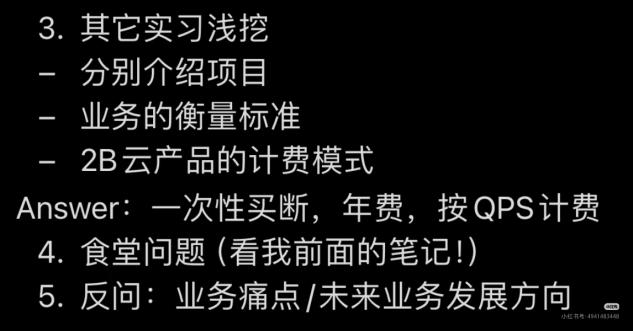

#### OCR 原文

（无 OCR 原文）

#### 清洗后文本

（无清洗文本）

#### 结构化候选问答

- 暂无可入库结构化问答。

### 图片 14: 03_3_4_image_014_90a29e7dd1.jpeg

- 来源：`D:\apps\ai-interview_archive\2026-05-19_competition_docs_cleanup\member_materials_raw\面试经历(3)(4).docx`
- SHA256：`90a29e7dd15841e426c29b2389770f82caa3045c7ee64bf843510832c4847563`
- OCR 状态：`ocr_unavailable`
- OCR 置信度：``
- 目标岗位：待人工确认
- 审核状态：待核验
- 图片：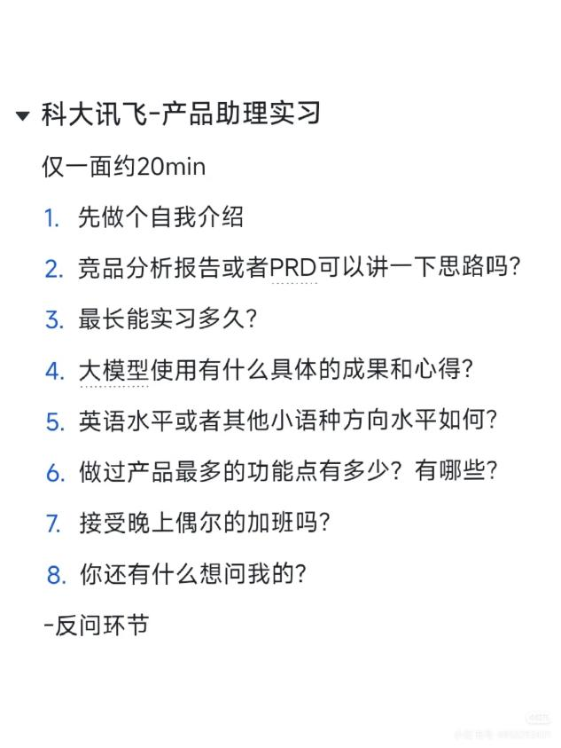

#### OCR 原文

（无 OCR 原文）

#### 清洗后文本

（无清洗文本）

#### 结构化候选问答

- 暂无可入库结构化问答。

### 图片 15: 03_3_4_image_015_cdedfd59ba.jpeg

- 来源：`D:\apps\ai-interview_archive\2026-05-19_competition_docs_cleanup\member_materials_raw\面试经历(3)(4).docx`
- SHA256：`cdedfd59ba8c0589911f82c0ffaf90685077cb25114ba21a8d333910e178bc9d`
- OCR 状态：`ocr_unavailable`
- OCR 置信度：``
- 目标岗位：待人工确认
- 审核状态：待核验
- 图片：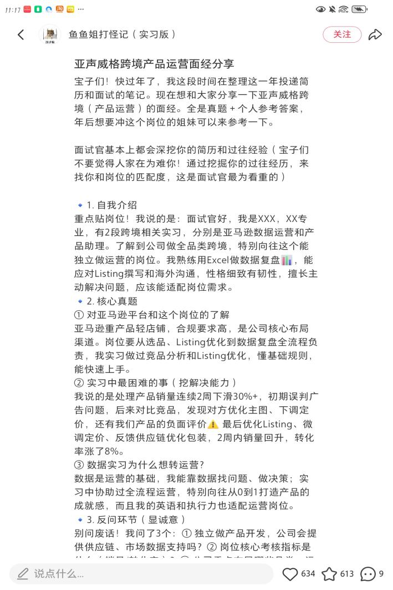

#### OCR 原文

（无 OCR 原文）

#### 清洗后文本

（无清洗文本）

#### 结构化候选问答

- 暂无可入库结构化问答。

### 图片 16: 03_3_4_image_016_69c4088a9f.jpeg

- 来源：`D:\apps\ai-interview_archive\2026-05-19_competition_docs_cleanup\member_materials_raw\面试经历(3)(4).docx`
- SHA256：`69c4088a9f3e0b16c827ad38be96fafc82f610188529526271e23b13a6060365`
- OCR 状态：`ocr_unavailable`
- OCR 置信度：``
- 目标岗位：待人工确认
- 审核状态：待核验
- 图片：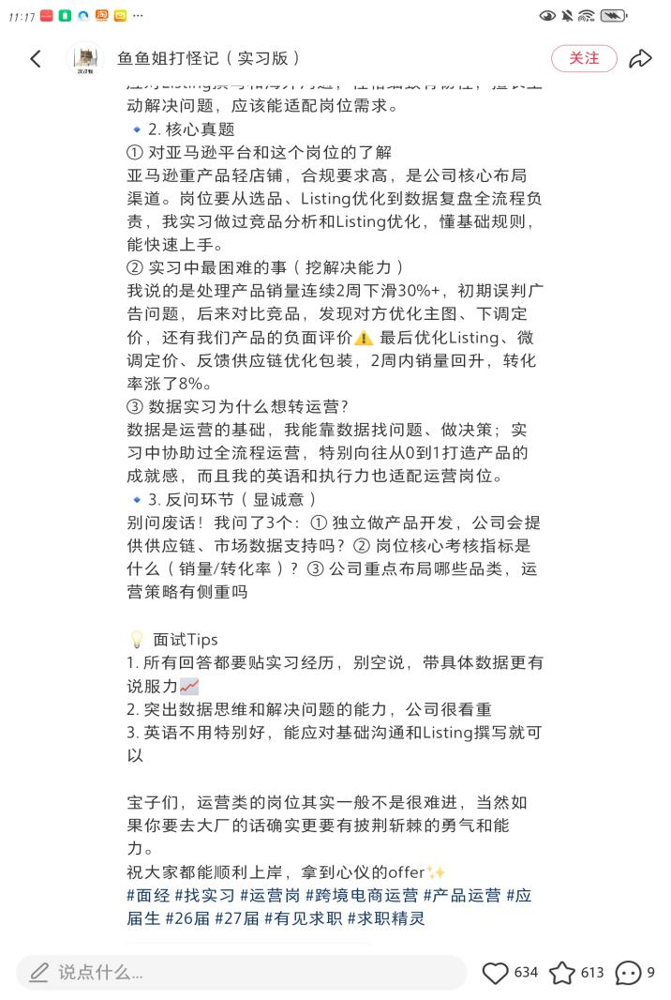

#### OCR 原文

（无 OCR 原文）

#### 清洗后文本

（无清洗文本）

#### 结构化候选问答

- 暂无可入库结构化问答。

### 图片 17: 03_3_4_image_017_36f85f8bb9.jpeg

- 来源：`D:\apps\ai-interview_archive\2026-05-19_competition_docs_cleanup\member_materials_raw\面试经历(3)(4).docx`
- SHA256：`36f85f8bb943adebd1469ed5e204e5c6c9596bee0c12d5661a78538e9ecddadf`
- OCR 状态：`ocr_unavailable`
- OCR 置信度：``
- 目标岗位：待人工确认
- 审核状态：待核验
- 图片：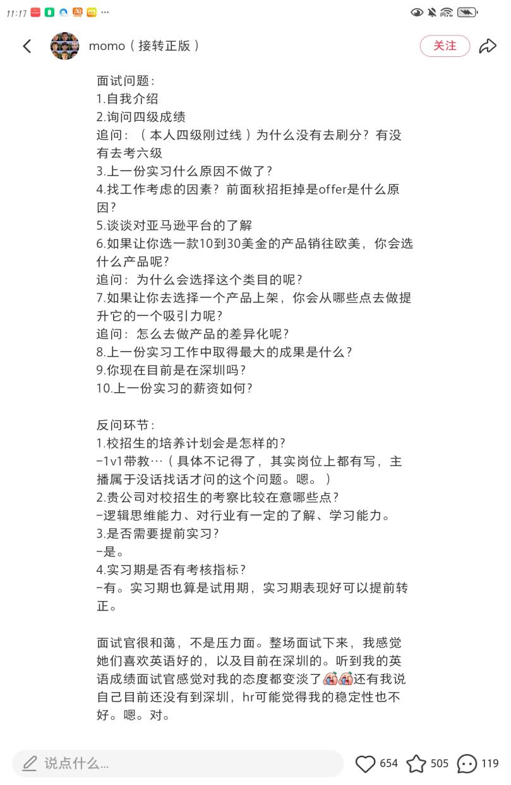

#### OCR 原文

（无 OCR 原文）

#### 清洗后文本

（无清洗文本）

#### 结构化候选问答

- 暂无可入库结构化问答。

### 图片 18: 03_3_4_image_018_06d67e5a9b.jpeg

- 来源：`D:\apps\ai-interview_archive\2026-05-19_competition_docs_cleanup\member_materials_raw\面试经历(3)(4).docx`
- SHA256：`06d67e5a9b552c893baf4f0a17b54a2991ee6885fcab2782d230c96de5d281a6`
- OCR 状态：`manual_visual_ocr`
- OCR 置信度：`0.76`
- 目标岗位：运营助理
- 审核状态：待核验
- 图片：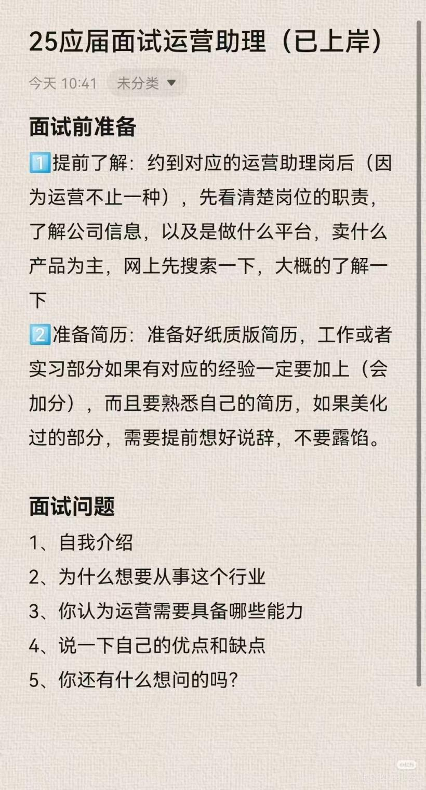

#### OCR 原文

运营助理应届面试：提前了解岗位、公司、平台和产品；准备简历；面试题包括自我介绍、为什么选择行业、运营需要哪些能力、个人优缺点、反问面试官。

#### 清洗后文本

运营助理基础面试重点是岗位认知、行业动机、运营能力模型和个人优劣势。

#### 结构化候选问答

- 岗位：运营助理
- 问题：运营助理岗位需要哪些基础能力？
- 回答要点：通常包括用户理解、数据意识、活动执行、内容或渠道运营、沟通协作、复盘能力和抗压执行力；回答时应结合自己做过的活动、社群、内容、数据分析或项目经历，而不是只列能力词。
- 复盘：该题适合作为运营助理 easy 难度基础题。
- 能力：岗位认知、运营基础、执行力、复盘意识
- 来源：03_3_4_image_018_06d67e5a9b.jpeg

### 图片 19: 03_3_4_image_019_f8d274f3fb.jpeg

- 来源：`D:\apps\ai-interview_archive\2026-05-19_competition_docs_cleanup\member_materials_raw\面试经历(3)(4).docx`
- SHA256：`f8d274f3fb0c83302781de94a5a7420865b03d7b25e79c0dcdc352a4d433d589`
- OCR 状态：`manual_visual_ocr`
- OCR 置信度：`0.74`
- 目标岗位：运营助理
- 审核状态：待核验
- 图片：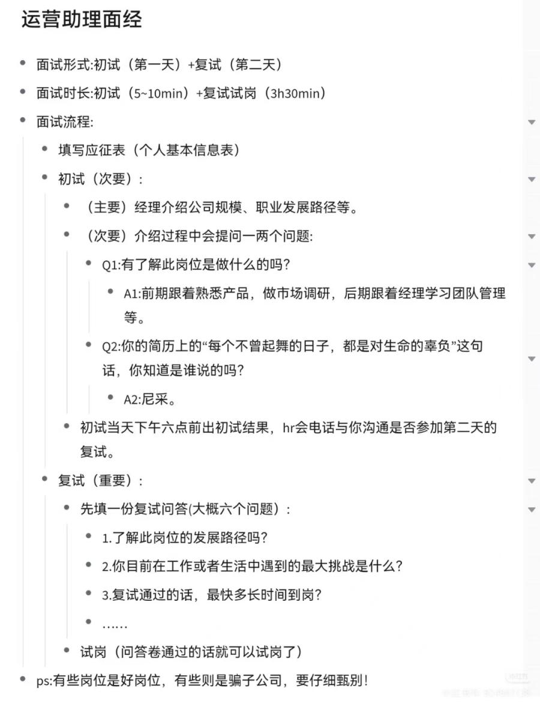

#### OCR 原文

运营助理面经：初面和复试；岗位理解；前期学习产品、市场调研，后期协助经理做团队管理；职业路径；最大挑战；到岗时间和试用；提醒警惕不正规公司。

#### 清洗后文本

运营助理面经关注岗位理解、产品学习、市场调研、团队协作、职业路径和最大挑战。

#### 结构化候选问答

- 岗位：运营助理
- 问题：你如何理解运营助理的工作内容和成长路径？
- 回答要点：前期通常以了解产品、用户、渠道和数据为主，承担基础执行、活动支持、数据整理和市场调研；随着熟悉业务，可参与方案制定、流程优化、复盘分析和团队协作管理。回答要体现先执行、再复盘、再优化的成长逻辑。
- 复盘：该题用于判断候选人是否把运营理解为长期业务增长工作，而不是简单打杂。
- 能力：岗位理解、职业规划、市场调研、团队协作
- 来源：03_3_4_image_019_f8d274f3fb.jpeg

### 图片 20: 03_3_4_image_020_3feb238ed1.jpeg

- 来源：`D:\apps\ai-interview_archive\2026-05-19_competition_docs_cleanup\member_materials_raw\面试经历(3)(4).docx`
- SHA256：`3feb238ed1be3f6b4eeace5148ac9b96d7d534d5e8891acbd983a04f6e59dc65`
- OCR 状态：`manual_visual_ocr`
- OCR 置信度：`0.76`
- 目标岗位：运营助理
- 审核状态：待核验
- 图片：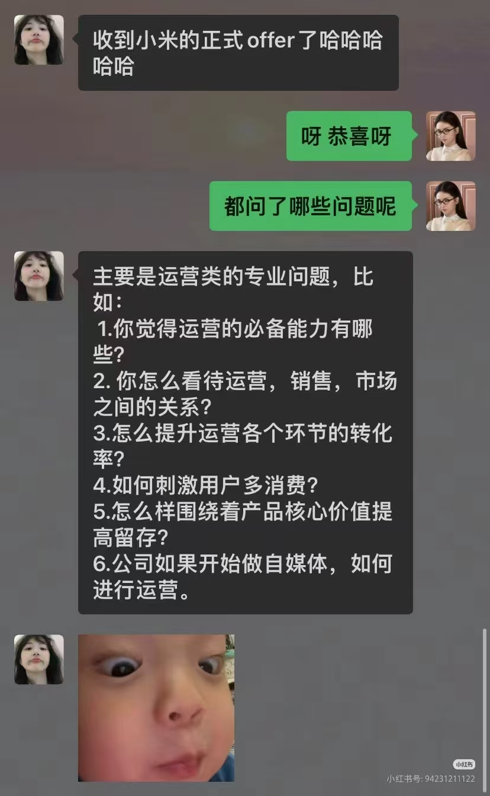

#### OCR 原文

运营面试常见问题：运营需要什么能力；运营、销售、市场之间的关系；如何提高转化率；如何刺激复购；围绕产品核心价值提高留存；如果公司开始做自媒体应该如何运营。

#### 清洗后文本

运营通用题覆盖转化、复购、留存、自媒体和运营与销售市场关系。

#### 结构化候选问答

- 岗位：运营助理
- 问题：如何围绕产品核心价值提高用户留存和复购？
- 回答要点：先明确产品核心价值和用户使用场景，再识别用户流失节点；通过新手引导、内容或活动触达、权益设计、社群维护、个性化推荐、售后体验和复购激励提高留存；需要用留存率、复购率、转化率和用户反馈验证效果。
- 复盘：该题适合中等难度运营追问，要求从动作回到指标验证。
- 能力：用户留存、复购、转化率、活动运营
- 来源：03_3_4_image_020_3feb238ed1.jpeg

### 图片 21: 03_3_4_image_021_049d45d2dc.jpeg

- 来源：`D:\apps\ai-interview_archive\2026-05-19_competition_docs_cleanup\member_materials_raw\面试经历(3)(4).docx`
- SHA256：`049d45d2dc4049b211818e15510d686608cb3f2effdd0e858ddee66980dd8022`
- OCR 状态：`manual_visual_ocr`
- OCR 置信度：`0.76`
- 目标岗位：运营助理
- 审核状态：待核验
- 图片：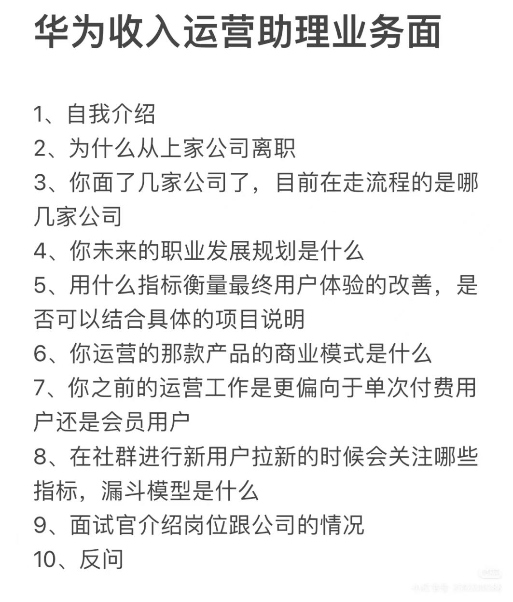

#### OCR 原文

华为收入运营助理业务面：自我介绍；为什么离开上一家公司；当前面试进度；职业规划；用户体验改善指标和项目案例；运营产品业务模式；上份工作一次性收费还是会员；社区获客指标和漏斗模型；反问。

#### 清洗后文本

收入运营助理面试关注业务模式、用户体验指标、获客漏斗、收费模式和职业规划。

#### 结构化候选问答

- 岗位：运营助理
- 问题：运营助理如何用漏斗模型分析社区获客效果？
- 回答要点：可以按曝光、点击、注册、激活、留存、付费或转介绍拆分漏斗；每个节点看转化率和流失原因，再针对内容、渠道、活动、产品体验或权益设计提出优化；要说明指标口径和数据来源。
- 复盘：该题考察运营数据化表达和业务模式理解。
- 能力：获客漏斗、业务模式、用户体验指标、数据分析
- 来源：03_3_4_image_021_049d45d2dc.jpeg

### 图片 22: 03_3_4_image_022_dd2f7b07cb.jpeg

- 来源：`D:\apps\ai-interview_archive\2026-05-19_competition_docs_cleanup\member_materials_raw\面试经历(3)(4).docx`
- SHA256：`dd2f7b07cb7199581c0eb7eee83340186bb4a2805bed0269e2986c90014ec31e`
- OCR 状态：`manual_visual_ocr`
- OCR 置信度：`0.75`
- 目标岗位：运营助理
- 审核状态：待核验
- 图片：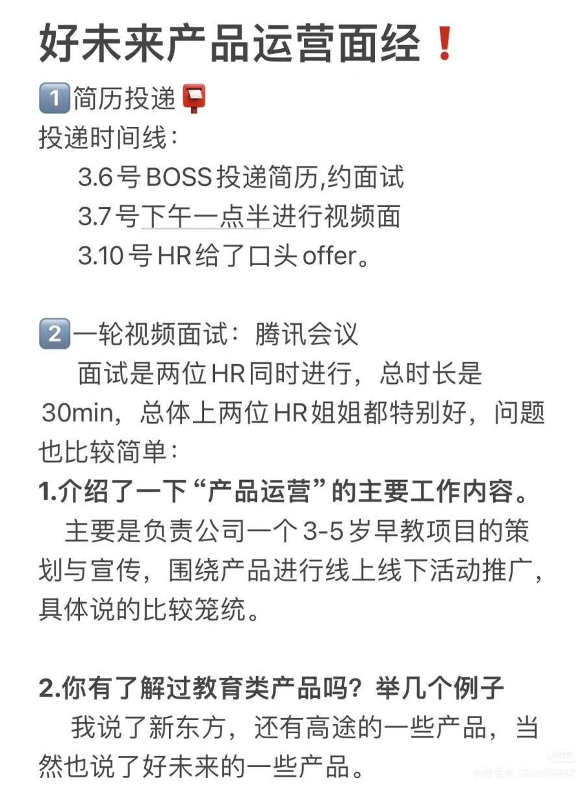

#### OCR 原文

好未来产品运营面经：产品运营工作面向 3-5 岁早教项目推广；了解教育产品；如何用视频或图文推广早教课；公域和私域流量；如何面向 3-5 岁产品做大规模推广；通勤、地点、工作时间和反问。

#### 清洗后文本

教育产品运营面试关注早教产品推广、视频/图文内容、公域私域流量和用户触达。

#### 结构化候选问答

- 岗位：运营助理
- 问题：教育产品运营如何设计 3-5 岁早教课程的推广方案？
- 回答要点：先明确购买者是家长、使用者是儿童，内容要突出安全、兴趣、成长效果和陪伴场景；公域可用短视频、图文种草和直播，私域可用社群、试听课、打卡和案例反馈；需要用线索量、试听转化、留存和复购衡量效果。
- 复盘：该题考察产品运营对用户角色、内容形式和转化链路的理解。
- 能力：教育产品运营、公域私域、内容推广、转化设计
- 来源：03_3_4_image_022_dd2f7b07cb.jpeg

### 图片 23: 03_3_4_image_023_3a189c158d.jpeg

- 来源：`D:\apps\ai-interview_archive\2026-05-19_competition_docs_cleanup\member_materials_raw\面试经历(3)(4).docx`
- SHA256：`3a189c158d65af8e32861e65700e0cca3cab3d1232f8582ae7f9bf629a3e4607`
- OCR 状态：`ocr_unavailable`
- OCR 置信度：``
- 目标岗位：待人工确认
- 审核状态：待核验
- 图片：

#### OCR 原文

（无 OCR 原文）

#### 清洗后文本

（无清洗文本）

#### 结构化候选问答

- 暂无可入库结构化问答。

### 图片 24: 03_3_4_image_024_9b3bf297f1.jpeg

- 来源：`D:\apps\ai-interview_archive\2026-05-19_competition_docs_cleanup\member_materials_raw\面试经历(3)(4).docx`
- SHA256：`9b3bf297f15283943dac2015c70a3b1b330e8f01105ed1c7e8186b5eb2261cca`
- OCR 状态：`ocr_unavailable`
- OCR 置信度：``
- 目标岗位：待人工确认
- 审核状态：待核验
- 图片：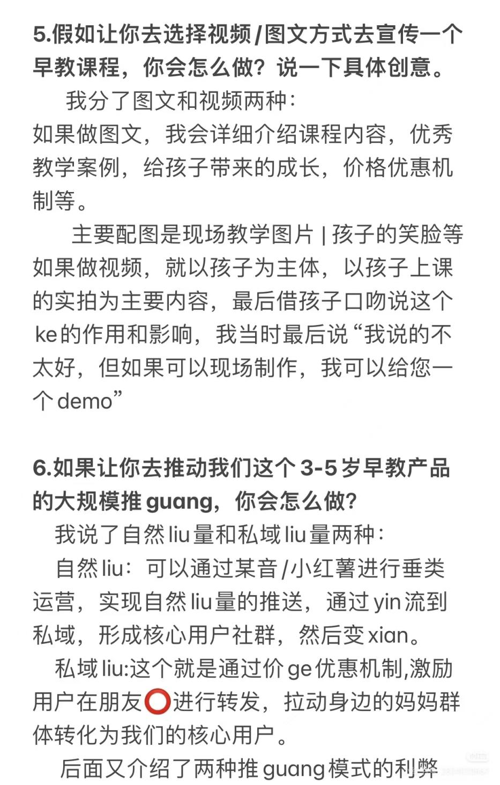

#### OCR 原文

（无 OCR 原文）

#### 清洗后文本

（无清洗文本）

#### 结构化候选问答

- 暂无可入库结构化问答。

### 图片 25: 03_3_4_image_025_4bb90eff0f.jpeg

- 来源：`D:\apps\ai-interview_archive\2026-05-19_competition_docs_cleanup\member_materials_raw\面试经历(3)(4).docx`
- SHA256：`4bb90eff0f7abe04ef8002cb68558af636b2f97913bdc330d783159fb9f7c60c`
- OCR 状态：`ocr_unavailable`
- OCR 置信度：``
- 目标岗位：待人工确认
- 审核状态：待核验
- 图片：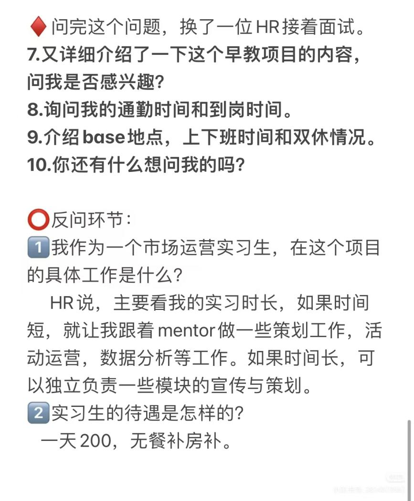

#### OCR 原文

（无 OCR 原文）

#### 清洗后文本

（无清洗文本）

#### 结构化候选问答

- 暂无可入库结构化问答。

### 图片 26: 03_3_4_image_026_47e50fdf16.jpeg

- 来源：`D:\apps\ai-interview_archive\2026-05-19_competition_docs_cleanup\member_materials_raw\面试经历(3)(4).docx`
- SHA256：`47e50fdf16f625db0269f7f733ebbb7c6ba76d55c48bb238fdea07576977870b`
- OCR 状态：`ocr_unavailable`
- OCR 置信度：``
- 目标岗位：待人工确认
- 审核状态：待核验
- 图片：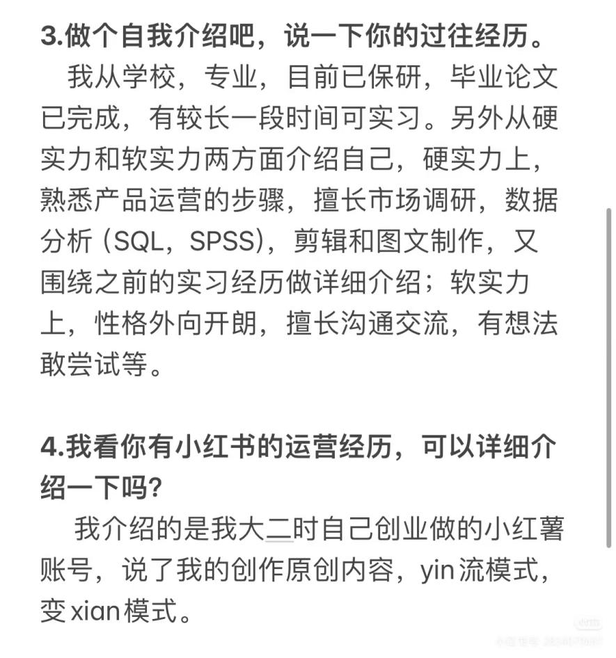

#### OCR 原文

（无 OCR 原文）

#### 清洗后文本

（无清洗文本）

#### 结构化候选问答

- 暂无可入库结构化问答。

### 图片 27: 03_3_4_image_027_a2b8966e7c.jpeg

- 来源：`D:\apps\ai-interview_archive\2026-05-19_competition_docs_cleanup\member_materials_raw\面试经历(3)(4).docx`
- SHA256：`a2b8966e7c1e2f91e0efa2a543654aca1dad730eedcd24e8d405b286737c07bb`
- OCR 状态：`ocr_unavailable`
- OCR 置信度：``
- 目标岗位：待人工确认
- 审核状态：待核验
- 图片：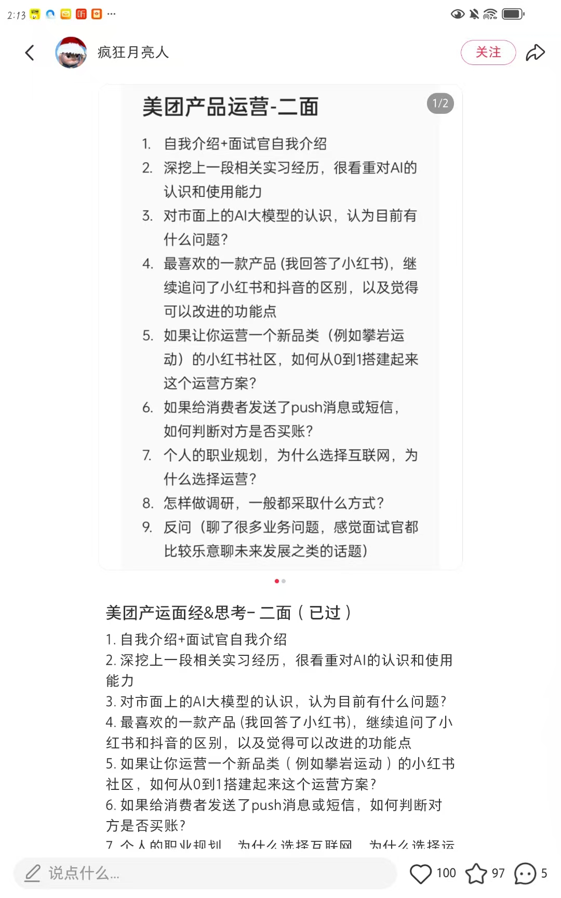

#### OCR 原文

（无 OCR 原文）

#### 清洗后文本

（无清洗文本）

#### 结构化候选问答

- 暂无可入库结构化问答。

### 图片 28: 03_3_4_image_028_73d64e01fb.jpeg

- 来源：`D:\apps\ai-interview_archive\2026-05-19_competition_docs_cleanup\member_materials_raw\面试经历(3)(4).docx`
- SHA256：`73d64e01fbc0dea4dacff6b16a5f11fd9505b90580fe9e78cbce164c8ef922d6`
- OCR 状态：`manual_visual_ocr`
- OCR 置信度：`0.76`
- 目标岗位：运营助理
- 审核状态：待核验
- 图片：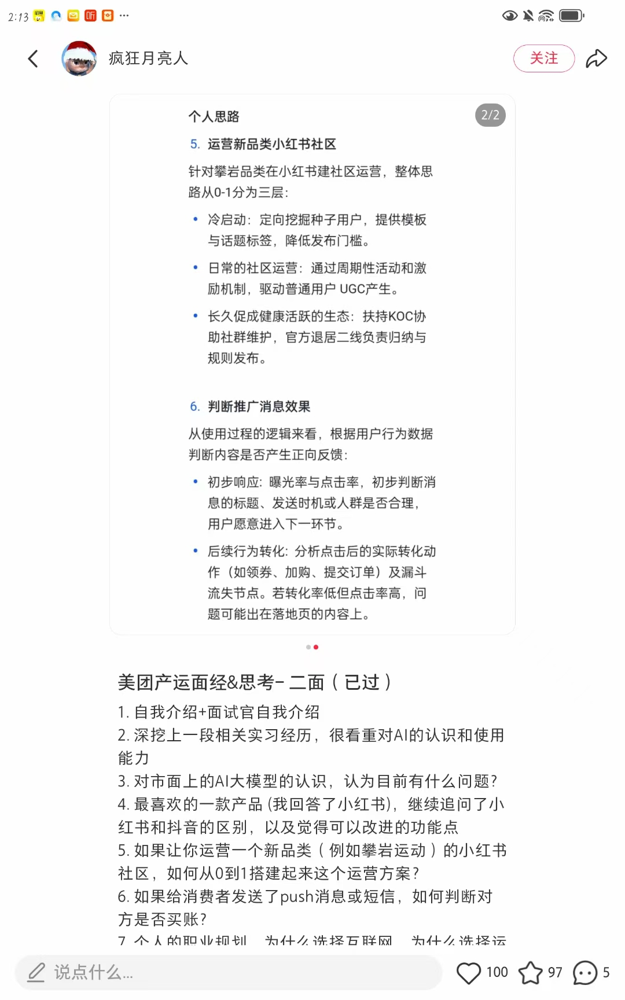

#### OCR 原文

美团产品运营二面：自我介绍；AI 知识；喜欢的产品小红书和抖音区别；新品类运营计划；push 和短信购买判断；职业规划和为什么互联网；市场调研；反问。总结：未来规划和个人规划会被问。

#### 清洗后文本

美团产品运营二面重点围绕产品理解、AI 知识、新品类运营、触达渠道、职业规划和市场调研。

#### 结构化候选问答

- 岗位：运营助理
- 问题：运营面试中如何比较小红书和抖音的产品差异？
- 回答要点：可以从用户动机、内容形态、分发机制、消费决策链路、社区氛围、商业化方式和适合的运营目标来比较。小红书偏种草和决策参考，抖音偏内容消费和即时转化；回答要结合具体品类和运营目标，而不是简单说一个图文一个视频。
- 复盘：该题考察候选人的产品观察和运营策略迁移能力。
- 能力：产品分析、运营策略、渠道触达、AI 认知
- 来源：03_3_4_image_028_73d64e01fb.jpeg

### 图片 29: 03_3_4_image_029_b724954563.jpeg

- 来源：`D:\apps\ai-interview_archive\2026-05-19_competition_docs_cleanup\member_materials_raw\面试经历(3)(4).docx`
- SHA256：`b724954563cbe5e21ef87e25b6595acf1d3fca09bf5429357aa8c03a352f44b8`
- OCR 状态：`manual_visual_ocr`
- OCR 置信度：`0.74`
- 目标岗位：运营助理
- 审核状态：待核验
- 图片：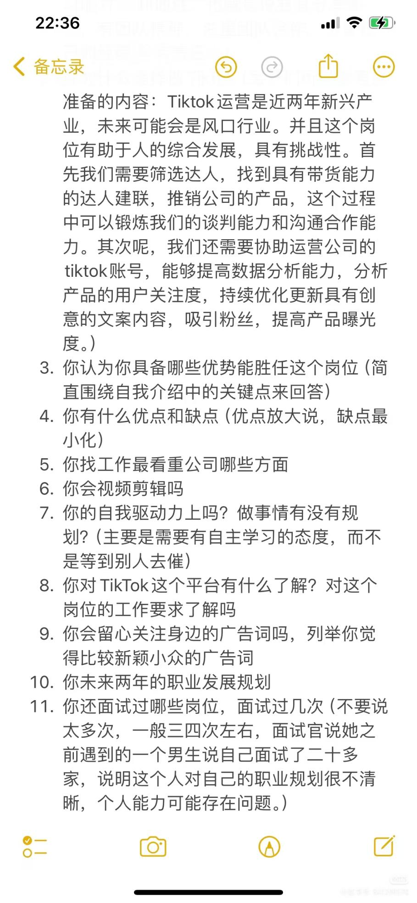

#### OCR 原文

TikTok 运营助理面试经验：自我介绍；为什么选择 TikTok 运营；岗位需要达人筛选、达人沟通、账号运营、数据分析、广告文案和品牌曝光；优势缺点；公司看重什么；视频剪辑；自我驱动力；了解 TikTok；广告词；未来两年规划；面试过哪些岗位和次数。

#### 清洗后文本

TikTok 运营助理面试重点是达人沟通、内容运营、数据分析、广告文案、品牌曝光、自驱力和职业规划。

#### 结构化候选问答

- 岗位：运营助理
- 问题：TikTok 运营助理如何回答达人筛选和账号运营能力？
- 回答要点：应说明如何根据目标用户、内容风格、粉丝画像、互动率、转化潜力和品牌匹配度筛选达人；账号运营需要结合内容选题、发布时间、互动数据、热点趋势、广告文案和转化指标持续优化。
- 复盘：该题适合短视频/跨境内容运营方向，强调数据和内容双能力。
- 能力：达人运营、内容运营、数据分析、品牌曝光
- 来源：03_3_4_image_029_b724954563.jpeg

### 图片 30: 03_3_4_image_030_f0a0726340.jpeg

- 来源：`D:\apps\ai-interview_archive\2026-05-19_competition_docs_cleanup\member_materials_raw\面试经历(3)(4).docx`
- SHA256：`f0a07263408b5e322ab8964c597d73990c9a5a3cab532ecc6ac8bf0956829e48`
- OCR 状态：`ocr_unavailable`
- OCR 置信度：``
- 目标岗位：待人工确认
- 审核状态：待核验
- 图片：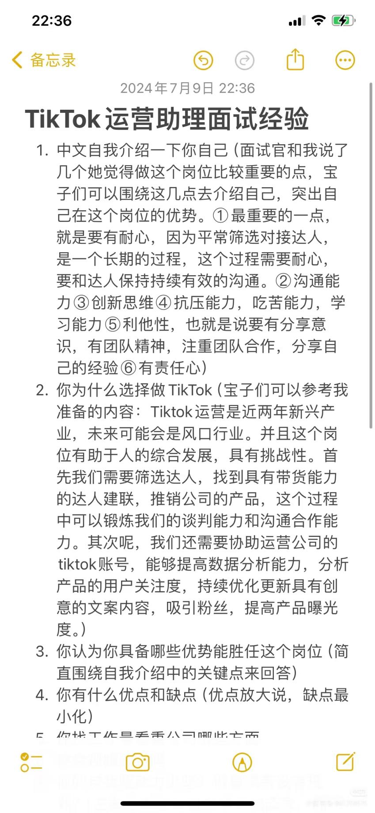

#### OCR 原文

（无 OCR 原文）

#### 清洗后文本

（无清洗文本）

#### 结构化候选问答

- 暂无可入库结构化问答。

### 图片 31: 03_3_4_image_031_2e04f2be9f.jpeg

- 来源：`D:\apps\ai-interview_archive\2026-05-19_competition_docs_cleanup\member_materials_raw\面试经历(3)(4).docx`
- SHA256：`2e04f2be9fd228a4ee2bdf8d40b762fafbb3ea0b3e28c836639f98206fb0d69a`
- OCR 状态：`ocr_unavailable`
- OCR 置信度：``
- 目标岗位：待人工确认
- 审核状态：待核验
- 图片：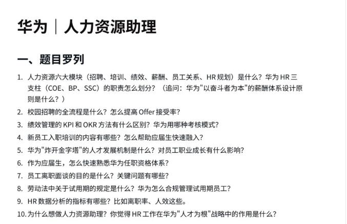

#### OCR 原文

（无 OCR 原文）

#### 清洗后文本

（无清洗文本）

#### 结构化候选问答

- 暂无可入库结构化问答。

### 图片 32: 03_3_4_image_032_88fc2661cd.jpeg

- 来源：`D:\apps\ai-interview_archive\2026-05-19_competition_docs_cleanup\member_materials_raw\面试经历(3)(4).docx`
- SHA256：`88fc2661cda94f4cafdb8a5e2b28d2dfcc91e32db78754cb14e70ccd71184dab`
- OCR 状态：`ocr_unavailable`
- OCR 置信度：``
- 目标岗位：待人工确认
- 审核状态：待核验
- 图片：

#### OCR 原文

（无 OCR 原文）

#### 清洗后文本

（无清洗文本）

#### 结构化候选问答

- 暂无可入库结构化问答。

### 图片 33: 03_3_4_image_033_cd0e0a4240.jpeg

- 来源：`D:\apps\ai-interview_archive\2026-05-19_competition_docs_cleanup\member_materials_raw\面试经历(3)(4).docx`
- SHA256：`cd0e0a42406d5747e124533c47864219ffe4045dcddbdddcb40912231ca8219a`
- OCR 状态：`ocr_unavailable`
- OCR 置信度：``
- 目标岗位：待人工确认
- 审核状态：待核验
- 图片：

#### OCR 原文

（无 OCR 原文）

#### 清洗后文本

（无清洗文本）

#### 结构化候选问答

- 暂无可入库结构化问答。

### 图片 34: 03_3_4_image_034_7fa82d1466.jpeg

- 来源：`D:\apps\ai-interview_archive\2026-05-19_competition_docs_cleanup\member_materials_raw\面试经历(3)(4).docx`
- SHA256：`7fa82d1466b0e5294ce5ff2e4bd022257fcfc7d402b0e38997f83f0f957fc748`
- OCR 状态：`ocr_unavailable`
- OCR 置信度：``
- 目标岗位：待人工确认
- 审核状态：待核验
- 图片：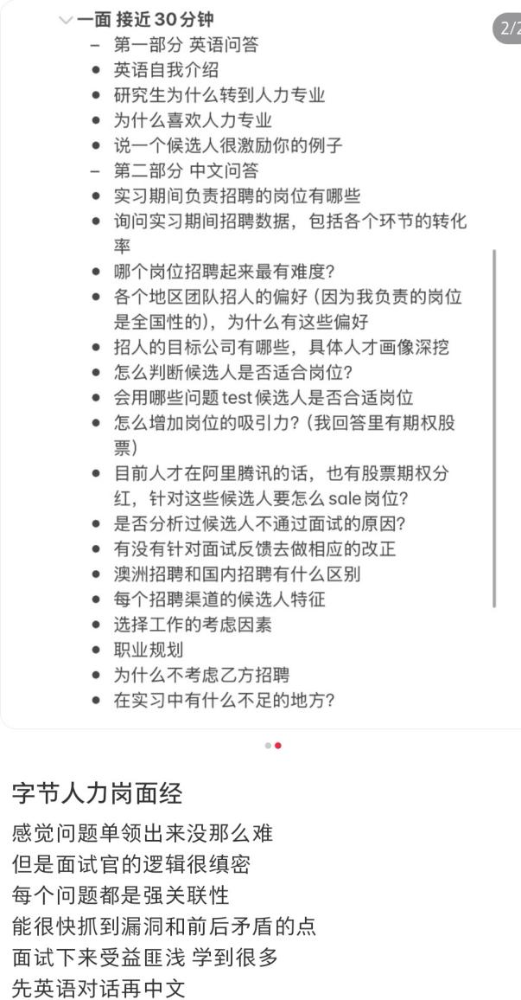

#### OCR 原文

（无 OCR 原文）

#### 清洗后文本

（无清洗文本）

#### 结构化候选问答

- 暂无可入库结构化问答。

### 图片 35: 03_3_4_image_035_a67c997a70.jpeg

- 来源：`D:\apps\ai-interview_archive\2026-05-19_competition_docs_cleanup\member_materials_raw\面试经历(3)(4).docx`
- SHA256：`a67c997a707005092ae5b3b3cf6af990ca9d08b3c7d20545683efa44cb50785d`
- OCR 状态：`ocr_unavailable`
- OCR 置信度：``
- 目标岗位：待人工确认
- 审核状态：待核验
- 图片：

#### OCR 原文

（无 OCR 原文）

#### 清洗后文本

（无清洗文本）

#### 结构化候选问答

- 暂无可入库结构化问答。

### 图片 36: 03_3_4_image_036_b37013b6ba.jpeg

- 来源：`D:\apps\ai-interview_archive\2026-05-19_competition_docs_cleanup\member_materials_raw\面试经历(3)(4).docx`
- SHA256：`b37013b6ba939bc757ea857032d8901476a45393f62edef7b4623e2d9636b336`
- OCR 状态：`manual_visual_ocr`
- OCR 置信度：`0.78`
- 目标岗位：产品助理
- 审核状态：待核验
- 图片：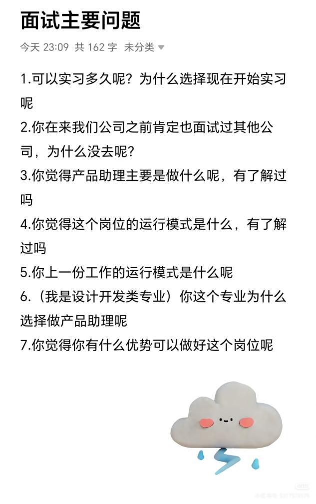

#### OCR 原文

产品助理面试主要问题：可以实习多久，为什么现在开始实习；来公司前是否面试过其他公司，为什么没去；产品助理主要做什么；岗位运行模式；上一份工作运行模式；设计开发类专业为什么做产品助理；有什么优势。

#### 清洗后文本

产品助理基础面试题关注实习稳定性、岗位理解、运行模式、转岗动机和个人优势。

#### 结构化候选问答

- 岗位：产品助理
- 问题：非产品专业候选人为什么选择产品助理岗位，应该如何回答？
- 回答要点：回答应把专业背景转化为岗位相关能力，例如设计开发背景可以支持原型理解、技术沟通和方案可行性判断；同时说明自己对用户、业务、数据和项目协同的兴趣，以及已做过的产品分析、PRD、原型或项目实践。
- 复盘：该题用于判断转岗动机是否清晰，以及候选人是否理解产品助理真实工作。
- 能力：岗位理解、转岗动机、优势表达、实习稳定性
- 来源：03_3_4_image_036_b37013b6ba.jpeg
