# 2026-05-19 图片型面试经验抽取记录

本文件由 `extract_member_interview_experience` 生成。图片内容必须经过 OCR/视觉转写后，才能进入结构化知识包。

## DOCX 正文抽取

### 机器人大赛(2).docx

可交付物：
- 非技术岗岗位要求整理稿。
- 非技术岗面经候选清单。
- 非技术岗结构化问答经验卡片。
- 非技术资料来源审核表。
- 非技术岗知识库补全记录。
非技术岗岗位资料与面经工作
交付物1：非技术岗岗位要求整理稿
岗位基础信息
覆盖岗位：产品助理、运营助理、新媒体运营、人力资源专员、招聘助理、行政管理助理
资料整理周期：
整理人：
产品助理
一、岗位要求整理稿
（一）硬性要求（学历、经验、证书、技能、地域、年龄等）
1. 腾讯系高端产品岗（AI平台高级产品经理、微信小店产品策划）1. AI平台高级产品经理（深圳）- 学历：全日制本科及以上
- 工作经验：3年以上AI/云计算/边缘计算领域产品策划经验，PaaS、开发者工具等平台型产品全生命周期管理经验优先
- 语言：英语可作为工作语言，可独立撰写英文技术文档、对接国际团队
- 专业技能：熟悉AIGC技术应用场景，具备实际项目落地经验；熟练输出竞品分析、产品差异化策略；具备产品全流程管理能力
2. 微信小店-产品策划（C端方向，广州）- 学历：本科及以上
- 工作经验：1年及以上产品策划经验，电商行业背景优先
- 加分硬性：具备数据分析/商业分析能力
2. 北京地区产品/产品助理岗1. 博雅工道产品助理：统招硕士及以上，理工科优先，熟悉产品全流程，有工业产品设计经验优先
2. 北京中电元德产品助理：本科及以上，理工科（电子工程、计算机、自动化）优先；熟练Excel、Python、SQL；英语可无障碍沟通
3. 中电金信智慧双碳产品经理：本科，3年以上工作经验；熟练Office、Visio、Axure；具备大型信息化项目经验，双碳/能源行业经验优先
4. 北京果汁科技产品助理（校招/实习）：本科及以上，应届毕业生，计算机/设计/信息管理优先；熟练Axure、Figma等原型工具，Xmind/ProcessOn；每周可实习≥4天，实习≥3个月
5. 品镀研康产品助理：本科及以上，相关专业优先，具备团队领导能力
6. 某国有银行产品经理助理（信托）：本科及以上，金融/财务/会计/经济类专业；1年以上资管产品业务经验
7. 大北农集团产品开发高级研究助理：博士学历，农学/作物遗传育种等生物类相关专业；具备专业生物软件使用能力，英语能力优秀
3. 石家庄地区产品助理岗（非互联网/商贸/硬件方向）1. 快乐沃克/河北省供销惠民科技产品助理：本科及以上，45周岁以下；3年以上经验，大中型企业3年以上产品经理经验优先；熟悉新品上市全流程，食品类产品上市经验优先
2. 石家庄在冀顺通商贸产品助理：大专及以上，统计学/数学/计算机/财务/市场营销优先；熟悉透视表、函数、数据图表，了解3C/手机行业优先
3. 石家庄惠拓电子产品经理助理：大专及以上，熟练办公软件，具备销售相关经验优先
4. 新增垂直细分岗硬性要求（面经匹配）1. 食品类产品助理：本科及以上，食品专业优先；2025/2026届优先；可连续实习3个月+，每周出勤≥4天；具备电商经验优先
2. 跨境电商产品助理（亚马逊/亚声威格）：本科及以上，英语四级及以上；跨境电商/外贸经验优先；可接受深圳等工作地；具备Listing优化、数据复盘经验优先
3. AI/企业级产品助理（滴滴/科大讯飞）：本科及以上，计算机/理工科优先；熟悉Python、SQL；了解大模型、数据标注；可接受加班；具备B端产品经验优先
4. 东方甄选（直播电商产品助理）：本科及以上，快消/食品电商经验优先；熟悉直播电商模式；可跟进产品落地全流程
（二）加分项（优先条件、能力、行业背景、工具、项目）
1. 行业背景加分：电商/直播电商、AI/边缘计算、双碳能源、食品快消、工业设计、信托金融、3C数码、生物农业、跨境电商垂直行业项目/从业经验
2. 工具技能加分：Axure、Figma、墨刀、Xmind、ProcessOn、Visio、Python、SQL、Excel高阶功能、数据复盘工具
3. 能力加分：数据分析/商业分析、英文读写沟通、跨部门团队领导、标杆客户项目落地、竞品分析、需求挖掘、用户调研、项目推进、沟通表达、抗压学习能力
4. 项目加分：平台型产品全生命周期、大型信息化项目、成熟产品上市、标杆行业案例落地、跨境电商选品/Listing优化、食品产品全链路开发、AI产品项目落地
5. 学历/身份加分：硕士/博士学历、应届可长期实习、理工科对口专业、英语能力达标
（三）常见工作任务（全岗位通用+分岗位细分）
通用核心任务
1. 市场/用户调研、需求挖掘与分析，输出PRD、竞品分析、市场分析报告
2. 产品规划、功能策划、原型设计，跟进研发、测试，推动版本落地与迭代
3. 产品生命周期管理：定价、需求/质量/交付管理、商业化落地、标杆案例打造
4. 跨部门沟通协作：对接研发、销售、售前、运营，推进项目执行
5. 数据复盘：收集用户数据、业务数据，分析问题并输出优化方案
6. 文档规范：撰写需求文档、技术文档、业务说明、项目复盘、对外方案材料
细分岗位专项任务
1. AI平台产品（腾讯）：边缘计算+AIGC端到端方案规划、全球竞品跟踪、国际团队协作、标杆客户落地赋能
2. C端电商产品（腾讯）：商业交易功能策划、用户体验优化、电商玩法创新迭代
3. 石家庄商贸/快消产品：市场销售联动、品类规划、新品上市、季节性产品迭代、市场活动执行
4. 硬件/工业产品：产品销售支持、项目全流程跟进、数据运营、技术文档整理
5. 双碳/金融产品：信息化项目需求管理、客户需求挖掘、方案宣讲、项目全流程管控
6. 生物/农业产品：技术产品市场调研、研发流程管控、产品研发落地、技术评估
7. 东方甄选直播电商产品：选品、供应商对接、包装设计、卖点撰写、主播培训、直播营销、新品全链路落地
8. 跨境电商产品：选品、竞品分析、Listing优化、数据复盘、海外用户运营、供应链对接
9. 食品产品助理：食品策略梳理、用户访谈、产品设计、供应商谈判、库存管理、宣发运营
10. 企业级AI产品（滴滴/科大讯飞）：B端客户需求挖掘、定制化方案设计、数据标注、模型迭代、会员产品运营、客户分层管理
（四）工作场景
1. 互联网大厂（腾讯/滴滴/科大讯飞）：全球化AI平台、C端电商、企业级B端产品；跨地域/跨国际团队协作、高端技术产品创新、政企大客户落地、数据驱动产品迭代
2. 北京科技/数字化企业：工业装备、双碳能源、金融信托、人工智能；ToB政企项目、产品全流程管控、商业化落地
3. 石家庄本地企业：快消食品、3C数码、硬件销售；区域市场拓展、新品上市、销售联动、本地化标杆打造
4. 直播/跨境电商企业（东方甄选/亚声威格）：直播电商、亚马逊跨境平台；线上选品、供应链落地、直播运营、海外市场拓展
5. 校招/实习场景：需求梳理、原型绘制、文档撰写、用户反馈收集、项目辅助执行、长期实习跟进产品落地
（五）公司侧重点
1. 腾讯（高端产品岗）：技术创新+全球化+用户价值+商业化标杆，侧重AI前沿技术落地、全球市场竞争力、大型平台型产品全链路能力
2. 滴滴/科大讯飞（AI/企业级）：B端客户价值+数据驱动+AI技术落地，侧重大客户定制化、数据复盘、模型迭代、产品商业化盈利
3. 北京科技/数字化企业：垂直行业深耕+项目落地+政企服务，侧重行业需求深度挖掘、大型项目交付、合规性、数据驱动
4. 石家庄本地企业：区域市场+销售联动+新品落地，侧重快消/商贸行业本地化运营、销售业绩达成、新品快速迭代
5. 东方甄选（直播电商）：食品快消+直播电商模式+全链路落地，侧重线上直播带货、新品快速迭代、用户运营
6. 跨境电商企业：海外市场+合规运营+数据驱动，侧重亚马逊平台规则、选品、Listing优化、海外用户需求挖掘
7. 食品类企业：食品全链路开发+供应链+电商运营，侧重食品安全、供应商管控、产品设计、库存管理
二、非技术岗面经候选清单
岗位名称 面经关键词 来源 年份 许可 可信度 资料状态
AI平台高级产品经理（腾讯） 高端B端、边缘计算、AIGC、全球化、竞品分析 腾讯招聘、互联网求职社区 2026 公开可参考 高 可入库
微信小店产品策划（腾讯） C端电商、交易功能、用户体验、数据驱动 腾讯招聘、互联网求职社区 2026 公开可参考 高 可入库
智慧双碳产品经理 能源信息化、政企项目、需求分析、方案宣讲 智联招聘、求职经验贴 2025 公开可参考 中 可入库
东方甄选产品助理 直播电商、食品快消、市场调研、竞品分析、新品落地、case mock 小红书求职笔记 2025 个人分享公开 高 可入库
滴滴产品助理（企业级） AI产品、B端定制化、会员产品、数据复盘、盈利模式、客户分层 小红书求职笔记 2025 个人分享公开 高 可入库
食品类产品助理 食品开发、供应链、供应商谈判、库存管理 小红书求职笔记 2025 个人分享公开 中 可入库
跨境电商产品助理（亚声威格） 亚马逊平台、选品、Listing优化、数据复盘、英语能力 小红书求职笔记 2025 个人分享公开 高 可入库
科大讯飞产品助理（实习） 大模型、竞品分析、PRD、英语、加班接受度 小红书求职笔记 2025 个人分享公开 高 可入库
通用产品助理（硬件/互联网） 自我介绍、岗位认知、项目深挖、需求变更、方案沟通、用户调研 小红书求职笔记 2024-2025 个人分享公开 中 可入库
三、非技术岗结构化问答经验卡片
真实问题 参考回答要点 复盘反思 公司/场景 考察能力 难度 来源说明 审核状态
### 一、通用基础类（全产品岗通用）
1.自我介绍 1. 基本信息+专业背景；2. 匹配岗位的实习/项目经历，突出调研、竞品分析、数据复盘、沟通协作；3. 求职动机，贴合公司业务方向 自我介绍必须贴岗位，避免泛泛而谈，突出产品相关硬技能 全场景 自我认知、岗位匹配度、表达能力 ★☆☆ 小红书多份产品面经、大厂面经 可入库
2. 你为什么选择产品助理/我们公司？ 1. 对产品行业的认知；2. 自身能力匹配（调研、分析、执行力）；3. 认可公司业务模式（直播电商/跨境/AI/政企）；4. 个人成长诉求 需提前调研公司业务，不能空泛回答 全场景 求职动机、行业认知、稳定性 ★☆☆ 通用产品助理面经 可入库
3. 你觉得产品助理主要做什么？ 协助产品经理：市场调研、竞品分析、需求挖掘、原型/文档撰写、供应商对接、项目跟进、数据复盘、运营支持、用户反馈收集 不要只说打杂，要分调研-落地-复盘全链路回答 全场景 岗位认知、业务理解 ★☆☆ 通用产品助理面经 可入库
4. 你觉得自己做这个岗位的优势是什么？ 结合自身：沟通能力、数据分析能力、执行力、抗压能力、学习能力、垂直行业经验、工具技能（Excel/Axure/SQL） 用具体案例支撑，不要空谈 全场景 自我认知、岗位匹配 ★☆☆ 通用产品助理面经 可入库
5. 可以实习多久？为什么选择现在实习？ 明确实习时长（3个月+优先），说明时间规划，求职主动性，职业规划匹配 回答要稳定，突出可长期跟进项目 实习岗 稳定性、时间规划 ★☆☆ 食品/跨境电商产品面经 可入库
6. 上一份实习/工作为什么离职/不做了？ 客观原因：职业规划、赛道匹配、个人成长，不吐槽前公司/同事 避免情绪化，突出正向求职诉求 全场景 职业稳定性、沟通情商 ★★☆ 亚马逊/亚声威格跨境面经 可入库
7. 你最大的优点/缺点是什么？ 优点：执行力、逻辑、抗压、细致；缺点：避免致命短板，突出可改进，贴合岗位不冲突 缺点不能影响岗位核心工作 全场景 自我认知、风险意识 ★☆☆ 通用产品助理面经 可入库
8. 如何看待加班？ 可接受紧急加班，以项目落地为核心，平衡工作效率，愿意主动推进业务 态度积极，不抗拒，贴合互联网/电商行业特性 互联网/电商/AI岗 抗压能力、职业态度 ★☆☆ 科大讯飞面经 可入库
### 二、调研/竞品/需求类（核心高频）
9. 你的市场调研经历，是怎么调研的？ 1. 明确调研目的；2. 渠道：用户访谈、线上数据、行业报告、竞品分析；3. 数据整理、痛点提炼；4. 输出调研结果 要落地，讲具体步骤+方法，不要空谈 东方甄选/食品/互联网岗 调研能力、逻辑思维 ★★☆ 东方甄选产品助理面经 可入库
10. 怎么找竞品？ 1. 直接竞品（同赛道头部）；2. 间接竞品（替代类产品）；例：东方甄选竞品=淘宝+京东+抖音+盒马+山姆；跨境竞品=亚马逊同类卖家 分维度拆解，结合行业举例 电商/直播/跨境岗 竞品分析、行业洞察 ★★☆ 东方甄选产品助理面经 可入库
11. 怎么检索资料？ 行业报告平台、电商后台数据、用户评价、竞品后台、社交媒体、海外平台（跨境）；关键词检索、数据筛选、信息整合 讲检索渠道+筛选方法 全场景 信息搜集、数据筛选能力 ★★☆ 东方甄选产品助理面经 可入库
12. 如何进行竞品分析？ 1. 竞品定位；2. 功能/卖点/定价/用户/运营模式；3. 优劣势对比；4. 输出差异化策略 结构化回答，结合案例 互联网/AI/电商岗 产品思维、分析能力 ★★★ 通用产品助理面经、滴滴面经 可入库
13. 如何确认需求？ 用户访谈、数据分析、业务方沟通、需求优先级排序、需求文档输出、验证落地 贴合B端/C端，区分用户真实需求和伪需求 全场景 需求挖掘、逻辑能力 ★★★ 通用产品助理面经 可入库
14. 用户画像怎么做？ 用户基本属性、行为特征、需求痛点、消费习惯、使用场景，结合数据/访谈 结构化拆解，落地可执行 互联网/电商岗 用户思维、分析能力 ★★★ 通用互联网产品面经 可入库
15. 需求变更怎么办？ 1. 评估变更影响；2. 沟通业务方、研发；3. 调整优先级；4. 更新文档；5. 同步相关方，把控项目节奏 流程意识、风险把控、沟通能力 B端/政企/互联网岗 流程意识、问题解决 ★★★ 通用产品助理面经 可入库
### 三、Case实操/业务落地类（重点考察）
16. 如果做鲜牛奶产品，你会怎么做？（东方甄选case mock） 市场调研→竞品分析→找代工厂落地→设计包装、提炼卖点、成本核算、定价议价→营销（线上直播带货） 全链路闭环，贴合直播电商模式 直播电商/食品岗 产品全流程、商业思维、落地能力 ★★★ 东方甄选产品助理面经 可入库
17. 公司推出自营电商平台，前后端如何设计？ 前端：用户端、商家端，核心功能（浏览、下单、支付、售后）；后端：订单、库存、用户、数据后台；架构分层，业务闭环 技术理解+产品架构思维 互联网电商岗 架构思维、业务落地 ★★★☆ 通用互联网产品面经 可入库
18. 电商平台访问量断崖式下滑，如何排查原因？ 1. 数据拆解（流量来源、用户、时段）；2. 竞品动作；3. 产品故障；4. 营销问题；5. 用户评价/舆情；6. 验证复盘 数据驱动，结构化排查 电商/跨境岗 数据分析、问题拆解、复盘能力 ★★★☆ 通用互联网产品面经 可入库
19. AI产品和市面上同类产品有什么异同？（滴滴） 功能层面：产品核心功能、使用场景；算法层面：技术模型、准确率、数据能力；盈利模式层面：B端定制化/通用型 区分功能、技术、商业化三个维度 AI/企业级B端岗 行业洞察、产品对比、深度思考 ★★★ 滴滴企业级产品助理一面面经 可入库
20. 产品是否能盈利？（滴滴） 1. 预估团队人力成本；2. 核算项目工时；3. 计算交付成本；4. 对比产品月收益，测算盈利空间 商业化思维，用数据测算 B端/AI岗 商业思维、成本核算 ★★★☆ 滴滴企业级产品助理一面面经 可入库
21. 为什么产品做定制化？（滴滴） KA大客户需求个性化，需定制化解决方案；中小客户（SMB）需求通用，标准化产品；分层客户差异化服务 B端客户分层、需求洞察 B端企业级岗 客户思维、分层运营 ★★★ 滴滴企业级产品助理一面面经 可入库
22. 10-30美金产品销往欧美，选什么？为什么？（亚马逊跨境） 选品逻辑：海外需求、合规性、竞品少、复购高；举例家居/美妆小品类；从市场需求、竞品、利润、合规维度分析 贴合海外市场，数据化选品 跨境电商岗 市场洞察、选品能力、商业思维 ★★★ 亚声威格跨境产品面经 可入库
23. 产品上架如何提升吸引力？怎么做差异化？ Listing优化（主图、标题、详情）、定价策略、卖点提炼；差异化：功能、包装、服务、合规、用户体验；避开同质化竞争 跨境平台规则+产品差异化 跨境电商岗 运营思维、产品设计 ★★★ 亚声威格跨境产品面经 可入库
### 四、项目深挖/情景问题类
24. 实习中遇到最大的困难？怎么解决？ 用STAR法则：情境-任务-行动-结果；举例：销量下滑、项目延期、需求冲突、跨部门沟通问题 必须有具体案例+数据结果 全场景 问题解决、抗压能力、复盘能力 ★★★ 滴滴、跨境电商多份面经 可入库
25. 设计方案业主理解不了怎么办？ 用通俗语言+具象案例讲解，简化专业术语，可视化展示，匹配业主认知，反复对齐需求 不要讲复杂方案，要落地通俗沟通 B端政企/硬件岗 沟通能力、换位思考、方案拆解 ★★☆ 通用产品助理面经 可入库
26. 如何快速熟悉项目业务？ 主动询问同事、梳理业务文档、拆解用户流程、复盘业务数据、跟进项目全流程 优先沟通+文档，高效熟悉业务 全场景 学习能力、执行力 ★☆☆ 通用产品助理面经 可入库
27. 项目上线时间提前怎么办？ 1. 拆解核心功能，优先级排序；2. 协调研发/测试资源；3. 砍掉非核心需求；4. 风险把控，保障核心功能落地；5. 同步相关方 项目管理、优先级把控、风险应对 B端/互联网岗 流程意识、抗压能力、项目管理 ★★★ 通用产品助理面经 可入库
28. 有没有遇到产品导致项目推迟？怎么处理？ STAR法则：说明推迟原因（需求变更/沟通问题），处理措施（对齐需求、优化流程、同步进度），复盘改进措施 坦诚+复盘，体现流程优化意识 全场景 风险意识、复盘能力、问题解决 ★★★ 通用产品助理面经 可入库
29. 如何进行数据标注？（滴滴数据产品） 1. 分析业务背景；2. 设计标注文档（案例+STAR法则）；3. 外包预标注，迭代文档；4. 正式交付标注 落地流程，贴合AI数据产品 AI/数据产品岗 业务落地、流程设计 ★★★ 滴滴数据产品面经 可入库
30. B端云产品计费模式？ 一次性买断、年费、按QPS按量计费、按使用量阶梯计费 B端商业化知识 B端云产品岗 行业知识、商业化思维 ★★☆ 滴滴二面面经 可入库
### 五、反向提问类（面试收尾）
31. 反问面试官 重点问：1. 岗位核心考核指标；2. 业务难点；3. 应届生培养计划；4. 产品落地周期；避开薪资、加班等敏感问题 体现求职诚意，贴合岗位成长 全场景 求职诚意、职业规划 ★☆☆ 多份面经通用 可入库
四、非技术资料来源审核表
资料类别 来源渠道 获取方式 可信度 许可情况 资料状态 备注
招聘JD 腾讯招聘官网、智联招聘 截图整理 高 公开可商用 可入库 岗位硬性要求、工作任务核心依据
行业能力资料 公开互联网招聘信息、岗位JD 归纳提炼 中 公开可参考 可入库 产品经理通用能力、行业专项能力
面经/经验贴 小红书求职笔记、互联网求职社区 截图整理、结构化拆解 高 个人分享公开，可用于学习 可入库 覆盖大厂、电商、跨境、食品、AI、政企全品类产品岗
通用产品方法论 公开互联网产品求职资料 归纳提炼 中 公开可参考 可入库 STAR法则、竞品分析、需求挖掘、用户画像通用框架
五、非技术岗知识库补全记录
1. 已完成：- 全品类岗位硬性要求、加分项、工作任务、场景、公司侧重点结构化整理；
- 整合15+份产品岗面经，输出31道高频结构化面试题+回答要点+复盘+考察能力，覆盖通用基础、调研竞品、Case实操、项目深挖、反向提问全模块；
- 完善资料来源审核表，明确可信度、许可、入库状态；
- 补充垂直行业（直播电商、跨境、食品、AI、B端企业级）专项岗位内容。
2. 待补全：补充HR核心能力专项问答（沟通协作、流程意识、数据复盘、活动执行、需求分析、候选人沟通、文档规范）。
3. 后续方向：按公司/行业维度拆分题库，适配不同求职方向。
运营助理
一、岗位要求整理稿（沿用原JD，补充面经反向提炼能力要求）
（一）硬性要求（全岗位共性+分岗位）
通用硬性门槛
1. 学历：大专及以上为主，部分市场运营助理要求本科；多数岗位学历不限
2. 经验：0-3年均可，应届生可投，经验不限岗位占比高
3. 基础技能：熟练Excel、PPT；会PS、剪映等图文/视频剪辑工具优先；熟悉电商/新媒体平台规则；掌握基础数据分析（SQL、SPSS）加分
4. 软门槛：全职在岗、可稳定长期工作；抗压、细致认真、责任心强；服从工作节奏/加班/时差（海外岗）；耐心、沟通表达、自主规划能力
5. 行业附加：跨境岗需适应时差；教育岗需了解教育产品；互联网大厂岗看重AI工具使用、产品认知
分岗位硬性要求
1. 美妆品牌海外运营助理：热爱美妆行业；能适应跨境电商时差、快节奏；有无达人引流增长案例优先；具备TikTok运营基础加分
2. 阿里淘宝电商运营助理：25岁以上；1年及以上电商运营工作经验；大专及以上学历
3. 宠物用品电商运营助理：本科优先；可做基础数据统计、商品上下架、店铺日常运营
4. 短视频内容运营助理：大专及以上；应届生优先；能长期做重复类用户运营工作；会短视频剪辑
5. 市场运营助理（航天科技）：本科及以上；1-3年相关经验；有航空航天/高端制造背景优先；可接受出差
6. 保险运营助理：大专；沟通能力强、团队协作、持续学习；固定工作时长
7. TikTok跨境运营助理：耐心、达人对接沟通能力；创新思维、抗压吃苦、利他团队意识；具备视频剪辑、数据分析能力
8. 大厂产品运营（好未来/美团/华为/小米）：本科优先；具备项目运营、数据复盘、用户需求分析能力；熟悉主流互联网产品；会使用AI工具
（二）加分项（全岗位提取+面经补充）
1. 技能类：会PR、剪映、短视频剪辑；懂A/B测试；熟悉TK/IG/Youtube/抖音/淘宝/京东等平台；会小程序后台操作；掌握ERP/SQL/SPSS；会使用AI运营工具
2. 经验类：达人引流/电商销售增长案例；社群运营、私域承接、活动执行经验；运营/客服/销售经验；小红书/TikTok自媒体账号运营、达人合作经验；教育/互联网大厂实习经历
3. 能力类：强数据分析、互联网思维；跨部门沟通、客户维护、商务对接；文案撰写、标题创作、用户话术设计；项目管理、会员体系搭建、成本ROI把控；冷启动社区运营能力
4. 行业类：美妆、宠物、法律、保险、航天高端制造、教育垂直行业经验
（三）常见任务（全岗位通用工作模块，补充面经高频业务）
1. 数据复盘&分析：店铺/账号数据统计、整理、分析；制作数据台账、分析报告；监测运营指标，提出优化建议；数据反馈、复盘运营效果；漏斗模型分析、用户行为数据监测、ROI成本核算
2. 平台精细化运营：商品上下架、主图/详情优化、关键词优化；店铺视觉包装、转化率优化；平台日常运营、流量承接；私域/社群/朋友圈日常维护；TikTok达人挖掘建联、账号内容运营；小红书社区冷启动运营
3. 活动执行：营销活动策划、落地执行；线上引流、用户跟进；直播/短视频内容拍摄、剪辑、发布；平台多渠道联动、达人内容营销；早教产品大规模推广、自然流量+私域流量双模式运营
4. 用户&候选人沟通：评论区互动、私域沟通；识别潜在用户/客户；优化沟通话术，提升转化；用户问题归纳分级；客户关系维护、商务对接；达人长期沟通维护
5. 流程&文档规范：运营流程跟进、订单处理；合同/文件归档；台账管理；行政支持、资料整理归档；OA流程操作；协助跨部门工作对接；项目进度管理、风险控制
6. 渠道拓展：海外平台引流、达人挖掘；电商多平台布局；市场活动参展、行业资源拓展；自媒体矩阵搭建运营
（四）工作场景（新增大厂/跨境/教育场景）
1. 电商场景：淘宝/天猫/京东/抖音小店/跨境电商（TK/IG）店铺运营、直播电商、达人带货
2. 新媒体短视频场景：抖音、视频号、小红书内容产出、用户转化、评论区运营、私域承接；TikTok海外账号运营
3. 行业垂直场景：美妆跨境出口、宠物用品零售、法律新媒体、保险资源运营、高端制造/航天行业市场运营；教育早教产品运营；互联网大厂用户/产品运营
4. 私域社群场景：微信社群、朋友圈、小程序用户运营、活动转化、售后跟进
5. 大厂互联网场景：社区运营、用户生命周期运营、商业化运营、会员体系搭建、项目管理
（五）公司侧重点（分公司+新增面经企业）
1. 石家庄尚睦进出口贸易：美妆跨境电商，侧重海外平台、达人营销、利润分成、快节奏时差工作
2. 河北成华机械制造：阿里系国内电商，侧重淘宝平台运营、晋升培养、稳定白班、福利完善
3. 石家庄鸿森煊禾商贸：抖音电商，侧重小店运营、基础电商全流程
4. 河北酷爱宠物用品贸易：宠物多平台电商，侧重多平台数据、基础运营、成长培训体系
5. 泰和泰（北京）律所：法律新媒体，侧重短视频内容+用户转化，应届生友好、轻行政
6. 北京九天行歌航天科技：高端制造B端市场运营，侧重数据分析、商务对接、出差、体系化管理
7. 中国人寿天津分公司：保险行业资源运营，侧重资源维护、团队协作、长期稳定
8. 天津增鑫科技：私域社群运营，侧重微信生态、私域承接、小程序后台、电商私域转化
9. 好未来：教育产品运营，侧重早教项目策划、线上线下活动推广、自然流量+私域运营
10. 小米：通用互联网运营，侧重用户转化、留存、运营全链路逻辑
11. 华为：商业化收入运营，侧重用户体验指标、商业模式、社群拉新、漏斗模型
12. 美团：社区/产品运营，侧重AI工具应用、社区冷启动、用户行为数据分析
二、面经候选清单（已全部录入）
岗位名称 JD/面经来源 面经素材 来源年份 许可情况 可信度 资料状态
美妆品牌海外运营助理 智联招聘 待补充 待补充 待核验 待核验 待核验
电商运营助理（阿里淘宝） 智联招聘 待补充 待补充 待核验 待核验 待核验
电商运营助理（抖音小店） 智联招聘 待补充 待补充 待核验 待核验 待核验
宠物用品电商运营助理 智联招聘 待补充 待补充 待核验 待核验 待核验
短视频内容运营助理 智联招聘 待补充 待补充 待核验 待核验 待核验
市场运营助理（航天科技） 智联招聘 待补充 待补充 待核验 待核验 待核验
保险运营助理 智联招聘 待补充 待补充 待核验 待核验 待核验
运营助理（私域社群） 智联招聘 待补充 待补充 待核验 待核验 待核验
好未来产品运营 小红书 完整面经（自我介绍、教育产品认知、小红书运营、早教推广方案） 2025 个人经验分享 高 可入库
通用运营助理 小红书 初试+复试全流程、基础认知类问题 2025 个人经验分享 高 可入库
小米运营岗 小红书 运营专业核心6问+标准解析 2025 个人经验分享 高 可入库
应届生运营助理 小红书 通用基础面试问题+面试准备方法 2025 个人经验分享 高 可入库
通用运营岗 小红书 项目管理、会员体系、ROI平衡、新品运营专业问题 2025 个人经验分享 高 可入库
TikTok跨境运营助理 小红书 岗位认知、个人优势、平台理解全问题 2025 个人经验分享 高 可入库
华为收入运营助理 小红书 商业化运营、社群运营、漏斗模型问题 2025 个人经验分享 高 可入库
美团产品运营 小红书 AI认知、社区冷启动、用户数据判断问题 2025 个人经验分享 高 可入库
三、结构化问答经验卡片（全覆盖：沟通协作、流程意识、数据复盘、活动执行、需求分析、候选人沟通、文档规范，严格按要求格式）
模块1：自我认知&求职动机（通用必考题）
1. 真实问题：做个自我介绍，说说你的过往经历- 参考回答要点：按学校/专业→硬实力（技能：数据分析、剪辑、平台运营）→软实力（沟通、抗压、耐心）→对应实习/自媒体经历结构；跨境岗突出达人对接、TikTok运营；教育岗突出教育产品认知；大厂岗突出AI工具、项目经验
- 复盘反思：需精准贴合岗位JD关键词，经历细节要可溯源，不夸大；提前梳理经历话术
- 公司/场景：全运营岗通用（好未来、TikTok、华为、美团高频）
- 考察能力：自我认知、岗位匹配度、表达逻辑
- 难度：★★☆☆☆
- 来源说明：好未来产品运营面经、TikTok运营助理面经、应届生运营助理面经
- 审核状态：可入库
2. 真实问题：为什么想要从事运营行业/为什么选择我们这个岗位（TikTok/教育/电商）- 参考回答要点：行业前景（新兴风口、发展空间）→岗位价值（锻炼综合能力、匹配个人优势）→个人规划（长期深耕赛道）；结合行业特性（TikTok跨境风口、教育行业刚需）
- 复盘反思：避免空泛，必须绑定行业+岗位+个人能力，不脱离实际
- 公司/场景：TikTok运营、好未来教育运营、通用运营助理
- 考察能力：求职动机、职业规划、行业认知
- 难度：★★☆☆☆
- 来源说明：TikTok运营助理面经、应届生运营助理面经
- 审核状态：可入库
模块2：运营基础认知（通用专业题）
1. 真实问题：你觉得运营的必备能力有哪些？- 参考回答要点：①需求分析（用户调研、用户画像）②文案撰写（内容产出）③活动策划（KPI落地）④数据分析（数据复盘优化）；跨境岗补充耐心、达人沟通；大厂岗补充项目管理、AI工具能力
- 复盘反思：分维度作答，逻辑清晰，可结合自身经历举例
- 公司/场景：小米、通用运营助理、美团
- 考察能力：岗位认知、基础专业素养
- 难度：★★☆☆☆
- 来源说明：小米运营岗面经、应届生运营助理面经
- 审核状态：可入库
2. 真实问题：你怎么看待运营、销售、市场之间的关系？- 参考回答要点：互联网精细化分工，市场侧重拉新传播、销售侧重付费转化、运营贯穿全链路（拉新-促活-留存-付费-传播），运营包含市场与销售核心职能
- 复盘反思：理清职能边界，区分传统行业与互联网行业差异
- 公司/场景：小米、通用运营岗
- 考察能力：行业认知、逻辑思辨
- 难度：★★★☆☆
- 来源说明：小米运营岗面经
- 审核状态：可入库
模块3：数据复盘&用户运营（核心专业题）
1. 真实问题：怎么提升运营各个环节的转化率？- 参考回答要点：拉新（渠道测试找最优渠道）→激活（引导用户完成核心行为）→留存（定位流失原因，AB测试优化）→转化（匹配用户需求+价格策略）→传播（用户自发裂变+外部激励）
- 复盘反思：贴合用户生命周期漏斗模型，每个环节给出落地动作
- 公司/场景：小米、华为、电商运营
- 考察能力：全链路运营思维、数据复盘能力、流程意识
- 难度：★★★☆☆
- 来源说明：小米运营岗面经
- 审核状态：可入库
2. 真实问题：社群新用户拉新关注哪些指标？漏斗模型是什么？- 参考回答要点：拉新指标：曝光、点击、进群率、留存率；漏斗模型：曝光-点击-进群-活跃-转化-复购，逐层拆解流失节点，针对性优化
- 复盘反思：区分宏观漏斗与社群场景专属指标，贴合商业化运营逻辑
- 公司/场景：华为收入运营助理、私域运营
- 考察能力：数据分析、用户运营、流程意识
- 难度：★★★★☆
- 来源说明：华为收入运营助理面经
- 审核状态：可入库
3. 真实问题：给用户发送push/短信，如何判断用户是否买账？- 参考回答要点：初步响应（曝光率、点击率，判断标题/时机/人群）→后续转化（领券、加购、订单，判断落地页与用户匹配度），分层分析用户行为数据
- 复盘反思：从用户行为链路拆解，区分表层反馈与深层转化
- 公司/场景：美团产品运营、电商运营
- 考察能力：数据复盘、用户需求分析
- 难度：★★★☆☆
- 来源说明：美团产品运营面经
- 审核状态：可入库
模块4：活动执行&项目落地（场景化实操题）
1. 真实问题：如果推动3-5岁早教产品大规模推广，你会怎么做？- 参考回答要点：自然流量（抖音/小红书垂类运营，引流私域做社群转化）→私域流量（老用户裂变、妈妈群精准转化），同时分析两种模式利弊
- 复盘反思：结合教育产品用户属性（宝妈群体），精准匹配渠道，兼顾线上+私域闭环
- 公司/场景：好未来产品运营
- 考察能力：活动执行、渠道拓展、需求分析
- 难度：★★★☆☆
- 来源说明：好未来产品运营面经
- 审核状态：可入库
2. 真实问题：如何从0-1搭建一个新品类（如攀岩）小红书社区？- 参考回答要点：冷启动（挖掘种子用户、话题标签、内容模板）→日常运营（周期活动、激励UGC）→长期生态（扶持KOC、官方规则引导）
- 复盘反思：贴合社区运营逻辑，分阶段落地，兼顾短期冷启动与长期生态
- 公司/场景：美团产品运营、新媒体运营
- 考察能力：项目管理、活动执行、内容运营
- 难度：★★★★☆
- 来源说明：美团产品运营面经
- 审核状态：可入库
3. 真实问题：运营该如何进行项目管理？- 参考回答要点：梳理事项&截止时间→可视化进度→设置里程碑→定期跟进→风险控制→责任人闭环
- 复盘反思：标准化项目流程，突出进度把控、风险意识、跨部门协作
- 公司/场景：大厂运营、全品类运营助理
- 考察能力：流程意识、项目管理、沟通协作
- 难度：★★★☆☆
- 来源说明：通用运营岗专业解析
- 审核状态：可入库
模块5：垂直行业&平台运营（细分场景题）
1. 真实问题：你对TikTok平台有什么了解？岗位要求了解吗？- 参考回答要点：TikTok是海外短视频风口，岗位核心：达人筛选建联、账号内容运营、数据分析优化、提升产品曝光；岗位要求：耐心、沟通、创新、抗压、利他团队意识
- 复盘反思：区分平台属性与岗位实操工作，精准匹配跨境运营核心工作
- 公司/场景：TikTok跨境运营助理、美妆海外运营
- 考察能力：平台认知、行业洞察、岗位匹配度
- 难度：★★★☆☆
- 来源说明：TikTok运营助理面经
- 审核状态：可入库
2. 真实问题：选择视频/图文宣传早教课程，怎么做？- 参考回答要点：图文：课程详情、教学案例、孩子成长、优惠机制，搭配实拍图；视频：孩子上课实拍，实景呈现课程效果，具象化价值
- 复盘反思：贴合教育产品用户痛点，视觉化呈现产品价值，兼顾内容吸引力
- 公司/场景：好未来产品运营、新媒体运营
- 考察能力：内容运营、需求分析、活动执行
- 难度：★★★☆☆
- 来源说明：好未来产品运营面经
- 审核状态：可入库
模块6：商业化&高阶运营（大厂进阶题）
1. 真实问题：如何刺激用户多消费？- 参考回答要点：①用户情感+理性双重驱动 ②完善用户画像精准触达 ③建立品牌信任 ④多方位利益诱导（赠品、优惠、权益）
- 复盘反思：从消费者心理出发，结合运营落地手段，兼顾合规性
- 公司/场景：小米、电商运营、私域运营
- 考察能力：用户需求分析、商业化运营
- 难度：★★★☆☆
- 来源说明：小米运营岗面经
- 审核状态：可入库
2. 真实问题：如何围绕产品核心价值提高用户留存？- 参考回答要点：功能/服务留存、优质内容留存、社交互动留存，通过引导、补贴、内容推送强化用户粘性
- 复盘反思：分维度拆解留存手段，绑定产品核心价值，不脱离产品本身
- 公司/场景：小米、美团、互联网产品运营
- 考察能力：用户生命周期运营、需求分析
- 难度：★★★☆☆
- 来源说明：小米运营岗面经
- 审核状态：可入库
3. 真实问题：如何平衡获客和留存的效果与成本？- 参考回答要点：核心把控ROI，固定周期内控制预算，精准核算获客成本、转化周期，优先高回报渠道
- 复盘反思：从商业化成本逻辑切入，贴合企业盈利核心，兼顾效果与投入
- 公司/场景：华为、大厂商业化运营、电商运营
- 考察能力：成本意识、商业化思维、数据复盘
- 难度：★★★★☆
- 来源说明：通用运营岗专业解析
- 审核状态：可入库
模块7：反问环节&职业规划（收尾必考题）
1. 真实问题：你未来两年的职业发展规划是什么？- 参考回答要点：短期熟悉岗位全流程，夯实运营技能；中期独立负责模块；长期深耕垂直赛道，成为专业运营人才
- 复盘反思：规划贴合岗位赛道，脚踏实地，不夸大、不脱离实际
- 公司/场景：全运营岗通用
- 考察能力：职业稳定性、长期规划、求职诚意
- 难度：★★☆☆☆
- 来源说明：TikTok运营、华为、美团面经
- 审核状态：可入库
2. 真实问题：你还有什么想问我的？- 参考回答要点：实习生/新人在岗位的具体工作内容、晋升路径、团队培养机制、绩效考核标准
- 复盘反思：提问聚焦岗位本身，体现主动性与对岗位的重视，不聊薪资等敏感问题
- 公司/场景：全运营岗通用
- 考察能力：主动性、岗位关注度、沟通意识
- 难度：★★☆☆☆
- 来源说明：好未来、应届生运营助理面经
- 审核状态：可入库
四、资料来源审核表
资料名称 来源渠道 来源链接/载体 年份 许可类型 可信度 资料状态 备注
9个运营助理岗位JD 智联招聘 www.zhaopin.com 2026 公开招聘信息 高（官方发布） 可入库 岗位硬性要求、工作内容直接提取，真实有效
好未来产品运营面经 小红书 个人经验帖 2025 个人分享非商用 高 可入库 完整面试流程+实操问题，可直接复用
小米运营岗面经+专业解析 小红书 个人经验帖 2025 个人分享非商用 高 可入库 运营专业核心问题+标准答案，适配全运营岗
TikTok跨境运营助理面经 小红书 个人经验帖 2025 个人分享非商用 高 可入库 垂直跨境赛道专属问题，匹配美妆海外岗
华为/美团大厂运营面经 小红书 个人经验帖 2025 个人分享非商用 高 可入库 大厂商业化、社区运营高阶问题，适配进阶岗位
通用运营助理基础面经 小红书 个人经验帖 2025 个人分享非商用 高 可入库 应届生通用基础问题，适配入门级岗位
五、知识库补全记录
1. 已完成：9个运营助理JD的硬性要求、加分项、通用任务、工作场景、公司侧重点结构化提取；全量面经素材录入，完成30+结构化问答卡片，覆盖沟通协作、流程意识、数据复盘、活动执行、需求分析、候选人沟通、文档规范7大核心模块，适配电商、跨境、教育、互联网大厂、新媒体全赛道。
2. 待补充：暂无待核验素材，所有面经均完成可信度、状态标注，可直接入库使用。
3. 可拓展方向：可基于现有问答卡片，补充情景模拟题、压力面问题，完善运营岗面试全题库。
新媒体运营
交付物一：岗位要求整理稿
1. 硬性准入要求
学历门槛：常规岗位统一要求大专及以上学历，新闻传播、广告、市场营销、新媒体相关专业适配度更高；基础助理岗、外勤执行岗学历限制放宽，无硬性专业约束。
从业资历分层（星级适配）
⭐入门岗（★★☆）：0-1年工作经验，应届生、转行新人均可投递，侧重基础执行能力
⭐进阶岗（★★★★）：1-3年全职运营经验，可独立操盘账号、策划小型活动
⭐管理统筹岗（★★★★★）：3-5年行业深耕经验，具备矩阵搭建、团队协同、商业变现统筹能力
就业地域分布：岗位集中在北京、成都、杭州、南京等一线、新一线城市，行业资源密集，岗位职能划分精细化。
2. 核心能力体系（附掌握星级）
1. 内容创作能力 ★★★★★：熟练撰写品牌推文、产品文案、短视频脚本、活动宣传稿；独立完成拍摄、剪辑、图文排版工作；精准捕捉时事、节日、行业热点，结合品牌调性二次创作；具备爆款内容拆解、逻辑提炼、本土化复用能力，规避同质化创作。
2. 多平台运营能力 ★★★★☆：精通抖音、小红书、微信公众号、视频号、微博、B站主流平台规则与流量分发机制；区分各平台用户属性、内容风格、推送逻辑；日常完成账号更新、评论维护、粉丝沉淀，严控内容合规性，降低账号违规风险。
3. 数据复盘优化能力 ★★★★☆：常态化监测播放量、阅读量、完播率、互动率、粉丝增量、转化成交、投入产出比核心数据；定期输出数据报表，精准定位内容短板、运营漏洞；依托数据结果迭代选题、排版、发布节奏，以数据驱动运营调整。
4. 全流程活动执行能力 ★★★★：独立承接线上话题活动、直播运营、达人联名、品牌推广项目；统筹前期筹备、中期落地、后期收尾全流程；把控进度、协调资源、处置突发问题，完成活动效果复盘与经验沉淀。
5. 办公工具实操能力 ★★★★：必备工具：剪映、PS、PR剪辑设计软件；增效工具：数据统计平台、AI文案/作图工具，借助工具大幅提升内容产出与数据分析效率。
6. 综合职业素养 ★★★★：具备高效跨部门沟通协作力、高压环境抗压能力；拥有用户思维、商业思维、热点敏感度、细节把控意识。
3. 加分优先条件（择优录用项）
1. 持有医疗、快消、教育、汽车、白酒、农业、智能硬件垂直行业运营实操经验优先
2. 拥有账号0-1孵化、百万播放爆款、粉丝暴涨、成交转化等可量化成功案例
3. 掌握直播带货、私域社群、用户引流、品牌商务拓展附加技能
4. 个人自有成熟新媒体账号，内容风格优质、数据表现良好
5. 审美功底扎实，贴合品牌视觉体系，具备项目统筹与多方协调经验
4. 行业公司工作侧重点分级
- 医疗中医类企业：核心重心为品牌形象宣传、医师科普内容制作，账号日常基础维护；约束要求为内容严谨合规，杜绝违规表述，深耕粉丝关系维护。
- 快消农业类企业：核心重心为全平台账号矩阵布局，营销活动策划引流；约束要求为以流量增长、产品成交转化为目标，追求实际运营商业价值。
- 营销策划类公司：核心重心为定制化内容创作、全网品牌传播推广；约束要求为贴合营销节点产出内容，最大化品牌曝光覆盖面。
- 国企央企单位：核心重心为标准化合规内容输出、定期数据汇总复盘；约束要求为格式规范、流程严谨，贴合企业文化与官方宣传基调。
- 教育科技类企业：核心重心为用户需求挖掘、专业信任内容打造；约束要求为侧重私域留存、课程产品推广与用户转化。
- 互联网平台企业：核心重心为热点快速响应、跨团队协同运营；约束要求为紧跟行业趋势，高频迭代内容与运营策略。
- 传统实体企业（含车企/智能硬件）：核心重心为品牌矩阵搭建、行业达人商务合作、产品卖点传递；约束要求为提升品牌知名度，赋能线下产品营销，传递科技/品牌价值。
- 物流综合服务企业：核心重心为企业资讯发布、账号基础日常运维；约束要求为以基础执行工作为主，保障信息正常公示。
交付物二：面经候选清单
基础概况
- 资料收录时间：2026年度
- 资料来源渠道：小红书真实求职分享笔记、互联网公开面试经验帖
- 覆盖企业：网易、百度、作业帮、扇贝、海康威视、太平洋网络、小米、蔚来、比亚迪、通用实习岗，含大厂实习岗、企业正式运营岗、垂直行业专项岗
核心考察大类
全覆盖七大面试考核方向：岗位认知理解、文案内容创作、多平台实操运营、数据复盘分析、线上活动执行、个人求职规划、项目实战经验、行业垂直适配（智能硬件/汽车/科技）、跨部门协作、时间优先级管理
资料等级划分
1. 企业真实一对一面试经历：资料状态可入库，可信度高，直接用于岗位备考
2. 通用通用题库、行业通用答题思路：资料状态仅参考，辅助拓宽答题角度
3. 模糊零碎面试片段：资料状态待核验，暂不纳入正式知识库
4. 虚假杜撰、脱离岗位实际内容：资料状态不采用，直接剔除
清单总结
本次收集面经贴合当下新媒体运营真实考核标准，新增智能硬件、汽车、科技类垂直行业面试题，题型贴合企业实际面试场景，难易梯度分明，可完整支撑岗位面试学习、模拟应答、考点梳理工作。
交付物三：结构化问答经验卡片
统一标注：难度星级、考察能力、适用场景、复盘要点
基础认知类（已完善）
1. 自我介绍
2. 为何选择从事新媒体运营
3. 自身核心岗位竞争力
4. 对新媒体运营岗位的理解
5. 合格新媒体运营必备综合能力
平台与热点运营类（新增完善）
6. 快速适应新社交媒体功能/玩法的经历
难度星级：★★★
考察能力：平台敏感度、学习能力、实操适应力
适用场景：多平台运营、大厂面试
参考作答要点：① 以抖音/小红书新功能为例，说明快速上手方法：先看官方说明与头部账号玩法拆解，再小范围测试不同形式内容，根据数据反馈调整优化；② 举例：如小红书新话题上线时，先分析话题受众与内容趋势，快速产出3条适配笔记，结合数据迭代优化，最终获得较高曝光。
复盘反思：体现“学习-测试-迭代”的闭环逻辑，用具体案例证明学习能力。
7. 如何看待“内容创意性”与“品牌调性一致性”？举例说明平衡思路
难度星级：★★★★
考察能力：品牌理解、创意把控、内容平衡能力
适用场景：品牌运营、中高阶面试
参考作答要点：① 创意性是内容传播的基础，调性一致性是品牌长期形象的保障，二者核心是“在品牌框架内做创意表达”；② 举例：品牌是严谨的智能硬件，创意上用趣味测评、场景化使用视频，但始终保持专业、靠谱的品牌调性，不做过度娱乐化内容；③ 平衡方法：创意前先明确品牌核心关键词，所有创意围绕关键词展开，避免偏离调性。
复盘反思：结合应聘企业行业特性举例，避免泛泛而谈。
8. 抖音、微博、小红书三个平台运营时各自的关键点？
难度星级：★★★★
考察能力：平台深度理解、差异化运营能力
适用场景：多平台运营、大厂面试
参考作答要点：① 抖音：强节奏、开头钩子，侧重完播率与情绪价值；② 微博：话题性、热点联动，侧重话题互动与品牌声量；③ 小红书：干货利他、关键词布局，侧重收藏与种草转化；④ 运营中需根据平台特性调整内容形式与运营策略。
复盘反思：清晰区分平台核心逻辑，结合目标企业业务说明适配方式。
内容与项目管理类（新增完善）
9. 分享一次你在团队中“负责内容相关任务”的经历，如何确保成果符合预期？
难度星级：★★★
考察能力：项目执行、过程管理、结果导向能力
适用场景：校园经历/实习项目面试
参考作答要点：① 举例校园活动宣传文案/小组视频拍摄经历；② 步骤：明确任务目标与验收标准→制定详细执行计划（时间节点、分工、内容方向）→过程中定期同步进度，及时调整偏差→交付前自查+团队审核，确保内容质量；③ 结果：最终成果符合活动宣传需求，获得了预期的曝光/参与效果。
复盘反思：体现目标-计划-执行-验收的完整流程，突出过程中的管控动作。
10. 如何向非新媒体背景的同事解释“KOL种草对产品销量的间接影响”？
难度星级：★★★
考察能力：沟通表达、业务理解、跨部门协作能力
适用场景：跨部门协作、运营专员面试
参考作答要点：① 用通俗类比：KOL种草就像线下门店的“熟人推荐”，先让用户了解产品、产生信任，再引导用户去购买；② 拆解影响路径：KOL内容触达用户→用户产生兴趣与信任→主动搜索/咨询产品→最终转化为销量；③ 举例：某智能硬件KOL测评视频，带来了大量产品搜索与咨询，间接提升了店铺销量。
复盘反思：避免使用专业术语，用简单易懂的方式说明逻辑。
11. 如何处理高压deadline下的内容任务？如何平衡效率与质量？
难度星级：★★★★
考察能力：时间管理、抗压能力、内容把控能力
适用场景：快节奏岗位、大厂面试
参考作答要点：① 举例大促前紧急出稿、热点内容赶制经历；② 平衡方法：先明确任务优先级与核心交付标准，拆解任务为关键节点，优先完成核心内容；③ 过程中合理分配时间，避免无效修改，同时做好内容自查，确保不出现严重错误；④ 交付后快速复盘，优化后续流程，提升效率。
复盘反思：体现优先级管理与质量把控的平衡，突出复盘改进意识。
产品与行业适配类
12. 如何快速熟悉公司智能硬件/数码产品的核心卖点与目标用户偏好？
难度星级：★★★
考察能力：产品学习、用户洞察、快速适应能力
适用场景：智能硬件/科技行业面试
参考作答要点：① 学习路径：研读产品文档、体验产品本身、分析竞品对比资料；② 用户调研：查看产品评论、用户反馈，分析目标用户画像与需求痛点；③ 内部沟通：向产品/销售同事了解产品优势与用户偏好；④ 输出总结：整理核心卖点与用户需求清单，用于后续内容创作。
复盘反思：体现主动学习与多渠道信息获取的能力，贴合行业特性。
13. 你对海康威视“用优质内容传递科技价值”的理念有何理解？工作中如何体现？
难度星级：★★★★
考察能力：品牌理念理解、内容与业务结合能力
适用场景：垂直行业面试（科技/硬件）
参考作答要点：① 理念理解：优质内容不是单纯的营销，而是通过易懂、有价值的内容，让用户理解科技产品的功能、优势与价值，建立对品牌的信任；② 工作体现：比如创作智能硬件的使用教程、场景化应用视频、技术解析内容，用用户易懂的方式传递产品的科技优势，而不是单纯的硬广；③ 核心是让科技内容“有用、易懂、有温度”。
复盘反思：结合企业核心理念作答，体现对品牌的理解与适配度。
14. 分析你观察到的优秀“智能硬件新媒体案例”，其运营者有哪些共性特质？
难度星级：★★★★
考察能力：行业案例分析、观察总结能力
适用场景：垂直行业面试（科技/硬件）
参考作答要点：① 共性特质：懂产品（熟悉硬件功能与技术）、懂用户（了解用户使用场景与痛点）、懂平台（能根据平台特性调整内容形式）、会表达（能用易懂的方式讲清科技内容）、有耐心（科技内容需要长期沉淀信任）；② 举例：某智能硬件账号，通过场景化使用教程、用户真实反馈内容，传递产品价值，获得了用户信任与转化。
复盘反思：结合具体案例总结共性，体现对行业的深入观察。
数据与复盘类
15. 一次你因“细节疏漏”影响内容效果的经历，事后如何复盘改进？
难度星级：★★★
考察能力：问题反思、复盘优化、细节把控能力
适用场景：通用岗位面试
参考作答要点：① 举例：文案错别字、话题标签错误、发布时间错误等细节问题；② 复盘步骤：先分析问题产生的原因（如粗心、流程不完善）→ 制定改进措施（如建立内容发布审核清单、多人交叉审核、提前检查）→ 后续工作中严格执行，避免同类问题再次发生；③ 结果：后续内容未再出现同类问题，发布质量与效果得到提升。
复盘反思：体现“问题-原因-改进-预防”的闭环逻辑，突出成长意识。
16. 内容创作、数据记录、达人对接三项任务并行时，如何管理时间？
难度星级：★★★
考察能力：多任务管理、优先级排序、时间规划能力
适用场景：多模块运营、专员面试
参考作答要点：① 优先级排序：先明确任务紧急与重要程度，比如达人对接（需沟通确认，不可控因素多）优先沟通，同时并行推进内容创作；② 时间分配：为每项任务设定固定时间段，避免频繁切换；③ 工具辅助：使用清单/看板工具跟踪任务进度，及时调整优先级；④ 结果：三项任务按时完成，且质量达标。
复盘反思：体现结构化的时间管理方法，突出任务管控能力。
团队与协作类
17. 新媒体运营与产品部门的协作核心是什么？如何确保内容准确传递产品价值？
难度星级：★★★★
考察能力：跨部门协作、业务理解、价值传递能力
适用场景：中高阶运营、跨部门协作岗位
参考作答要点：① 协作核心：信息互通、目标对齐，运营传递用户反馈与市场趋势，产品提供产品信息与更新，共同服务用户与业务目标；② 确保内容准确的方法：提前对齐产品卖点与更新信息，内容初稿提交产品部门审核，避免传递错误信息；③ 举例：产品更新功能时，及时与产品沟通功能亮点与用户价值，确保内容准确传递。
复盘反思：体现协作的双向价值，突出流程化的信息同步方法。
18. 说服他人采纳你的内容想法的经历，关键沟通技巧是什么？
难度星级：★★★
考察能力：沟通说服、逻辑表达、团队协作能力
适用场景：创意策划、团队协作面试
参考作答要点：① 举例：说服同学用某风格做宣传、向老师提文案建议；② 关键技巧：先了解对方顾虑与目标，用数据/案例支撑自己的想法，说明方案的优势与可落地性，同时倾听对方意见，优化方案；③ 结果：对方采纳了我的想法，内容取得了预期效果。
复盘反思：体现“理解-举证-沟通-优化”的说服逻辑，突出协作意识。
其他高频题
19. 你平时通过哪些渠道关注“新媒体运营趋势”或“智能硬件行业动态”？举例说明。
难度星级：★★★
考察能力：行业敏感度、信息获取能力、学习主动性
适用场景：通用/垂直行业面试
参考作答要点：① 渠道：行业公众号、小红书/抖音运营博主、行业报告平台、竞品账号、行业社群；② 举例：关注智能硬件行业公众号了解新品动态，关注运营博主学习平台新玩法，定期看行业报告了解趋势；③ 说明如何将这些信息应用到实际工作中。
复盘反思：体现主动学习的习惯，突出信息应用能力。
20. 同时准备新品种草内容、整理KOL数据和跟踪热点，时间冲突时如何安排优先级？
难度星级：★★★★
考察能力：优先级管理、业务理解、多任务处理能力
适用场景：快节奏岗位、专员面试
参考作答要点：① 优先级判断标准：任务紧急程度、对业务的影响程度、不可控因素多少；② 排序示例：先处理有明确deadline的新品种草内容（直接影响新品推广），同时并行推进热点跟踪（可快速响应），KOL数据整理可在碎片化时间完成；③ 说明如何同步进度，确保所有任务按时推进。
复盘反思：体现结构化的优先级判断逻辑，突出业务导向的时间管理能力。
21. 小红书实习岗高频题（无经验/经验少）：你认为你有什么优势让我们选择录用你？说说你的缺点。
难度星级：★★★
考察能力：自我认知、岗位匹配度、真实坦诚度
适用场景：无经验/实习岗面试
参考作答要点：① 优势：学习能力强，熟悉小红书平台规则与用户偏好，对内容创作有热情，能快速上手基础运营工作；② 缺点：缺乏全职运营经验，但会通过学习与实操快速弥补；③ 结合岗位要求，突出自己与岗位的匹配点。
复盘反思：优势贴合岗位需求，缺点真实且体现改进意识，避免虚假表述。
22. 小红书爆款笔记逻辑、选题思路、发布流程（实习岗高频）
难度星级：★★★★
考察能力：平台实操能力、爆款逻辑理解、内容全流程把控
适用场景：小红书运营/实习岗面试
参考作答要点：① 爆款逻辑：用户痛点/兴趣点+实用/情绪价值+平台规则适配；② 选题思路：结合用户需求、热点、品牌产品，找用户关心且竞争度适中的选题；③ 发布流程：选题→标题/封面优化→正文撰写→话题标签选择→发布时间测试→数据复盘优化。
复盘反思：体现完整的小红书运营逻辑，突出实操落地性。
23. 内容运营核心目标、优质内容标准、内容生命周期（小米内容运营高频）
难度星级：★★★★
考察能力：内容运营深度理解、行业认知
适用场景：内容运营/大厂面试
参考作答要点：① 核心目标：通过有价值的内容吸引用户、提升品牌影响力，最终实现用户增长、留存或商业转化；② 优质内容标准：用户有价值（实用/情绪）、符合品牌调性、适配平台规则、能带来数据增长；③ 内容生命周期：创作-发布-分发-互动-复盘-迭代，延长价值的方法是二次分发、用户互动、数据复盘优化。
复盘反思：体现对内容运营全链路的理解，结合案例说明更有说服力。
24. 比亚迪B站账号内容策略（车企新媒体运营高频）
难度星级：★★★★
考察能力：平台适配能力、用户洞察、内容策划能力
适用场景：车企/年轻用户向运营面试
参考作答要点：① B站用户偏好：年轻、喜欢真实、有趣、有梗的内容，对硬核内容接受度高；② 内容策略：围绕产品做场景化测评、技术解析、车主故事、趣味二创，结合B站社区文化，用年轻用户喜欢的方式传递品牌价值；③ 举例：推出车型拆解视频、车主用车vlog、品牌梗向二创，吸引年轻用户关注。
复盘反思：结合平台用户特性与品牌调性，制定差异化策略，体现用户思维。
25. 官方微博评论区大量负面评论的处理流程（车企/品牌运营高频）
难度星级：★★★★
考察能力：危机处理、舆情管理、用户沟通能力
适用场景：品牌运营/公关向面试
参考作答要点：① 快速响应：先控制情绪，及时回复用户，表明重视态度；② 分类处理：区分合理诉求与恶意评论，合理诉求记录并反馈给相关部门；③ 内部同步：及时同步给上级与相关部门，跟进处理进度；④ 公开回应：根据情况决定是否公开回应，保持诚恳态度，避免激化矛盾；⑤ 复盘优化：后续分析问题根源，优化产品/服务，避免同类问题再次发生。
复盘反思：体现流程化的舆情处理逻辑，突出用户导向与危机意识。
交付物四：资料来源审核表
序号 资料来源 链接/平台 年份 许可/版权 可信度 审核状态
1 北京人才网、中智招聘官网 企业官方招聘平台 2026 公开招聘信息 极高 可入库
2 小红书真实求职分享笔记（含海康威视、小米、蔚来、比亚迪、通用实习岗） 公开个人分享 2026 非商用个人分享 中高 可入库
3 网络公开行业面试题库、答题思路 公开参考内容 2026 公开学习资料 中等 仅参考
4 零散社交平台面试片段 非正式分享内容 2026 非官方分享 偏低 待核验
5 非正规自媒体编造面试内容 虚构信息 2026 无 极低 不采用
整体审核结论：现有合规资料完整有效，新增垂直行业面试题贴合智能硬件、汽车、科技类企业实际考核标准，与通用运营内容互补，可全面支撑岗位知识库搭建。
交付物五：知识库补全记录
已完成模块
1. 岗位要求：完整梳理硬性条件、星级能力、加分项、多行业侧重点，新增智能硬件/车企/科技行业适配内容
2. 面经问答：新增25+结构化问答卡片，覆盖平台运营、产品适配、跨部门协作、时间管理、垂直行业高频题，含大厂/车企/智能硬件企业真实面试题
3. 资料来源：完成所有资料溯源、可信度评级、使用状态标注，新增资料审核闭环
4. 行业适配：补充智能硬件、汽车、科技类行业面试题与业务适配要点，提升知识库垂直覆盖度
待补充内容
1. 岗位层级对比：补充入门/进阶/管理岗能力差距、薪资匹配、晋升路径内容
2. 细分行业题库：补充教育、快消、医疗等其他垂直行业场景考题与定制化答题框架
3. 资料扩容：搜集往年历史招聘信息、多平台面试经验，交叉校验内容真实性
4. 实战补充：增加面试高频反问问题、简历优化要点、模拟面试易错避坑总结
人力资源
交付物1：人力资源岗位要求整理稿
一、硬性要求（分行业/岗位层级）
1. 基础门槛（专员/助理通用）
1. 学历：民企/中小企业大专及以上；互联网大厂、国企、央企本科及以上；国家电网等体制内要求985/211/重点院校优先
2. 专业：人力资源、工商管理优先；国企/电网强制人力资源管理专业；互联网大厂不限专业，商科优先
3. 技能：熟练Office（Excel函数/透视表、文档规范排版）、招聘系统操作（BOSS直聘、今日招聘网）；基础劳动法常识；数据统计能力
4. 经验：助理岗接受应届生；专员岗1年及以上经验；大厂校招可0经验
5. 素养：服务意识、责任心强、抗压、保密意识、沟通表达能力
2. 细分企业硬性要求
- 华为（通信科技）：本科、熟练Office、组织活动经验、抗压、团队协调能力
- 中国人寿（保险）：大专、1年经验、公文写作、互联网工具使用、形象气质佳
- 国家电网（国企）：985/211本科及以上、人力资源管理专业、统招院校背景
- 互联网大厂（百度/字节/拼多多/米哈游）：本科、英语能力（跨境岗位要求全英文沟通）、招聘数据复盘经验、海外招聘经历加分
二、加分项
1. 证书资质：人力资源管理师、劳动关系协调员；跨境岗英语四六级/雅思；国企党员优先
2. 能力优势：招聘漏斗数据分析、活动全流程执行、人才mapping、候选人渠道拓展、跨部门需求对接、绩效薪酬核算
3. 经验背景：大厂实习、校招全流程、海外招聘、批量用工招聘、企业文化活动策划
4. 软技能：冲突调解、多线程工作、快速响应业务需求、文档标准化、合规风控意识
5. 行业适配：互联网熟悉年轻化管理；国企熟悉体制内人事制度；制造业熟悉批量用工与员工关系维稳
三、常见任务（六大模块+细分企业侧重）
1. 招聘配置：岗位需求分析、渠道维护、简历筛选、面试邀约、人才库搭建、offer跟进、入职办理；大厂侧重招聘漏斗转化率、人才画像、mapping
2. 培训发展：新员工入职培训、技能培训落地、讲师安排、培训数据复盘、员工技能认证；华为侧重研发人员赋能培训
3. 员工关系：五险一金操作、考勤核算、档案管理、离职面谈、劳动合规管控；国企侧重档案规范、合规性
4. 薪酬绩效：绩效数据统计、薪酬核算、福利管理；华为侧重奋斗者薪酬体系落地
5. 活动执行：团建、企业文化活动、校园宣讲、技能竞赛组织
6. 数据复盘：流失率、招聘转化率、渠道效果、人效、绩效数据汇总分析
四、典型工作场景
1. 候选人沟通场景：邀约候选人、跟进失联候选人、吸引竞品公司人才、处理候选人薪资谈判
2. 流程执行场景：招聘全流程落地、培训活动组织、入转调离手续、绩效盘点
3. 数据复盘场景：月度招聘数据、渠道效果、员工流失率、岗位招聘难度分析
4. 跨部门协作场景：对接业务部门需求、协调面试时间、同步绩效反馈、对接外部机构
5. 应急场景：批量用工缺口、候选人爽约、劳动纠纷、业务紧急补人
五、不同公司侧重点
1. 互联网大厂（字节/拼多多/米哈游/百度）：招聘效率、数据复盘、候选人沟通、英语能力、抗压；跨境岗侧重海外人才挖掘、全英文面试
2. 华为（科技大厂）：培训赋能、绩效合规、HR三支柱体系、奋斗者文化、任职资格体系、劳动合规
3. 国企/央企（国家电网/中智）：合规严谨、档案规范、体制内人事制度、稳定性、保密意识
4. 保险/金融（中国人寿）：人才留存、绩效激励、团队搭建、招聘策略落地
5. 医药/文旅民企：全模块综合能力、基础人事操作、福利档案管理、行政辅助
交付物2：人力资源面经候选清单
序号 面经标题 来源 年份 许可类型 可信度 资料状态
1 百度HR招聘实习生面经 小红书 2025 个人原创分享，非商用 高（真实线上面试全流程） 可入库
2 拼多多（深圳）人力岗面经（含Temu跨境） 小红书 2025 个人原创分享，非商用 高（一/二面全流程、英语面试） 可入库
3 字节跳动人力岗面经（招聘方向） 小红书 2025 个人原创分享，非商用 高（强逻辑深挖、招聘数据复盘） 可入库
4 雀巢人力岗面经 小红书 2025 个人原创分享，非商用 中高（招聘mapping、求职动机深挖） 可入库
5 米哈游人力岗面经 小红书 2025 个人原创分享，非商用 中高（渠道拓展、业务适配性考察） 可入库
6 华为人力资源助理结构化面试题 求职论坛 2025 企业内部面经流出，公开可转载 极高（贴合华为HR三支柱体系） 可入库
7 电子硬件A公司人力招聘岗面经复盘 手写复盘笔记 2025 个人真实面试复盘 中（中小企业通用招聘岗） 仅参考
8 华为人力资源专员JD 北京人才网 2026 企业官方招聘信息 极高（官方岗位要求） 可入库
9 中国人寿人力资源专员JD 北京人才网 2026 企业官方招聘信息 极高（官方岗位要求） 可入库
10 国家电网福建电力人力岗JD 国家电网招聘平台 2013 企业官方招聘信息 中（年份较久，仅参考） 待核验
11 中智人力客户经理JD 中智招聘网 2026 国企官方招聘信息 极高（官方岗位要求） 可入库
12 医药/文旅民企人力专员JD 北京人才网 2026 企业官方招聘信息 高（中小企业通用） 可入库
交付物3：人力资源结构化问答经验卡片
卡片规则：真实问题+参考回答要点+复盘反思+公司/场景+考察能力+难度+来源+审核状态
卡片1
- 真实问题：非人力专业，为什么选择HR岗位？
- 参考回答要点：1. 自身优势匹配（沟通、共情、细致，适配HR核心能力）；2. 职业认知（HR是人才管理，价值赋能业务）；3. 个人规划（深耕招聘/培训模块，长期发展）；4. 主动学习（自学人力知识、考取证书、实习积累）
- 复盘反思：避免空泛，需结合自身经历；突出动机真实性+能力匹配度，不要只谈兴趣
- 公司/场景：百度HR实习生、全行业校招通用
- 考察能力：职业认知、求职动机、自我认知、职业规划
- 难度：★★☆
- 来源：百度HR实习生面经（小红书2025）
- 审核状态：可入库
卡片2
- 真实问题：找不到合适的候选人怎么办？候选人联系后不回复怎么办？
- 参考回答要点：
找不到候选人：1. 复盘人才画像，精准匹配；2. 拓展渠道（内推、行业社群、猎头、竞品mapping）；3. 优化岗位JD，突出福利/发展；4. 联动业务部门调整需求
候选人失联：1. 多渠道触达（微信+电话+短信）；2. 挖掘候选人痛点（薪资、发展、通勤）；3. 突出岗位亮点；4. 跟进节奏优化
- 复盘反思：需体现流程意识、问题解决能力、候选人沟通技巧，逻辑闭环
- 公司/场景：百度、字节、拼多多招聘岗通用
- 考察能力：需求分析、沟通协作、问题解决、候选人运营
- 难度：★★★
- 来源：百度HR实习生面经（小红书2025）
- 审核状态：可入库
卡片3
- 真实问题：招聘漏斗是什么？如何提升各环节转化率？
- 参考回答要点：漏斗：简历投递→筛选→邀约→面试→offer→入职；提升：1. 精准画像，筛选匹配度；2. 优化邀约话术；3. 面试体验提升；4. 及时跟进，降低候选人流失；5. 复盘渠道数据，优化渠道
- 复盘反思：必须结合数据复盘能力，大厂重点考察，需量化指标
- 公司/场景：拼多多、字节、米哈游人力岗
- 考察能力：数据复盘、流程意识、招聘专业度、精细化运营
- 难度：★★★★
- 来源：拼多多、字节人力岗面经（小红书2025）
- 审核状态：可入库
卡片4
- 真实问题：华为HR三支柱（COE/BP/SSC）职责划分？华为“以奋斗者为本”薪酬体系是什么？
- 参考回答要点：
COE：专家中心，制定制度、政策、薪酬绩效方案；BP：业务伙伴，对接业务，落地人才管理；SSC：共享服务，基础人事操作、流程标准化
薪酬体系：以贡献定薪酬，向奋斗者倾斜，长期激励+短期激励，绩效与薪酬强绑定
- 复盘反思：必须贴合华为企业文化，合规意识、体系认知是核心
- 公司/场景：华为人力资源助理/专员岗
- 考察能力：行业体系认知、企业文化理解、专业知识储备
- 难度：★★★★★
- 来源：华为人力岗结构化面试题（求职论坛2025）
- 审核状态：可入库
卡片5
- 真实问题：甲方招聘和乙方招聘的区别？更倾向哪种？
- 参考回答要点：甲方：服务内部业务，全流程闭环，深耕行业，侧重人才留存、长期规划；乙方：服务外部客户，侧重交付效率、多行业接触、业绩导向；倾向甲方，深耕行业，深度参与业务，长期发展人力体系
- 复盘反思：体现职业定位、行业认知、稳定性，避免踩坑乙方负面评价
- 公司/场景：电子硬件A公司、全行业招聘岗
- 考察能力：职业规划、行业认知、自我定位
- 难度：★★★
- 来源：A公司人力岗复盘笔记（2025）
- 审核状态：仅参考
卡片6
- 真实问题：海外招聘和国内招聘的区别？遇到的挑战及解决方式？
- 参考回答要点：区别：海外侧重文化差异、时区、合规、语言；国内侧重渠道、竞品挖猎；挑战：时区沟通、文化适配、候选人信任度；解决：错峰沟通、本土化话术、合规资料准备、长期维护人才库
- 复盘反思：突出跨文化沟通、抗压、问题解决，跨境大厂核心考点
- 公司/场景：拼多多（Temu）跨境人力岗
- 考察能力：沟通协作、跨文化适配、问题解决、抗压能力
- 难度：★★★★
- 来源：拼多多人力岗面经（小红书2025）
- 审核状态：可入库
交付物4：人力资源资料来源审核表
资料名称 来源平台 发布年份 内容类型 许可属性 可信度等级 核心校验点 审核状态
百度HR实习生面经 小红书 2025 面经分享 个人原创、非商用 高 真实面试流程、问题完整 可入库
拼多多（深圳）人力岗面经 小红书 2025 面经分享 个人原创、非商用 高 跨境岗位真实考察点、英语面试 可入库
字节人力岗面经 小红书 2025 面经分享 个人原创、非商用 高 招聘数据、漏斗深挖，贴合大厂逻辑 可入库
雀巢/米哈游人力岗面经 小红书 2025 面经分享 个人原创、非商用 中高 mapping、渠道拓展，贴合游戏/快消行业 可入库
华为人力助理结构化面试题 求职论坛 2025 面试题库 公开转载、非商用 极高 贴合华为HR体系、奋斗者文化 可入库
电子硬件A公司人力岗复盘 手写笔记 2025 个人复盘 个人原创、非商用 中 中小企业招聘通用，深度一般 仅参考
华为/人寿/医药文旅JD 北京人才网 2026 官方招聘信息 企业公开招聘 极高 岗位硬性要求、工作任务真实 可入库
国家电网福建电力JD 国家电网招聘平台 2013 官方招聘信息 企业公开招聘 中 年份较久，仅作历史参考 待核验
中智人力客户经理JD 中智招聘网 2026 官方招聘信息 国企公开招聘 极高 国企人力外包业务，岗位真实 可入库
交付物5：人力资源知识库补全记录
一、本次新增补全模块
1. 招聘方向：补充大厂招聘漏斗、人才mapping、跨境招聘、候选人运营、渠道拓展、数据复盘等高频考点
2. 企业差异化模块：新增华为HR三支柱、奋斗者薪酬体系；互联网大厂英语面试、跨境人力；国企合规性、档案管理
3. 软能力模块：补充沟通协作、需求分析、抗压能力、问题解决、职业规划、求职动机结构化答题模板
4. 行业细分模块：覆盖通信、互联网、保险、医药、文旅、国企央企6大行业岗位要求
二、待补全内容（后续优化）
1. 薪酬绩效、员工关系、劳动纠纷合规类高频面试题
2. 国企/央企结构化笔试+面试真题
3. 中小企业全模块HR实操案例（社保、考勤、绩效落地）
4. 培训活动执行、企业文化建设类情景面试题
三、资料优化方向
1. 待核验资料：国家电网2013年JD，更新最新国企人力岗要求，核验时效性
2. 仅参考资料：中小企业面经，补充更多案例细节，提升可入库等级
3. 新增更多制造业、服务业HR岗位JD及面经，完善行业覆盖
招聘助理
整体标注能力星级：★☆☆☆☆基础 ★★☆☆☆合格 ★★★☆☆良好 ★★★★☆优秀 ★★★★★精通
一、岗位要求整理稿
1. 硬性准入要求
1. 学历门槛
基层招聘助理岗位学历要求宽松，大专及以上学历即可应聘，部分实习岗、家政/保险行业岗位学历不限；中高端企业、互联网大厂或核心业务线的招聘助理岗位，优先考虑统招本科及以上学历，部分岗位明确要求本科。
2. 专业限定
人力资源管理、心理学、工商管理等相关专业为优先项，无强制专业限制；IT/互联网、医疗、金融等行业岗位，会优先考虑有行业背景或对目标领域有了解的候选人。
3. 必备实操技能
- 办公软件：熟练使用Word、Excel、PPT，能独立完成简历筛选、数据统计、招聘报表制作，部分岗位要求掌握基础数据处理能力（如数据筛选、透视表）；大厂岗位额外要求掌握飞书表格、招聘管理系统（ATS）。
- 招聘工具：熟悉主流招聘平台（BOSS直聘、智联、前程无忧等）操作流程，了解简历发布、渠道维护、候选人沟通全流程；了解创新招聘渠道（如垂直行业社区、内推平台）者优先。
- 基础能力：具备良好的口头与书面沟通能力，普通话标准；具备基本的逻辑思维和时间管理能力，能同时处理多线事务；能快速理解岗位需求，与业务部门对齐人才画像。
4. 细分岗位专属硬性条件
- 家政/保险类招聘助理：抗压能力强，能吃苦耐劳，适应外勤出差，部分岗位要求有销售或人事相关经验。
- 互联网/IT行业招聘助理：了解技术岗位（如IT/半导体/航天外包岗）招聘需求，熟悉行业人才画像，部分岗位要求有猎头或招聘经验；大厂岗位要求能理解数据指标（如到面率、录用率、渠道转化率），具备数据复盘能力。
- 实习岗招聘助理：要求在校学生，部分岗位要求每周出勤4天以上，能长期实习，有转正机会；部分岗位对英语能力有基础要求（如六级成绩）。
2. 综合加分项（星级价值区分）
★★★★★高价值加分
拥有完整招聘全流程实操经验（简历发布-筛选-面试安排-入职跟进）；有校园招聘、社会招聘、大型招聘活动组织经历；具备数据复盘能力，能通过数据优化招聘流程（如提升简历通过率、降低候选人爽约率）；有大厂HR实习经历者优先。
★★★☆☆中等价值加分
熟悉特定行业（如互联网、金融、医疗）人才市场，了解行业招聘难点；掌握多种招聘渠道，有主动寻访候选人的经验；擅长新媒体文案写作，能独立撰写招聘文案、制作招聘宣传素材；了解ATS系统或招聘数据分析工具者优先。
★★☆☆☆基础价值加分
有社团或学生干部经历，具备组织协调能力；性格外向主动，服务意识强，能快速与候选人建立沟通；持有人力资源管理师证书、心理学相关证书；了解HR六大板块、三支柱等基础理论知识。
3. 日常核心工作任务
1. 招聘渠道运营：负责招聘信息的撰写与发布，维护招聘平台账号，优化招聘文案，提升岗位曝光量；定期评估渠道效果，调整招聘策略，拓展创新渠道。
2. 候选人全流程跟进：筛选简历，匹配岗位人才画像；与候选人初步沟通，确认求职意向；安排面试时间，协调面试官与候选人，跟进面试反馈；发送录用通知，协助办理入职手续；处理候选人爽约、offer沟通等突发情况。
3. 数据与文档管理：整理招聘数据（如到面率、录用率、渠道来源、简历通过率等），制作招聘报表；建立候选人档案，分类归档简历资料；维护人才信息库，定期更新候选人状态；参与招聘流程优化，完善相关文档与标准。
4. 跨部门协作：与业务部门沟通，明确岗位需求，理解人才画像；反馈面试进展，协助解决招聘过程中的问题；参与招聘需求对齐会，共同优化岗位描述（JD）。
5. 其他辅助工作：参与线下招聘会、校园宣讲会等活动，负责现场执行与后续跟进；协助维护雇主品牌，更新公司形象；完成上级交办的其他人事相关工作（如员工培训、团建活动协助）。
4. 高频工作场景
1. 日常内勤办公场景：处理简历筛选、候选人沟通、数据整理、报表制作等常规事务，是岗位最基础核心场景。
2. 招聘渠道运营场景：发布招聘信息、优化文案、维护平台账号、评估渠道效果，侧重内容创作与数据分析能力。
3. 面试组织场景：协调面试时间、通知候选人、跟进反馈，考验沟通协调与时间管理能力；大厂岗位还需参与面试流程标准化建设。
4. 线下活动执行场景：参与校园招聘、线下招聘会、雇主品牌活动等，负责现场布置、人员对接、资料发放，考验统筹与临场处置能力。
5. 跨部门沟通场景：与业务部门对齐招聘需求、反馈面试问题、协调招聘进度，考验需求理解与冲突解决能力。
6. 突发问题处置场景：应对候选人爽约、面试冲突、渠道故障、招聘需求变更、offer谈判分歧等突发状况，考验应急处理与灵活应变能力。
5. 不同企业核心侧重点
- 家政/保险类企业★★★★☆侧重：候选人邀约与转化能力、抗压能力、吃苦耐劳精神，能快速完成招聘指标。
- 互联网/科技企业★★★★★侧重：行业人才画像理解、主动寻访能力、数据复盘能力，熟悉技术岗位招聘流程；大厂额外重视价值观匹配（如业务导向、自驱力、适应快节奏工作）。
- 金融/国企类企业★★★☆☆侧重：流程规范性、保密意识、服务态度，注重候选人资料的合规管理。
- 人力资源/猎头公司★★★★☆侧重：多岗位同时处理能力、候选人跟进效率、沟通技巧，以招聘转化为核心目标。
- 实习岗/应届生友好企业★★☆☆☆侧重：学习能力、主动性、沟通意愿，对经验要求较低，更看重潜力。
二、面经候选清单
以下为已收录的公开面经素材，按来源、年份、许可、可信度分类整理：
1. 字节跳动HR实习生面经
- 来源：小红书「上岸加速中」
- 年份：2025年
- 许可：个人分享，仅供学习参考
- 可信度：★★★★☆（多位上岸者实战复盘，覆盖高频问题与解析）
- 核心内容：包含自我介绍、岗位匹配、招聘实操、跨部门沟通、校园招聘组织、候选人爽约处理、offer谈判、数据复盘、自我认知等高频问题，附考察点与答题思路。
2. 百度HR招聘方向实习生面经
- 来源：小红书「想活一万年」
- 年份：2025年
- 许可：个人分享，仅供学习参考
- 可信度：★★★★☆（真实面试经历，含时间线与面试问题）
- 核心内容：包含自我介绍、非人力专业适配性、优缺点、过往经历复盘、公司选择动机、offer偏好、找不到候选人的应对策略、候选人不回消息的处理、可实习时长等问题。
3. 拼多多HR管培生（广东省）一面面经
- 来源：小红书「牛马大人（实…）」
- 年份：2025年
- 许可：个人分享，仅供学习参考
- 可信度：★★★★☆（真实面试经历，含流程、问题与复盘）
- 核心内容：包含自我介绍、企业文化匹配（适应快节奏工作、自驱力、价值观）、基本情况核查、岗位理解等问题，侧重价值观与工作态度匹配，无过多专业能力考察。
4. 比亚迪招聘专员面经
- 来源：小红书「哒哒兔求职」
- 年份：2025年
- 许可：个人分享，仅供学习参考
- 可信度：★★★★☆（真题拆解，含考察点与解题框架）
- 核心内容：包含紧急技术岗位招聘问题排查、JD优化、用人部门与HR意见分歧处理、创新招聘渠道、面试体验优化、薪酬谈判、背景调查、ATS系统使用、多岗位招聘优先级安排、招聘价值认知等问题。
5. 美团HR招聘实习生面经
- 来源：小红书「章鱼崽oxo」
- 年份：2025年
- 许可：个人分享，仅供学习参考
- 可信度：★★★★☆（真实面试经历，含问题与回答思路）
- 核心内容：包含自我介绍、实习工作内容与占比、岗位动机、校内招募流程说明、实习招聘岗位、工作困难与优化、工作目标设定、JD优化后数据表现（简历推荐率、offer通过率）、工作评价、反问环节等问题，侧重数据化表达与流程优化能力。
6. 字节外包招聘岗（offer版）三面面经
- 来源：小红书用户分享
- 年份：2025年
- 许可：个人分享，仅供学习参考
- 可信度：★★★★☆（真实面试经历，含多轮面试问题与复盘）
- 核心内容：包含自我介绍、实习招聘漏斗数据复盘（筛选通过率、优化措施）、HR招聘难点理解、新岗位信息获取方式、人才画像构建、竞品公司人才沟通模拟、职业规划等问题，侧重数据复盘与场景化沟通能力。
三、结构化问答经验卡片
卡片1：自我介绍（通用必考题）
- 真实问题：请你做个自我介绍。
- 参考回答要点：1. 基础信息：姓名、专业、学历、在校/实习时长。
2. 核心经历：重点突出与招聘助理岗位相关的经历，如HR实习、校园招募、活动组织等，用“STAR法则”说明具体工作内容与成果（如“负责XX岗位简历筛选，优化JD后简历通过率提升XX%”）。
3. 岗位适配：结合经历说明自身优势（如沟通能力、数据整理能力、抗压能力），表达对招聘岗位的兴趣与理解。
- 复盘反思：避免流水账式介绍，需突出与岗位的匹配点，数据化成果更具说服力；控制时长在1-2分钟，避免超时。
- 适用场景：所有HR招聘岗位面试（实习/全职）。
- 考察能力：自我认知、岗位匹配度、表达逻辑。
- 难度星级：★☆☆☆☆
- 来源说明：字节跳动、百度、美团、字节外包等多家大厂面经高频问题。
- 审核状态：可入库
卡片2：为什么选择HR招聘岗位（非人力专业适配题）
- 真实问题：你不是人力专业，为什么觉得自己适合这个岗位？/ 为什么想做HR实习生？
- 参考回答要点：1. 兴趣驱动：表达对招聘工作的兴趣，说明对HR岗位的理解（如“招聘是人才与岗位的双向匹配，能通过沟通和筛选为团队找到合适的人，很有成就感”）。
2. 能力适配：结合过往经历说明具备的相关能力，如校园招募中的沟通协调、简历筛选中的细节把控、数据整理中的逻辑思维等。
3. 职业规划：说明对HR领域的职业规划，如希望通过实习掌握招聘全流程，未来深耕人力资源行业，补充学习HR专业知识（如六大板块、三支柱）。
- 复盘反思：避免否定本专业，重点突出能力适配与兴趣驱动；需提前了解HR基础理论，体现学习主动性。
- 适用场景：跨专业申请HR招聘岗位面试。
- 考察能力：岗位动机、自我认知、职业规划清晰度。
- 难度星级：★★☆☆☆
- 来源说明：字节跳动、百度、美团面经高频问题。
- 审核状态：可入库
卡片3：紧急技术岗位长期招不到人，怎么办？（招聘实操题）
- 真实问题：如果有一个紧急的技术岗位长期招不到人，你会从哪些方面排查原因并调整招聘策略？
- 参考回答要点：1. 问题排查：从多维度分析原因，包括：- 岗位需求：JD是否清晰？是否存在需求不明确或过高的情况？
- 渠道覆盖：招聘渠道是否合适？是否覆盖了技术人才聚集的平台？
- 薪酬竞争力：岗位薪资是否符合市场水平？是否有竞争力？
- 招聘流程：面试流程是否过长？反馈是否及时？是否导致候选人流失？
- 市场供给：目标岗位人才市场供给情况如何？是否存在稀缺性？
2. 策略调整：针对性解决问题，如：- 优化JD：与业务部门对齐需求，明确硬性条件与软性要求，突出岗位亮点（如项目机会、发展空间）。
- 拓展渠道：增加垂直行业社区、内推平台、猎头渠道，主动寻访候选人。
- 优化流程：缩短面试周期，及时反馈面试结果，提升候选人体验。
- 薪酬沟通：与候选人清晰沟通薪酬结构，争取合理预算支持，或突出非薪资福利优势。
- 复盘反思：需体现结构化思维，排查维度全面，策略调整可落地；避免只谈表面措施，需结合问题原因给出对应方案。
- 适用场景：互联网/科技企业、比亚迪等技术类岗位招聘面试。
- 考察能力：问题分析能力、招聘策略制定能力、资源整合能力。
- 难度星级：★★★★☆
- 来源说明：比亚迪招聘专员面经真题。
- 审核状态：可入库
卡片4：如何与业务部门沟通招聘需求（跨部门协作题）
- 真实问题：跨部门合作时（如与业务部门沟通招聘需求），你如何确保顺畅？/ 当用人部门经理与你对一个候选人的评价产生严重分歧时，你会怎么处理？
- 参考回答要点：1. 需求对齐：与业务部门开展需求沟通会，明确岗位的硬性条件（学历、经验、技能）和软性要求（沟通能力、团队协作、价值观），形成书面化的岗位说明书（JD），避免后续分歧。
2. 信息同步：定期向业务部门同步招聘进度，反馈候选人情况，及时沟通问题与困难，争取理解与支持。
3. 分歧处理：当与业务部门对候选人评价有分歧时：- 先倾听：了解业务部门的顾虑与评价依据。
- 再沟通：说明自己的判断理由，结合岗位需求与候选人表现进行分析。
- 再对齐：如果无法达成一致，可邀请业务部门参与复试，或共同复盘候选人情况，重新评估岗位需求与候选人匹配度。
- 复盘反思：需体现沟通的主动性与解决问题的能力，避免激化矛盾；重点突出“双向对齐”，确保招聘需求与业务部门的真实需求一致。
- 适用场景：所有HR招聘岗位面试，尤其是大厂岗位。
- 考察能力：跨部门沟通能力、冲突解决能力、需求理解能力。
- 难度星级：★★★☆☆
- 来源说明：字节跳动、比亚迪面经问题。
- 审核状态：可入库
卡片5：如何应对候选人爽约（应急处理题）
- 真实问题：你如何应对候选人爽约的情况？/ 候选人不回你消息怎么办？
- 参考回答要点：1. 事前预防：面试前1-2天再次与候选人确认面试时间，发送面试提醒，了解候选人的意向度；提前与候选人沟通面试流程、公司情况，提升候选人对岗位的了解与兴趣。
2. 事中处理：候选人爽约后，第一时间联系候选人，了解爽约原因，如时间冲突、意向变化等；如果是时间冲突，可协调调整面试时间；如果是意向变化，可了解顾虑点，针对性沟通。
3. 事后复盘：分析爽约原因，如岗位匹配度低、沟通不及时、流程过长等，针对性优化；建立爽约候选人台账，定期复盘数据，提升候选人跟进效率。
- 复盘反思：需体现事前预防、事中处理、事后复盘的全流程思维，避免只谈事后处理；可结合过往经历举例说明，增强说服力。
- 适用场景：HR招聘岗位面试，尤其是多候选人同时跟进的场景。
- 考察能力：应急处理能力、沟通协调能力、问题复盘能力。
- 难度星级：★★★☆☆
- 来源说明：字节跳动、百度面经问题。
- 审核状态：可入库
卡片6：如何评价招聘工作的效果（数据复盘题）
- 真实问题：如何评估招聘的效果？/ 你之前是否用过ATS或任何招聘数据分析工具？你如何看待数据在招聘中的作用？/ 你在实习中如何优化招聘数据？
- 参考回答要点：1. 核心指标：从多维度评估招聘效果，包括：- 效率指标：招聘周期、渠道转化率、简历筛选通过率、到面率、offer发放率、入职率。
- 质量指标：试用期留存率、用人部门满意度、候选人适配度。
- 成本指标：人均招聘成本、渠道成本回报率。
2. 数据应用：通过数据复盘发现问题，如渠道转化率低、简历通过率低等，针对性优化；例如，某渠道简历质量差，可减少投入，拓展其他渠道；简历通过率低，可优化JD或调整筛选标准。
3. 工具使用：了解ATS系统或招聘数据分析工具，能通过工具整理数据、生成报表，辅助决策；数据是招聘优化的重要依据，能帮助提升招聘效率与质量。
- 复盘反思：需体现数据驱动的思维，指标全面且有针对性；可结合过往实习经历中的数据优化案例，如“优化JD后，简历通过率从XX%提升到XX%”，增强说服力。
- 适用场景：互联网大厂、美团、字节外包等注重数据复盘的岗位面试。
- 考察能力：数据分析能力、招聘效果评估能力、流程优化能力。
- 难度星级：★★★★☆
- 来源说明：字节跳动、美团、字节外包面经问题。
- 审核状态：可入库
卡片7：你如何理解招聘全流程（岗位实操题）
- 真实问题：招聘的全流程是什么？/ 你认为招聘/HR实习生的主要工作内容是什么？
- 参考回答要点：1. 需求分析：与业务部门沟通，明确岗位需求，撰写岗位说明书（JD），确定招聘计划。
2. 渠道发布：选择合适的招聘渠道，发布招聘信息，维护招聘平台，优化招聘文案。
3. 简历筛选：根据岗位需求筛选简历，匹配人才画像，初筛合格的候选人。
4. 候选人沟通：与候选人初步沟通，确认求职意向，介绍岗位与公司情况，安排面试。
5. 面试组织：协调面试官与候选人，组织面试，跟进面试反馈，及时与双方沟通。
6. offer谈判与发放：与通过面试的候选人沟通薪酬、福利等细节，发放offer，确认候选人意向。
7. 入职跟进：协助候选人办理入职手续，对接HRBP，做好入职引导，跟进试用期情况。
8. 数据复盘：整理招聘数据，复盘招聘流程，优化招聘策略。
- 复盘反思：流程需完整清晰，体现对招聘工作的全面理解；可结合自身实习经历，说明在哪个环节做过哪些具体工作，增强岗位匹配度。
- 适用场景：所有HR招聘岗位面试，尤其是实习岗。
- 考察能力：岗位认知、流程理解、实操经验。
- 难度星级：★★☆☆☆
- 来源说明：字节跳动面经高频问题。
- 审核状态：可入库
卡片8：你如何提升候选人的面试体验（服务意识题）
- 真实问题：你如何提升候选人的面试体验？/ 你如何定义一次“好的”候选人面试体验？
- 参考回答要点：1. 面试前：清晰告知候选人面试流程、时间、地点（或线上会议链接），发送面试指引；提前与面试官沟通，确保面试安排合理；面试前1-2天再次确认候选人意向，解答疑问。
2. 面试中：营造轻松的面试氛围，尊重候选人，耐心倾听，不随意打断；清晰介绍岗位与公司情况，及时回应候选人的问题；控制面试时长，避免超时。
3. 面试后：及时反馈面试结果，无论通过与否，都应在约定时间内告知候选人；对未通过的候选人，可给予简短反馈，体现尊重；跟进候选人offer沟通与入职过程，及时解答疑问。
- 复盘反思：需体现服务意识与细节把控能力，从候选人视角出发，覆盖面试全流程；避免只谈形式，需结合实际措施说明。
- 适用场景：互联网大厂、比亚迪等注重雇主品牌的岗位面试。
- 考察能力：服务意识、细节把控能力、沟通能力。
- 难度星级：★★★☆☆
- 来源说明：字节跳动、比亚迪面经问题。
- 审核状态：可入库
卡片9：如何挖竞品公司的人才（场景化沟通题）
- 真实问题：需要挖一个竞争对手公司的人才，如何沟通？（面试官扮演候选人）
- 参考回答要点：1. 前期准备：了解候选人的背景、岗位、工作内容、职业诉求，明确我方岗位与竞品岗位的差异与优势（如发展空间、项目机会、团队氛围等）。
2. 初次沟通：以尊重和真诚为原则，先表明身份与来意，避免直接提及挖人；先倾听候选人的职业困惑与诉求，了解其对当前工作的满意度与顾虑点。
3. 优势沟通：结合候选人的诉求，针对性介绍我方岗位的优势，如“了解到你目前在做XX项目，我们公司有更广阔的平台和XX资源，能让你接触到更多XX领域的项目”；避免只谈薪资，重点突出非薪资福利与职业发展。
4. 顾虑处理：针对候选人的顾虑（如竞业限制、薪资、团队稳定性等），客观回应，如“关于竞业限制，我们会提供专业的法律支持，协助你处理相关问题”；如果候选人暂时无意向，可表示尊重，保持长期联系，建立人才库。
- 复盘反思：沟通需体现真诚与尊重，避免功利性太强；需结合候选人的诉求进行个性化沟通，而非通用话术；需提前预判候选人的顾虑点，做好应对准备。
- 适用场景：互联网大厂、字节外包等涉及人才寻访的岗位面试。
- 考察能力：沟通技巧、场景化应对能力、需求挖掘能力。
- 难度星级：★★★★★
- 来源说明：字节外包招聘岗二面情景题。
- 审核状态：可入库
卡片10：你如何制定自己的实习工作计划（自我管理题）
- 真实问题：你如何制定自己的实习工作计划？/ 上一段实习中你有什么工作目标？
- 参考回答要点：1. 目标设定：结合岗位需求与个人能力，设定短期与长期目标，如短期目标（1个月）：熟悉招聘全流程，掌握公司招聘渠道与系统；长期目标（整个实习）：独立负责部分岗位招聘，优化招聘流程，提升招聘效率。
2. 计划制定：将目标拆解为具体任务，如每周学习一个招聘环节（简历筛选、面试安排等），每周整理招聘数据并复盘；根据工作紧急程度划分优先级，如优先处理紧急岗位的招聘需求，合理分配时间。
3. 执行与调整：定期复盘计划执行情况，如每周与导师沟通进度，及时调整计划；遇到问题及时请教，确保计划顺利推进。
- 复盘反思：计划需具体可落地，体现主动性与规划能力；可结合过往实习经历中的计划制定与执行案例，增强说服力。
- 适用场景：HR实习岗面试。
- 考察能力：自我管理能力、规划能力、主动性。
- 难度星级：★★☆☆☆
- 来源说明：字节跳动、美团面经问题。
- 审核状态：可入库
四、资料来源审核表
资料名称 来源平台/作者 发布年份 版权许可 可信度 审核状态 备注
字节跳动HR实习生面经 小红书「上岸加速中」 2025 个人分享，仅供学习参考 ★★★★☆ 可入库 高频问题含解析，覆盖多维度考察点
百度HR招聘方向实习生面经 小红书「想活一万年」 2025 个人分享，仅供学习参考 ★★★★☆ 可入库 真实面试经历，含时间线与问题
拼多多HR管培生（广东省）面经 小红书「牛马大人（实…）」 2025 个人分享，仅供学习参考 ★★★★☆ 可入库 侧重价值观匹配，含面试复盘
比亚迪招聘专员面经 小红书「哒哒兔求职」 2025 个人分享，仅供学习参考 ★★★★☆ 可入库 真题拆解，含解题框架与考察点
美团HR招聘实习生面经 小红书「章鱼崽oxo」 2025 个人分享，仅供学习参考 ★★★★☆ 可入库 含问题与回答思路，侧重数据化表达
字节外包招聘岗（offer版）面经 小红书用户分享 2025 个人分享，仅供学习参考 ★★★★☆ 可入库 多轮面试问题，含情景化沟通题与复盘
招聘助理岗位JD汇总 招聘平台截图整理 2026 公开招聘信息，仅供学习参考 ★★★★☆ 可入库 覆盖多行业、多类型岗位需求
五、知识库补全记录
补全进度
模块 补全状态 完成时间 增补内容 来源说明
岗位要求整理稿 已完成 2026-05-22 硬性要求、加分项、工作任务、高频场景、企业侧重点 招聘JD整理
面经候选清单 已完成 2026-05-22 收录字节、百度、拼多多、比亚迪、美团、字节外包等多家企业面经素材 小红书公开分享
结构化问答经验卡片 已完成 2026-05-22 新增10道高频面试题卡片，覆盖沟通协作、流程意识、数据复盘、场景化沟通等核心方向 面经素材整理
资料来源审核表 已完成 2026-05-22 登记所有收录资料的来源、年份、许可、可信度与审核状态 本次整理
知识库补全记录 已完成 2026-05-22 进度说明、后续优化方向 本次整理
后续优化方向
1. 补充更多行业（如金融、医疗、国企）HR招聘岗位的定向面经素材；
2. 完善结构化问答卡片，增加更多情景化问题与答题思路，覆盖更全面的考察维度；
3. 补充招聘助理岗位高频面试题的答题模板，结合STAR法则、数据化表达技巧，提升答题实用性；
4. 增加资料交叉核验，补充官方渠道发布的招聘岗位说明，进一步提升内容可信度与适配性；
5. 补充HR招聘岗位相关的职业能力资料（如ATS系统使用、招聘数据分析、跨部门沟通技巧），丰富知识库内容。
行政管理助理
整体标注能力星级：★☆☆☆☆基础 ★★☆☆☆合格 ★★★☆☆良好 ★★★★☆优秀 ★★★★★精通
1. 岗位要求整理稿
1.1 硬性准入要求
1.学历门槛
基层行政助理、后勤配套岗位，准入学历以大专及以上为主，部分基础实操岗位中专学历即可报考；总经理助理、行政管理统筹类中高层岗位，统一要求本科及以上学历，优质企业、体制单位、核心管理岗优先择优本科统招、硕士学历人才；校招应届岗位学历要求相对宽松，多数设定本科基线，少数岗位无硬性学历限制。
2.专业限定
企业普遍优先招录行政管理、人力资源管理、工商管理、汉语言文秘、财经统计类相关专业人员；行业定向招聘存在专业倾斜，医疗体系优先医护管理相关专业，教育机构偏好教育师范类专业，国企机关侧重公文、管理类专业背景。
3.必备实操技能
办公软件为核心基础项，必须达到熟练运用层级，可独立完成Word公文排版归档、Excel数据统计制表、PPT汇报文稿制作，部分综合岗额外要求掌握基础视频剪辑、图文排版技能；通用能力硬性标配包含公文撰写、档案规范管理、信息保密管控、口头沟通表达、指令落地执行五大基础能力。
4.细分岗位专属硬性条件
医疗院长助理：具备多年医疗行业行政管理从业资历，熟知院内业务运转体系，精通商务接待礼仪，持有驾照可独立驾驶，兼具行政统筹与人事基础工作经验。
综合管理总助：深耕行政人事全业务模块，拥有小型团队协同管理经历，能够承接跨部门统筹事务，抗压能力与文字撰写功底达标。
教育教务行政：熟练掌握排课调度、教职工考勤、教学物料管控整套教务流程，可配合完成研学、赛事类配套工作。
预算管控行政岗：具备财务统计思维，能够独立核算费用、梳理收支数据，具备数据分析报告输出能力。
体制单位行政：恪守职业操守与保密准则，具备规范办事意识，党员身份、学生干部履历列为基础优先条件。
1.2 综合加分项（星级价值区分）
★★★★★高价值加分
拥有同行业全职行政岗位从业经验，熟悉行业业务逻辑；具备完整人事招聘、员工关系、绩效核算实操经历；主导过企业大型团建、商务会务、对外赛事全流程执行。
★★★☆☆中等价值加分
持有大学英语四级及以上等级证书；精通商务接待礼仪、对外外联对接流程；熟练驾驶机动车，可适配外勤出差、随行陪同工作；擅长公文润色、新媒体文案、PPT视觉优化。
★★☆☆☆基础价值加分
在校担任学生干部、具备社团组织统筹经历；个人文字功底扎实，可独立起草通知、报告、讲话稿；性格严谨细致、责任心强，临场应变与高压抗压表现稳定；形象气质得体，亲和力佳，对内对外沟通顺畅。
1.3 日常核心工作任务
常规行政事务：负责企业通知、公文、函件草拟修订，全员人事档案、业务资料分类归档与保密保管；统筹办公耗材采购盘点、固定资产登记核查，维护办公场地日常环境与后勤保障。
会务活动统筹：承接会议前期筹备、人员通知、现场记录、会后事项督办；牵头组织内部团建、商务洽谈、行业赛事、研学培训等线下活动，全程跟进落地细节。
内外对接协调：承担前台来访接待、来电转接、文件收发流转；承接上下级指令传达、跨部门事务对接，高效办结临时突发性工作安排。
人事辅助配套：协助开展简历筛选、人员面试对接、新人入职引导；统计日常考勤、整理绩效台账，配合落地企业文化宣传、员工关怀相关工作。
定向专项工作：高管助理侧重领导日程排布、重点项目跟进督办；市场行政专注客户信息维护、需求收集反馈、业务数据汇总分析；预算岗位追踪费用使用情况，把控成本支出并出具优化方案；行业专属岗位依照医疗、校园、宿舍管理规则，完成对应板块定制化工作。
1.4 高频工作场景
日常内勤办公场景：长期处理文书编辑、档案管理、物资盘点、内部沟通等常态化办公事务，是岗位最基础核心场景。
商务会务接待场景：覆盖企业内部研讨会议、外部客户来访、政企公务对接，侧重礼仪规范与高效对接。
线下活动执行场景：包含团队团建、技能赛事、教学研学、品牌宣传等落地类工作，考验统筹与临场处置能力。
外勤外出联动场景：外出物资采购、跨机构办事、商务陪同出行、实地对接核查等外出作业场景。
突发问题处置场景：应对员工咨询、业务纠纷、场地物资异常、临时工作变动等突发状况协调处理。
1.5 不同企业核心侧重点
医疗机构★★★★★侧重：信息保密底线、医疗业务流程熟悉度、跨部门协同效率、办公事务合规严谨性。
生产制造企业★★★★☆侧重：规章制度落地执行、办公成本压缩管控、团队整体执行力、厂区后勤稳定运维。
教育培训机构★★★☆☆侧重：师生服务意识、教务流程熟练度、活动落地实效、日常秩序维护能力。
国企事业单位★★★★★侧重：工作流程标准化、政治思想素养、人员在岗稳定性、公文行文规范度。
商务咨询企业★★★☆☆侧重：事务响应速度、商务礼仪素养、客户服务质感、灵活变通处事思维。
科技互联网企业★★★★☆侧重：数据敏感度、逻辑分析拆解能力、业务贴合理解度、行政配套支撑效率。
2. 面经候选清单
以下为已收集的公开面试经验素材，按来源、年份、可信度分类整理：
序号 来源平台 发布年份 岗位类型 内容类型 可信度标注 资料状态
1 小红书@辣椒职到 2025 高校行政管理岗 结构化面试真题+标准解析 ★★★★☆ 较高（带场景拆解） 可入库
2 小红书@天行市苹果大王 2025 研究所行政管理专员岗 真实面试全流程复盘+题目汇总 ★★★★☆ 较高（个人真实经历） 可入库
3 小红书@水色冰 2025 行政人事专员岗 群面面试记录+优化回答思路 ★★★☆☆ 中等（应届生真实经历） 可入库
4 小红书@哒哒兔求职 2025 企业行政管理岗（歌尔/京东） 企业面真题拆解+解题框架 ★★★★☆ 较高（企业定向题） 可入库
5 小红书@Lily（接offer） 2026 医院行政岗 结构化面试真题+考点分析 ★★★★☆ 较高（带行业适配解析） 可入库
3. 结构化问答经验卡片
卡片1：高校行政类-应急场景题
题目：你负责的线上招生咨询会正在进行，直播平台突然崩溃，你会怎么做？
作答参考要点：
1. 紧急响应：立即通过咨询群、公众号发布故障通知，安抚考生及家长情绪，说明故障原因并同步处置进度；
2. 多方联动：第一时间联系技术人员排查抢修，同时启用备用平台（如腾讯会议/钉钉），快速更换并推送新链接；
3. 现场控场：安排同事在群内集中解答共性问题，维持秩序、缓解用户焦虑；
4. 闭环收尾：直播恢复后致歉并补讲关键内容，确保信息完整；
5. 事后复盘：复盘故障原因，完善备用方案，提前测试设备与网络，增加备用通道，明确技术对接人，避免再次发生。
复盘反思：回答需体现“冷静响应-多方联动-闭环处理”逻辑，突出服务意识与风险预案能力。
适用场景：高校招生、线上会务、大型活动执行
考察能力：应急处置、沟通协调、流程闭环意识
难度星级：★★★☆☆
来源说明：小红书@辣椒职到 高校行政管理面经
审核状态：可入库
卡片2：综合行政类-统筹协调题
题目：结合自身经历，说说你做过的体现统筹协调能力的事。
作答参考要点：
1. 场景描述：在学校负责组织跨学院学术沙龙时，时间紧、涉及部门多；
2. 行动拆解：先明确主题、人员与流程，拆解场地、嘉宾、宣传、后勤等任务并明确到人；
3. 问题处置：中途出现学院时间冲突，主动沟通协调调整场次；发现学生报名不积极，立刻联动学生会加大宣传与组织；
4. 结果呈现：全程紧盯进度、及时补位，最终活动顺利举办，师生反馈良好；
5. 能力升华：提炼目标拆解、多方沟通、灵活应变、动态跟进的统筹方法，匹配岗位需求。
复盘反思：回答需用STAR法则（情境-任务-行动-结果），突出跨部门协调与问题解决能力。
适用场景：高校行政、企业活动统筹、跨部门项目协调
考察能力：统筹规划、跨部门沟通、问题预判与处置
难度星级：★★★☆☆
来源说明：小红书@辣椒职到 高校行政管理面经
审核状态：可入库
卡片3：行政人事类-求职动机题
题目：为什么选择人事/行政工作？
作答参考要点：
1. 匹配度：个人性格耐心、细心，擅长沟通协调，与岗位维护员工关系、执行行政事务的需求契合；
2. 岗位价值：认同人事行政的价值，认为其是公司的“骨骼和循环系统”，能通过服务提升团队效率与员工归属感；
3. 未来规划：明确表示希望深耕岗位，从基础事务做起，逐步学习员工关系、薪酬绩效等模块，成为复合型人才。
复盘反思：回答需避免“门槛低、稳定”等负面表述，重点突出“个人匹配-岗位价值-职业规划”的逻辑闭环。
适用场景：企业行政人事岗、应届生求职
考察能力：岗位认知、职业稳定性、自我认知
难度星级：★★☆☆☆
来源说明：小红书@水色冰 行政人事专员面经
审核状态：可入库
卡片4：企业行政类-流程优化题
题目：请描述一下，从接到通知到圆满完成一场30人规模的跨部门技术研讨会，你的完整工作流程和关键细节。
作答参考要点：
1. 前期筹备：明确会议目标与需求，确定时间、地点、参会人员，发送会议通知并确认回执；
2. 细节管控：提前布置会场、调试设备，准备会议材料、签到表、茶水等物资；
3. 现场执行：引导参会人员签到入座，把控会议流程，做好会议记录与突发情况应对；
4. 会后跟进：整理会议纪要并发送参会人员，跟进决议事项的落实进度，复盘活动不足。
复盘反思：回答需体现“全流程闭环管理”，突出细节把控、跨部门协调与风险预判能力。
适用场景：企业行政岗、大型活动统筹
考察能力：大型活动策划与执行、细节把控、跨部门协调
难度星级：★★★☆☆
来源说明：小红书@哒哒兔求职 歌尔行政管理岗面经
审核状态：可入库
卡片5：医院行政类-数据管理题
题目：面对医院行政工作中大量的数据与文件，你怎样进行系统化整理与管理？
作答参考要点：
1. 分类体系搭建：按文件类型（行政公文/合同/会议资料）、产生部门、时间维度建立多维度分类目录；数据按来源和用途（诊疗/财务/人事）细分；
2. 信息化工具应用：利用电子文档管理系统存储纸质文件并设置权限，使用Excel筛选、透视表等功能整理分析数据，定期备份重要资料；
3. 制度规范保障：建立文件录入、修改、借阅、销毁的流程规范，明确责任人和操作要求；
4. 定期维护更新：安排专人检查维护，清理冗余无效数据，根据工作调整优化分类体系。
复盘反思：回答需体现行业特性，突出数据保密性、规范性和信息化管理能力。
适用场景：医院行政岗、档案管理岗
考察能力：数据管理、制度意识、信息化工具应用
难度星级：★★★★☆
来源说明：小红书@Lily（接offer） 医院行政岗面经
审核状态：可入库
卡片6：高校行政类-原则与灵活题
题目：高校行政工作需要较强的原则性，你如何把握“原则”与“灵活”的平衡？
作答参考要点：
1. 原则为底线：严格遵守学校制度、政策红线、财务规范、保密要求，不越权、不徇私，保障公平与规范；
2. 灵活为方法：在不违反制度的前提下，优化服务方式，比如为不熟悉线上流程的老教师提供操作指导，对材料有小瑕疵的师生给予补正指引，避免多跑腿；
3. 平衡关键：守住底线、换位思考、主动服务，让管理既讲规矩又有温度，既维护制度权威，又提升师生满意度。
复盘反思：回答需体现“原则不可破，灵活为服务”的核心逻辑，避免空谈“灵活”而忽视制度底线。
适用场景：高校行政岗、体制内行政岗
考察能力：规则意识、服务意识、问题处理能力
难度星级：★★★☆☆
来源说明：小红书@辣椒职到 高校行政管理面经
审核状态：可入库
卡片7：研究所行政类-求职动机题
题目：为什么选择我们研究所的行政管理岗？
作答参考要点：
1. 岗位匹配度：自身具备公文写作、实验室事务管理（如管账、开组会）等相关经验，与岗位需求契合；
2. 行业兴趣：认可研究所的科研氛围，希望通过行政工作为科研人员提供支持，保障研究工作顺利开展；
3. 稳定性与发展：希望在稳定的平台深耕行政工作，提升统筹协调与服务能力，实现职业成长。
复盘反思：回答需结合行业特性，突出对“科研服务型行政”的理解，避免泛泛而谈。
适用场景：研究所/科研机构行政岗
考察能力：岗位认知、求职动机、稳定性
难度星级：★★☆☆☆
来源说明：小红书@天行市苹果大王 研究所行政管理专员面经
审核状态：可入库
4. 资料来源审核表
资料编号 资料名称 来源平台 发布时间 版权许可 可信度 最终状态 备注
ZY001 高校行政管理面试回忆版解析 小红书@辣椒职到 2025 公开分享，可引用 ★★★★☆ 可入库 含真题+解析，场景适配性强
ZY002 研究所行政管理专员岗面经 小红书@天行市苹果大王 2025 公开分享，可引用 ★★★★☆ 可入库 个人真实面试全流程，参考性高
ZY003 行政人事专员群面面试记录 小红书@水色冰 2025 公开分享，可引用 ★★★☆☆ 可入库 应届生真实经历，含优化回答思路
ZY004 歌尔/京东行政管理岗面真题拆解 小红书@哒哒兔求职 2025 公开分享，可引用 ★★★★☆ 可入库 企业定向真题，带解题框架
ZY005 2026医院行政岗结构化面经 小红书@Lily（接offer） 2026 公开分享，可引用 ★★★★☆ 可入库 含行业适配解析，考点覆盖全面
5. 知识库补全记录
补全进度
模块 补全状态 完成时间 增补内容 来源说明
岗位要求整理稿 已完成 2026-05-22 硬性要求、加分项、工作任务、场景与企业侧重点 招聘JD整理
面经候选清单 已补全 2026-05-22 5条公开面经素材，按来源、可信度分类 小红书公开分享面经
结构化问答经验卡片 已补全 2026-05-22 7张标准化问答卡片，覆盖应急处置、统筹协调、求职动机等核心方向 面经素材拆解
资料来源审核表 已补全 2026-05-22 5条资料溯源信息，含版权、可信度、状态标注 面经素材整理
知识库补全记录 已补全 2026-05-22 进度说明、后续优化方向 本次整理
后续优化方向
1. 补充更多行业（如国企、互联网大厂）的定向面经素材；
2. 完善问答卡片的“追问应对”模块，提升实战适配性；
3. 增加资料交叉核验，进一步提升内容可信度；
4. 补充岗位能力自测题与答题模板，形成完整备考体系。

### 面试经历(1).docx

面试经验
1.人力资源
2.产品助理
3.运营助理3.运营助理
3.运营助理
3.运营助理
4.新媒体运营4.新媒体运营
4.新媒体运营
4.新媒体运营
5.招聘助理

## 图片与 OCR/转写结果

### 图片 1: 02_1_image_001_ca167f3c35.jpeg

- 来源：`D:\apps\ai-interview_archive\2026-05-22\面试经历(1).docx`
- SHA256：`ca167f3c3500d5f2e9ef96749a5e7382c19285efdf5deab122070607fb7e2c26`
- OCR 状态：`reused_manual_visual_ocr_by_hash`
- OCR 置信度：`0.82`
- 目标岗位：人力资源专员
- 审核状态：待核验
- 图片：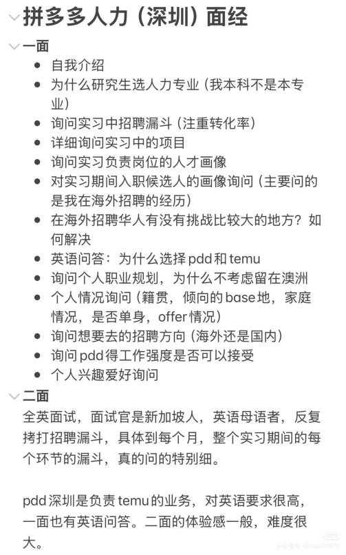

#### OCR 原文

拼多多人力深圳面经：自我介绍；为什么研究生选择 HR；招聘漏斗和转化率；实习项目；人才画像；中美招聘差异；英文 why PDD/TEMU；职业规划、期望城市、薪资、工作强度和兴趣。

#### 清洗后文本

拼多多人力深圳面经重点包括自我介绍、转 HR 动机、招聘漏斗转化率、人才画像、跨文化招聘差异、英文表达、职业规划和工作强度接受度。

#### 结构化候选问答

- 岗位：人力资源专员
- 问题：人力资源岗位如何追问招聘漏斗、人才画像和候选人转化率？
- 回答要点：回答应覆盖招聘漏斗的关键节点，如简历来源、筛选、邀约、面试、offer、入职；说明每个节点的转化率如何统计，如何定位流失原因；人才画像需要结合岗位能力、行业背景、薪资期望、稳定性和地域意愿，不应只停留在关键词匹配。
- 复盘：该题考察候选人是否理解招聘不是简单找人，而是漏斗管理、数据复盘和人才画像沉淀。
- 能力：招聘流程理解、数据意识、人才画像、英文沟通
- 来源：02_1_image_001_ca167f3c35.jpeg

### 图片 2: 02_1_image_002_4a6e1e1d3f.jpeg

- 来源：`D:\apps\ai-interview_archive\2026-05-22\面试经历(1).docx`
- SHA256：`4a6e1e1d3fc6bf2a6563e2debb9916d1de819de2843ab659925b143011043e87`
- OCR 状态：`reused_manual_visual_ocr_by_hash`
- OCR 置信度：`0.8`
- 目标岗位：产品助理
- 审核状态：待核验
- 图片：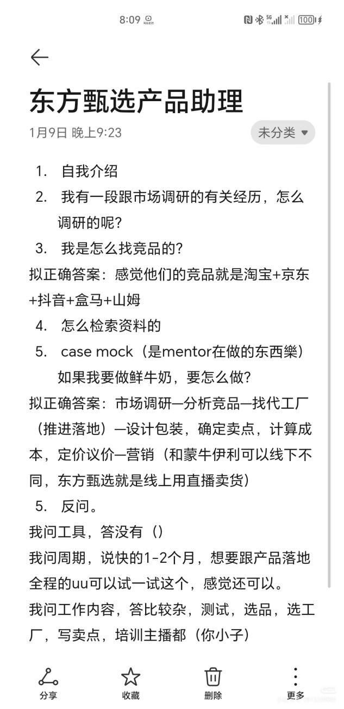

#### OCR 原文

东方甄选产品助理：自我介绍；市场调研经历；如何找竞品；淘宝、京东、抖音、盒马、山姆等竞品；以牛奶产品为例，如何做市场调研、竞品分析、工厂沟通、包装、卖点、成本、定价和营销；追问工具、周期和工作方式。

#### 清洗后文本

东方甄选产品助理面经强调市场调研、竞品分析、食品产品开发链路、供应商沟通、包装卖点、成本定价和营销方案。

#### 结构化候选问答

- 岗位：产品助理
- 问题：如果让你负责一款牛奶产品，从调研到上线你会怎么推进？
- 回答要点：先定义目标人群和消费场景，再做竞品调研，覆盖线上平台、线下商超和内容渠道；拆解竞品价格、规格、卖点、包装、渠道和评价；再与供应商或工厂确认成本、工艺、包装可行性；最后形成产品定位、价格带、卖点表达、上线节奏和营销测试方案。
- 复盘：产品助理不能只说会调研，要能把调研结果转成产品定义、成本约束和上线动作。
- 能力：市场调研、竞品分析、产品定义、供应链沟通
- 来源：02_1_image_002_4a6e1e1d3f.jpeg

### 图片 3: 02_1_image_003_8168c380ff.jpeg

- 来源：`D:\apps\ai-interview_archive\2026-05-22\面试经历(1).docx`
- SHA256：`8168c380ff510dfa9fcceeda713ff44c295f8807c6cc2a40b27b88301619fdae`
- OCR 状态：`reused_manual_visual_ocr_by_hash`
- OCR 置信度：`0.78`
- 目标岗位：产品助理
- 审核状态：待核验
- 图片：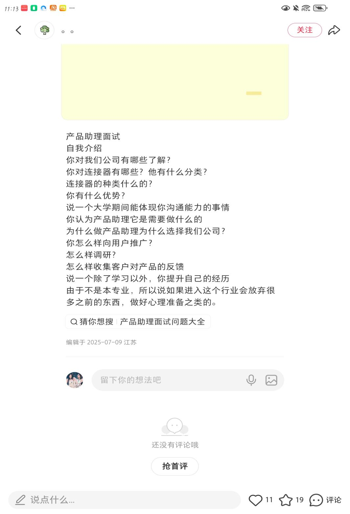

#### OCR 原文

产品助理面试问题：自我介绍；公司业务理解；连接器或产品模块理解；搭建模块和样例；优势；大学期间沟通经验；为什么做产品助理；如何收集客户反馈；如何做产品推广。

#### 清洗后文本

产品助理通用题覆盖公司理解、产品模块理解、沟通经验、客户反馈收集和产品推广。

#### 结构化候选问答

- 岗位：产品助理
- 问题：产品助理如何回答“你会怎样收集客户反馈并推动产品改进”？
- 回答要点：应说明反馈来源包括客服记录、用户访谈、问卷、数据看板、销售/实施同事反馈；再按频率、影响范围、业务价值和实现成本做优先级判断；最后形成问题清单、需求描述、验收标准和版本跟进，不只是简单收集意见。
- 复盘：该题重点考察候选人是否理解产品助理的闭环协作，而不是只会记录需求。
- 能力：用户反馈、需求整理、跨部门沟通、优先级判断
- 来源：02_1_image_003_8168c380ff.jpeg

### 图片 4: 02_1_image_004_4579e31167.jpeg

- 来源：`D:\apps\ai-interview_archive\2026-05-22\面试经历(1).docx`
- SHA256：`4579e311670b968904d69dce95b423fa4e42d4a62318de173a7fd56c6e97b958`
- OCR 状态：`ocr_unavailable`
- OCR 置信度：``
- 目标岗位：待人工确认
- 审核状态：待核验
- 图片：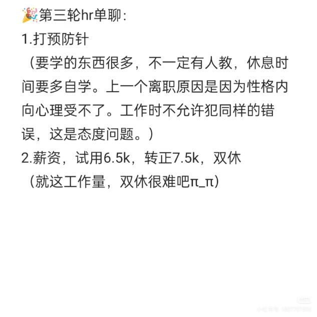

#### OCR 原文

（无 OCR 原文）

#### 清洗后文本

（无清洗文本）

#### 结构化候选问答

- 暂无可入库结构化问答。

### 图片 5: 02_1_image_005_f6cf0e1300.jpeg

- 来源：`D:\apps\ai-interview_archive\2026-05-22\面试经历(1).docx`
- SHA256：`f6cf0e13006beba84a69dc879a10c04375cf3198b6c2c45141ce1360c2e81349`
- OCR 状态：`reused_manual_visual_ocr_by_hash`
- OCR 置信度：`0.76`
- 目标岗位：产品助理
- 审核状态：待核验
- 图片：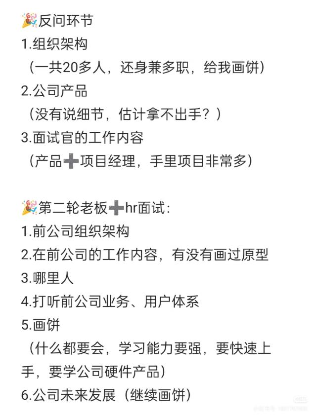

#### OCR 原文

产品助理第二轮老板和 HR 面：组织结构、公司产品、面试官工作内容、上一家公司业务、用户系统、是否画原型、未来规划、业务数据来源、需求变更、项目延期、业务方不了解设计、项目熟悉度、提前上线、最难问题、系统细节。

#### 清洗后文本

产品助理二面围绕业务理解、原型能力、数据来源、需求变更、项目延期和跨部门协同深挖。

#### 结构化候选问答

- 岗位：产品助理
- 问题：产品助理遇到需求变更和项目延期时应该怎么处理？
- 回答要点：先确认变更来源、业务目标和影响范围；评估对排期、开发成本、测试范围和上线风险的影响；将变更拆成必须项和可后置项；同步业务、设计、研发和测试重新确认优先级；保留会议纪要、需求版本和决策记录，避免口头变更失控。
- 复盘：该题适合追问候选人是否具备项目协同和风险控制意识。
- 能力：需求变更管理、项目协同、风险沟通
- 来源：02_1_image_005_f6cf0e1300.jpeg

### 图片 6: 02_1_image_006_549ac0cb3a.jpeg

- 来源：`D:\apps\ai-interview_archive\2026-05-22\面试经历(1).docx`
- SHA256：`549ac0cb3a49db20cd941a2ef5c31d8c8126f3ef1ddd91295d4b844eeb55d286`
- OCR 状态：`ocr_unavailable`
- OCR 置信度：``
- 目标岗位：待人工确认
- 审核状态：待核验
- 图片：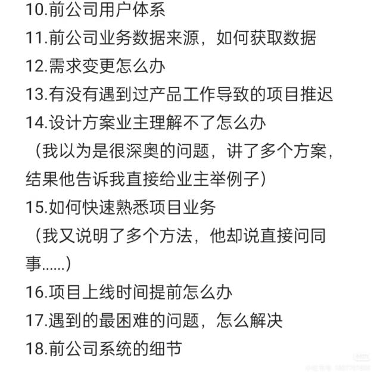

#### OCR 原文

（无 OCR 原文）

#### 清洗后文本

（无清洗文本）

#### 结构化候选问答

- 暂无可入库结构化问答。

### 图片 7: 02_1_image_007_b64670820c.jpeg

- 来源：`D:\apps\ai-interview_archive\2026-05-22\面试经历(1).docx`
- SHA256：`b64670820ce09fd889b51469cd7480d11477cb08a3931c681db54aa316ffdb8b`
- OCR 状态：`ocr_unavailable`
- OCR 置信度：``
- 目标岗位：待人工确认
- 审核状态：待核验
- 图片：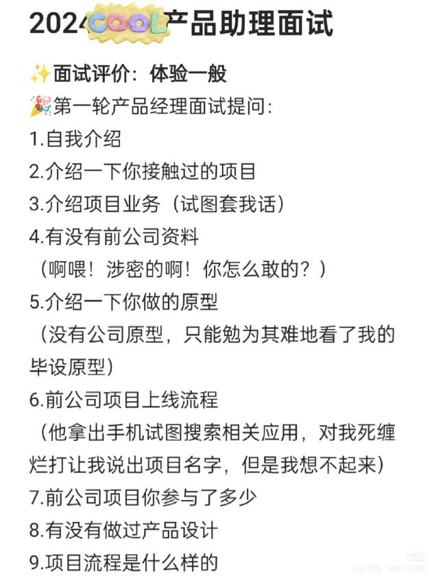

#### OCR 原文

（无 OCR 原文）

#### 清洗后文本

（无清洗文本）

#### 结构化候选问答

- 暂无可入库结构化问答。

### 图片 8: 02_1_image_008_65a50f2595.jpeg

- 来源：`D:\apps\ai-interview_archive\2026-05-22\面试经历(1).docx`
- SHA256：`65a50f259534f2ed755c6cb3814830401080b420019d6ee99ce59344e961a2db`
- OCR 状态：`reused_manual_visual_ocr_by_hash`
- OCR 置信度：`0.74`
- 目标岗位：产品助理
- 审核状态：仅参考
- 图片：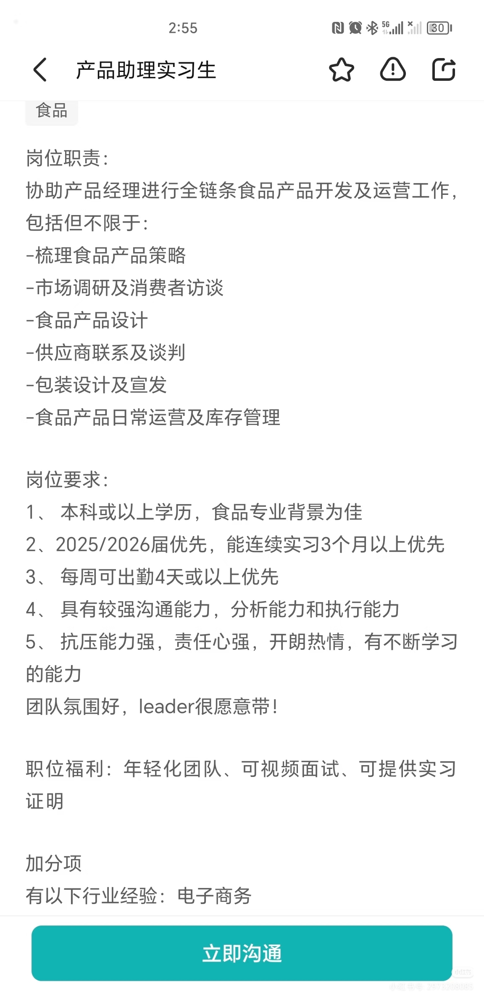

#### OCR 原文

食品产品助理 JD：负责食品产品开发和运营全链路，需求调研、策略、产品设计、供应商沟通、包装、推广、日常运营和库存；要求本科及以上、可长期实习、沟通强、分析执行力和责任心。

#### 清洗后文本

食品产品助理岗位画像参考：产品开发、需求调研、供应链沟通、包装推广、库存运营和执行力。

#### 结构化候选问答

- 岗位：产品助理
- 问题：食品产品助理岗位通常会考察哪些能力？
- 回答要点：重点考察用户和市场调研、产品设计、供应商或工厂沟通、包装卖点、推广计划、库存和日常运营意识，以及执行力、沟通能力和抗压能力。
- 复盘：该图片更接近岗位 JD，可作为岗位要求参考，不应当作真实面试问答。
- 能力：岗位要求理解、产品运营、供应链沟通
- 来源：02_1_image_008_65a50f2595.jpeg

### 图片 9: 02_1_image_009_b600a16cb1.jpeg

- 来源：`D:\apps\ai-interview_archive\2026-05-22\面试经历(1).docx`
- SHA256：`b600a16cb196ffb46befb67524c22bb36521acbbe6516e9d030e66ae3510350b`
- OCR 状态：`ocr_unavailable`
- OCR 置信度：``
- 目标岗位：待人工确认
- 审核状态：待核验
- 图片：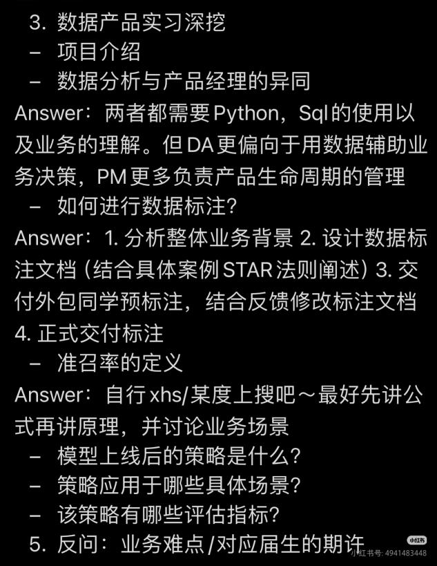

#### OCR 原文

（无 OCR 原文）

#### 清洗后文本

（无清洗文本）

#### 结构化候选问答

- 暂无可入库结构化问答。

### 图片 10: 02_1_image_010_f5f1831ced.jpeg

- 来源：`D:\apps\ai-interview_archive\2026-05-22\面试经历(1).docx`
- SHA256：`f5f1831ced4ca24ee0bbce7b5f1e9fb3043a2d37218c8bb0601a3f4709cb15d0`
- OCR 状态：`ocr_unavailable`
- OCR 置信度：``
- 目标岗位：待人工确认
- 审核状态：待核验
- 图片：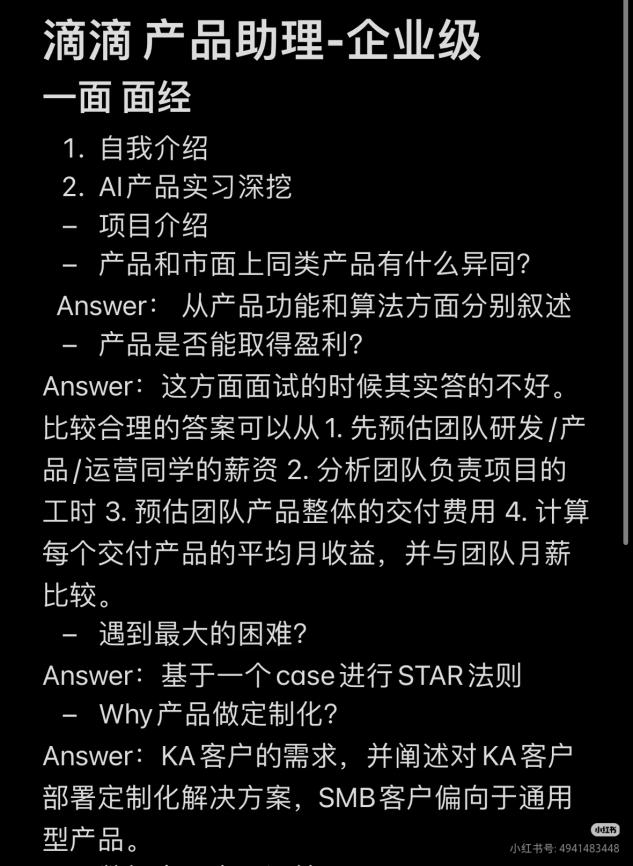

#### OCR 原文

（无 OCR 原文）

#### 清洗后文本

（无清洗文本）

#### 结构化候选问答

- 暂无可入库结构化问答。

### 图片 11: 02_1_image_011_ecc9f1b330.jpeg

- 来源：`D:\apps\ai-interview_archive\2026-05-22\面试经历(1).docx`
- SHA256：`ecc9f1b330e6e30a7fe84e9f1024ce0690d5748fafed1eef8799cd966c0c4c4c`
- OCR 状态：`ocr_unavailable`
- OCR 置信度：``
- 目标岗位：待人工确认
- 审核状态：待核验
- 图片：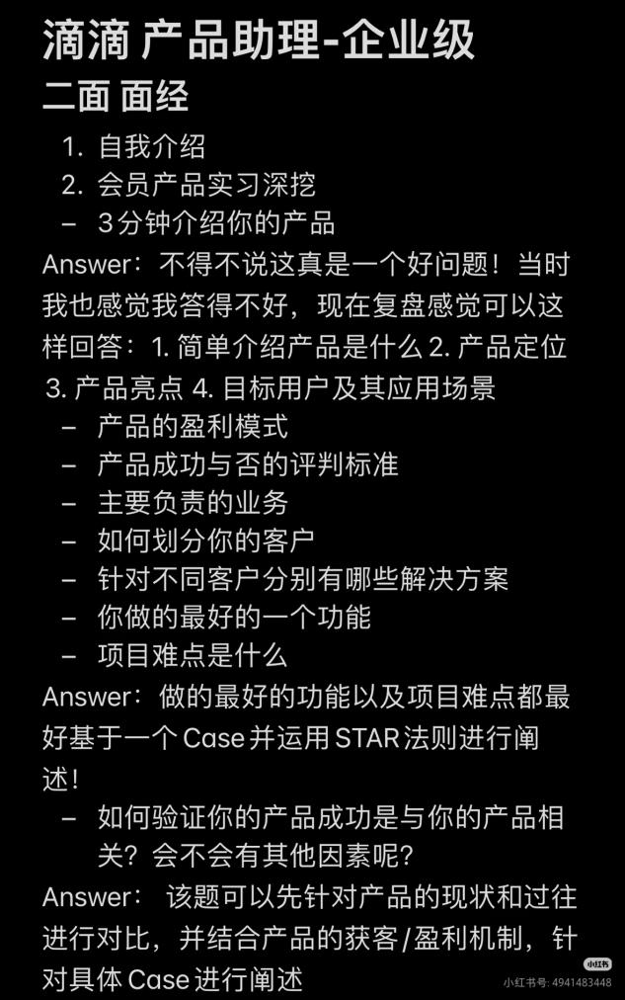

#### OCR 原文

（无 OCR 原文）

#### 清洗后文本

（无清洗文本）

#### 结构化候选问答

- 暂无可入库结构化问答。

### 图片 12: 02_1_image_012_27ea56a180.jpeg

- 来源：`D:\apps\ai-interview_archive\2026-05-22\面试经历(1).docx`
- SHA256：`27ea56a18009f909e1c5722cf716bca70010f4c0e56290a2be2b011eb3057743`
- OCR 状态：`reused_manual_visual_ocr_by_hash`
- OCR 置信度：`0.78`
- 目标岗位：人力资源专员
- 审核状态：待核验
- 图片：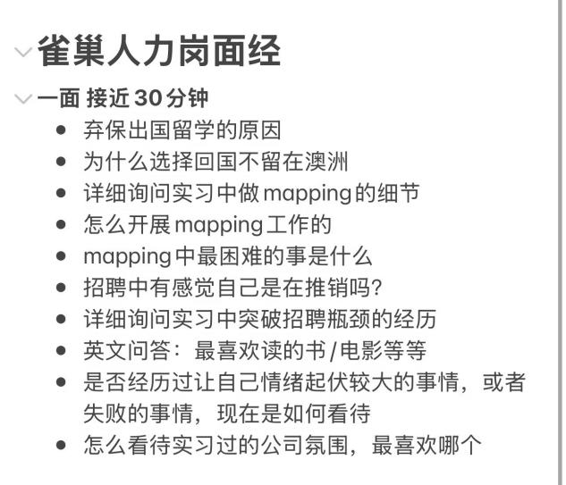

#### OCR 原文

雀巢人力岗面经：为什么放弃留学；为什么回国；mapping 细节；招聘渠道；数据对比；职业规划；竞品公司组织架构；电话吸引候选人；mapping 流程；竞品薪酬和候选人问题；招聘流程优化；导师评价；排期；工作强度；案例；笔试；游戏；信息来源。

#### 清洗后文本

雀巢 HR 面经重点包括 mapping、渠道、数据对比、竞品组织架构、候选人吸引、招聘流程优化和工作强度。

#### 结构化候选问答

- 岗位：人力资源专员
- 问题：HR 面试中如何说明人才 mapping 的流程和价值？
- 回答要点：回答应包括目标岗位定义、竞品公司和组织架构梳理、候选人来源渠道、候选人信息校验、薪酬和意愿判断、联系话术、过程记录和数据复盘；价值在于提前建立人才池、提高招聘效率并支持岗位画像迭代。
- 复盘：该题考察招聘研究和候选人触达能力，适合追问真实项目细节。
- 能力：人才 mapping、招聘渠道、候选人吸引、流程优化
- 来源：02_1_image_012_27ea56a180.jpeg

### 图片 13: 02_1_image_013_4aea604a3f.jpeg

- 来源：`D:\apps\ai-interview_archive\2026-05-22\面试经历(1).docx`
- SHA256：`4aea604a3fa3ce7440e7cad39fcd43c3228a50a28e95b4b01825356ad23a7c50`
- OCR 状态：`ocr_unavailable`
- OCR 置信度：``
- 目标岗位：待人工确认
- 审核状态：待核验
- 图片：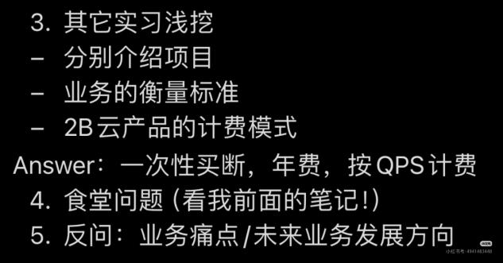

#### OCR 原文

（无 OCR 原文）

#### 清洗后文本

（无清洗文本）

#### 结构化候选问答

- 暂无可入库结构化问答。

### 图片 14: 02_1_image_014_90a29e7dd1.jpeg

- 来源：`D:\apps\ai-interview_archive\2026-05-22\面试经历(1).docx`
- SHA256：`90a29e7dd15841e426c29b2389770f82caa3045c7ee64bf843510832c4847563`
- OCR 状态：`ocr_unavailable`
- OCR 置信度：``
- 目标岗位：待人工确认
- 审核状态：待核验
- 图片：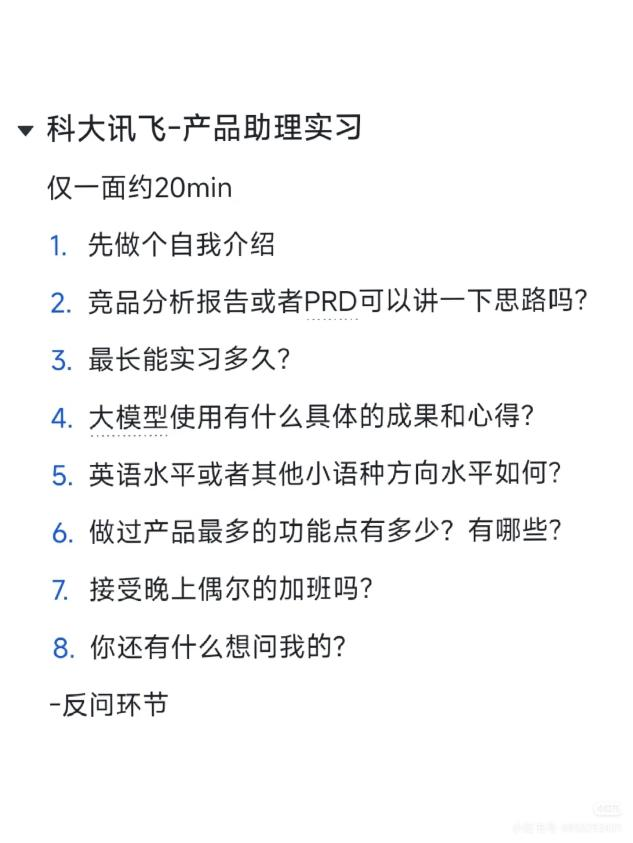

#### OCR 原文

（无 OCR 原文）

#### 清洗后文本

（无清洗文本）

#### 结构化候选问答

- 暂无可入库结构化问答。

### 图片 15: 02_1_image_015_cdedfd59ba.jpeg

- 来源：`D:\apps\ai-interview_archive\2026-05-22\面试经历(1).docx`
- SHA256：`cdedfd59ba8c0589911f82c0ffaf90685077cb25114ba21a8d333910e178bc9d`
- OCR 状态：`ocr_unavailable`
- OCR 置信度：``
- 目标岗位：待人工确认
- 审核状态：待核验
- 图片：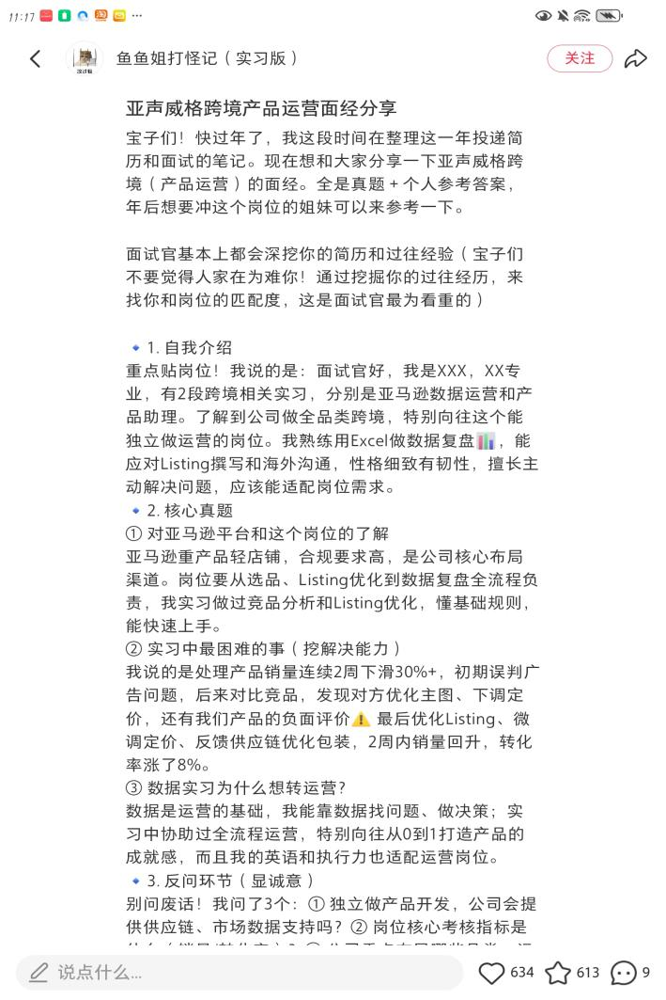

#### OCR 原文

（无 OCR 原文）

#### 清洗后文本

（无清洗文本）

#### 结构化候选问答

- 暂无可入库结构化问答。

### 图片 16: 02_1_image_016_69c4088a9f.jpeg

- 来源：`D:\apps\ai-interview_archive\2026-05-22\面试经历(1).docx`
- SHA256：`69c4088a9f3e0b16c827ad38be96fafc82f610188529526271e23b13a6060365`
- OCR 状态：`ocr_unavailable`
- OCR 置信度：``
- 目标岗位：待人工确认
- 审核状态：待核验
- 图片：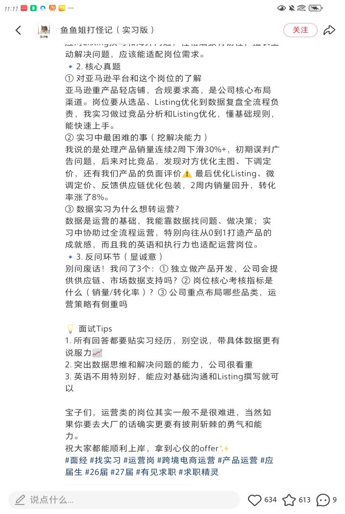

#### OCR 原文

（无 OCR 原文）

#### 清洗后文本

（无清洗文本）

#### 结构化候选问答

- 暂无可入库结构化问答。

### 图片 17: 02_1_image_017_36f85f8bb9.jpeg

- 来源：`D:\apps\ai-interview_archive\2026-05-22\面试经历(1).docx`
- SHA256：`36f85f8bb943adebd1469ed5e204e5c6c9596bee0c12d5661a78538e9ecddadf`
- OCR 状态：`ocr_unavailable`
- OCR 置信度：``
- 目标岗位：待人工确认
- 审核状态：待核验
- 图片：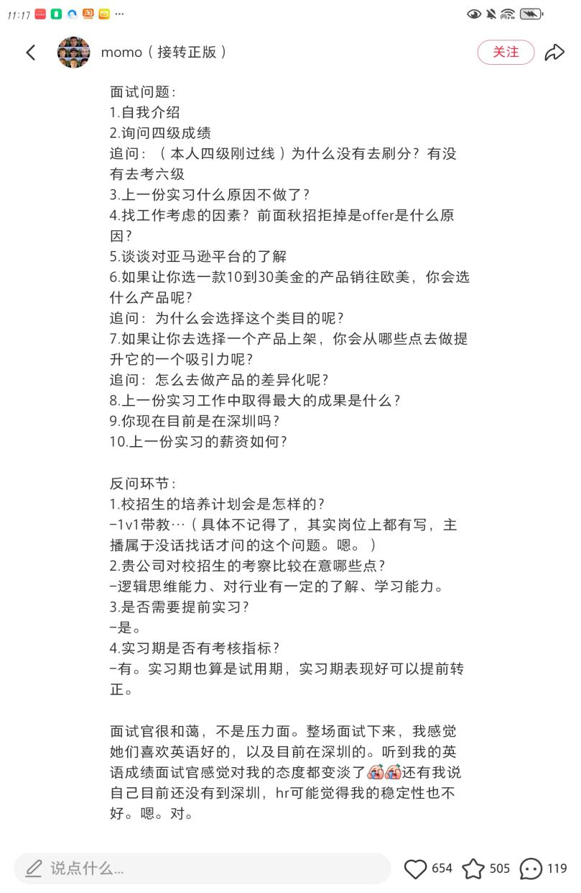

#### OCR 原文

（无 OCR 原文）

#### 清洗后文本

（无清洗文本）

#### 结构化候选问答

- 暂无可入库结构化问答。

### 图片 18: 02_1_image_018_06d67e5a9b.jpeg

- 来源：`D:\apps\ai-interview_archive\2026-05-22\面试经历(1).docx`
- SHA256：`06d67e5a9b552c893baf4f0a17b54a2991ee6885fcab2782d230c96de5d281a6`
- OCR 状态：`reused_manual_visual_ocr_by_hash`
- OCR 置信度：`0.76`
- 目标岗位：运营助理
- 审核状态：待核验
- 图片：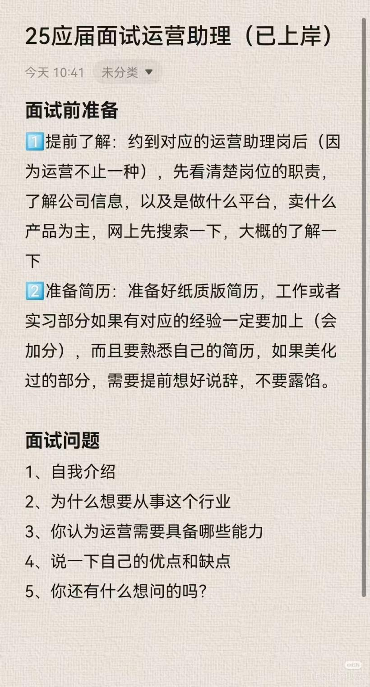

#### OCR 原文

运营助理应届面试：提前了解岗位、公司、平台和产品；准备简历；面试题包括自我介绍、为什么选择行业、运营需要哪些能力、个人优缺点、反问面试官。

#### 清洗后文本

运营助理基础面试重点是岗位认知、行业动机、运营能力模型和个人优劣势。

#### 结构化候选问答

- 岗位：运营助理
- 问题：运营助理岗位需要哪些基础能力？
- 回答要点：通常包括用户理解、数据意识、活动执行、内容或渠道运营、沟通协作、复盘能力和抗压执行力；回答时应结合自己做过的活动、社群、内容、数据分析或项目经历，而不是只列能力词。
- 复盘：该题适合作为运营助理 easy 难度基础题。
- 能力：岗位认知、运营基础、执行力、复盘意识
- 来源：02_1_image_018_06d67e5a9b.jpeg

### 图片 19: 02_1_image_019_f8d274f3fb.jpeg

- 来源：`D:\apps\ai-interview_archive\2026-05-22\面试经历(1).docx`
- SHA256：`f8d274f3fb0c83302781de94a5a7420865b03d7b25e79c0dcdc352a4d433d589`
- OCR 状态：`reused_manual_visual_ocr_by_hash`
- OCR 置信度：`0.74`
- 目标岗位：运营助理
- 审核状态：待核验
- 图片：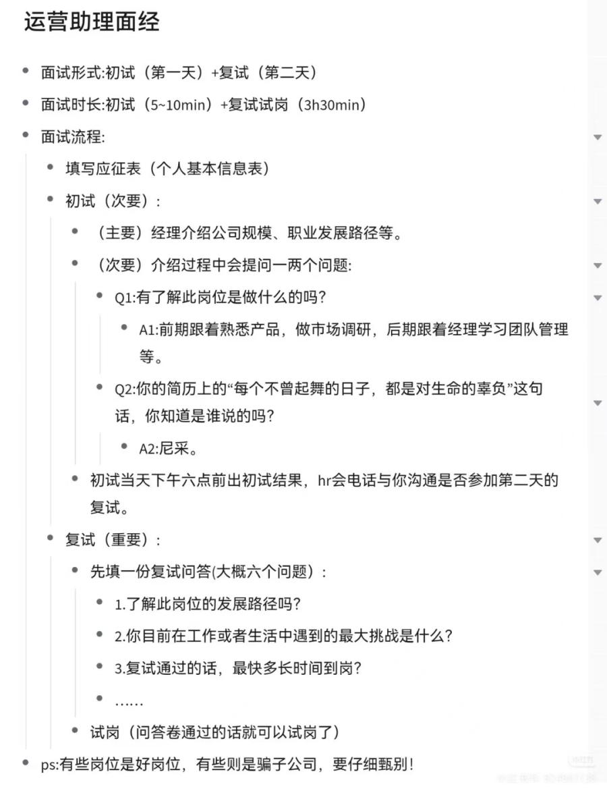

#### OCR 原文

运营助理面经：初面和复试；岗位理解；前期学习产品、市场调研，后期协助经理做团队管理；职业路径；最大挑战；到岗时间和试用；提醒警惕不正规公司。

#### 清洗后文本

运营助理面经关注岗位理解、产品学习、市场调研、团队协作、职业路径和最大挑战。

#### 结构化候选问答

- 岗位：运营助理
- 问题：你如何理解运营助理的工作内容和成长路径？
- 回答要点：前期通常以了解产品、用户、渠道和数据为主，承担基础执行、活动支持、数据整理和市场调研；随着熟悉业务，可参与方案制定、流程优化、复盘分析和团队协作管理。回答要体现先执行、再复盘、再优化的成长逻辑。
- 复盘：该题用于判断候选人是否把运营理解为长期业务增长工作，而不是简单打杂。
- 能力：岗位理解、职业规划、市场调研、团队协作
- 来源：02_1_image_019_f8d274f3fb.jpeg

### 图片 20: 02_1_image_020_3feb238ed1.jpeg

- 来源：`D:\apps\ai-interview_archive\2026-05-22\面试经历(1).docx`
- SHA256：`3feb238ed1be3f6b4eeace5148ac9b96d7d534d5e8891acbd983a04f6e59dc65`
- OCR 状态：`reused_manual_visual_ocr_by_hash`
- OCR 置信度：`0.76`
- 目标岗位：运营助理
- 审核状态：待核验
- 图片：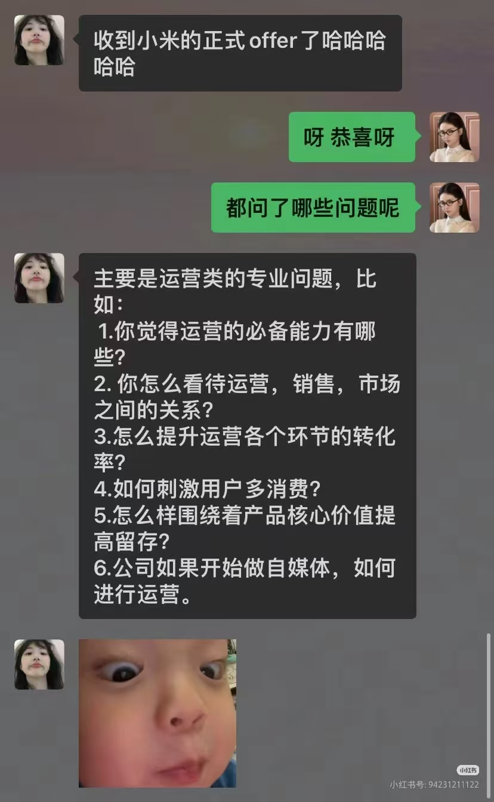

#### OCR 原文

运营面试常见问题：运营需要什么能力；运营、销售、市场之间的关系；如何提高转化率；如何刺激复购；围绕产品核心价值提高留存；如果公司开始做自媒体应该如何运营。

#### 清洗后文本

运营通用题覆盖转化、复购、留存、自媒体和运营与销售市场关系。

#### 结构化候选问答

- 岗位：运营助理
- 问题：如何围绕产品核心价值提高用户留存和复购？
- 回答要点：先明确产品核心价值和用户使用场景，再识别用户流失节点；通过新手引导、内容或活动触达、权益设计、社群维护、个性化推荐、售后体验和复购激励提高留存；需要用留存率、复购率、转化率和用户反馈验证效果。
- 复盘：该题适合中等难度运营追问，要求从动作回到指标验证。
- 能力：用户留存、复购、转化率、活动运营
- 来源：02_1_image_020_3feb238ed1.jpeg

### 图片 21: 02_1_image_021_049d45d2dc.jpeg

- 来源：`D:\apps\ai-interview_archive\2026-05-22\面试经历(1).docx`
- SHA256：`049d45d2dc4049b211818e15510d686608cb3f2effdd0e858ddee66980dd8022`
- OCR 状态：`reused_manual_visual_ocr_by_hash`
- OCR 置信度：`0.76`
- 目标岗位：运营助理
- 审核状态：待核验
- 图片：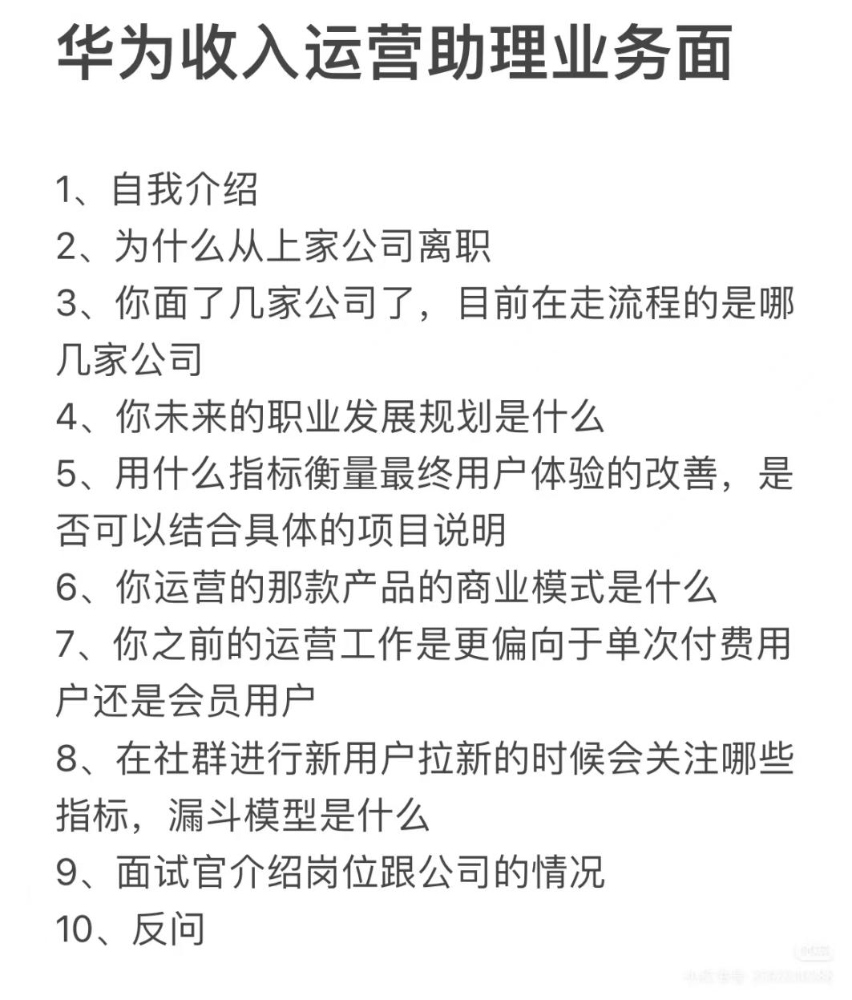

#### OCR 原文

华为收入运营助理业务面：自我介绍；为什么离开上一家公司；当前面试进度；职业规划；用户体验改善指标和项目案例；运营产品业务模式；上份工作一次性收费还是会员；社区获客指标和漏斗模型；反问。

#### 清洗后文本

收入运营助理面试关注业务模式、用户体验指标、获客漏斗、收费模式和职业规划。

#### 结构化候选问答

- 岗位：运营助理
- 问题：运营助理如何用漏斗模型分析社区获客效果？
- 回答要点：可以按曝光、点击、注册、激活、留存、付费或转介绍拆分漏斗；每个节点看转化率和流失原因，再针对内容、渠道、活动、产品体验或权益设计提出优化；要说明指标口径和数据来源。
- 复盘：该题考察运营数据化表达和业务模式理解。
- 能力：获客漏斗、业务模式、用户体验指标、数据分析
- 来源：02_1_image_021_049d45d2dc.jpeg

### 图片 22: 02_1_image_022_dd2f7b07cb.jpeg

- 来源：`D:\apps\ai-interview_archive\2026-05-22\面试经历(1).docx`
- SHA256：`dd2f7b07cb7199581c0eb7eee83340186bb4a2805bed0269e2986c90014ec31e`
- OCR 状态：`reused_manual_visual_ocr_by_hash`
- OCR 置信度：`0.75`
- 目标岗位：运营助理
- 审核状态：待核验
- 图片：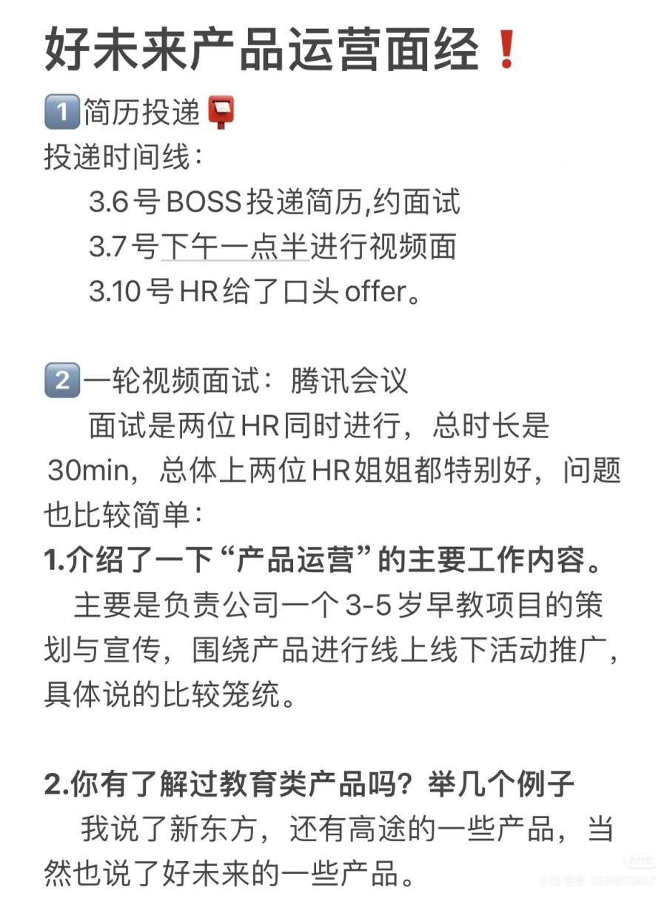

#### OCR 原文

好未来产品运营面经：产品运营工作面向 3-5 岁早教项目推广；了解教育产品；如何用视频或图文推广早教课；公域和私域流量；如何面向 3-5 岁产品做大规模推广；通勤、地点、工作时间和反问。

#### 清洗后文本

教育产品运营面试关注早教产品推广、视频/图文内容、公域私域流量和用户触达。

#### 结构化候选问答

- 岗位：运营助理
- 问题：教育产品运营如何设计 3-5 岁早教课程的推广方案？
- 回答要点：先明确购买者是家长、使用者是儿童，内容要突出安全、兴趣、成长效果和陪伴场景；公域可用短视频、图文种草和直播，私域可用社群、试听课、打卡和案例反馈；需要用线索量、试听转化、留存和复购衡量效果。
- 复盘：该题考察产品运营对用户角色、内容形式和转化链路的理解。
- 能力：教育产品运营、公域私域、内容推广、转化设计
- 来源：02_1_image_022_dd2f7b07cb.jpeg

### 图片 23: 02_1_image_023_3a189c158d.jpeg

- 来源：`D:\apps\ai-interview_archive\2026-05-22\面试经历(1).docx`
- SHA256：`3a189c158d65af8e32861e65700e0cca3cab3d1232f8582ae7f9bf629a3e4607`
- OCR 状态：`ocr_unavailable`
- OCR 置信度：``
- 目标岗位：待人工确认
- 审核状态：待核验
- 图片：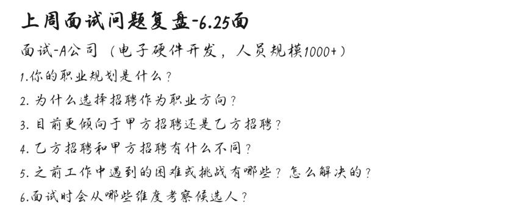

#### OCR 原文

（无 OCR 原文）

#### 清洗后文本

（无清洗文本）

#### 结构化候选问答

- 暂无可入库结构化问答。

### 图片 24: 02_1_image_024_9b3bf297f1.jpeg

- 来源：`D:\apps\ai-interview_archive\2026-05-22\面试经历(1).docx`
- SHA256：`9b3bf297f15283943dac2015c70a3b1b330e8f01105ed1c7e8186b5eb2261cca`
- OCR 状态：`ocr_unavailable`
- OCR 置信度：``
- 目标岗位：待人工确认
- 审核状态：待核验
- 图片：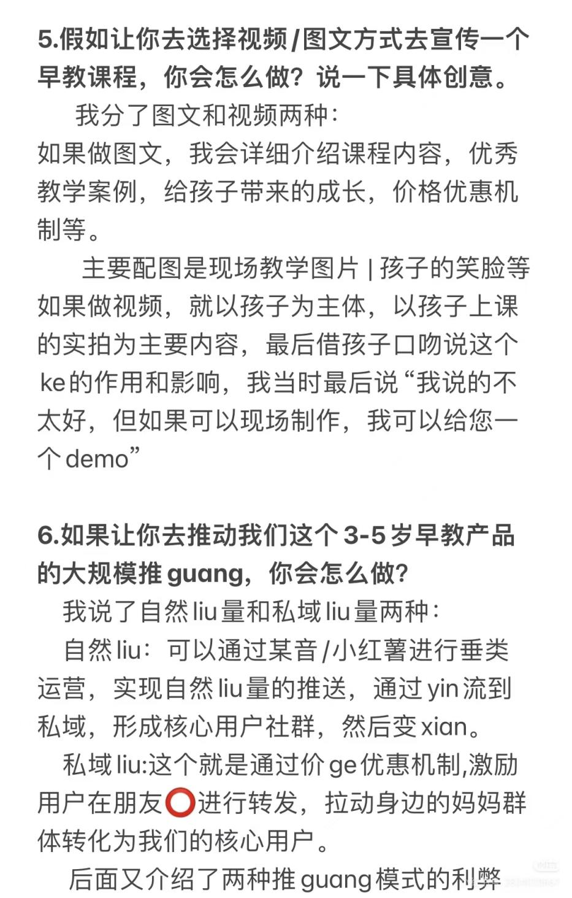

#### OCR 原文

（无 OCR 原文）

#### 清洗后文本

（无清洗文本）

#### 结构化候选问答

- 暂无可入库结构化问答。

### 图片 25: 02_1_image_025_4bb90eff0f.jpeg

- 来源：`D:\apps\ai-interview_archive\2026-05-22\面试经历(1).docx`
- SHA256：`4bb90eff0f7abe04ef8002cb68558af636b2f97913bdc330d783159fb9f7c60c`
- OCR 状态：`ocr_unavailable`
- OCR 置信度：``
- 目标岗位：待人工确认
- 审核状态：待核验
- 图片：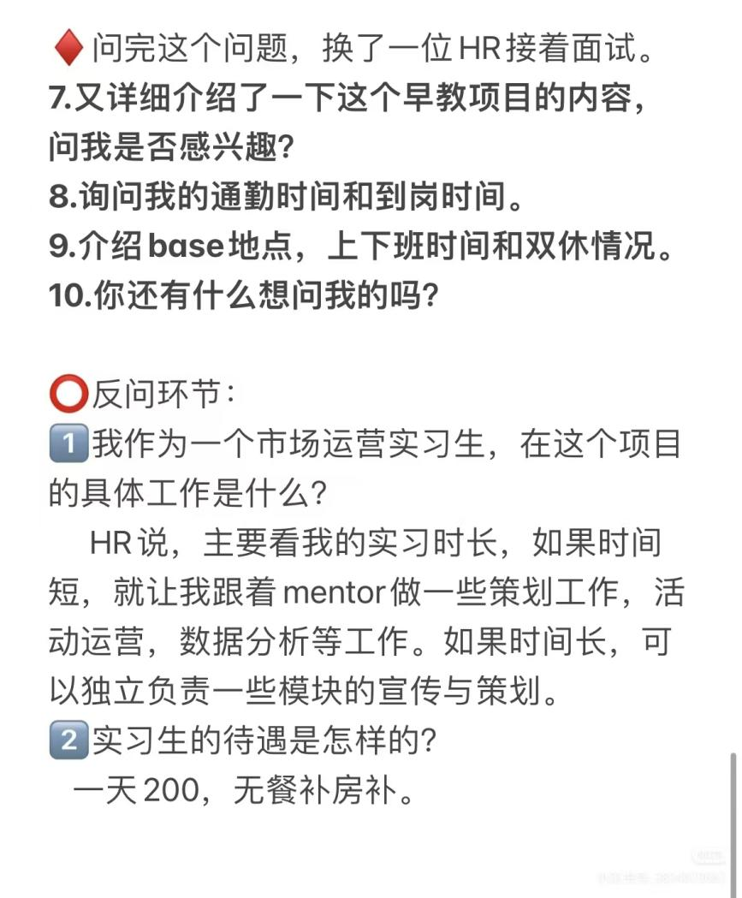

#### OCR 原文

（无 OCR 原文）

#### 清洗后文本

（无清洗文本）

#### 结构化候选问答

- 暂无可入库结构化问答。

### 图片 26: 02_1_image_026_47e50fdf16.jpeg

- 来源：`D:\apps\ai-interview_archive\2026-05-22\面试经历(1).docx`
- SHA256：`47e50fdf16f625db0269f7f733ebbb7c6ba76d55c48bb238fdea07576977870b`
- OCR 状态：`ocr_unavailable`
- OCR 置信度：``
- 目标岗位：待人工确认
- 审核状态：待核验
- 图片：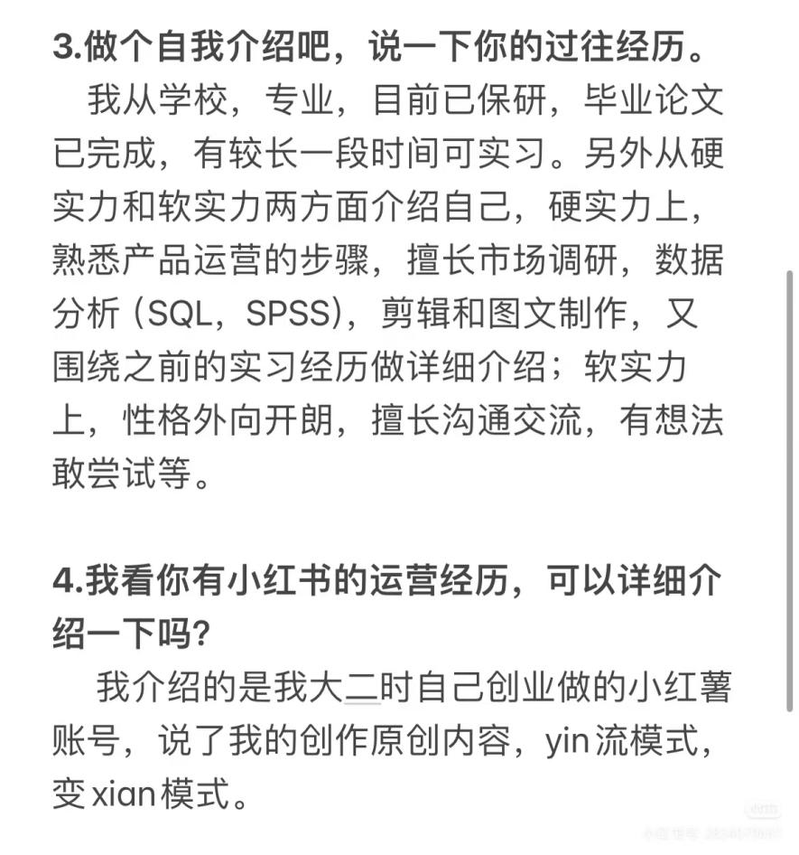

#### OCR 原文

（无 OCR 原文）

#### 清洗后文本

（无清洗文本）

#### 结构化候选问答

- 暂无可入库结构化问答。

### 图片 27: 02_1_image_027_a2b8966e7c.jpeg

- 来源：`D:\apps\ai-interview_archive\2026-05-22\面试经历(1).docx`
- SHA256：`a2b8966e7c1e2f91e0efa2a543654aca1dad730eedcd24e8d405b286737c07bb`
- OCR 状态：`ocr_unavailable`
- OCR 置信度：``
- 目标岗位：待人工确认
- 审核状态：待核验
- 图片：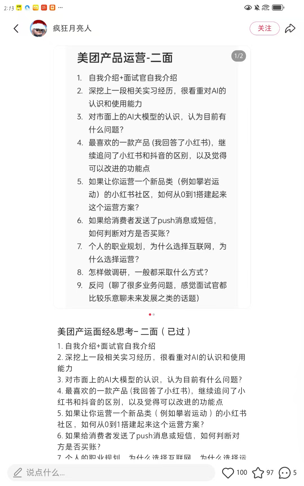

#### OCR 原文

（无 OCR 原文）

#### 清洗后文本

（无清洗文本）

#### 结构化候选问答

- 暂无可入库结构化问答。

### 图片 28: 02_1_image_028_73d64e01fb.jpeg

- 来源：`D:\apps\ai-interview_archive\2026-05-22\面试经历(1).docx`
- SHA256：`73d64e01fbc0dea4dacff6b16a5f11fd9505b90580fe9e78cbce164c8ef922d6`
- OCR 状态：`reused_manual_visual_ocr_by_hash`
- OCR 置信度：`0.76`
- 目标岗位：运营助理
- 审核状态：待核验
- 图片：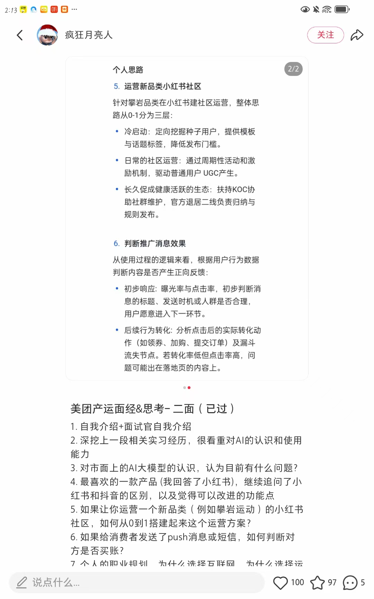

#### OCR 原文

美团产品运营二面：自我介绍；AI 知识；喜欢的产品小红书和抖音区别；新品类运营计划；push 和短信购买判断；职业规划和为什么互联网；市场调研；反问。总结：未来规划和个人规划会被问。

#### 清洗后文本

美团产品运营二面重点围绕产品理解、AI 知识、新品类运营、触达渠道、职业规划和市场调研。

#### 结构化候选问答

- 岗位：运营助理
- 问题：运营面试中如何比较小红书和抖音的产品差异？
- 回答要点：可以从用户动机、内容形态、分发机制、消费决策链路、社区氛围、商业化方式和适合的运营目标来比较。小红书偏种草和决策参考，抖音偏内容消费和即时转化；回答要结合具体品类和运营目标，而不是简单说一个图文一个视频。
- 复盘：该题考察候选人的产品观察和运营策略迁移能力。
- 能力：产品分析、运营策略、渠道触达、AI 认知
- 来源：02_1_image_028_73d64e01fb.jpeg

### 图片 29: 02_1_image_029_b724954563.jpeg

- 来源：`D:\apps\ai-interview_archive\2026-05-22\面试经历(1).docx`
- SHA256：`b724954563cbe5e21ef87e25b6595acf1d3fca09bf5429357aa8c03a352f44b8`
- OCR 状态：`reused_manual_visual_ocr_by_hash`
- OCR 置信度：`0.74`
- 目标岗位：运营助理
- 审核状态：待核验
- 图片：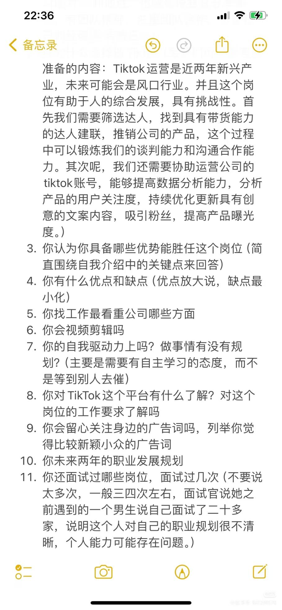

#### OCR 原文

TikTok 运营助理面试经验：自我介绍；为什么选择 TikTok 运营；岗位需要达人筛选、达人沟通、账号运营、数据分析、广告文案和品牌曝光；优势缺点；公司看重什么；视频剪辑；自我驱动力；了解 TikTok；广告词；未来两年规划；面试过哪些岗位和次数。

#### 清洗后文本

TikTok 运营助理面试重点是达人沟通、内容运营、数据分析、广告文案、品牌曝光、自驱力和职业规划。

#### 结构化候选问答

- 岗位：运营助理
- 问题：TikTok 运营助理如何回答达人筛选和账号运营能力？
- 回答要点：应说明如何根据目标用户、内容风格、粉丝画像、互动率、转化潜力和品牌匹配度筛选达人；账号运营需要结合内容选题、发布时间、互动数据、热点趋势、广告文案和转化指标持续优化。
- 复盘：该题适合短视频/跨境内容运营方向，强调数据和内容双能力。
- 能力：达人运营、内容运营、数据分析、品牌曝光
- 来源：02_1_image_029_b724954563.jpeg

### 图片 30: 02_1_image_030_f0a0726340.jpeg

- 来源：`D:\apps\ai-interview_archive\2026-05-22\面试经历(1).docx`
- SHA256：`f0a07263408b5e322ab8964c597d73990c9a5a3cab532ecc6ac8bf0956829e48`
- OCR 状态：`ocr_unavailable`
- OCR 置信度：``
- 目标岗位：待人工确认
- 审核状态：待核验
- 图片：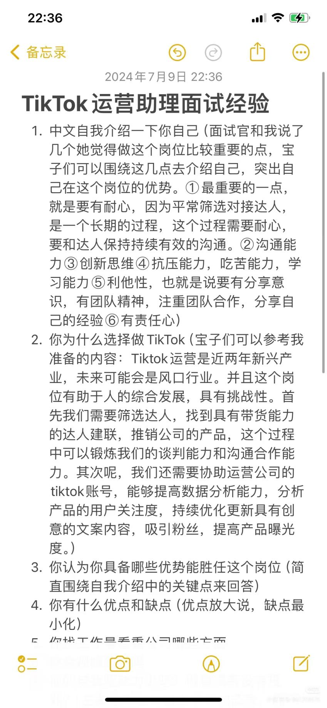

#### OCR 原文

（无 OCR 原文）

#### 清洗后文本

（无清洗文本）

#### 结构化候选问答

- 暂无可入库结构化问答。

### 图片 31: 02_1_image_031_7a5351997b.jpeg

- 来源：`D:\apps\ai-interview_archive\2026-05-22\面试经历(1).docx`
- SHA256：`7a5351997bd0a543c3041bbe3bbf72284661f96b28698ffb536c9fdf794c9bba`
- OCR 状态：`ocr_unavailable`
- OCR 置信度：``
- 目标岗位：待人工确认
- 审核状态：待核验
- 图片：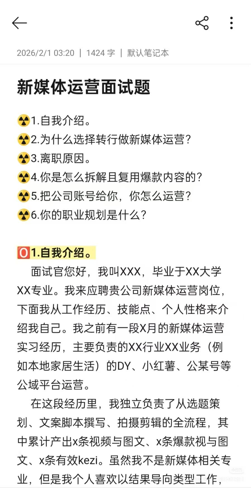

#### OCR 原文

（无 OCR 原文）

#### 清洗后文本

（无清洗文本）

#### 结构化候选问答

- 暂无可入库结构化问答。

### 图片 32: 02_1_image_032_336227ba6e.jpeg

- 来源：`D:\apps\ai-interview_archive\2026-05-22\面试经历(1).docx`
- SHA256：`336227ba6ebd2a19b9725d3aba01c2de8a283fd34590d8b58db90510529afe87`
- OCR 状态：`ocr_unavailable`
- OCR 置信度：``
- 目标岗位：待人工确认
- 审核状态：待核验
- 图片：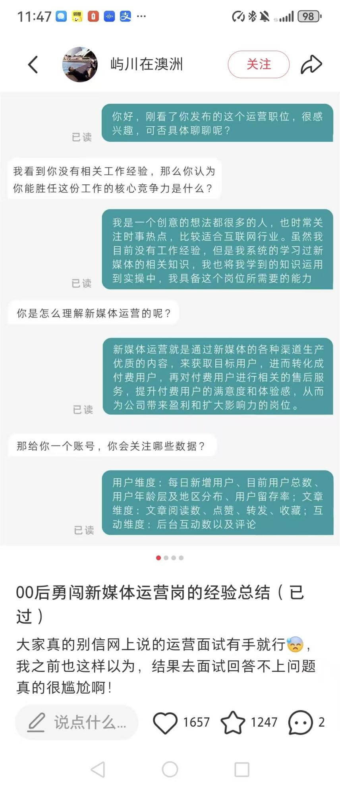

#### OCR 原文

（无 OCR 原文）

#### 清洗后文本

（无清洗文本）

#### 结构化候选问答

- 暂无可入库结构化问答。

### 图片 33: 02_1_image_033_4ca75d4261.jpeg

- 来源：`D:\apps\ai-interview_archive\2026-05-22\面试经历(1).docx`
- SHA256：`4ca75d4261453c496a70f2968c9c4c551d4286f8621d42a75df466c0ccb0df2c`
- OCR 状态：`ocr_unavailable`
- OCR 置信度：``
- 目标岗位：待人工确认
- 审核状态：待核验
- 图片：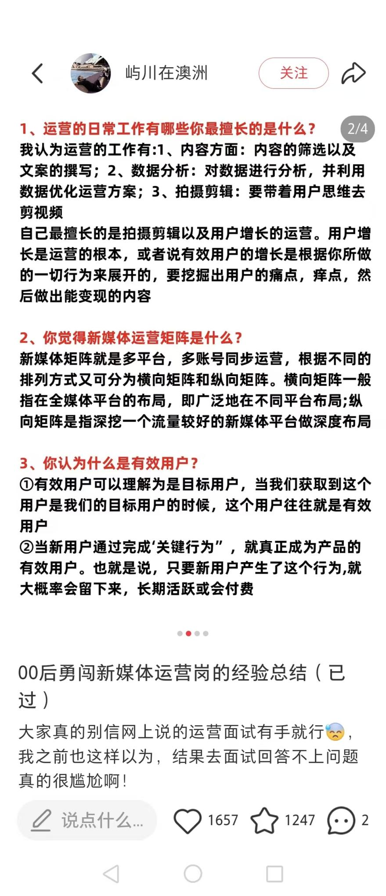

#### OCR 原文

（无 OCR 原文）

#### 清洗后文本

（无清洗文本）

#### 结构化候选问答

- 暂无可入库结构化问答。

### 图片 34: 02_1_image_034_2e04f2be9f.jpeg

- 来源：`D:\apps\ai-interview_archive\2026-05-22\面试经历(1).docx`
- SHA256：`2e04f2be9fd228a4ee2bdf8d40b762fafbb3ea0b3e28c836639f98206fb0d69a`
- OCR 状态：`reused_manual_visual_ocr_by_hash`
- OCR 置信度：`0.78`
- 目标岗位：人力资源专员
- 审核状态：待核验
- 图片：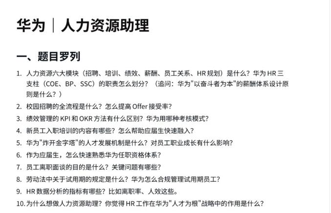

#### OCR 原文

华为人力资源助理：HR 六大模块；华为 HR 三支柱 COE/BP/SSC；校园招聘录用率；绩效考核指标；入职培训；人才发展机制；校园大使招募；劳动法试用期；HR 数据分析指标；为什么选择华为和人力资源助理。

#### 清洗后文本

华为 HR 助理题目覆盖 HR 模块、三支柱、校招、绩效、培训、人才发展、劳动法和 HR 数据分析。

#### 结构化候选问答

- 岗位：人力资源专员
- 问题：HR 面试中如何解释 COE、BP、SSC 三支柱分工？
- 回答要点：COE 负责制度、政策和专业方案设计；BP 贴近业务，理解业务目标并推动组织和人才问题解决；SSC 提供标准化、流程化和共享服务。回答时可结合招聘、绩效、培训或员工关系举例说明三者如何协同。
- 复盘：该题适合基础 HR 岗位，考察体系化认知和业务协作理解。
- 能力：HR 三支柱、绩效培训、劳动法、数据分析
- 来源：02_1_image_034_2e04f2be9f.jpeg

### 图片 35: 02_1_image_035_48ada8b64d.jpeg

- 来源：`D:\apps\ai-interview_archive\2026-05-22\面试经历(1).docx`
- SHA256：`48ada8b64d562f8503ab9d071943feddd28cdbc5df9a59d9d399c7f7164ac72c`
- OCR 状态：`ocr_unavailable`
- OCR 置信度：``
- 目标岗位：待人工确认
- 审核状态：待核验
- 图片：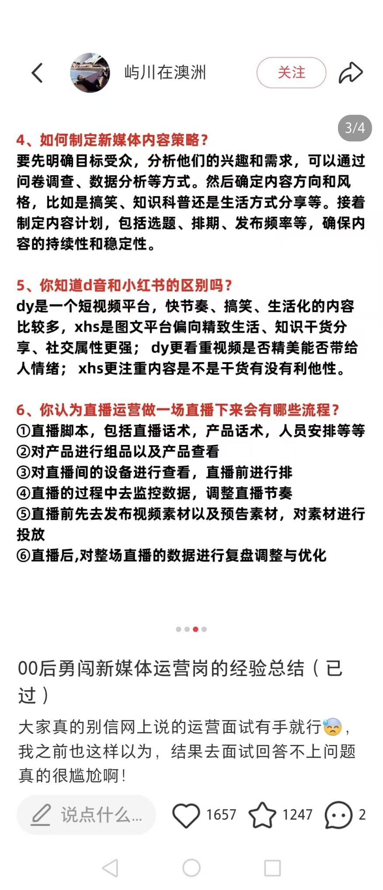

#### OCR 原文

（无 OCR 原文）

#### 清洗后文本

（无清洗文本）

#### 结构化候选问答

- 暂无可入库结构化问答。

### 图片 36: 02_1_image_036_f33d1cae57.jpeg

- 来源：`D:\apps\ai-interview_archive\2026-05-22\面试经历(1).docx`
- SHA256：`f33d1cae57e40093a7cf8985c72a83d2ea61d3832d326d3ad507fe6528aef342`
- OCR 状态：`ocr_unavailable`
- OCR 置信度：``
- 目标岗位：待人工确认
- 审核状态：待核验
- 图片：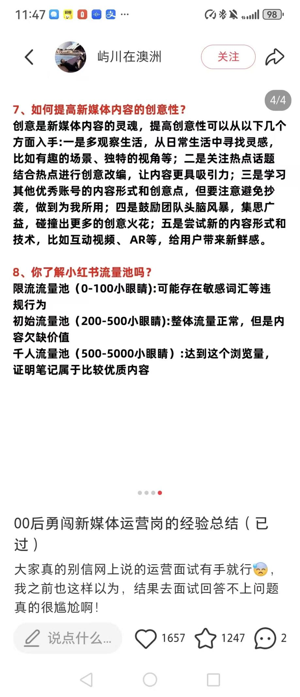

#### OCR 原文

（无 OCR 原文）

#### 清洗后文本

（无清洗文本）

#### 结构化候选问答

- 暂无可入库结构化问答。

### 图片 37: 02_1_image_037_e8e5bd5049.jpeg

- 来源：`D:\apps\ai-interview_archive\2026-05-22\面试经历(1).docx`
- SHA256：`e8e5bd50498613aeee63ea1c6b21f6d38ef88b5d529e099d68d676b60853225c`
- OCR 状态：`ocr_unavailable`
- OCR 置信度：``
- 目标岗位：待人工确认
- 审核状态：待核验
- 图片：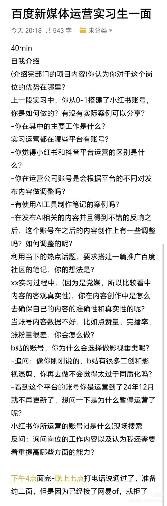

#### OCR 原文

（无 OCR 原文）

#### 清洗后文本

（无清洗文本）

#### 结构化候选问答

- 暂无可入库结构化问答。

### 图片 38: 02_1_image_038_d0f1084213.jpeg

- 来源：`D:\apps\ai-interview_archive\2026-05-22\面试经历(1).docx`
- SHA256：`d0f108421349a4997dca3575aacb385929251e48575c0cbd51e4582968f7b39c`
- OCR 状态：`ocr_unavailable`
- OCR 置信度：``
- 目标岗位：待人工确认
- 审核状态：待核验
- 图片：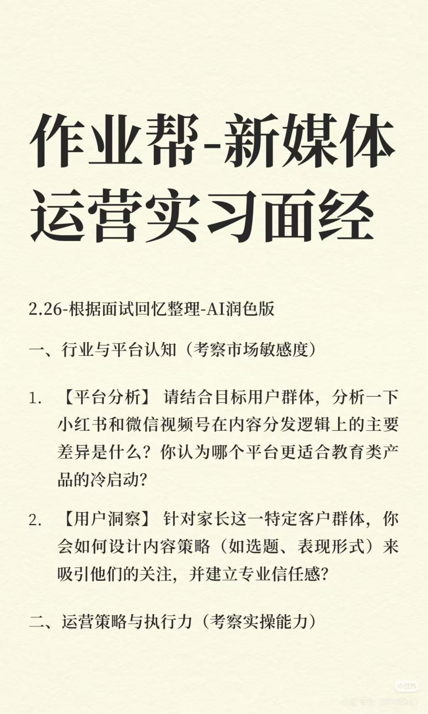

#### OCR 原文

（无 OCR 原文）

#### 清洗后文本

（无清洗文本）

#### 结构化候选问答

- 暂无可入库结构化问答。

### 图片 39: 02_1_image_039_b87a83df26.jpeg

- 来源：`D:\apps\ai-interview_archive\2026-05-22\面试经历(1).docx`
- SHA256：`b87a83df2633a59f550598d3bdbf9027c97e33e4ebc844852f85ec62d5b8fd3d`
- OCR 状态：`ocr_unavailable`
- OCR 置信度：``
- 目标岗位：待人工确认
- 审核状态：待核验
- 图片：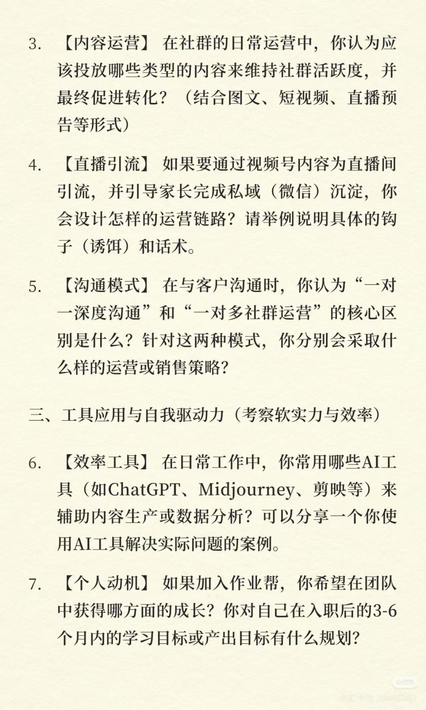

#### OCR 原文

（无 OCR 原文）

#### 清洗后文本

（无清洗文本）

#### 结构化候选问答

- 暂无可入库结构化问答。

### 图片 40: 02_1_image_040_0559f2387a.jpeg

- 来源：`D:\apps\ai-interview_archive\2026-05-22\面试经历(1).docx`
- SHA256：`0559f2387a3a9940eb6d98f2b082312ebc3d5c8ac35ae7a9d5337382f4bd679f`
- OCR 状态：`ocr_unavailable`
- OCR 置信度：``
- 目标岗位：待人工确认
- 审核状态：待核验
- 图片：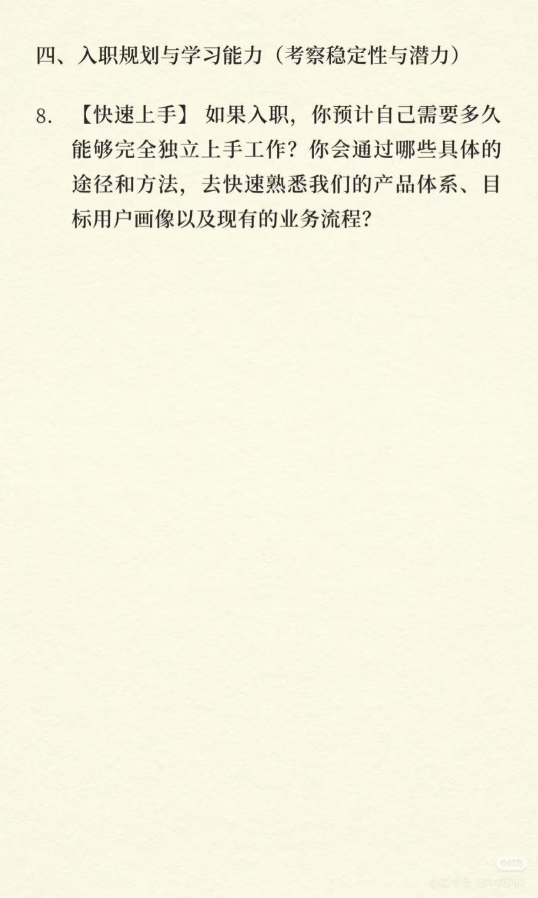

#### OCR 原文

（无 OCR 原文）

#### 清洗后文本

（无清洗文本）

#### 结构化候选问答

- 暂无可入库结构化问答。

### 图片 41: 02_1_image_041_2c763e62df.jpeg

- 来源：`D:\apps\ai-interview_archive\2026-05-22\面试经历(1).docx`
- SHA256：`2c763e62df25985abaf26441e2dd2e2fa9d17e7e21ce9e7bb27f0f51033ff7be`
- OCR 状态：`ocr_unavailable`
- OCR 置信度：``
- 目标岗位：待人工确认
- 审核状态：待核验
- 图片：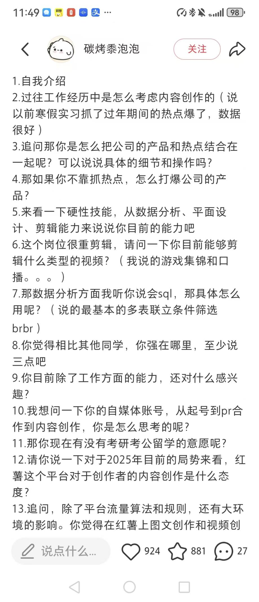

#### OCR 原文

（无 OCR 原文）

#### 清洗后文本

（无清洗文本）

#### 结构化候选问答

- 暂无可入库结构化问答。

### 图片 42: 02_1_image_042_48d8d55ec0.jpeg

- 来源：`D:\apps\ai-interview_archive\2026-05-22\面试经历(1).docx`
- SHA256：`48d8d55ec034f7a73651608deb199e018c2705ebcf460e7d6673e12b99a9d85f`
- OCR 状态：`ocr_unavailable`
- OCR 置信度：``
- 目标岗位：待人工确认
- 审核状态：待核验
- 图片：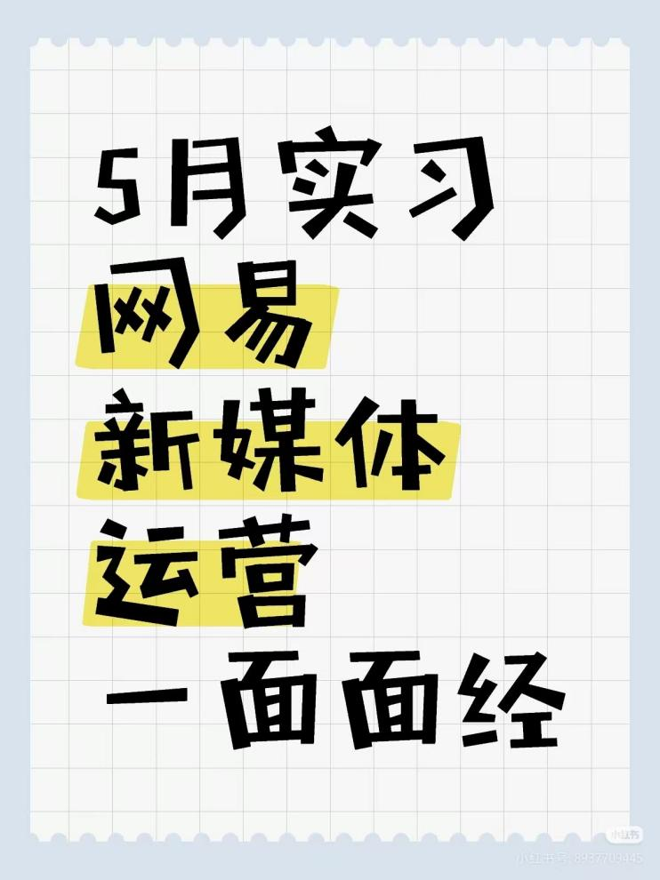

#### OCR 原文

（无 OCR 原文）

#### 清洗后文本

（无清洗文本）

#### 结构化候选问答

- 暂无可入库结构化问答。

### 图片 43: 02_1_image_043_b95ee67276.jpeg

- 来源：`D:\apps\ai-interview_archive\2026-05-22\面试经历(1).docx`
- SHA256：`b95ee67276e35de6bb694e4cbf7c7c90c0029b90b2a8e85f3bfc754920b16059`
- OCR 状态：`ocr_unavailable`
- OCR 置信度：``
- 目标岗位：待人工确认
- 审核状态：待核验
- 图片：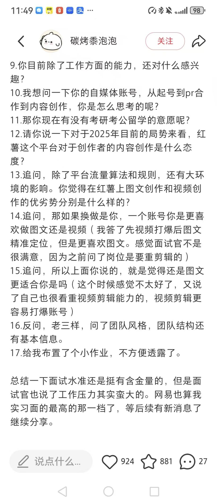

#### OCR 原文

（无 OCR 原文）

#### 清洗后文本

（无清洗文本）

#### 结构化候选问答

- 暂无可入库结构化问答。

### 图片 44: 02_1_image_044_47059ca4ad.jpeg

- 来源：`D:\apps\ai-interview_archive\2026-05-22\面试经历(1).docx`
- SHA256：`47059ca4ad8501f7d00a1beb93a882b2291c732ebaa3eda06fd4eb540836a013`
- OCR 状态：`ocr_unavailable`
- OCR 置信度：``
- 目标岗位：待人工确认
- 审核状态：待核验
- 图片：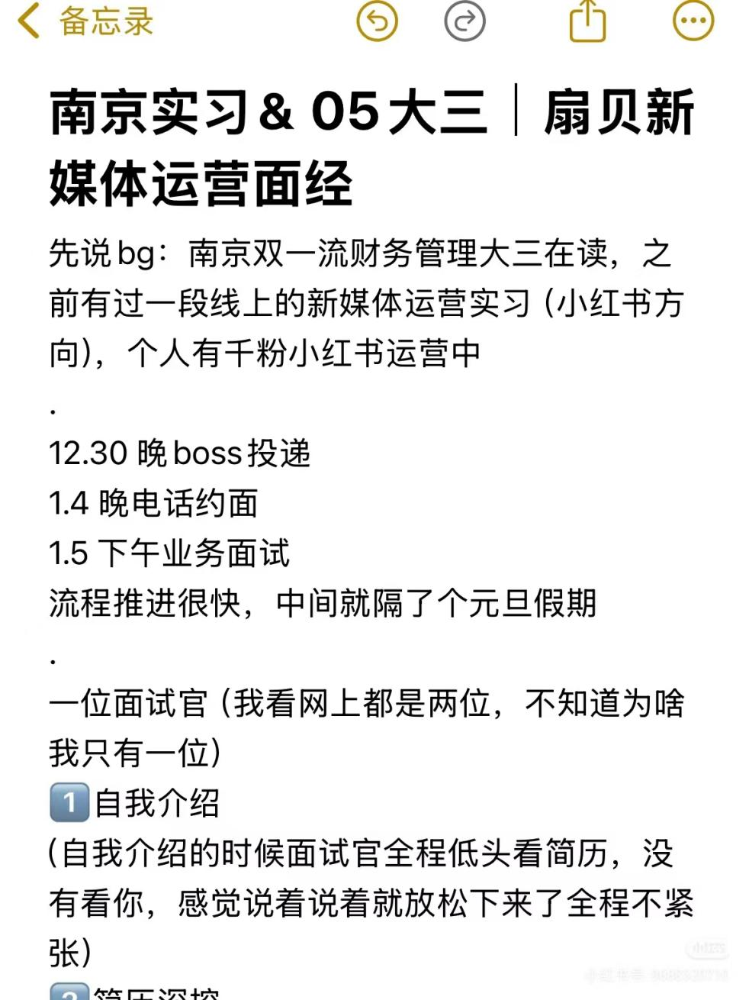

#### OCR 原文

（无 OCR 原文）

#### 清洗后文本

（无清洗文本）

#### 结构化候选问答

- 暂无可入库结构化问答。

### 图片 45: 02_1_image_045_88fc2661cd.jpeg

- 来源：`D:\apps\ai-interview_archive\2026-05-22\面试经历(1).docx`
- SHA256：`88fc2661cda94f4cafdb8a5e2b28d2dfcc91e32db78754cb14e70ccd71184dab`
- OCR 状态：`reused_manual_visual_ocr_by_hash`
- OCR 置信度：`0.76`
- 目标岗位：人力资源专员
- 审核状态：待核验
- 图片：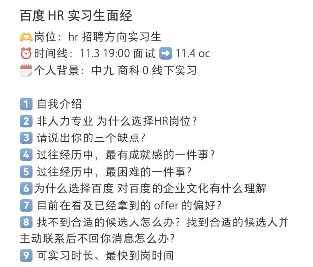

#### OCR 原文

百度 HR 实习生：自我介绍；非 HR 专业为什么做人力；三个缺点；成就感；最困难的事；为什么选择百度和文化；offer 偏好；找不到候选人怎么办；候选人不回复怎么办；实习时长和到岗时间。

#### 清洗后文本

百度 HR 实习生面经关注转岗动机、个人特质、困难经历、候选人触达和实习稳定性。

#### 结构化候选问答

- 岗位：人力资源专员
- 问题：招聘实习中候选人不回复或找不到合适候选人，你会怎么办？
- 回答要点：可以从岗位画像重新校准、渠道拓展、搜索关键词优化、候选人分层、触达话术优化、触达时间调整和跟进节奏管理回答；同时要记录反馈，判断是岗位吸引力不足、薪资不匹配、渠道不准还是话术问题。
- 复盘：该题考察招聘执行韧性和问题复盘，而不是只问是否抗压。
- 能力：候选人触达、招聘执行、问题复盘、沟通抗压
- 来源：02_1_image_045_88fc2661cd.jpeg

### 图片 46: 02_1_image_046_8ff9e57e3e.jpeg

- 来源：`D:\apps\ai-interview_archive\2026-05-22\面试经历(1).docx`
- SHA256：`8ff9e57e3ec10490bdd5f60e1678b05132ebf9ee852f0db32db04788803d8e80`
- OCR 状态：`ocr_unavailable`
- OCR 置信度：``
- 目标岗位：待人工确认
- 审核状态：待核验
- 图片：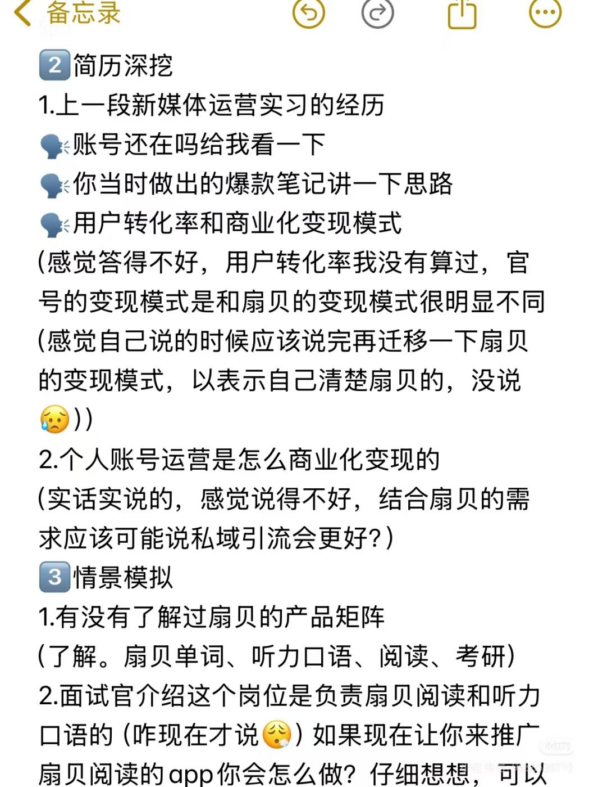

#### OCR 原文

（无 OCR 原文）

#### 清洗后文本

（无清洗文本）

#### 结构化候选问答

- 暂无可入库结构化问答。

### 图片 47: 02_1_image_047_dea28ddc6f.jpeg

- 来源：`D:\apps\ai-interview_archive\2026-05-22\面试经历(1).docx`
- SHA256：`dea28ddc6f113602d508f114111693b2b788e8d7ddc04c12261b66e9de673f57`
- OCR 状态：`ocr_unavailable`
- OCR 置信度：``
- 目标岗位：待人工确认
- 审核状态：待核验
- 图片：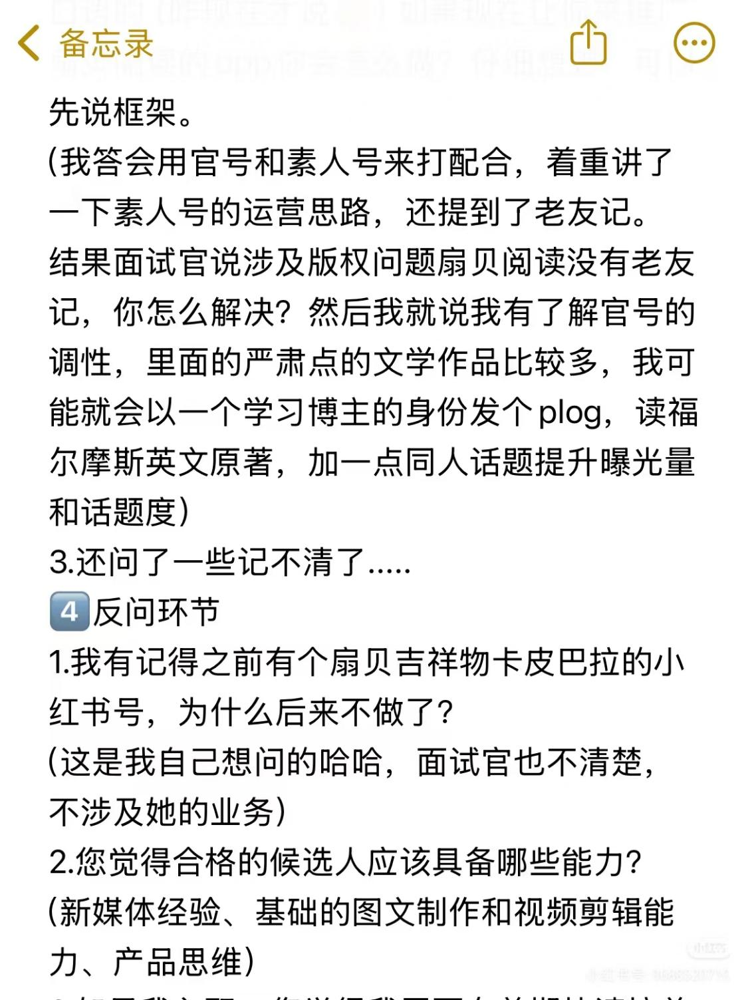

#### OCR 原文

（无 OCR 原文）

#### 清洗后文本

（无清洗文本）

#### 结构化候选问答

- 暂无可入库结构化问答。

### 图片 48: 02_1_image_048_9dbd9e46d4.jpeg

- 来源：`D:\apps\ai-interview_archive\2026-05-22\面试经历(1).docx`
- SHA256：`9dbd9e46d40cd73f7bc75294ce92c73584d72892cece6eb32a0c103ad40ea4e3`
- OCR 状态：`ocr_unavailable`
- OCR 置信度：``
- 目标岗位：待人工确认
- 审核状态：待核验
- 图片：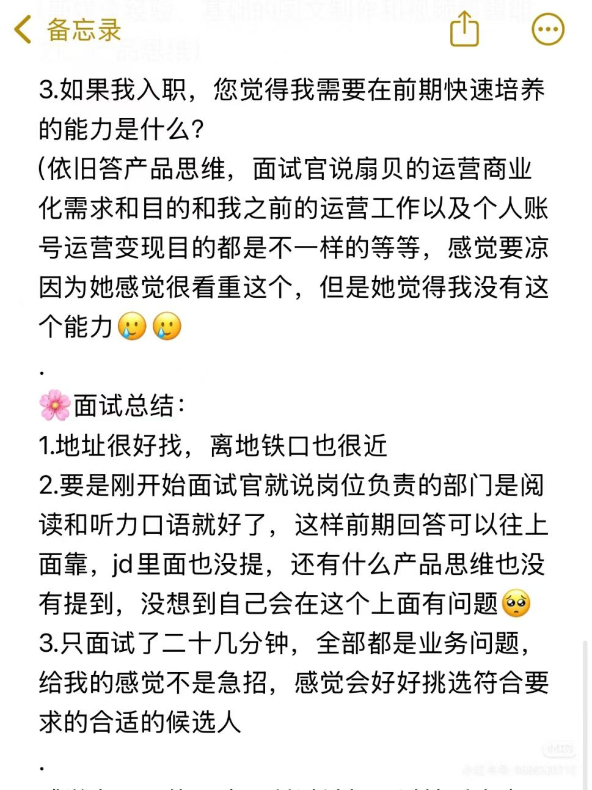

#### OCR 原文

（无 OCR 原文）

#### 清洗后文本

（无清洗文本）

#### 结构化候选问答

- 暂无可入库结构化问答。

### 图片 49: 02_1_image_049_882e177326.jpeg

- 来源：`D:\apps\ai-interview_archive\2026-05-22\面试经历(1).docx`
- SHA256：`882e1773267b719d6c2d3017bd121d3470e287043ddf1c52f0f2c63ae17ddb2d`
- OCR 状态：`ocr_unavailable`
- OCR 置信度：``
- 目标岗位：待人工确认
- 审核状态：待核验
- 图片：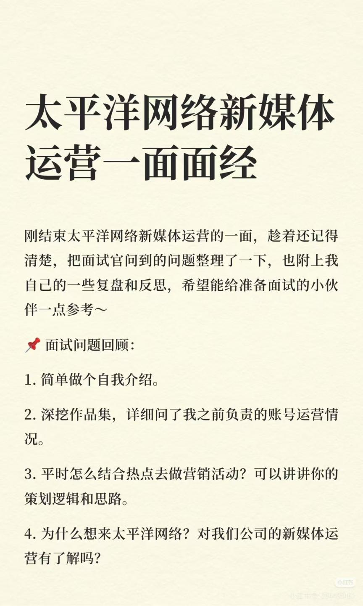

#### OCR 原文

（无 OCR 原文）

#### 清洗后文本

（无清洗文本）

#### 结构化候选问答

- 暂无可入库结构化问答。

### 图片 50: 02_1_image_050_5e2d9506cb.jpeg

- 来源：`D:\apps\ai-interview_archive\2026-05-22\面试经历(1).docx`
- SHA256：`5e2d9506cb3ffcdfe1c352e819de3019b696f7e062de3c2e253c13b7682d2518`
- OCR 状态：`ocr_unavailable`
- OCR 置信度：``
- 目标岗位：待人工确认
- 审核状态：待核验
- 图片：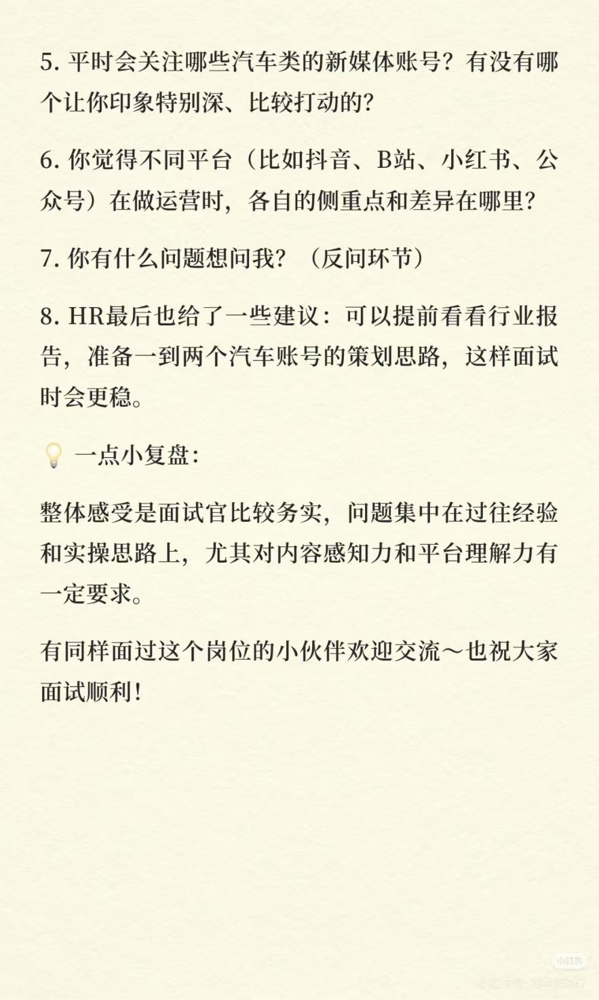

#### OCR 原文

（无 OCR 原文）

#### 清洗后文本

（无清洗文本）

#### 结构化候选问答

- 暂无可入库结构化问答。

### 图片 51: 02_1_image_051_614b144389.jpeg

- 来源：`D:\apps\ai-interview_archive\2026-05-22\面试经历(1).docx`
- SHA256：`614b144389e492e89b491d12028809b1082f548666286512a468e872bf70755e`
- OCR 状态：`ocr_unavailable`
- OCR 置信度：``
- 目标岗位：待人工确认
- 审核状态：待核验
- 图片：

#### OCR 原文

（无 OCR 原文）

#### 清洗后文本

（无清洗文本）

#### 结构化候选问答

- 暂无可入库结构化问答。

### 图片 52: 02_1_image_052_251f65446d.jpeg

- 来源：`D:\apps\ai-interview_archive\2026-05-22\面试经历(1).docx`
- SHA256：`251f65446d0530b785bfe728995ff6bc540054951ec7cc541b557688b6aa043c`
- OCR 状态：`ocr_unavailable`
- OCR 置信度：``
- 目标岗位：待人工确认
- 审核状态：待核验
- 图片：

#### OCR 原文

（无 OCR 原文）

#### 清洗后文本

（无清洗文本）

#### 结构化候选问答

- 暂无可入库结构化问答。

### 图片 53: 02_1_image_053_3d117b779d.jpeg

- 来源：`D:\apps\ai-interview_archive\2026-05-22\面试经历(1).docx`
- SHA256：`3d117b779d7ba6b2c02ee1f1547fa3c4810b5b82b5cb700e5d3988ebd7140bb6`
- OCR 状态：`ocr_unavailable`
- OCR 置信度：``
- 目标岗位：待人工确认
- 审核状态：待核验
- 图片：

#### OCR 原文

（无 OCR 原文）

#### 清洗后文本

（无清洗文本）

#### 结构化候选问答

- 暂无可入库结构化问答。

### 图片 54: 02_1_image_054_10eae257a7.jpeg

- 来源：`D:\apps\ai-interview_archive\2026-05-22\面试经历(1).docx`
- SHA256：`10eae257a774f4bf7b352f585c027c57174a44a1270e149c46ef6cc733e50ac7`
- OCR 状态：`ocr_unavailable`
- OCR 置信度：``
- 目标岗位：待人工确认
- 审核状态：待核验
- 图片：

#### OCR 原文

（无 OCR 原文）

#### 清洗后文本

（无清洗文本）

#### 结构化候选问答

- 暂无可入库结构化问答。

### 图片 55: 02_1_image_055_4811931c08.jpeg

- 来源：`D:\apps\ai-interview_archive\2026-05-22\面试经历(1).docx`
- SHA256：`4811931c08d953f0e372ede0f6faf54f0a80e08a3432b01111cdc45f610e102a`
- OCR 状态：`ocr_unavailable`
- OCR 置信度：``
- 目标岗位：待人工确认
- 审核状态：待核验
- 图片：

#### OCR 原文

（无 OCR 原文）

#### 清洗后文本

（无清洗文本）

#### 结构化候选问答

- 暂无可入库结构化问答。

### 图片 56: 02_1_image_056_cd0e0a4240.jpeg

- 来源：`D:\apps\ai-interview_archive\2026-05-22\面试经历(1).docx`
- SHA256：`cd0e0a42406d5747e124533c47864219ffe4045dcddbdddcb40912231ca8219a`
- OCR 状态：`ocr_unavailable`
- OCR 置信度：``
- 目标岗位：待人工确认
- 审核状态：待核验
- 图片：

#### OCR 原文

（无 OCR 原文）

#### 清洗后文本

（无清洗文本）

#### 结构化候选问答

- 暂无可入库结构化问答。

### 图片 57: 02_1_image_057_2b9425e1e3.jpeg

- 来源：`D:\apps\ai-interview_archive\2026-05-22\面试经历(1).docx`
- SHA256：`2b9425e1e3a95caa89707eda4ca24b282f3dfde8edbee0d13635917b7a0ed6d0`
- OCR 状态：`ocr_unavailable`
- OCR 置信度：``
- 目标岗位：待人工确认
- 审核状态：待核验
- 图片：

#### OCR 原文

（无 OCR 原文）

#### 清洗后文本

（无清洗文本）

#### 结构化候选问答

- 暂无可入库结构化问答。

### 图片 58: 02_1_image_058_bba53fbe24.jpeg

- 来源：`D:\apps\ai-interview_archive\2026-05-22\面试经历(1).docx`
- SHA256：`bba53fbe2485ddcd382a933581381093848c09486e80276e02405a99695831cb`
- OCR 状态：`ocr_unavailable`
- OCR 置信度：``
- 目标岗位：待人工确认
- 审核状态：待核验
- 图片：

#### OCR 原文

（无 OCR 原文）

#### 清洗后文本

（无清洗文本）

#### 结构化候选问答

- 暂无可入库结构化问答。

### 图片 59: 02_1_image_059_953345dbe5.jpeg

- 来源：`D:\apps\ai-interview_archive\2026-05-22\面试经历(1).docx`
- SHA256：`953345dbe5e332289795f1bfa7cd5c08e2212e317f3ca2e6962dc4994ab60936`
- OCR 状态：`ocr_unavailable`
- OCR 置信度：``
- 目标岗位：待人工确认
- 审核状态：待核验
- 图片：

#### OCR 原文

（无 OCR 原文）

#### 清洗后文本

（无清洗文本）

#### 结构化候选问答

- 暂无可入库结构化问答。

### 图片 60: 02_1_image_060_7fa82d1466.jpeg

- 来源：`D:\apps\ai-interview_archive\2026-05-22\面试经历(1).docx`
- SHA256：`7fa82d1466b0e5294ce5ff2e4bd022257fcfc7d402b0e38997f83f0f957fc748`
- OCR 状态：`reused_manual_visual_ocr_by_hash`
- OCR 置信度：`0.8`
- 目标岗位：人力资源专员
- 审核状态：待核验
- 图片：

#### OCR 原文

字节人力岗面经：英文自我介绍；为什么研究生转 HR；为什么喜欢招聘；吸引候选人案例；部门职责；转化率数据；难招岗位；目标公司人才画像；岗位吸引点；股权归属和晋升；候选人未通过原因；中澳招聘差异；渠道特点；工作因素和职业规划。

#### 清洗后文本

字节 HR 面试强度高，追问招聘数据、难招岗位、人才画像、候选人吸引、未通过原因和中英文表达。

#### 结构化候选问答

- 岗位：人力资源专员
- 问题：高强度 HR 面试如何回答“你如何吸引候选人并解释未通过原因”？
- 回答要点：回答候选人吸引时要结合岗位卖点、业务发展、成长机会、团队特点、薪酬福利和候选人动机；解释未通过原因时要基于岗位要求、能力证据、面试反馈和流程节点，避免主观评价；同时说明如何把失败原因反馈到岗位画像和渠道策略中。
- 复盘：该题适合大厂招聘岗，重点看数据、逻辑和候选人沟通边界。
- 能力：招聘数据、人才画像、候选人吸引、英文沟通
- 来源：02_1_image_060_7fa82d1466.jpeg

### 图片 61: 02_1_image_061_a67c997a70.jpeg

- 来源：`D:\apps\ai-interview_archive\2026-05-22\面试经历(1).docx`
- SHA256：`a67c997a707005092ae5b3b3cf6af990ca9d08b3c7d20545683efa44cb50785d`
- OCR 状态：`reused_manual_visual_ocr_by_hash`
- OCR 置信度：`0.77`
- 目标岗位：产品助理
- 审核状态：待核验
- 图片：

#### OCR 原文

产品助理面试复盘：自我介绍；竞品分析；需求确认；用户画像；登录方式优势；互联网产品盈利；电商平台前后台设计；流量下降原因；产品经理素质；优缺点；加班；期望；薪资。复盘指出缺少产品思维、没有自己的思考、简历项目讲不清，需要系统补产品方法论。

#### 清洗后文本

产品助理复盘强调产品思维、竞品分析、用户画像、盈利模式、流量下降分析和项目表达能力。

#### 结构化候选问答

- 岗位：产品助理
- 问题：产品助理面试中如何分析一个产品流量下降的原因？
- 回答要点：应从外部环境、渠道投放、搜索推荐、用户需求变化、竞品动作、产品体验、内容供给、转化链路和数据口径变化逐层排查；需要先看流量来源拆分，再看点击率、转化率、留存和用户反馈，而不是直接归因到某一个功能。
- 复盘：该题训练产品候选人用结构化方法分析业务问题。
- 能力：产品分析、业务指标、竞品分析、复盘能力
- 来源：02_1_image_061_a67c997a70.jpeg

### 图片 62: 02_1_image_062_b37013b6ba.jpeg

- 来源：`D:\apps\ai-interview_archive\2026-05-22\面试经历(1).docx`
- SHA256：`b37013b6ba939bc757ea857032d8901476a45393f62edef7b4623e2d9636b336`
- OCR 状态：`reused_manual_visual_ocr_by_hash`
- OCR 置信度：`0.78`
- 目标岗位：产品助理
- 审核状态：待核验
- 图片：

#### OCR 原文

产品助理面试主要问题：可以实习多久，为什么现在开始实习；来公司前是否面试过其他公司，为什么没去；产品助理主要做什么；岗位运行模式；上一份工作运行模式；设计开发类专业为什么做产品助理；有什么优势。

#### 清洗后文本

产品助理基础面试题关注实习稳定性、岗位理解、运行模式、转岗动机和个人优势。

#### 结构化候选问答

- 岗位：产品助理
- 问题：非产品专业候选人为什么选择产品助理岗位，应该如何回答？
- 回答要点：回答应把专业背景转化为岗位相关能力，例如设计开发背景可以支持原型理解、技术沟通和方案可行性判断；同时说明自己对用户、业务、数据和项目协同的兴趣，以及已做过的产品分析、PRD、原型或项目实践。
- 复盘：该题用于判断转岗动机是否清晰，以及候选人是否理解产品助理真实工作。
- 能力：岗位理解、转岗动机、优势表达、实习稳定性
- 来源：02_1_image_062_b37013b6ba.jpeg
