# 2026-05-23 图片型面试经验抽取记录

本文件由 `extract_member_interview_experience` 生成。图片内容必须经过 OCR/视觉转写后，才能进入结构化知识包。

## DOCX 正文抽取

### 面试经历(2).docx

面试经验
1.人力资源
2.产品助理
3.运营助理3.运营助理
3.运营助理
3.运营助理
4.新媒体运营4.新媒体运营
4.新媒体运营
4.新媒体运营
5.行政管理助理
6.招聘助理

## 图片与 OCR/转写结果

### 图片 1: 01_2_image_001_ca167f3c35.jpeg

- 来源：`D:\apps\ai-interview_archive\2026-05-23\面试经历(2).docx`
- SHA256：`ca167f3c3500d5f2e9ef96749a5e7382c19285efdf5deab122070607fb7e2c26`
- OCR 状态：`reused_manual_visual_ocr_by_hash`
- OCR 置信度：`0.82`
- 目标岗位：人力资源专员
- 审核状态：待核验
- 复用来源：hash_override
- 是否进入 package：False
- 是否需要复核：True
- 图片：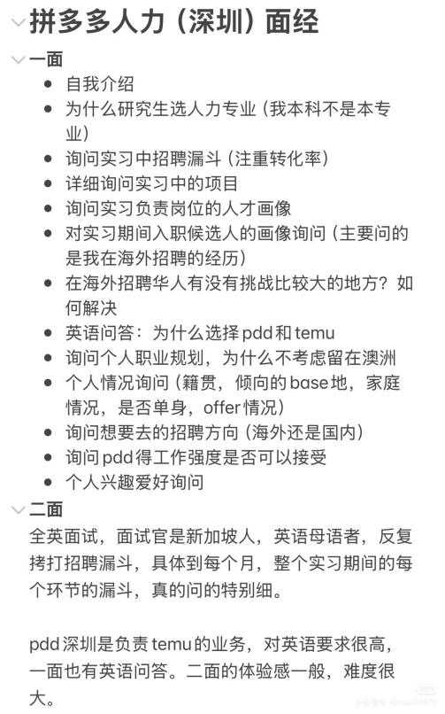

#### OCR 原文

拼多多人力深圳面经：自我介绍；为什么研究生选择 HR；招聘漏斗和转化率；实习项目；人才画像；中美招聘差异；英文 why PDD/TEMU；职业规划、期望城市、薪资、工作强度和兴趣。

#### 清洗后文本

拼多多人力深圳面经重点包括自我介绍、转 HR 动机、招聘漏斗转化率、人才画像、跨文化招聘差异、英文表达、职业规划和工作强度接受度。

#### 结构化候选问答

- 岗位：人力资源专员
- 问题：人力资源岗位如何追问招聘漏斗、人才画像和候选人转化率？
- 回答要点：回答应覆盖招聘漏斗的关键节点，如简历来源、筛选、邀约、面试、offer、入职；说明每个节点的转化率如何统计，如何定位流失原因；人才画像需要结合岗位能力、行业背景、薪资期望、稳定性和地域意愿，不应只停留在关键词匹配。
- 复盘：该题考察候选人是否理解招聘不是简单找人，而是漏斗管理、数据复盘和人才画像沉淀。
- 能力：招聘流程理解、数据意识、人才画像、英文沟通
- 来源：01_2_image_001_ca167f3c35.jpeg

### 图片 2: 01_2_image_002_4a6e1e1d3f.jpeg

- 来源：`D:\apps\ai-interview_archive\2026-05-23\面试经历(2).docx`
- SHA256：`4a6e1e1d3fc6bf2a6563e2debb9916d1de819de2843ab659925b143011043e87`
- OCR 状态：`reused_manual_visual_ocr_by_hash`
- OCR 置信度：`0.8`
- 目标岗位：产品助理
- 审核状态：待核验
- 复用来源：hash_override
- 是否进入 package：False
- 是否需要复核：True
- 图片：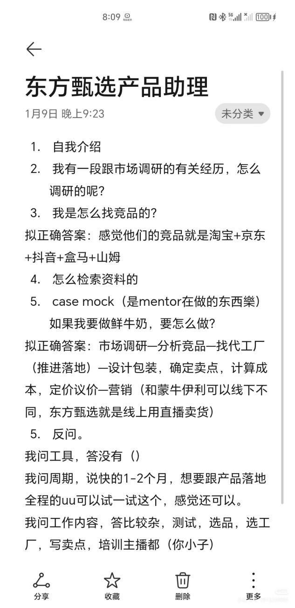

#### OCR 原文

东方甄选产品助理：自我介绍；市场调研经历；如何找竞品；淘宝、京东、抖音、盒马、山姆等竞品；以牛奶产品为例，如何做市场调研、竞品分析、工厂沟通、包装、卖点、成本、定价和营销；追问工具、周期和工作方式。

#### 清洗后文本

东方甄选产品助理面经强调市场调研、竞品分析、食品产品开发链路、供应商沟通、包装卖点、成本定价和营销方案。

#### 结构化候选问答

- 岗位：产品助理
- 问题：如果让你负责一款牛奶产品，从调研到上线你会怎么推进？
- 回答要点：先定义目标人群和消费场景，再做竞品调研，覆盖线上平台、线下商超和内容渠道；拆解竞品价格、规格、卖点、包装、渠道和评价；再与供应商或工厂确认成本、工艺、包装可行性；最后形成产品定位、价格带、卖点表达、上线节奏和营销测试方案。
- 复盘：产品助理不能只说会调研，要能把调研结果转成产品定义、成本约束和上线动作。
- 能力：市场调研、竞品分析、产品定义、供应链沟通
- 来源：01_2_image_002_4a6e1e1d3f.jpeg

### 图片 3: 01_2_image_003_8168c380ff.jpeg

- 来源：`D:\apps\ai-interview_archive\2026-05-23\面试经历(2).docx`
- SHA256：`8168c380ff510dfa9fcceeda713ff44c295f8807c6cc2a40b27b88301619fdae`
- OCR 状态：`reused_manual_visual_ocr_by_hash`
- OCR 置信度：`0.78`
- 目标岗位：产品助理
- 审核状态：待核验
- 复用来源：hash_override
- 是否进入 package：False
- 是否需要复核：True
- 图片：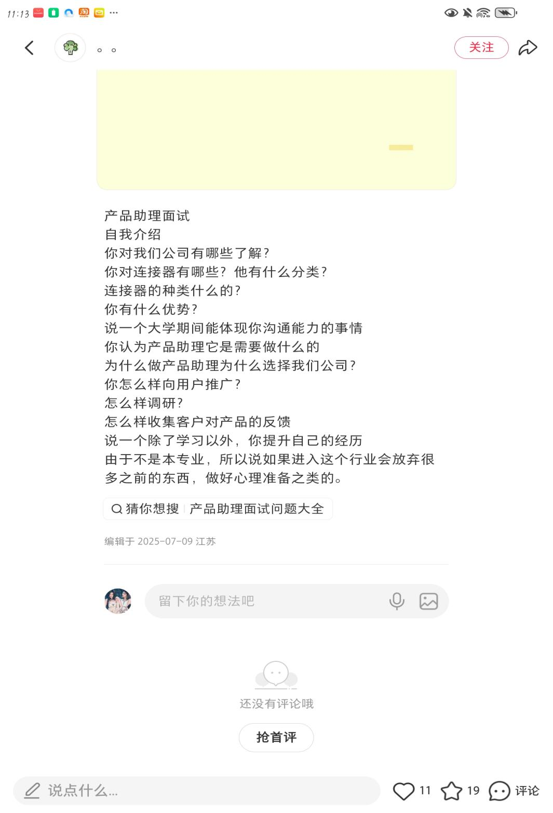

#### OCR 原文

产品助理面试问题：自我介绍；公司业务理解；连接器或产品模块理解；搭建模块和样例；优势；大学期间沟通经验；为什么做产品助理；如何收集客户反馈；如何做产品推广。

#### 清洗后文本

产品助理通用题覆盖公司理解、产品模块理解、沟通经验、客户反馈收集和产品推广。

#### 结构化候选问答

- 岗位：产品助理
- 问题：产品助理如何回答“你会怎样收集客户反馈并推动产品改进”？
- 回答要点：应说明反馈来源包括客服记录、用户访谈、问卷、数据看板、销售/实施同事反馈；再按频率、影响范围、业务价值和实现成本做优先级判断；最后形成问题清单、需求描述、验收标准和版本跟进，不只是简单收集意见。
- 复盘：该题重点考察候选人是否理解产品助理的闭环协作，而不是只会记录需求。
- 能力：用户反馈、需求整理、跨部门沟通、优先级判断
- 来源：01_2_image_003_8168c380ff.jpeg

### 图片 4: 01_2_image_004_4579e31167.jpeg

- 来源：`D:\apps\ai-interview_archive\2026-05-23\面试经历(2).docx`
- SHA256：`4579e311670b968904d69dce95b423fa4e42d4a62318de173a7fd56c6e97b958`
- OCR 状态：`ocr_unavailable`
- OCR 置信度：``
- 目标岗位：待人工确认
- 审核状态：待核验
- 复用来源：hash_override
- 是否进入 package：False
- 是否需要复核：True
- 图片：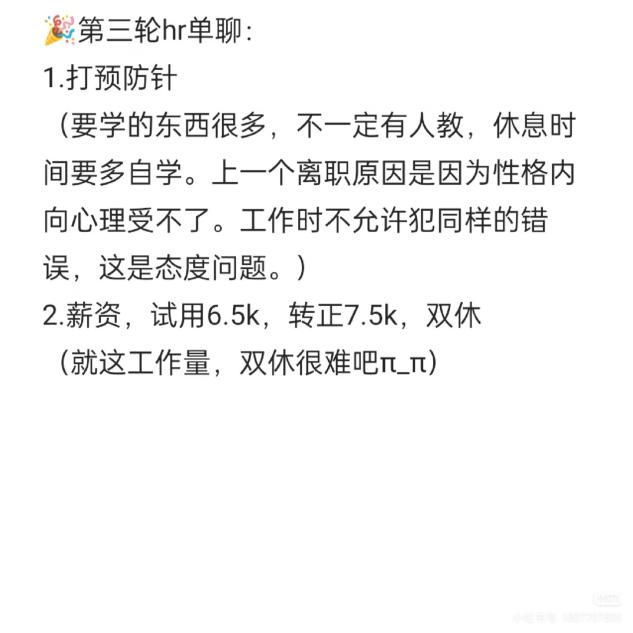

#### OCR 原文

（无 OCR 原文）

#### 清洗后文本

（无清洗文本）

#### 结构化候选问答

- 暂无可入库结构化问答。

### 图片 5: 01_2_image_005_f6cf0e1300.jpeg

- 来源：`D:\apps\ai-interview_archive\2026-05-23\面试经历(2).docx`
- SHA256：`f6cf0e13006beba84a69dc879a10c04375cf3198b6c2c45141ce1360c2e81349`
- OCR 状态：`reused_manual_visual_ocr_by_hash`
- OCR 置信度：`0.76`
- 目标岗位：产品助理
- 审核状态：待核验
- 复用来源：hash_override
- 是否进入 package：False
- 是否需要复核：True
- 图片：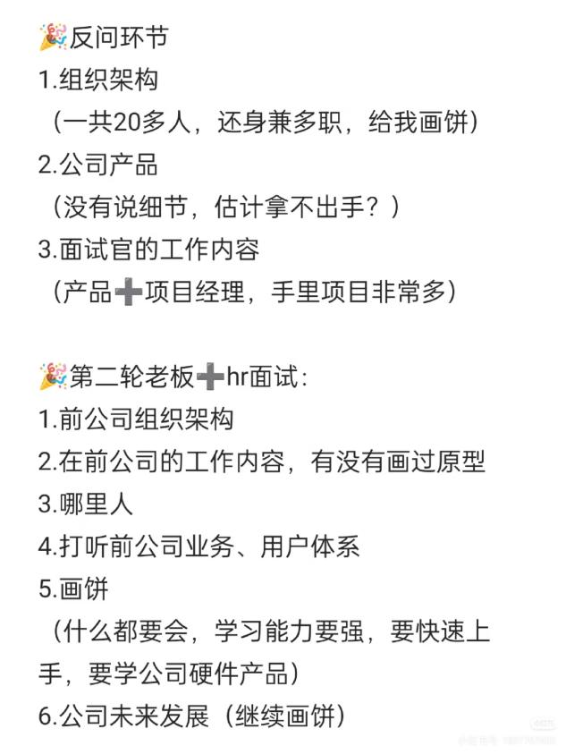

#### OCR 原文

产品助理第二轮老板和 HR 面：组织结构、公司产品、面试官工作内容、上一家公司业务、用户系统、是否画原型、未来规划、业务数据来源、需求变更、项目延期、业务方不了解设计、项目熟悉度、提前上线、最难问题、系统细节。

#### 清洗后文本

产品助理二面围绕业务理解、原型能力、数据来源、需求变更、项目延期和跨部门协同深挖。

#### 结构化候选问答

- 岗位：产品助理
- 问题：产品助理遇到需求变更和项目延期时应该怎么处理？
- 回答要点：先确认变更来源、业务目标和影响范围；评估对排期、开发成本、测试范围和上线风险的影响；将变更拆成必须项和可后置项；同步业务、设计、研发和测试重新确认优先级；保留会议纪要、需求版本和决策记录，避免口头变更失控。
- 复盘：该题适合追问候选人是否具备项目协同和风险控制意识。
- 能力：需求变更管理、项目协同、风险沟通
- 来源：01_2_image_005_f6cf0e1300.jpeg

### 图片 6: 01_2_image_006_549ac0cb3a.jpeg

- 来源：`D:\apps\ai-interview_archive\2026-05-23\面试经历(2).docx`
- SHA256：`549ac0cb3a49db20cd941a2ef5c31d8c8126f3ef1ddd91295d4b844eeb55d286`
- OCR 状态：`ocr_unavailable`
- OCR 置信度：``
- 目标岗位：待人工确认
- 审核状态：待核验
- 复用来源：hash_override
- 是否进入 package：False
- 是否需要复核：True
- 图片：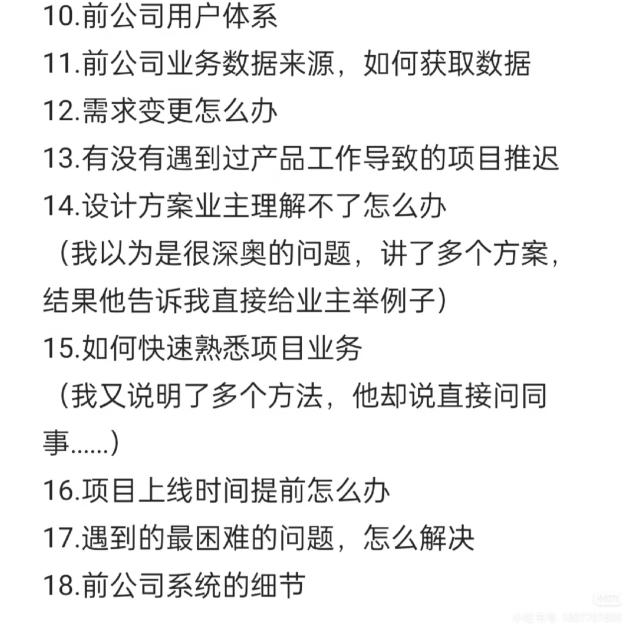

#### OCR 原文

（无 OCR 原文）

#### 清洗后文本

（无清洗文本）

#### 结构化候选问答

- 暂无可入库结构化问答。

### 图片 7: 01_2_image_007_b64670820c.jpeg

- 来源：`D:\apps\ai-interview_archive\2026-05-23\面试经历(2).docx`
- SHA256：`b64670820ce09fd889b51469cd7480d11477cb08a3931c681db54aa316ffdb8b`
- OCR 状态：`ocr_unavailable`
- OCR 置信度：``
- 目标岗位：待人工确认
- 审核状态：待核验
- 复用来源：hash_override
- 是否进入 package：False
- 是否需要复核：True
- 图片：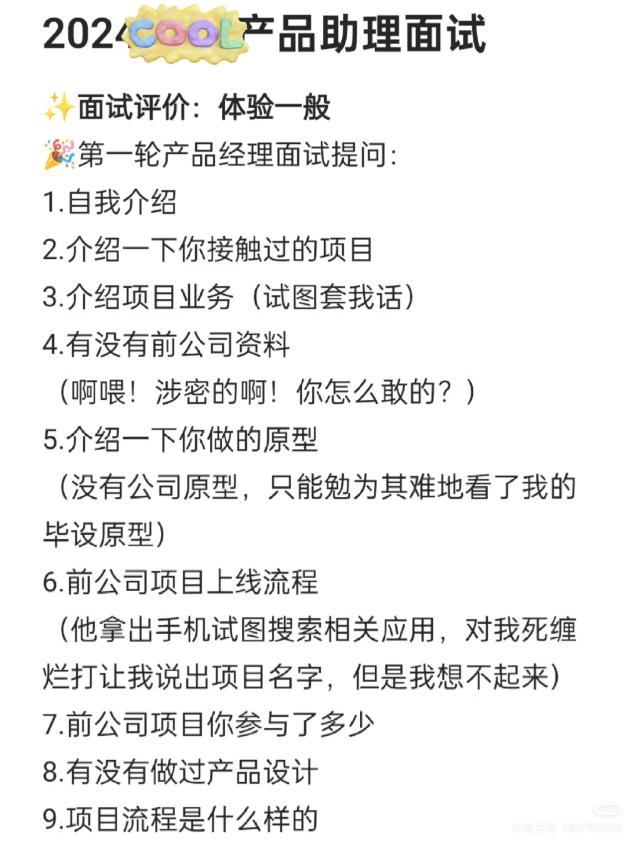

#### OCR 原文

（无 OCR 原文）

#### 清洗后文本

（无清洗文本）

#### 结构化候选问答

- 暂无可入库结构化问答。

### 图片 8: 01_2_image_008_65a50f2595.jpeg

- 来源：`D:\apps\ai-interview_archive\2026-05-23\面试经历(2).docx`
- SHA256：`65a50f259534f2ed755c6cb3814830401080b420019d6ee99ce59344e961a2db`
- OCR 状态：`reused_manual_visual_ocr_by_hash`
- OCR 置信度：`0.74`
- 目标岗位：产品助理
- 审核状态：仅参考
- 复用来源：hash_override
- 是否进入 package：True
- 是否需要复核：False
- 图片：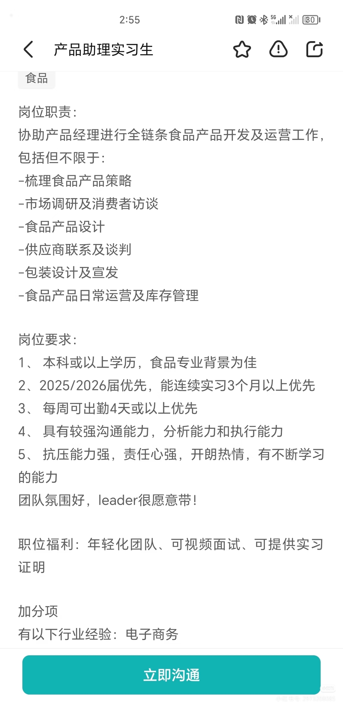

#### OCR 原文

食品产品助理 JD：负责食品产品开发和运营全链路，需求调研、策略、产品设计、供应商沟通、包装、推广、日常运营和库存；要求本科及以上、可长期实习、沟通强、分析执行力和责任心。

#### 清洗后文本

食品产品助理岗位画像参考：产品开发、需求调研、供应链沟通、包装推广、库存运营和执行力。

#### 结构化候选问答

- 岗位：产品助理
- 问题：食品产品助理岗位通常会考察哪些能力？
- 回答要点：重点考察用户和市场调研、产品设计、供应商或工厂沟通、包装卖点、推广计划、库存和日常运营意识，以及执行力、沟通能力和抗压能力。
- 复盘：该图片更接近岗位 JD，可作为岗位要求参考，不应当作真实面试问答。
- 能力：岗位要求理解、产品运营、供应链沟通
- 来源：01_2_image_008_65a50f2595.jpeg

### 图片 9: 01_2_image_009_b600a16cb1.jpeg

- 来源：`D:\apps\ai-interview_archive\2026-05-23\面试经历(2).docx`
- SHA256：`b600a16cb196ffb46befb67524c22bb36521acbbe6516e9d030e66ae3510350b`
- OCR 状态：`ocr_unavailable`
- OCR 置信度：``
- 目标岗位：待人工确认
- 审核状态：待核验
- 复用来源：hash_override
- 是否进入 package：False
- 是否需要复核：True
- 图片：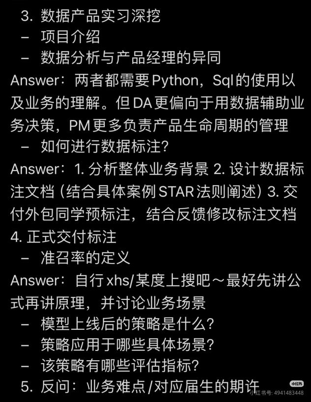

#### OCR 原文

（无 OCR 原文）

#### 清洗后文本

（无清洗文本）

#### 结构化候选问答

- 暂无可入库结构化问答。

### 图片 10: 01_2_image_010_f5f1831ced.jpeg

- 来源：`D:\apps\ai-interview_archive\2026-05-23\面试经历(2).docx`
- SHA256：`f5f1831ced4ca24ee0bbce7b5f1e9fb3043a2d37218c8bb0601a3f4709cb15d0`
- OCR 状态：`ocr_unavailable`
- OCR 置信度：``
- 目标岗位：待人工确认
- 审核状态：待核验
- 复用来源：hash_override
- 是否进入 package：False
- 是否需要复核：True
- 图片：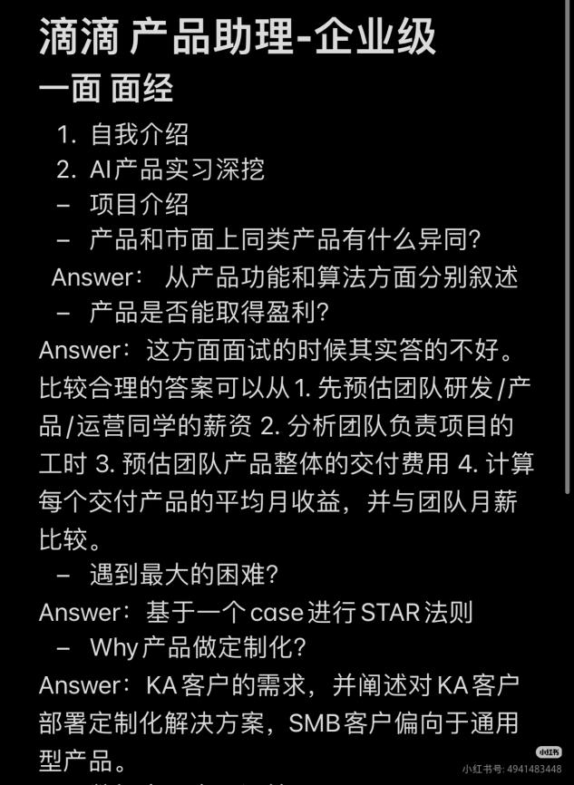

#### OCR 原文

（无 OCR 原文）

#### 清洗后文本

（无清洗文本）

#### 结构化候选问答

- 暂无可入库结构化问答。

### 图片 11: 01_2_image_011_ecc9f1b330.jpeg

- 来源：`D:\apps\ai-interview_archive\2026-05-23\面试经历(2).docx`
- SHA256：`ecc9f1b330e6e30a7fe84e9f1024ce0690d5748fafed1eef8799cd966c0c4c4c`
- OCR 状态：`ocr_unavailable`
- OCR 置信度：``
- 目标岗位：待人工确认
- 审核状态：待核验
- 复用来源：hash_override
- 是否进入 package：False
- 是否需要复核：True
- 图片：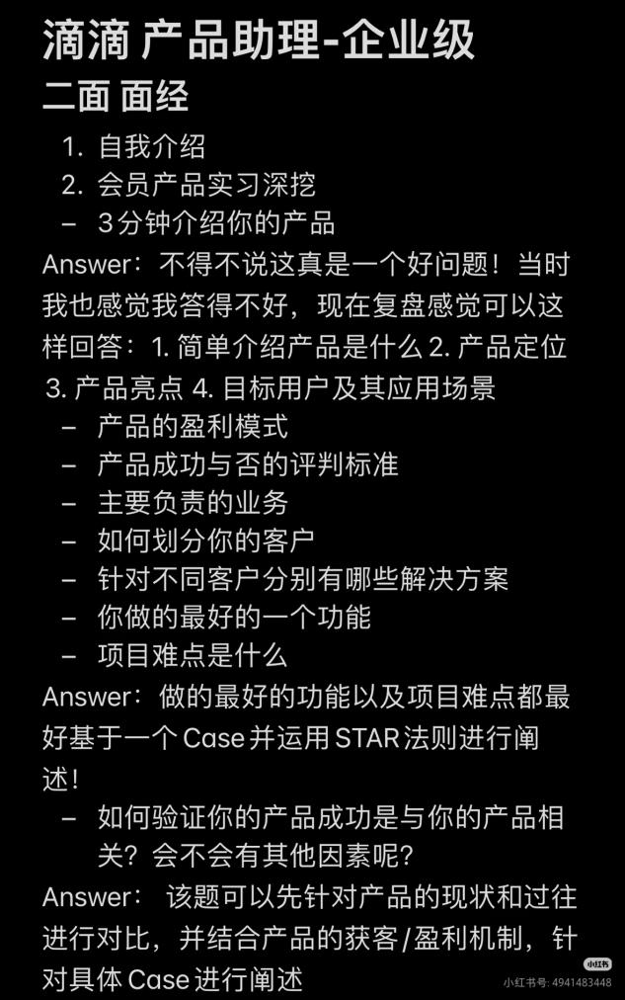

#### OCR 原文

（无 OCR 原文）

#### 清洗后文本

（无清洗文本）

#### 结构化候选问答

- 暂无可入库结构化问答。

### 图片 12: 01_2_image_012_27ea56a180.jpeg

- 来源：`D:\apps\ai-interview_archive\2026-05-23\面试经历(2).docx`
- SHA256：`27ea56a18009f909e1c5722cf716bca70010f4c0e56290a2be2b011eb3057743`
- OCR 状态：`reused_manual_visual_ocr_by_hash`
- OCR 置信度：`0.78`
- 目标岗位：人力资源专员
- 审核状态：待核验
- 复用来源：hash_override
- 是否进入 package：False
- 是否需要复核：True
- 图片：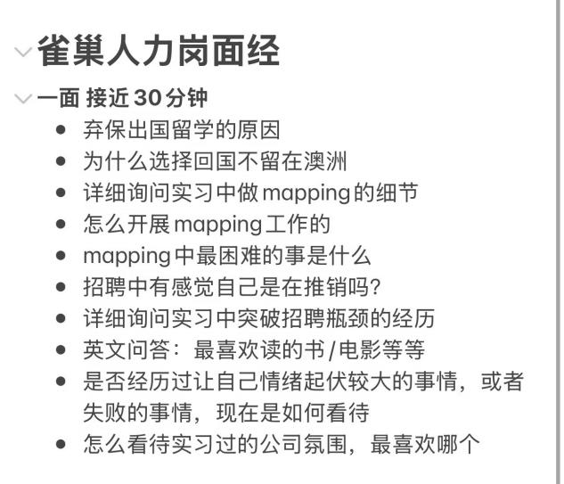

#### OCR 原文

雀巢人力岗面经：为什么放弃留学；为什么回国；mapping 细节；招聘渠道；数据对比；职业规划；竞品公司组织架构；电话吸引候选人；mapping 流程；竞品薪酬和候选人问题；招聘流程优化；导师评价；排期；工作强度；案例；笔试；游戏；信息来源。

#### 清洗后文本

雀巢 HR 面经重点包括 mapping、渠道、数据对比、竞品组织架构、候选人吸引、招聘流程优化和工作强度。

#### 结构化候选问答

- 岗位：人力资源专员
- 问题：HR 面试中如何说明人才 mapping 的流程和价值？
- 回答要点：回答应包括目标岗位定义、竞品公司和组织架构梳理、候选人来源渠道、候选人信息校验、薪酬和意愿判断、联系话术、过程记录和数据复盘；价值在于提前建立人才池、提高招聘效率并支持岗位画像迭代。
- 复盘：该题考察招聘研究和候选人触达能力，适合追问真实项目细节。
- 能力：人才 mapping、招聘渠道、候选人吸引、流程优化
- 来源：01_2_image_012_27ea56a180.jpeg

### 图片 13: 01_2_image_013_4aea604a3f.jpeg

- 来源：`D:\apps\ai-interview_archive\2026-05-23\面试经历(2).docx`
- SHA256：`4aea604a3fa3ce7440e7cad39fcd43c3228a50a28e95b4b01825356ad23a7c50`
- OCR 状态：`ocr_unavailable`
- OCR 置信度：``
- 目标岗位：待人工确认
- 审核状态：待核验
- 复用来源：hash_override
- 是否进入 package：False
- 是否需要复核：True
- 图片：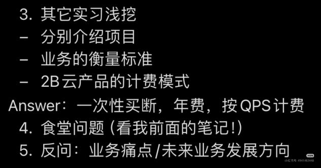

#### OCR 原文

（无 OCR 原文）

#### 清洗后文本

（无清洗文本）

#### 结构化候选问答

- 暂无可入库结构化问答。

### 图片 14: 01_2_image_014_90a29e7dd1.jpeg

- 来源：`D:\apps\ai-interview_archive\2026-05-23\面试经历(2).docx`
- SHA256：`90a29e7dd15841e426c29b2389770f82caa3045c7ee64bf843510832c4847563`
- OCR 状态：`ocr_unavailable`
- OCR 置信度：``
- 目标岗位：待人工确认
- 审核状态：待核验
- 复用来源：hash_override
- 是否进入 package：False
- 是否需要复核：True
- 图片：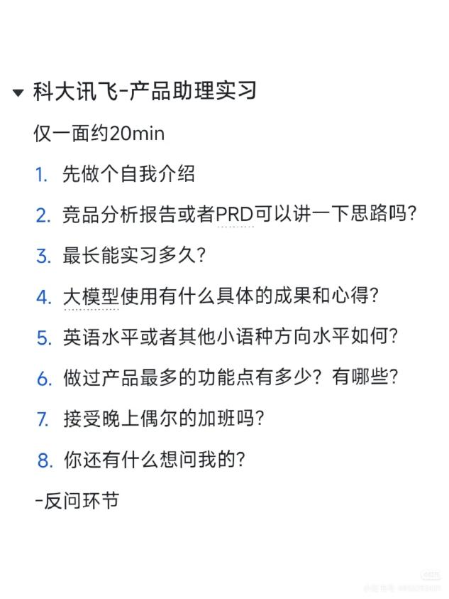

#### OCR 原文

（无 OCR 原文）

#### 清洗后文本

（无清洗文本）

#### 结构化候选问答

- 暂无可入库结构化问答。

### 图片 15: 01_2_image_015_cdedfd59ba.jpeg

- 来源：`D:\apps\ai-interview_archive\2026-05-23\面试经历(2).docx`
- SHA256：`cdedfd59ba8c0589911f82c0ffaf90685077cb25114ba21a8d333910e178bc9d`
- OCR 状态：`ocr_unavailable`
- OCR 置信度：``
- 目标岗位：待人工确认
- 审核状态：待核验
- 复用来源：hash_override
- 是否进入 package：False
- 是否需要复核：True
- 图片：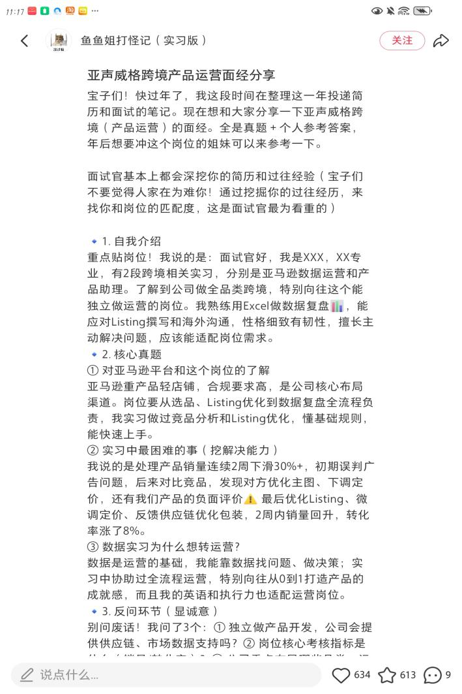

#### OCR 原文

（无 OCR 原文）

#### 清洗后文本

（无清洗文本）

#### 结构化候选问答

- 暂无可入库结构化问答。

### 图片 16: 01_2_image_016_69c4088a9f.jpeg

- 来源：`D:\apps\ai-interview_archive\2026-05-23\面试经历(2).docx`
- SHA256：`69c4088a9f3e0b16c827ad38be96fafc82f610188529526271e23b13a6060365`
- OCR 状态：`ocr_unavailable`
- OCR 置信度：``
- 目标岗位：待人工确认
- 审核状态：待核验
- 复用来源：hash_override
- 是否进入 package：False
- 是否需要复核：True
- 图片：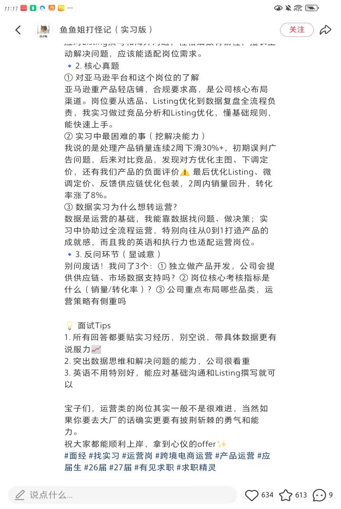

#### OCR 原文

（无 OCR 原文）

#### 清洗后文本

（无清洗文本）

#### 结构化候选问答

- 暂无可入库结构化问答。

### 图片 17: 01_2_image_017_36f85f8bb9.jpeg

- 来源：`D:\apps\ai-interview_archive\2026-05-23\面试经历(2).docx`
- SHA256：`36f85f8bb943adebd1469ed5e204e5c6c9596bee0c12d5661a78538e9ecddadf`
- OCR 状态：`ocr_unavailable`
- OCR 置信度：``
- 目标岗位：待人工确认
- 审核状态：待核验
- 复用来源：hash_override
- 是否进入 package：False
- 是否需要复核：True
- 图片：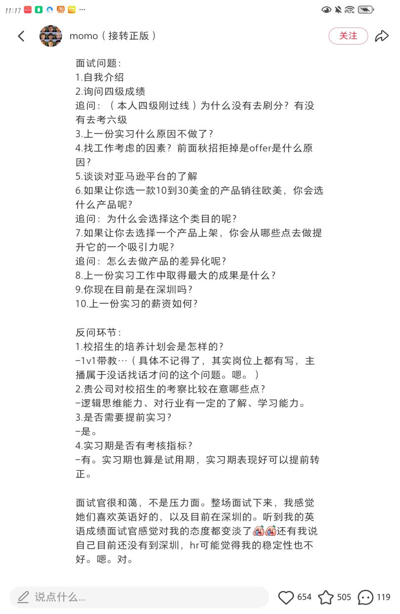

#### OCR 原文

（无 OCR 原文）

#### 清洗后文本

（无清洗文本）

#### 结构化候选问答

- 暂无可入库结构化问答。

### 图片 18: 01_2_image_018_06d67e5a9b.jpeg

- 来源：`D:\apps\ai-interview_archive\2026-05-23\面试经历(2).docx`
- SHA256：`06d67e5a9b552c893baf4f0a17b54a2991ee6885fcab2782d230c96de5d281a6`
- OCR 状态：`reused_manual_visual_ocr_by_hash`
- OCR 置信度：`0.76`
- 目标岗位：运营助理
- 审核状态：待核验
- 复用来源：hash_override
- 是否进入 package：False
- 是否需要复核：True
- 图片：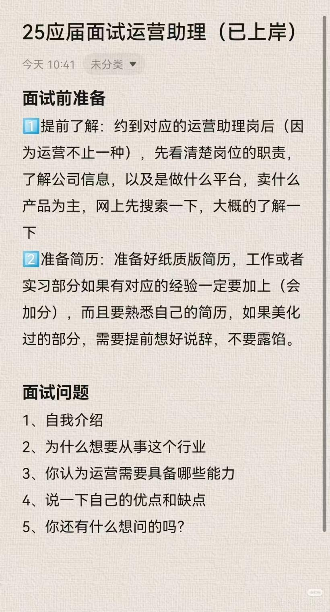

#### OCR 原文

运营助理应届面试：提前了解岗位、公司、平台和产品；准备简历；面试题包括自我介绍、为什么选择行业、运营需要哪些能力、个人优缺点、反问面试官。

#### 清洗后文本

运营助理基础面试重点是岗位认知、行业动机、运营能力模型和个人优劣势。

#### 结构化候选问答

- 岗位：运营助理
- 问题：运营助理岗位需要哪些基础能力？
- 回答要点：通常包括用户理解、数据意识、活动执行、内容或渠道运营、沟通协作、复盘能力和抗压执行力；回答时应结合自己做过的活动、社群、内容、数据分析或项目经历，而不是只列能力词。
- 复盘：该题适合作为运营助理 easy 难度基础题。
- 能力：岗位认知、运营基础、执行力、复盘意识
- 来源：01_2_image_018_06d67e5a9b.jpeg

### 图片 19: 01_2_image_019_f8d274f3fb.jpeg

- 来源：`D:\apps\ai-interview_archive\2026-05-23\面试经历(2).docx`
- SHA256：`f8d274f3fb0c83302781de94a5a7420865b03d7b25e79c0dcdc352a4d433d589`
- OCR 状态：`reused_manual_visual_ocr_by_hash`
- OCR 置信度：`0.74`
- 目标岗位：运营助理
- 审核状态：待核验
- 复用来源：hash_override
- 是否进入 package：False
- 是否需要复核：True
- 图片：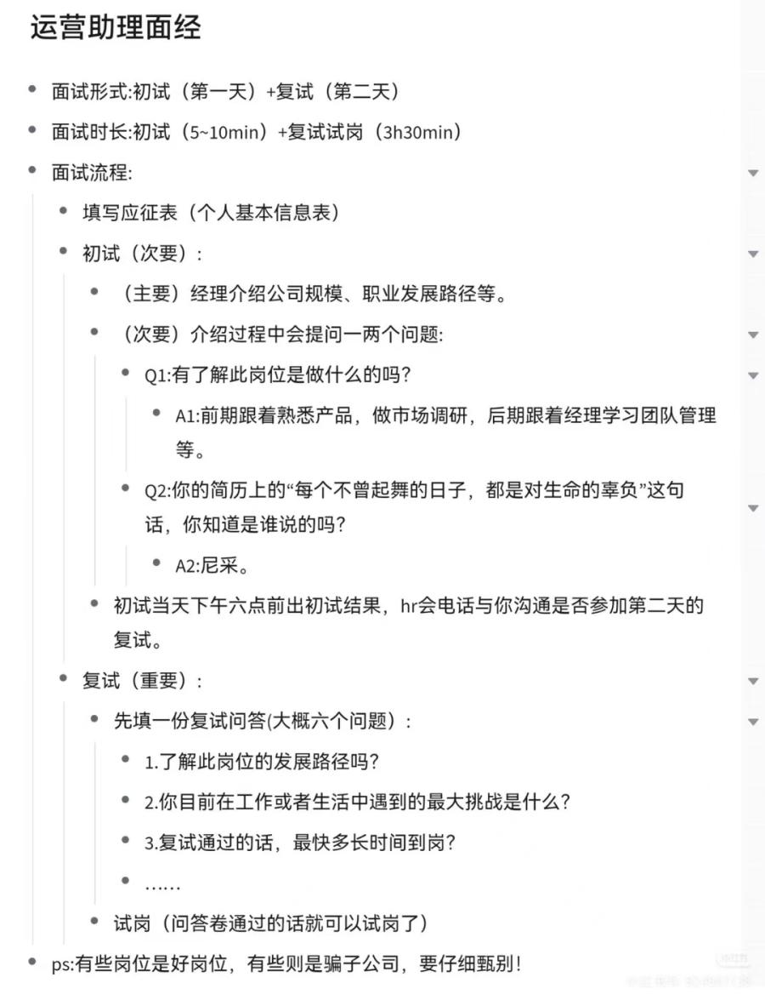

#### OCR 原文

运营助理面经：初面和复试；岗位理解；前期学习产品、市场调研，后期协助经理做团队管理；职业路径；最大挑战；到岗时间和试用；提醒警惕不正规公司。

#### 清洗后文本

运营助理面经关注岗位理解、产品学习、市场调研、团队协作、职业路径和最大挑战。

#### 结构化候选问答

- 岗位：运营助理
- 问题：你如何理解运营助理的工作内容和成长路径？
- 回答要点：前期通常以了解产品、用户、渠道和数据为主，承担基础执行、活动支持、数据整理和市场调研；随着熟悉业务，可参与方案制定、流程优化、复盘分析和团队协作管理。回答要体现先执行、再复盘、再优化的成长逻辑。
- 复盘：该题用于判断候选人是否把运营理解为长期业务增长工作，而不是简单打杂。
- 能力：岗位理解、职业规划、市场调研、团队协作
- 来源：01_2_image_019_f8d274f3fb.jpeg

### 图片 20: 01_2_image_020_3feb238ed1.jpeg

- 来源：`D:\apps\ai-interview_archive\2026-05-23\面试经历(2).docx`
- SHA256：`3feb238ed1be3f6b4eeace5148ac9b96d7d534d5e8891acbd983a04f6e59dc65`
- OCR 状态：`reused_manual_visual_ocr_by_hash`
- OCR 置信度：`0.76`
- 目标岗位：运营助理
- 审核状态：待核验
- 复用来源：hash_override
- 是否进入 package：False
- 是否需要复核：True
- 图片：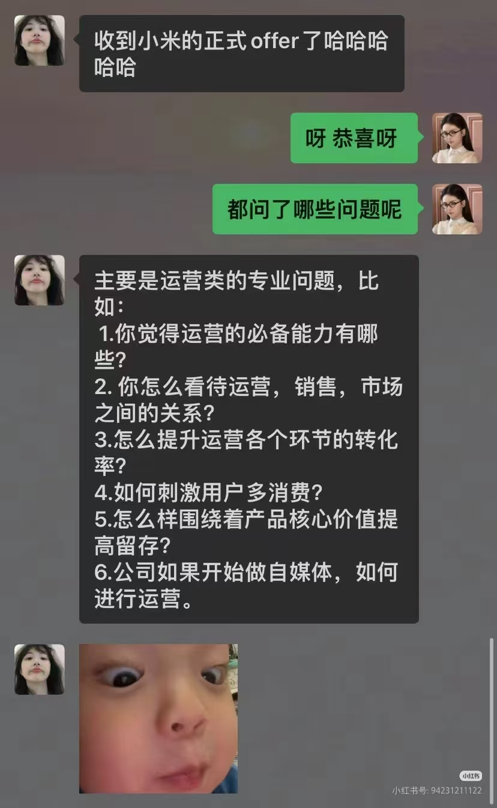

#### OCR 原文

运营面试常见问题：运营需要什么能力；运营、销售、市场之间的关系；如何提高转化率；如何刺激复购；围绕产品核心价值提高留存；如果公司开始做自媒体应该如何运营。

#### 清洗后文本

运营通用题覆盖转化、复购、留存、自媒体和运营与销售市场关系。

#### 结构化候选问答

- 岗位：运营助理
- 问题：如何围绕产品核心价值提高用户留存和复购？
- 回答要点：先明确产品核心价值和用户使用场景，再识别用户流失节点；通过新手引导、内容或活动触达、权益设计、社群维护、个性化推荐、售后体验和复购激励提高留存；需要用留存率、复购率、转化率和用户反馈验证效果。
- 复盘：该题适合中等难度运营追问，要求从动作回到指标验证。
- 能力：用户留存、复购、转化率、活动运营
- 来源：01_2_image_020_3feb238ed1.jpeg

### 图片 21: 01_2_image_021_049d45d2dc.jpeg

- 来源：`D:\apps\ai-interview_archive\2026-05-23\面试经历(2).docx`
- SHA256：`049d45d2dc4049b211818e15510d686608cb3f2effdd0e858ddee66980dd8022`
- OCR 状态：`reused_manual_visual_ocr_by_hash`
- OCR 置信度：`0.76`
- 目标岗位：运营助理
- 审核状态：待核验
- 复用来源：hash_override
- 是否进入 package：False
- 是否需要复核：True
- 图片：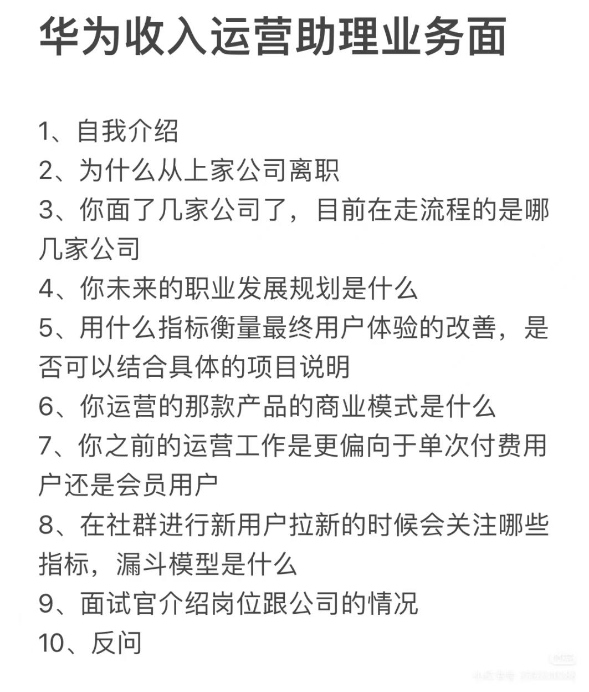

#### OCR 原文

华为收入运营助理业务面：自我介绍；为什么离开上一家公司；当前面试进度；职业规划；用户体验改善指标和项目案例；运营产品业务模式；上份工作一次性收费还是会员；社区获客指标和漏斗模型；反问。

#### 清洗后文本

收入运营助理面试关注业务模式、用户体验指标、获客漏斗、收费模式和职业规划。

#### 结构化候选问答

- 岗位：运营助理
- 问题：运营助理如何用漏斗模型分析社区获客效果？
- 回答要点：可以按曝光、点击、注册、激活、留存、付费或转介绍拆分漏斗；每个节点看转化率和流失原因，再针对内容、渠道、活动、产品体验或权益设计提出优化；要说明指标口径和数据来源。
- 复盘：该题考察运营数据化表达和业务模式理解。
- 能力：获客漏斗、业务模式、用户体验指标、数据分析
- 来源：01_2_image_021_049d45d2dc.jpeg

### 图片 22: 01_2_image_022_dd2f7b07cb.jpeg

- 来源：`D:\apps\ai-interview_archive\2026-05-23\面试经历(2).docx`
- SHA256：`dd2f7b07cb7199581c0eb7eee83340186bb4a2805bed0269e2986c90014ec31e`
- OCR 状态：`reused_manual_visual_ocr_by_hash`
- OCR 置信度：`0.75`
- 目标岗位：运营助理
- 审核状态：待核验
- 复用来源：hash_override
- 是否进入 package：False
- 是否需要复核：True
- 图片：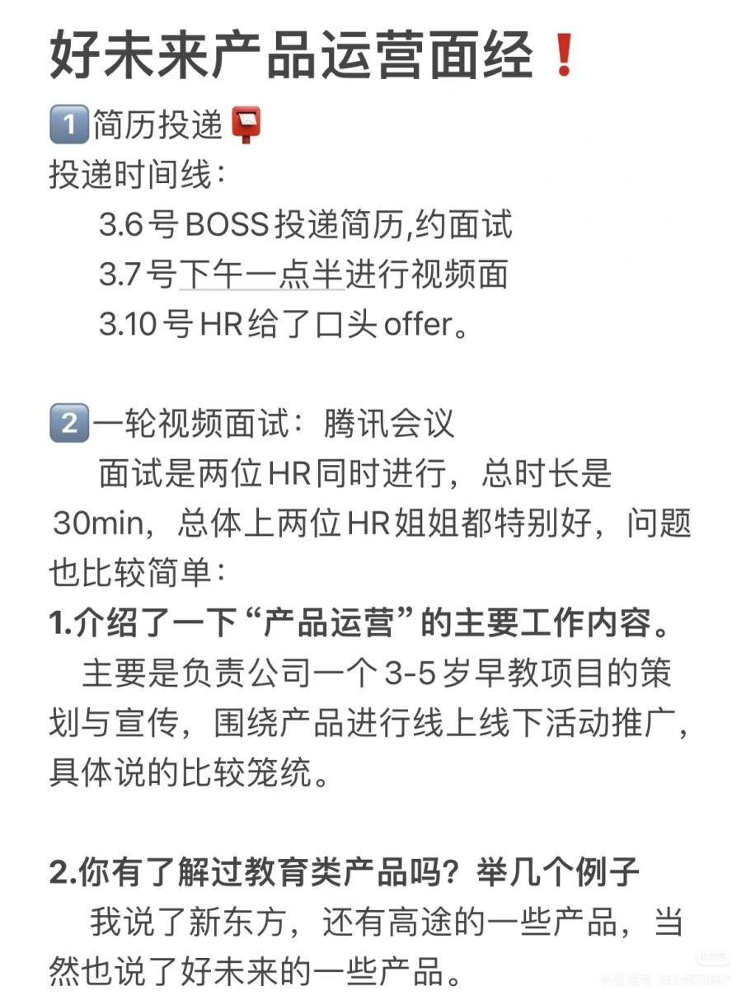

#### OCR 原文

好未来产品运营面经：产品运营工作面向 3-5 岁早教项目推广；了解教育产品；如何用视频或图文推广早教课；公域和私域流量；如何面向 3-5 岁产品做大规模推广；通勤、地点、工作时间和反问。

#### 清洗后文本

教育产品运营面试关注早教产品推广、视频/图文内容、公域私域流量和用户触达。

#### 结构化候选问答

- 岗位：运营助理
- 问题：教育产品运营如何设计 3-5 岁早教课程的推广方案？
- 回答要点：先明确购买者是家长、使用者是儿童，内容要突出安全、兴趣、成长效果和陪伴场景；公域可用短视频、图文种草和直播，私域可用社群、试听课、打卡和案例反馈；需要用线索量、试听转化、留存和复购衡量效果。
- 复盘：该题考察产品运营对用户角色、内容形式和转化链路的理解。
- 能力：教育产品运营、公域私域、内容推广、转化设计
- 来源：01_2_image_022_dd2f7b07cb.jpeg

### 图片 23: 01_2_image_023_3a189c158d.jpeg

- 来源：`D:\apps\ai-interview_archive\2026-05-23\面试经历(2).docx`
- SHA256：`3a189c158d65af8e32861e65700e0cca3cab3d1232f8582ae7f9bf629a3e4607`
- OCR 状态：`ocr_unavailable`
- OCR 置信度：``
- 目标岗位：待人工确认
- 审核状态：待核验
- 复用来源：hash_override
- 是否进入 package：False
- 是否需要复核：True
- 图片：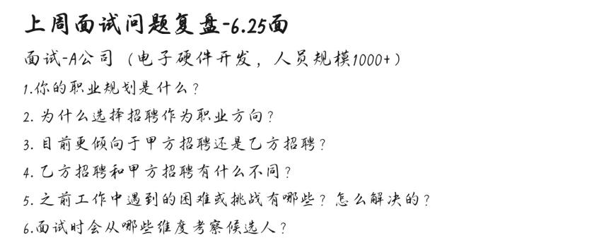

#### OCR 原文

（无 OCR 原文）

#### 清洗后文本

（无清洗文本）

#### 结构化候选问答

- 暂无可入库结构化问答。

### 图片 24: 01_2_image_024_9b3bf297f1.jpeg

- 来源：`D:\apps\ai-interview_archive\2026-05-23\面试经历(2).docx`
- SHA256：`9b3bf297f15283943dac2015c70a3b1b330e8f01105ed1c7e8186b5eb2261cca`
- OCR 状态：`ocr_unavailable`
- OCR 置信度：``
- 目标岗位：待人工确认
- 审核状态：待核验
- 复用来源：hash_override
- 是否进入 package：False
- 是否需要复核：True
- 图片：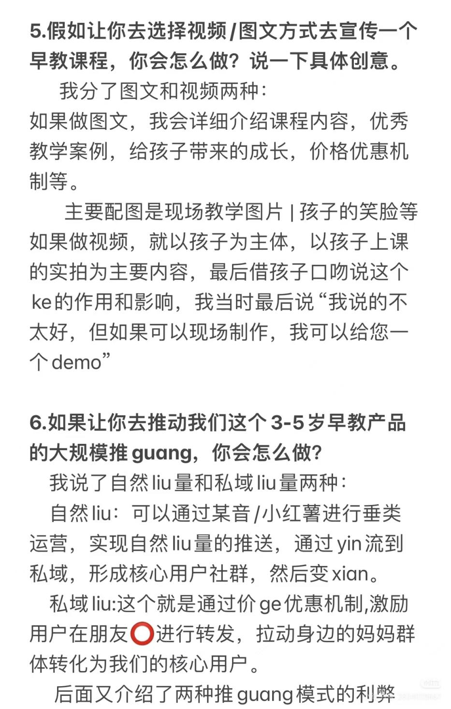

#### OCR 原文

（无 OCR 原文）

#### 清洗后文本

（无清洗文本）

#### 结构化候选问答

- 暂无可入库结构化问答。

### 图片 25: 01_2_image_025_4bb90eff0f.jpeg

- 来源：`D:\apps\ai-interview_archive\2026-05-23\面试经历(2).docx`
- SHA256：`4bb90eff0f7abe04ef8002cb68558af636b2f97913bdc330d783159fb9f7c60c`
- OCR 状态：`ocr_unavailable`
- OCR 置信度：``
- 目标岗位：待人工确认
- 审核状态：待核验
- 复用来源：hash_override
- 是否进入 package：False
- 是否需要复核：True
- 图片：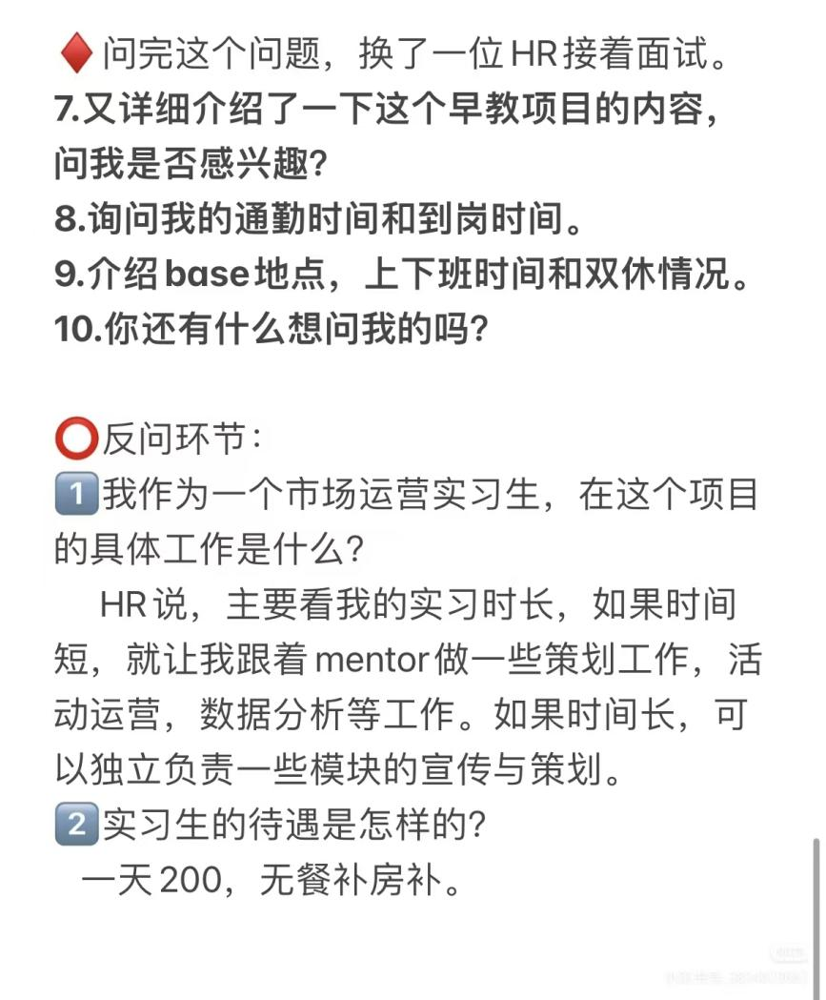

#### OCR 原文

（无 OCR 原文）

#### 清洗后文本

（无清洗文本）

#### 结构化候选问答

- 暂无可入库结构化问答。

### 图片 26: 01_2_image_026_47e50fdf16.jpeg

- 来源：`D:\apps\ai-interview_archive\2026-05-23\面试经历(2).docx`
- SHA256：`47e50fdf16f625db0269f7f733ebbb7c6ba76d55c48bb238fdea07576977870b`
- OCR 状态：`ocr_unavailable`
- OCR 置信度：``
- 目标岗位：待人工确认
- 审核状态：待核验
- 复用来源：hash_override
- 是否进入 package：False
- 是否需要复核：True
- 图片：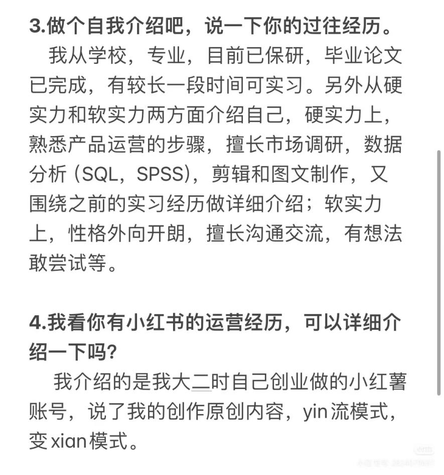

#### OCR 原文

（无 OCR 原文）

#### 清洗后文本

（无清洗文本）

#### 结构化候选问答

- 暂无可入库结构化问答。

### 图片 27: 01_2_image_027_a2b8966e7c.jpeg

- 来源：`D:\apps\ai-interview_archive\2026-05-23\面试经历(2).docx`
- SHA256：`a2b8966e7c1e2f91e0efa2a543654aca1dad730eedcd24e8d405b286737c07bb`
- OCR 状态：`ocr_unavailable`
- OCR 置信度：``
- 目标岗位：待人工确认
- 审核状态：待核验
- 复用来源：hash_override
- 是否进入 package：False
- 是否需要复核：True
- 图片：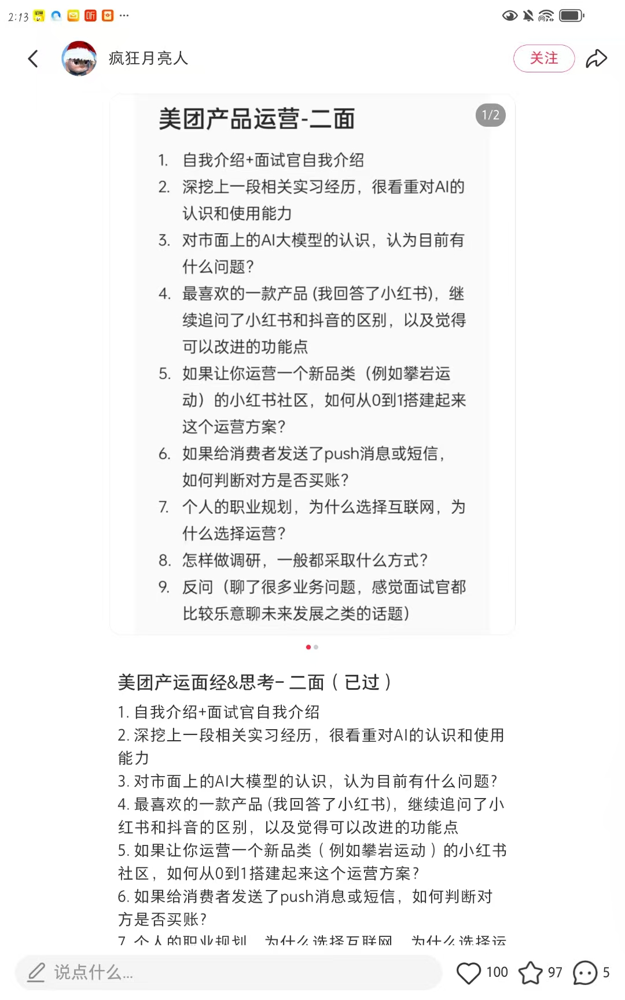

#### OCR 原文

（无 OCR 原文）

#### 清洗后文本

（无清洗文本）

#### 结构化候选问答

- 暂无可入库结构化问答。

### 图片 28: 01_2_image_028_73d64e01fb.jpeg

- 来源：`D:\apps\ai-interview_archive\2026-05-23\面试经历(2).docx`
- SHA256：`73d64e01fbc0dea4dacff6b16a5f11fd9505b90580fe9e78cbce164c8ef922d6`
- OCR 状态：`reused_manual_visual_ocr_by_hash`
- OCR 置信度：`0.76`
- 目标岗位：运营助理
- 审核状态：待核验
- 复用来源：hash_override
- 是否进入 package：False
- 是否需要复核：True
- 图片：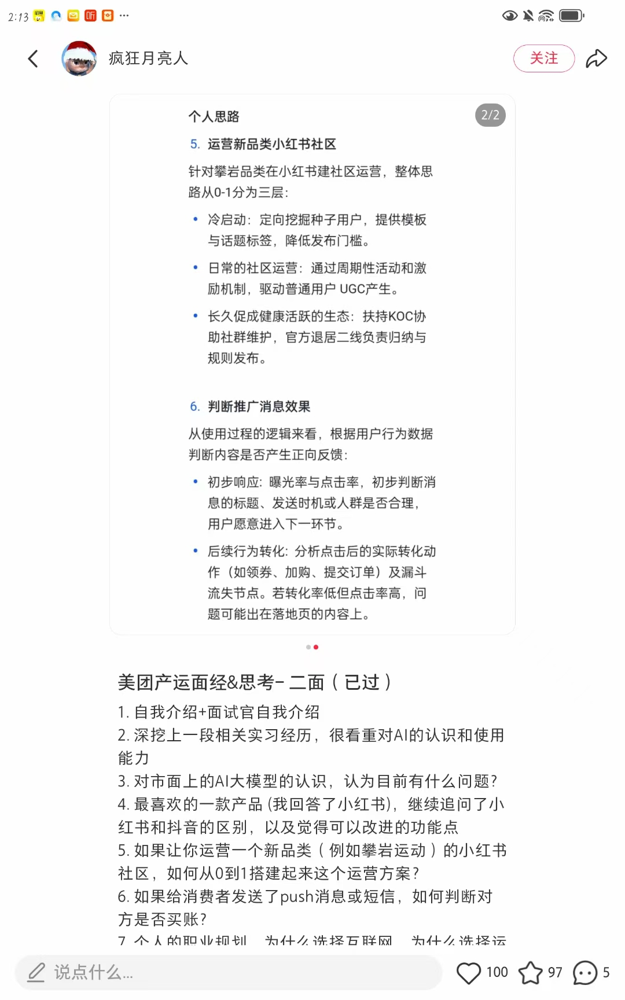

#### OCR 原文

美团产品运营二面：自我介绍；AI 知识；喜欢的产品小红书和抖音区别；新品类运营计划；push 和短信购买判断；职业规划和为什么互联网；市场调研；反问。总结：未来规划和个人规划会被问。

#### 清洗后文本

美团产品运营二面重点围绕产品理解、AI 知识、新品类运营、触达渠道、职业规划和市场调研。

#### 结构化候选问答

- 岗位：运营助理
- 问题：运营面试中如何比较小红书和抖音的产品差异？
- 回答要点：可以从用户动机、内容形态、分发机制、消费决策链路、社区氛围、商业化方式和适合的运营目标来比较。小红书偏种草和决策参考，抖音偏内容消费和即时转化；回答要结合具体品类和运营目标，而不是简单说一个图文一个视频。
- 复盘：该题考察候选人的产品观察和运营策略迁移能力。
- 能力：产品分析、运营策略、渠道触达、AI 认知
- 来源：01_2_image_028_73d64e01fb.jpeg

### 图片 29: 01_2_image_029_b724954563.jpeg

- 来源：`D:\apps\ai-interview_archive\2026-05-23\面试经历(2).docx`
- SHA256：`b724954563cbe5e21ef87e25b6595acf1d3fca09bf5429357aa8c03a352f44b8`
- OCR 状态：`reused_manual_visual_ocr_by_hash`
- OCR 置信度：`0.74`
- 目标岗位：运营助理
- 审核状态：待核验
- 复用来源：hash_override
- 是否进入 package：False
- 是否需要复核：True
- 图片：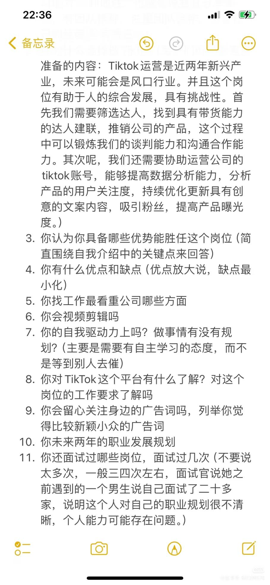

#### OCR 原文

TikTok 运营助理面试经验：自我介绍；为什么选择 TikTok 运营；岗位需要达人筛选、达人沟通、账号运营、数据分析、广告文案和品牌曝光；优势缺点；公司看重什么；视频剪辑；自我驱动力；了解 TikTok；广告词；未来两年规划；面试过哪些岗位和次数。

#### 清洗后文本

TikTok 运营助理面试重点是达人沟通、内容运营、数据分析、广告文案、品牌曝光、自驱力和职业规划。

#### 结构化候选问答

- 岗位：运营助理
- 问题：TikTok 运营助理如何回答达人筛选和账号运营能力？
- 回答要点：应说明如何根据目标用户、内容风格、粉丝画像、互动率、转化潜力和品牌匹配度筛选达人；账号运营需要结合内容选题、发布时间、互动数据、热点趋势、广告文案和转化指标持续优化。
- 复盘：该题适合短视频/跨境内容运营方向，强调数据和内容双能力。
- 能力：达人运营、内容运营、数据分析、品牌曝光
- 来源：01_2_image_029_b724954563.jpeg

### 图片 30: 01_2_image_030_f0a0726340.jpeg

- 来源：`D:\apps\ai-interview_archive\2026-05-23\面试经历(2).docx`
- SHA256：`f0a07263408b5e322ab8964c597d73990c9a5a3cab532ecc6ac8bf0956829e48`
- OCR 状态：`ocr_unavailable`
- OCR 置信度：``
- 目标岗位：待人工确认
- 审核状态：待核验
- 复用来源：hash_override
- 是否进入 package：False
- 是否需要复核：True
- 图片：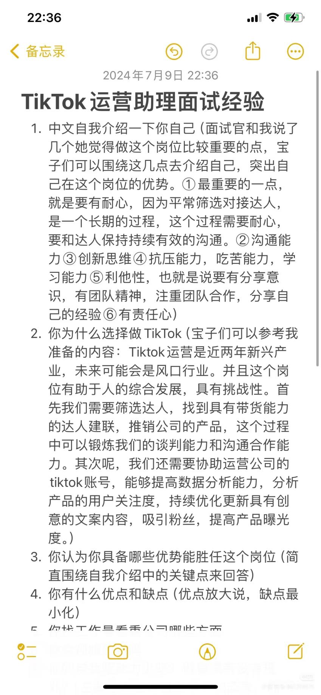

#### OCR 原文

（无 OCR 原文）

#### 清洗后文本

（无清洗文本）

#### 结构化候选问答

- 暂无可入库结构化问答。

### 图片 31: 01_2_image_031_7a5351997b.jpeg

- 来源：`D:\apps\ai-interview_archive\2026-05-23\面试经历(2).docx`
- SHA256：`7a5351997bd0a543c3041bbe3bbf72284661f96b28698ffb536c9fdf794c9bba`
- OCR 状态：`ocr_unavailable`
- OCR 置信度：``
- 目标岗位：待人工确认
- 审核状态：待核验
- 复用来源：hash_override
- 是否进入 package：False
- 是否需要复核：True
- 图片：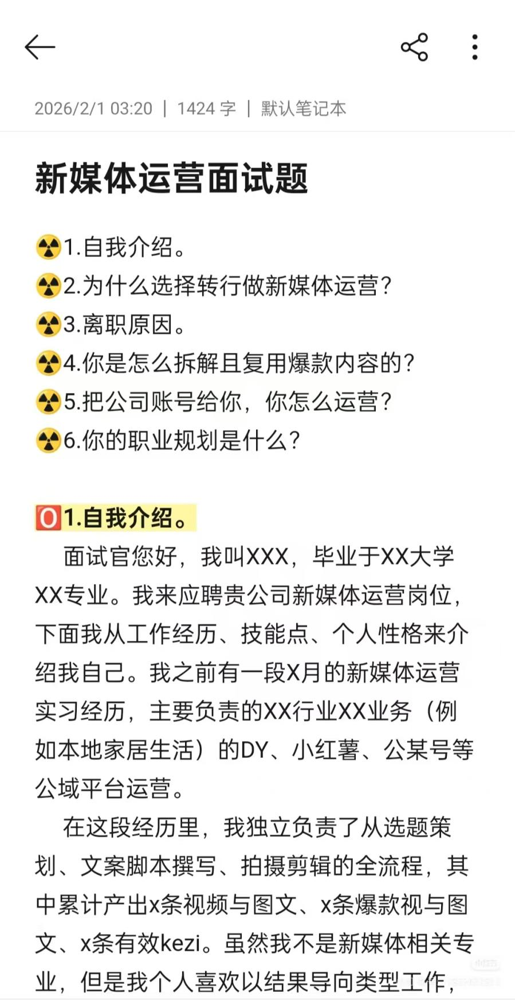

#### OCR 原文

（无 OCR 原文）

#### 清洗后文本

（无清洗文本）

#### 结构化候选问答

- 暂无可入库结构化问答。

### 图片 32: 01_2_image_032_336227ba6e.jpeg

- 来源：`D:\apps\ai-interview_archive\2026-05-23\面试经历(2).docx`
- SHA256：`336227ba6ebd2a19b9725d3aba01c2de8a283fd34590d8b58db90510529afe87`
- OCR 状态：`ocr_unavailable`
- OCR 置信度：``
- 目标岗位：待人工确认
- 审核状态：待核验
- 复用来源：hash_override
- 是否进入 package：False
- 是否需要复核：True
- 图片：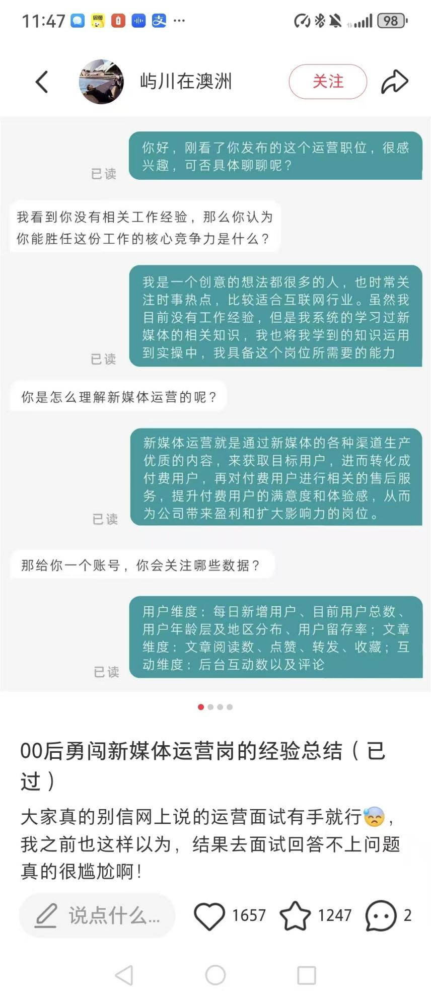

#### OCR 原文

（无 OCR 原文）

#### 清洗后文本

（无清洗文本）

#### 结构化候选问答

- 暂无可入库结构化问答。

### 图片 33: 01_2_image_033_4ca75d4261.jpeg

- 来源：`D:\apps\ai-interview_archive\2026-05-23\面试经历(2).docx`
- SHA256：`4ca75d4261453c496a70f2968c9c4c551d4286f8621d42a75df466c0ccb0df2c`
- OCR 状态：`ocr_unavailable`
- OCR 置信度：``
- 目标岗位：待人工确认
- 审核状态：待核验
- 复用来源：hash_override
- 是否进入 package：False
- 是否需要复核：True
- 图片：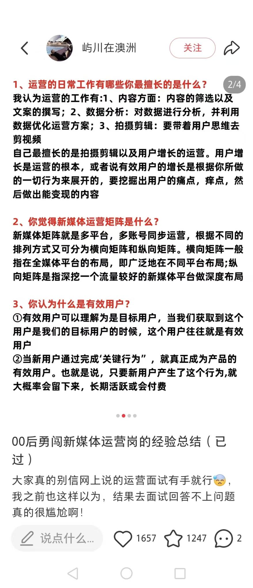

#### OCR 原文

（无 OCR 原文）

#### 清洗后文本

（无清洗文本）

#### 结构化候选问答

- 暂无可入库结构化问答。

### 图片 34: 01_2_image_034_2e04f2be9f.jpeg

- 来源：`D:\apps\ai-interview_archive\2026-05-23\面试经历(2).docx`
- SHA256：`2e04f2be9fd228a4ee2bdf8d40b762fafbb3ea0b3e28c836639f98206fb0d69a`
- OCR 状态：`reused_manual_visual_ocr_by_hash`
- OCR 置信度：`0.78`
- 目标岗位：人力资源专员
- 审核状态：待核验
- 复用来源：hash_override
- 是否进入 package：False
- 是否需要复核：True
- 图片：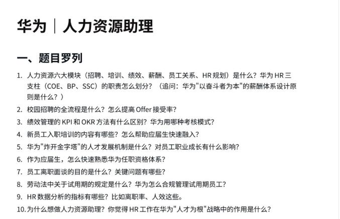

#### OCR 原文

华为人力资源助理：HR 六大模块；华为 HR 三支柱 COE/BP/SSC；校园招聘录用率；绩效考核指标；入职培训；人才发展机制；校园大使招募；劳动法试用期；HR 数据分析指标；为什么选择华为和人力资源助理。

#### 清洗后文本

华为 HR 助理题目覆盖 HR 模块、三支柱、校招、绩效、培训、人才发展、劳动法和 HR 数据分析。

#### 结构化候选问答

- 岗位：人力资源专员
- 问题：HR 面试中如何解释 COE、BP、SSC 三支柱分工？
- 回答要点：COE 负责制度、政策和专业方案设计；BP 贴近业务，理解业务目标并推动组织和人才问题解决；SSC 提供标准化、流程化和共享服务。回答时可结合招聘、绩效、培训或员工关系举例说明三者如何协同。
- 复盘：该题适合基础 HR 岗位，考察体系化认知和业务协作理解。
- 能力：HR 三支柱、绩效培训、劳动法、数据分析
- 来源：01_2_image_034_2e04f2be9f.jpeg

### 图片 35: 01_2_image_035_48ada8b64d.jpeg

- 来源：`D:\apps\ai-interview_archive\2026-05-23\面试经历(2).docx`
- SHA256：`48ada8b64d562f8503ab9d071943feddd28cdbc5df9a59d9d399c7f7164ac72c`
- OCR 状态：`ocr_unavailable`
- OCR 置信度：``
- 目标岗位：待人工确认
- 审核状态：待核验
- 复用来源：hash_override
- 是否进入 package：False
- 是否需要复核：True
- 图片：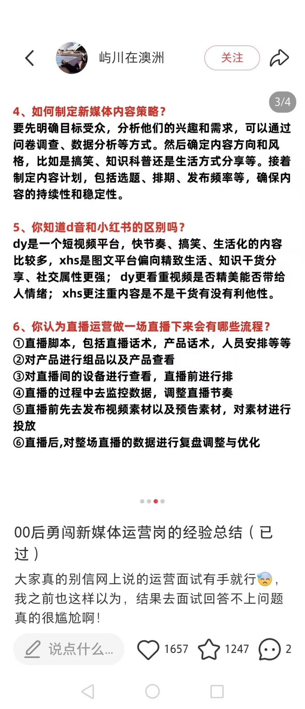

#### OCR 原文

（无 OCR 原文）

#### 清洗后文本

（无清洗文本）

#### 结构化候选问答

- 暂无可入库结构化问答。

### 图片 36: 01_2_image_036_f33d1cae57.jpeg

- 来源：`D:\apps\ai-interview_archive\2026-05-23\面试经历(2).docx`
- SHA256：`f33d1cae57e40093a7cf8985c72a83d2ea61d3832d326d3ad507fe6528aef342`
- OCR 状态：`ocr_unavailable`
- OCR 置信度：``
- 目标岗位：待人工确认
- 审核状态：待核验
- 复用来源：hash_override
- 是否进入 package：False
- 是否需要复核：True
- 图片：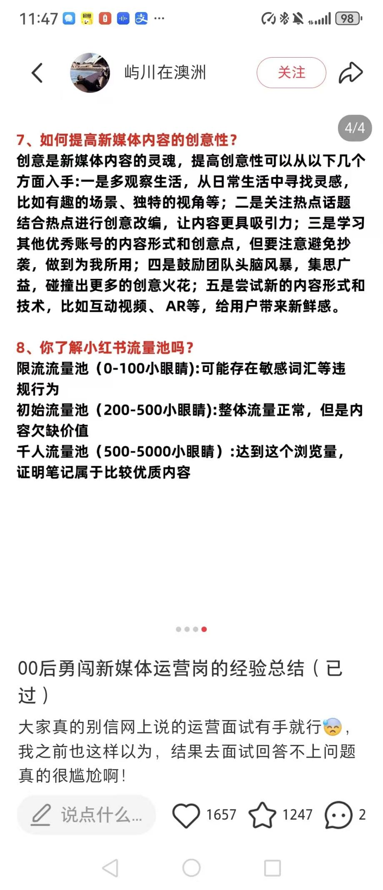

#### OCR 原文

（无 OCR 原文）

#### 清洗后文本

（无清洗文本）

#### 结构化候选问答

- 暂无可入库结构化问答。

### 图片 37: 01_2_image_037_e8e5bd5049.jpeg

- 来源：`D:\apps\ai-interview_archive\2026-05-23\面试经历(2).docx`
- SHA256：`e8e5bd50498613aeee63ea1c6b21f6d38ef88b5d529e099d68d676b60853225c`
- OCR 状态：`ocr_unavailable`
- OCR 置信度：``
- 目标岗位：待人工确认
- 审核状态：待核验
- 复用来源：hash_override
- 是否进入 package：False
- 是否需要复核：True
- 图片：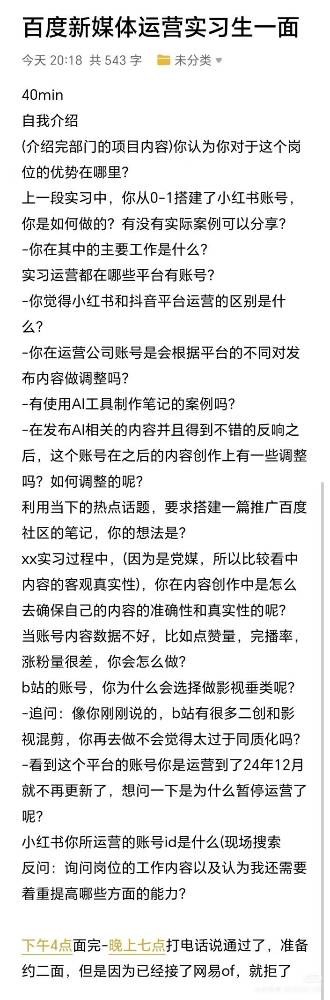

#### OCR 原文

（无 OCR 原文）

#### 清洗后文本

（无清洗文本）

#### 结构化候选问答

- 暂无可入库结构化问答。

### 图片 38: 01_2_image_038_d0f1084213.jpeg

- 来源：`D:\apps\ai-interview_archive\2026-05-23\面试经历(2).docx`
- SHA256：`d0f108421349a4997dca3575aacb385929251e48575c0cbd51e4582968f7b39c`
- OCR 状态：`ocr_unavailable`
- OCR 置信度：``
- 目标岗位：待人工确认
- 审核状态：待核验
- 复用来源：hash_override
- 是否进入 package：False
- 是否需要复核：True
- 图片：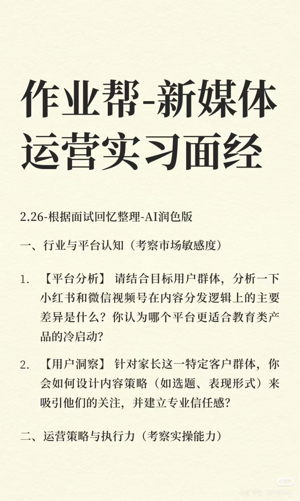

#### OCR 原文

（无 OCR 原文）

#### 清洗后文本

（无清洗文本）

#### 结构化候选问答

- 暂无可入库结构化问答。

### 图片 39: 01_2_image_039_b87a83df26.jpeg

- 来源：`D:\apps\ai-interview_archive\2026-05-23\面试经历(2).docx`
- SHA256：`b87a83df2633a59f550598d3bdbf9027c97e33e4ebc844852f85ec62d5b8fd3d`
- OCR 状态：`ocr_unavailable`
- OCR 置信度：``
- 目标岗位：待人工确认
- 审核状态：待核验
- 复用来源：hash_override
- 是否进入 package：False
- 是否需要复核：True
- 图片：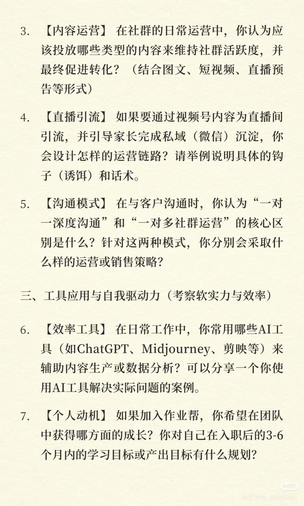

#### OCR 原文

（无 OCR 原文）

#### 清洗后文本

（无清洗文本）

#### 结构化候选问答

- 暂无可入库结构化问答。

### 图片 40: 01_2_image_040_0559f2387a.jpeg

- 来源：`D:\apps\ai-interview_archive\2026-05-23\面试经历(2).docx`
- SHA256：`0559f2387a3a9940eb6d98f2b082312ebc3d5c8ac35ae7a9d5337382f4bd679f`
- OCR 状态：`ocr_unavailable`
- OCR 置信度：``
- 目标岗位：待人工确认
- 审核状态：待核验
- 复用来源：hash_override
- 是否进入 package：False
- 是否需要复核：True
- 图片：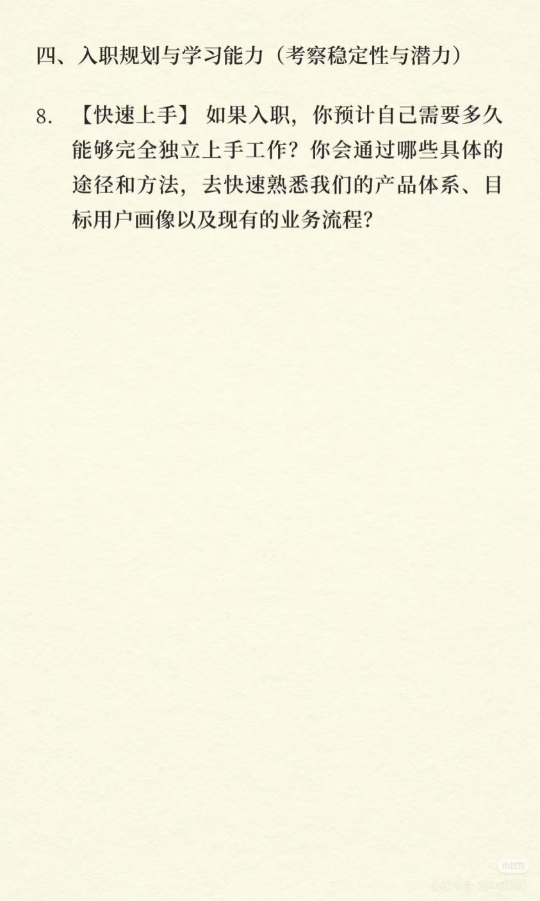

#### OCR 原文

（无 OCR 原文）

#### 清洗后文本

（无清洗文本）

#### 结构化候选问答

- 暂无可入库结构化问答。

### 图片 41: 01_2_image_041_2c763e62df.jpeg

- 来源：`D:\apps\ai-interview_archive\2026-05-23\面试经历(2).docx`
- SHA256：`2c763e62df25985abaf26441e2dd2e2fa9d17e7e21ce9e7bb27f0f51033ff7be`
- OCR 状态：`ocr_unavailable`
- OCR 置信度：``
- 目标岗位：待人工确认
- 审核状态：待核验
- 复用来源：hash_override
- 是否进入 package：False
- 是否需要复核：True
- 图片：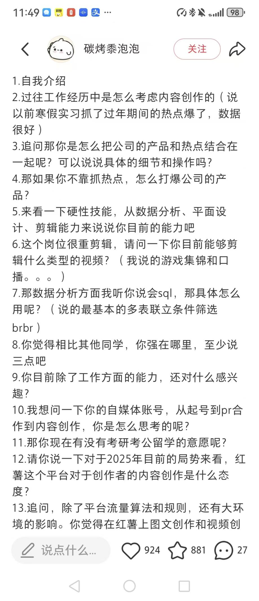

#### OCR 原文

（无 OCR 原文）

#### 清洗后文本

（无清洗文本）

#### 结构化候选问答

- 暂无可入库结构化问答。

### 图片 42: 01_2_image_042_48d8d55ec0.jpeg

- 来源：`D:\apps\ai-interview_archive\2026-05-23\面试经历(2).docx`
- SHA256：`48d8d55ec034f7a73651608deb199e018c2705ebcf460e7d6673e12b99a9d85f`
- OCR 状态：`ocr_unavailable`
- OCR 置信度：``
- 目标岗位：待人工确认
- 审核状态：待核验
- 复用来源：hash_override
- 是否进入 package：False
- 是否需要复核：True
- 图片：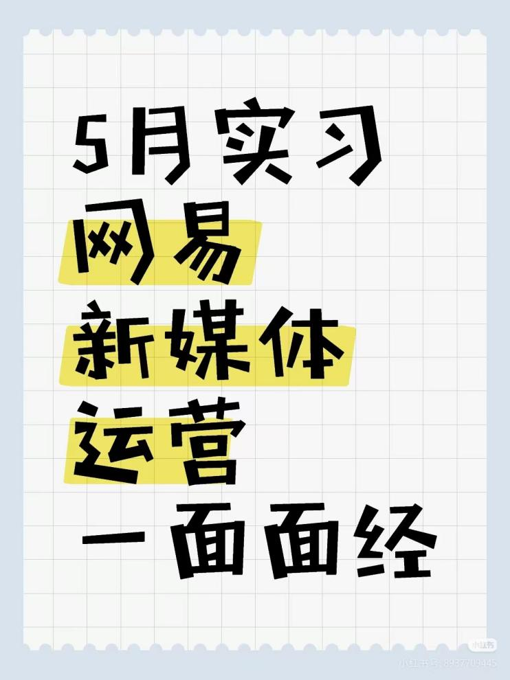

#### OCR 原文

（无 OCR 原文）

#### 清洗后文本

（无清洗文本）

#### 结构化候选问答

- 暂无可入库结构化问答。

### 图片 43: 01_2_image_043_b95ee67276.jpeg

- 来源：`D:\apps\ai-interview_archive\2026-05-23\面试经历(2).docx`
- SHA256：`b95ee67276e35de6bb694e4cbf7c7c90c0029b90b2a8e85f3bfc754920b16059`
- OCR 状态：`ocr_unavailable`
- OCR 置信度：``
- 目标岗位：待人工确认
- 审核状态：待核验
- 复用来源：hash_override
- 是否进入 package：False
- 是否需要复核：True
- 图片：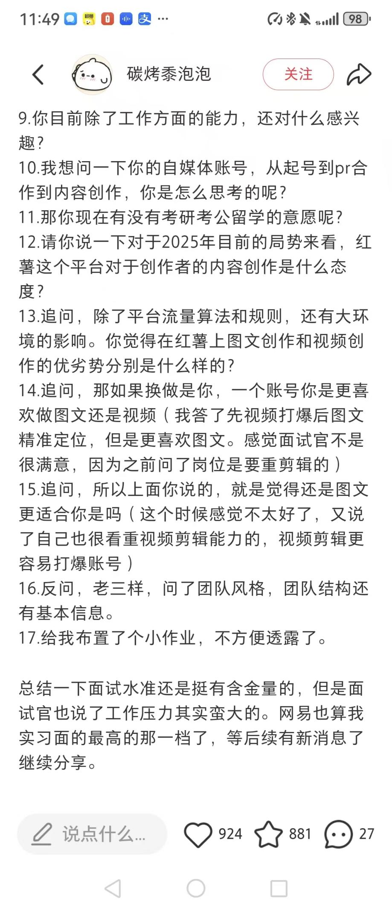

#### OCR 原文

（无 OCR 原文）

#### 清洗后文本

（无清洗文本）

#### 结构化候选问答

- 暂无可入库结构化问答。

### 图片 44: 01_2_image_044_47059ca4ad.jpeg

- 来源：`D:\apps\ai-interview_archive\2026-05-23\面试经历(2).docx`
- SHA256：`47059ca4ad8501f7d00a1beb93a882b2291c732ebaa3eda06fd4eb540836a013`
- OCR 状态：`ocr_unavailable`
- OCR 置信度：``
- 目标岗位：待人工确认
- 审核状态：待核验
- 复用来源：hash_override
- 是否进入 package：False
- 是否需要复核：True
- 图片：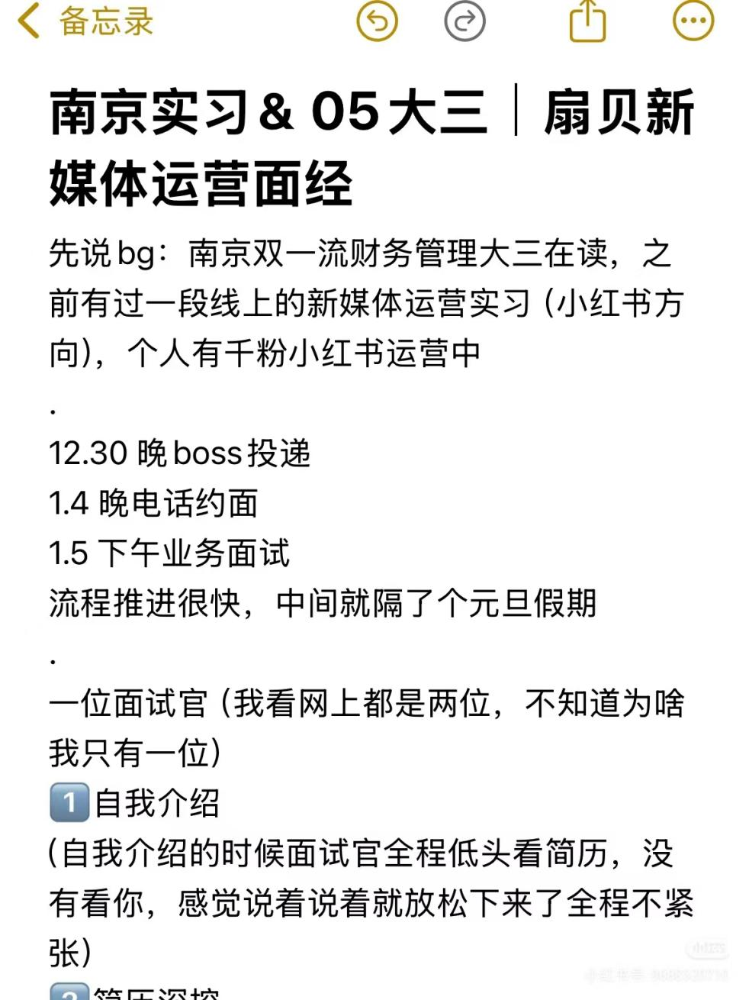

#### OCR 原文

（无 OCR 原文）

#### 清洗后文本

（无清洗文本）

#### 结构化候选问答

- 暂无可入库结构化问答。

### 图片 45: 01_2_image_045_88fc2661cd.jpeg

- 来源：`D:\apps\ai-interview_archive\2026-05-23\面试经历(2).docx`
- SHA256：`88fc2661cda94f4cafdb8a5e2b28d2dfcc91e32db78754cb14e70ccd71184dab`
- OCR 状态：`reused_manual_visual_ocr_by_hash`
- OCR 置信度：`0.76`
- 目标岗位：人力资源专员
- 审核状态：待核验
- 复用来源：hash_override
- 是否进入 package：False
- 是否需要复核：True
- 图片：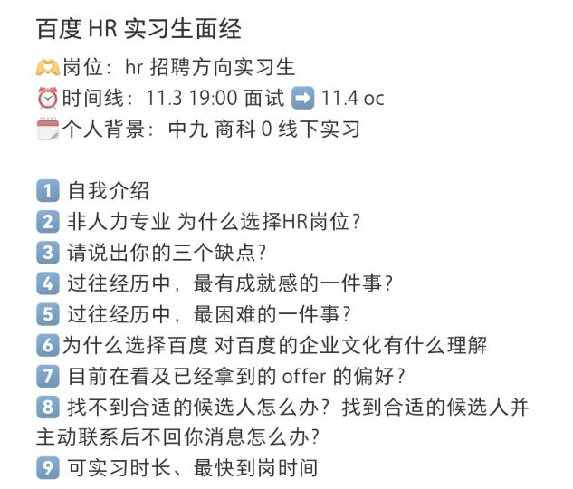

#### OCR 原文

百度 HR 实习生：自我介绍；非 HR 专业为什么做人力；三个缺点；成就感；最困难的事；为什么选择百度和文化；offer 偏好；找不到候选人怎么办；候选人不回复怎么办；实习时长和到岗时间。

#### 清洗后文本

百度 HR 实习生面经关注转岗动机、个人特质、困难经历、候选人触达和实习稳定性。

#### 结构化候选问答

- 岗位：人力资源专员
- 问题：招聘实习中候选人不回复或找不到合适候选人，你会怎么办？
- 回答要点：可以从岗位画像重新校准、渠道拓展、搜索关键词优化、候选人分层、触达话术优化、触达时间调整和跟进节奏管理回答；同时要记录反馈，判断是岗位吸引力不足、薪资不匹配、渠道不准还是话术问题。
- 复盘：该题考察招聘执行韧性和问题复盘，而不是只问是否抗压。
- 能力：候选人触达、招聘执行、问题复盘、沟通抗压
- 来源：01_2_image_045_88fc2661cd.jpeg

### 图片 46: 01_2_image_046_8ff9e57e3e.jpeg

- 来源：`D:\apps\ai-interview_archive\2026-05-23\面试经历(2).docx`
- SHA256：`8ff9e57e3ec10490bdd5f60e1678b05132ebf9ee852f0db32db04788803d8e80`
- OCR 状态：`ocr_unavailable`
- OCR 置信度：``
- 目标岗位：待人工确认
- 审核状态：待核验
- 复用来源：hash_override
- 是否进入 package：False
- 是否需要复核：True
- 图片：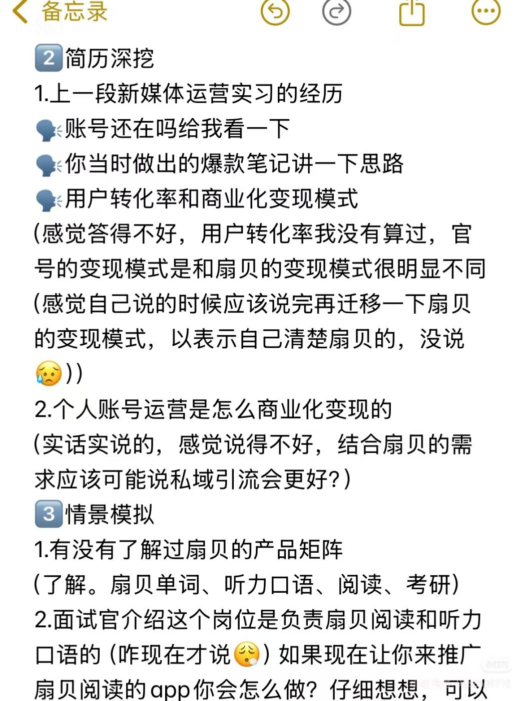

#### OCR 原文

（无 OCR 原文）

#### 清洗后文本

（无清洗文本）

#### 结构化候选问答

- 暂无可入库结构化问答。

### 图片 47: 01_2_image_047_dea28ddc6f.jpeg

- 来源：`D:\apps\ai-interview_archive\2026-05-23\面试经历(2).docx`
- SHA256：`dea28ddc6f113602d508f114111693b2b788e8d7ddc04c12261b66e9de673f57`
- OCR 状态：`ocr_unavailable`
- OCR 置信度：``
- 目标岗位：待人工确认
- 审核状态：待核验
- 复用来源：hash_override
- 是否进入 package：False
- 是否需要复核：True
- 图片：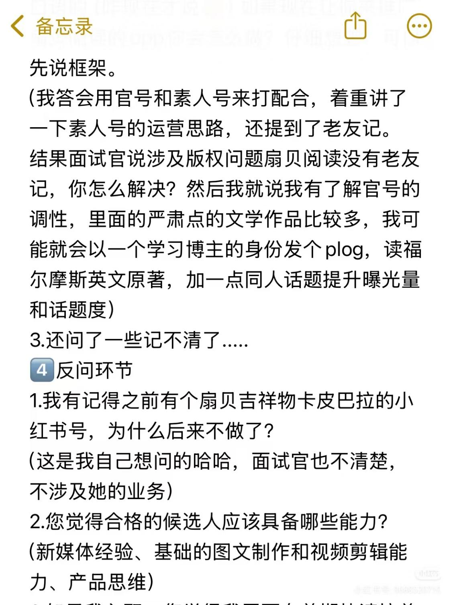

#### OCR 原文

（无 OCR 原文）

#### 清洗后文本

（无清洗文本）

#### 结构化候选问答

- 暂无可入库结构化问答。

### 图片 48: 01_2_image_048_9dbd9e46d4.jpeg

- 来源：`D:\apps\ai-interview_archive\2026-05-23\面试经历(2).docx`
- SHA256：`9dbd9e46d40cd73f7bc75294ce92c73584d72892cece6eb32a0c103ad40ea4e3`
- OCR 状态：`ocr_unavailable`
- OCR 置信度：``
- 目标岗位：待人工确认
- 审核状态：待核验
- 复用来源：hash_override
- 是否进入 package：False
- 是否需要复核：True
- 图片：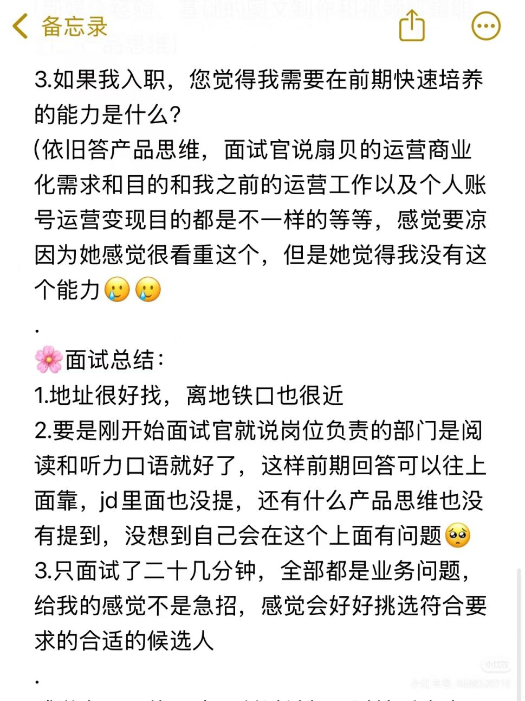

#### OCR 原文

（无 OCR 原文）

#### 清洗后文本

（无清洗文本）

#### 结构化候选问答

- 暂无可入库结构化问答。

### 图片 49: 01_2_image_049_882e177326.jpeg

- 来源：`D:\apps\ai-interview_archive\2026-05-23\面试经历(2).docx`
- SHA256：`882e1773267b719d6c2d3017bd121d3470e287043ddf1c52f0f2c63ae17ddb2d`
- OCR 状态：`ocr_unavailable`
- OCR 置信度：``
- 目标岗位：待人工确认
- 审核状态：待核验
- 复用来源：hash_override
- 是否进入 package：False
- 是否需要复核：True
- 图片：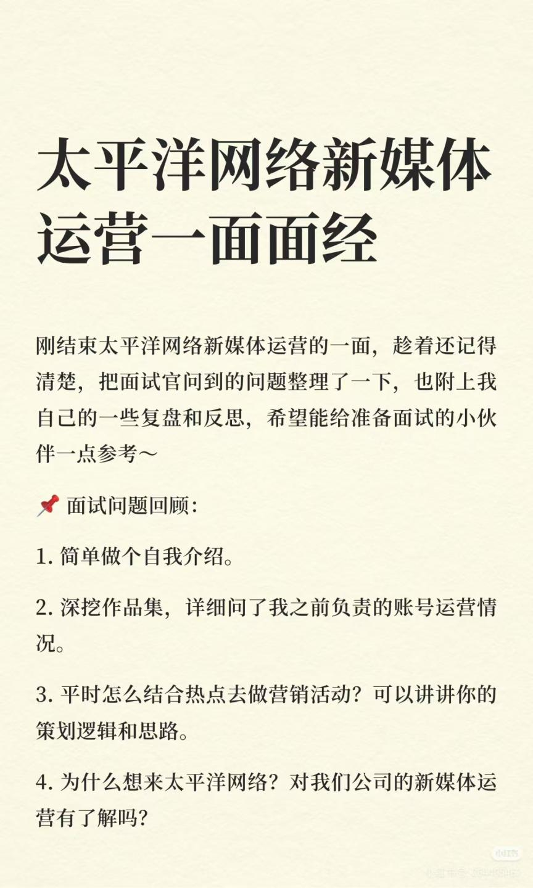

#### OCR 原文

（无 OCR 原文）

#### 清洗后文本

（无清洗文本）

#### 结构化候选问答

- 暂无可入库结构化问答。

### 图片 50: 01_2_image_050_5e2d9506cb.jpeg

- 来源：`D:\apps\ai-interview_archive\2026-05-23\面试经历(2).docx`
- SHA256：`5e2d9506cb3ffcdfe1c352e819de3019b696f7e062de3c2e253c13b7682d2518`
- OCR 状态：`ocr_unavailable`
- OCR 置信度：``
- 目标岗位：待人工确认
- 审核状态：待核验
- 复用来源：hash_override
- 是否进入 package：False
- 是否需要复核：True
- 图片：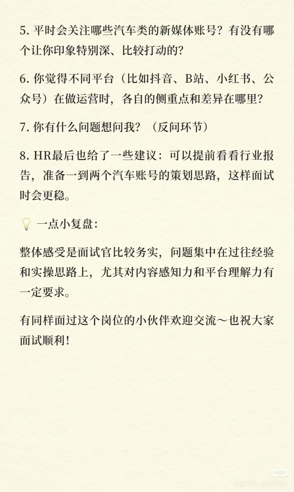

#### OCR 原文

（无 OCR 原文）

#### 清洗后文本

（无清洗文本）

#### 结构化候选问答

- 暂无可入库结构化问答。

### 图片 51: 01_2_image_051_614b144389.jpeg

- 来源：`D:\apps\ai-interview_archive\2026-05-23\面试经历(2).docx`
- SHA256：`614b144389e492e89b491d12028809b1082f548666286512a468e872bf70755e`
- OCR 状态：`ocr_unavailable`
- OCR 置信度：``
- 目标岗位：待人工确认
- 审核状态：待核验
- 复用来源：hash_override
- 是否进入 package：False
- 是否需要复核：True
- 图片：

#### OCR 原文

（无 OCR 原文）

#### 清洗后文本

（无清洗文本）

#### 结构化候选问答

- 暂无可入库结构化问答。

### 图片 52: 01_2_image_052_261e45c5b6.jpeg

- 来源：`D:\apps\ai-interview_archive\2026-05-23\面试经历(2).docx`
- SHA256：`261e45c5b6474a339889f2f248c476d118cbeb7679db3647c45f812237179c83`
- OCR 状态：`manual_visual_review`
- OCR 置信度：``
- 目标岗位：新媒体运营
- 审核状态：仅参考
- 复用来源：
- 是否进入 package：True
- 是否需要复核：False
- 图片：

#### OCR 原文

岗位要求：广告、新闻、市场营销、数字媒体等相关专业；熟悉抖音、小红书、知乎等平台；具备基础内容生产能力。高频题包括自我介绍、为什么选择新媒体运营、社交媒体内容发布经历、团队内容风格分歧沟通、核心非专业能力。

#### 清洗后文本

岗位要求：广告、新闻、市场营销、数字媒体等相关专业；熟悉抖音、小红书、知乎等平台；具备基础内容生产能力。高频题包括自我介绍、为什么选择新媒体运营、社交媒体内容发布经历、团队内容风格分歧沟通、核心非专业能力。

#### 结构化候选问答

- 岗位：新媒体运营
- 问题：为什么选择新媒体运营岗？如何理解“内容连接品牌与用户”的价值？
- 回答要点：回答应说明对目标用户、平台语境和品牌调性的理解；把内容从单纯发布上升到用户触达、互动反馈、转化线索和品牌心智沉淀；可结合抖音、小红书或知乎的内容形态差异说明。
- 复盘：该图更接近新媒体运营题库，可作为追问方向，不直接当作候选人经历。
- 能力：岗位认知、平台理解、内容策略
- 来源：01_2_image_052_261e45c5b6.jpeg

- 岗位：新媒体运营
- 问题：团队对某条内容的风格有分歧时，你会如何沟通推动共识？
- 回答要点：先回到内容目标、受众画像和发布平台规则，再用历史数据、竞品案例或小范围测试降低主观争论；明确哪些部分坚持品牌底线，哪些部分可以 A/B 测试，并同步复盘指标。
- 复盘：适合作为内容协作类追问，重点看数据化沟通。
- 能力：沟通协作、内容判断、数据意识
- 来源：01_2_image_052_261e45c5b6.jpeg

### 图片 53: 01_2_image_053_3d117b779d.jpeg

- 来源：`D:\apps\ai-interview_archive\2026-05-23\面试经历(2).docx`
- SHA256：`3d117b779d7ba6b2c02ee1f1547fa3c4810b5b82b5cb700e5d3988ebd7140bb6`
- OCR 状态：`ocr_unavailable`
- OCR 置信度：``
- 目标岗位：待人工确认
- 审核状态：待核验
- 复用来源：hash_override
- 是否进入 package：False
- 是否需要复核：True
- 图片：

#### OCR 原文

（无 OCR 原文）

#### 清洗后文本

（无清洗文本）

#### 结构化候选问答

- 暂无可入库结构化问答。

### 图片 54: 01_2_image_054_10eae257a7.jpeg

- 来源：`D:\apps\ai-interview_archive\2026-05-23\面试经历(2).docx`
- SHA256：`10eae257a774f4bf7b352f585c027c57174a44a1270e149c46ef6cc733e50ac7`
- OCR 状态：`ocr_unavailable`
- OCR 置信度：``
- 目标岗位：待人工确认
- 审核状态：待核验
- 复用来源：hash_override
- 是否进入 package：False
- 是否需要复核：True
- 图片：

#### OCR 原文

（无 OCR 原文）

#### 清洗后文本

（无清洗文本）

#### 结构化候选问答

- 暂无可入库结构化问答。

### 图片 55: 01_2_image_055_4811931c08.jpeg

- 来源：`D:\apps\ai-interview_archive\2026-05-23\面试经历(2).docx`
- SHA256：`4811931c08d953f0e372ede0f6faf54f0a80e08a3432b01111cdc45f610e102a`
- OCR 状态：`ocr_unavailable`
- OCR 置信度：``
- 目标岗位：待人工确认
- 审核状态：待核验
- 复用来源：hash_override
- 是否进入 package：False
- 是否需要复核：True
- 图片：

#### OCR 原文

（无 OCR 原文）

#### 清洗后文本

（无清洗文本）

#### 结构化候选问答

- 暂无可入库结构化问答。

### 图片 56: 01_2_image_056_cd0e0a4240.jpeg

- 来源：`D:\apps\ai-interview_archive\2026-05-23\面试经历(2).docx`
- SHA256：`cd0e0a42406d5747e124533c47864219ffe4045dcddbdddcb40912231ca8219a`
- OCR 状态：`ocr_unavailable`
- OCR 置信度：``
- 目标岗位：待人工确认
- 审核状态：待核验
- 复用来源：hash_override
- 是否进入 package：False
- 是否需要复核：True
- 图片：

#### OCR 原文

（无 OCR 原文）

#### 清洗后文本

（无清洗文本）

#### 结构化候选问答

- 暂无可入库结构化问答。

### 图片 57: 01_2_image_057_2b9425e1e3.jpeg

- 来源：`D:\apps\ai-interview_archive\2026-05-23\面试经历(2).docx`
- SHA256：`2b9425e1e3a95caa89707eda4ca24b282f3dfde8edbee0d13635917b7a0ed6d0`
- OCR 状态：`ocr_unavailable`
- OCR 置信度：``
- 目标岗位：待人工确认
- 审核状态：待核验
- 复用来源：hash_override
- 是否进入 package：False
- 是否需要复核：True
- 图片：

#### OCR 原文

（无 OCR 原文）

#### 清洗后文本

（无清洗文本）

#### 结构化候选问答

- 暂无可入库结构化问答。

### 图片 58: 01_2_image_058_bba53fbe24.jpeg

- 来源：`D:\apps\ai-interview_archive\2026-05-23\面试经历(2).docx`
- SHA256：`bba53fbe2485ddcd382a933581381093848c09486e80276e02405a99695831cb`
- OCR 状态：`ocr_unavailable`
- OCR 置信度：``
- 目标岗位：待人工确认
- 审核状态：待核验
- 复用来源：hash_override
- 是否进入 package：False
- 是否需要复核：True
- 图片：

#### OCR 原文

（无 OCR 原文）

#### 清洗后文本

（无清洗文本）

#### 结构化候选问答

- 暂无可入库结构化问答。

### 图片 59: 01_2_image_059_953345dbe5.jpeg

- 来源：`D:\apps\ai-interview_archive\2026-05-23\面试经历(2).docx`
- SHA256：`953345dbe5e332289795f1bfa7cd5c08e2212e317f3ca2e6962dc4994ab60936`
- OCR 状态：`ocr_unavailable`
- OCR 置信度：``
- 目标岗位：待人工确认
- 审核状态：待核验
- 复用来源：hash_override
- 是否进入 package：False
- 是否需要复核：True
- 图片：

#### OCR 原文

（无 OCR 原文）

#### 清洗后文本

（无清洗文本）

#### 结构化候选问答

- 暂无可入库结构化问答。

### 图片 60: 01_2_image_060_9aaf720862.jpeg

- 来源：`D:\apps\ai-interview_archive\2026-05-23\面试经历(2).docx`
- SHA256：`9aaf720862bd852f3e3286d0d71eda41c6beaa2135dc0650ff686e3134297716`
- OCR 状态：`ocr_unavailable`
- OCR 置信度：``
- 目标岗位：待人工确认
- 审核状态：待核验
- 复用来源：
- 是否进入 package：False
- 是否需要复核：True
- 图片：

#### OCR 原文

（无 OCR 原文）

#### 清洗后文本

（无清洗文本）

#### 结构化候选问答

- 暂无可入库结构化问答。

### 图片 61: 01_2_image_061_a425323f7e.jpeg

- 来源：`D:\apps\ai-interview_archive\2026-05-23\面试经历(2).docx`
- SHA256：`a425323f7e4afadd85d629b3a608b7ff0efe84746d3d6857baafedfaccb28913`
- OCR 状态：`manual_visual_review`
- OCR 置信度：``
- 目标岗位：行政管理助理
- 审核状态：可入库
- 复用来源：
- 是否进入 package：True
- 是否需要复核：False
- 图片：

#### OCR 原文

研究所行政岗面经：流程包括自我介绍、提问、候选人问答。问题涉及是否清楚行政管理岗、是否独生子女、家庭情况、为什么选择实验室、期望薪资、组织项目经历、技术岗理解、空窗期、面对新项目的优势缺点。

#### 清洗后文本

研究所行政岗面经：流程包括自我介绍、提问、候选人问答。问题涉及是否清楚行政管理岗、是否独生子女、家庭情况、为什么选择实验室、期望薪资、组织项目经历、技术岗理解、空窗期、面对新项目的优势缺点。

#### 结构化候选问答

- 岗位：行政管理助理
- 问题：行政管理岗面试中如何说明“为什么选择这个岗位，以及你能提供什么”？
- 回答要点：回答应先说明对行政工作的理解，包括流程支持、会议组织、文件流转、跨部门沟通和后勤保障；再结合个人经历说明细致、责任心、沟通协调和执行闭环；最后强调愿意从基础事务做起并沉淀流程。
- 复盘：该题适合判断候选人是否真正理解行政支持工作的价值。
- 能力：岗位认知、执行力、沟通协调
- 来源：01_2_image_061_a425323f7e.jpeg

- 岗位：行政管理助理
- 问题：面对一个新项目，你会如何说明自己的优势和不足？
- 回答要点：优势可围绕学习速度、信息整理、任务拆解、沟通跟进和记录复盘展开；不足要具体且可改进，例如行业背景不熟，需要通过制度文件、历史材料和请教同事快速补齐。
- 复盘：回答不能只说性格优点，应落到行政项目执行动作。
- 能力：自我认知、项目支持、复盘改进
- 来源：01_2_image_061_a425323f7e.jpeg

### 图片 62: 01_2_image_062_21e4e66437.jpeg

- 来源：`D:\apps\ai-interview_archive\2026-05-23\面试经历(2).docx`
- SHA256：`21e4e66437ceadb0274a06689625f7192fc0f2cda1cb3e60630d449394fb8fa6`
- OCR 状态：`manual_visual_review`
- OCR 置信度：``
- 目标岗位：行政管理助理
- 审核状态：可入库
- 复用来源：
- 是否进入 package：True
- 是否需要复核：False
- 图片：

#### OCR 原文

研究所行政岗续页：问题包括从哪知道招聘、写作方面是否多、公文相关经验、为什么简历没有论文填写；复盘提到岗位专业性要求不高但更看匹配度。

#### 清洗后文本

研究所行政岗续页：问题包括从哪知道招聘、写作方面是否多、公文相关经验、为什么简历没有论文填写；复盘提到岗位专业性要求不高但更看匹配度。

#### 结构化候选问答

- 岗位：行政管理助理
- 问题：没有很多公文或行政经验时，如何回答自己能胜任行政管理岗？
- 回答要点：先承认经验边界，再把已有的材料整理、会议记录、项目协调、信息核对或文书写作经历迁移到行政场景；说明会按模板、流程和审批要求学习，保证准确性、时效性和留痕。
- 复盘：该题用于区分候选人是否能把经历迁移为岗位能力，而不是简单说愿意学习。
- 能力：经验迁移、公文意识、流程执行
- 来源：01_2_image_062_21e4e66437.jpeg

### 图片 63: 01_2_image_063_09ab56224f.jpeg

- 来源：`D:\apps\ai-interview_archive\2026-05-23\面试经历(2).docx`
- SHA256：`09ab56224f943d288acd65237de0d78520b41686f710c582bd887f87155c2458`
- OCR 状态：`ocr_unavailable`
- OCR 置信度：``
- 目标岗位：待人工确认
- 审核状态：待核验
- 复用来源：
- 是否进入 package：False
- 是否需要复核：True
- 图片：

#### OCR 原文

（无 OCR 原文）

#### 清洗后文本

（无清洗文本）

#### 结构化候选问答

- 暂无可入库结构化问答。

### 图片 64: 01_2_image_064_a29f10597a.jpeg

- 来源：`D:\apps\ai-interview_archive\2026-05-23\面试经历(2).docx`
- SHA256：`a29f10597a46529d888a3837d56e208097e08ffdfcee9f396d4e90bd3bb93d27`
- OCR 状态：`ocr_unavailable`
- OCR 置信度：``
- 目标岗位：待人工确认
- 审核状态：待核验
- 复用来源：
- 是否进入 package：False
- 是否需要复核：True
- 图片：

#### OCR 原文

（无 OCR 原文）

#### 清洗后文本

（无清洗文本）

#### 结构化候选问答

- 暂无可入库结构化问答。

### 图片 65: 01_2_image_065_304bd7ff5e.jpeg

- 来源：`D:\apps\ai-interview_archive\2026-05-23\面试经历(2).docx`
- SHA256：`304bd7ff5ebc6831ec20dd09ce5202431aa5e4e40416278f18cd41a77e8d1710`
- OCR 状态：`ocr_unavailable`
- OCR 置信度：``
- 目标岗位：待人工确认
- 审核状态：待核验
- 复用来源：
- 是否进入 package：False
- 是否需要复核：True
- 图片：

#### OCR 原文

（无 OCR 原文）

#### 清洗后文本

（无清洗文本）

#### 结构化候选问答

- 暂无可入库结构化问答。

### 图片 66: 01_2_image_066_fbac40130d.jpeg

- 来源：`D:\apps\ai-interview_archive\2026-05-23\面试经历(2).docx`
- SHA256：`fbac40130dd07c62636f1597df41d11f1f0faff5c9f343156cb74344c7441578`
- OCR 状态：`manual_visual_review`
- OCR 置信度：``
- 目标岗位：行政管理助理
- 审核状态：仅参考
- 复用来源：
- 是否进入 package：True
- 是否需要复核：False
- 图片：

#### OCR 原文

歌尔集团行政管理岗面真题拆解：题目示例包括接到通知组织30人规模内部技术研讨会的完整流程和关键细节，以及协助领导安排重要客户来访接待。

#### 清洗后文本

歌尔集团行政管理岗面真题拆解：题目示例包括接到通知组织30人规模内部技术研讨会的完整流程和关键细节，以及协助领导安排重要客户来访接待。

#### 结构化候选问答

- 岗位：行政管理助理
- 问题：从接到通知到圆满完成一场30人规模内部技术研讨会，你会怎样安排流程和关键细节？
- 回答要点：可按需求确认、时间地点、参会名单、议程材料、会议通知、设备调试、签到接待、现场记录、餐饮交通、纪要输出和问题复盘拆解；关键是提前排风险、明确负责人和时间节点。
- 复盘：该题更像标准化题库，适合作为行政会务能力追问。
- 能力：会务组织、流程拆解、风险预案
- 来源：01_2_image_066_fbac40130d.jpeg

- 岗位：行政管理助理
- 问题：协助领导安排重要客户来访接待时，行政助理要关注哪些事项？
- 回答要点：需要确认来访目的、人员名单、行程安排、会议室、接待路线、材料准备、用餐住宿、保密要求和应急联系人；全程要做到信息准确、沟通及时、服务有边界。
- 复盘：可用于测试候选人是否有接待流程和服务意识。
- 能力：接待安排、跨部门协调、服务意识
- 来源：01_2_image_066_fbac40130d.jpeg

### 图片 67: 01_2_image_067_7fa82d1466.jpeg

- 来源：`D:\apps\ai-interview_archive\2026-05-23\面试经历(2).docx`
- SHA256：`7fa82d1466b0e5294ce5ff2e4bd022257fcfc7d402b0e38997f83f0f957fc748`
- OCR 状态：`reused_manual_visual_ocr_by_hash`
- OCR 置信度：`0.8`
- 目标岗位：人力资源专员
- 审核状态：待核验
- 复用来源：hash_override
- 是否进入 package：False
- 是否需要复核：True
- 图片：

#### OCR 原文

字节人力岗面经：英文自我介绍；为什么研究生转 HR；为什么喜欢招聘；吸引候选人案例；部门职责；转化率数据；难招岗位；目标公司人才画像；岗位吸引点；股权归属和晋升；候选人未通过原因；中澳招聘差异；渠道特点；工作因素和职业规划。

#### 清洗后文本

字节 HR 面试强度高，追问招聘数据、难招岗位、人才画像、候选人吸引、未通过原因和中英文表达。

#### 结构化候选问答

- 岗位：人力资源专员
- 问题：高强度 HR 面试如何回答“你如何吸引候选人并解释未通过原因”？
- 回答要点：回答候选人吸引时要结合岗位卖点、业务发展、成长机会、团队特点、薪酬福利和候选人动机；解释未通过原因时要基于岗位要求、能力证据、面试反馈和流程节点，避免主观评价；同时说明如何把失败原因反馈到岗位画像和渠道策略中。
- 复盘：该题适合大厂招聘岗，重点看数据、逻辑和候选人沟通边界。
- 能力：招聘数据、人才画像、候选人吸引、英文沟通
- 来源：01_2_image_067_7fa82d1466.jpeg

### 图片 68: 01_2_image_068_526c69b3dd.jpeg

- 来源：`D:\apps\ai-interview_archive\2026-05-23\面试经历(2).docx`
- SHA256：`526c69b3dda3f2e4155e42568ac0a159371ba15b7df5632e32044c8f0b07d958`
- OCR 状态：`ocr_unavailable`
- OCR 置信度：``
- 目标岗位：待人工确认
- 审核状态：待核验
- 复用来源：
- 是否进入 package：False
- 是否需要复核：True
- 图片：

#### OCR 原文

（无 OCR 原文）

#### 清洗后文本

（无清洗文本）

#### 结构化候选问答

- 暂无可入库结构化问答。

### 图片 69: 01_2_image_069_ecd675518c.jpeg

- 来源：`D:\apps\ai-interview_archive\2026-05-23\面试经历(2).docx`
- SHA256：`ecd675518c318344d1087c8b54faa737bc160c134835d7a8c4dbffbccf808a32`
- OCR 状态：`manual_visual_review`
- OCR 置信度：``
- 目标岗位：行政管理助理
- 审核状态：仅参考
- 复用来源：
- 是否进入 package：True
- 是否需要复核：False
- 图片：

#### OCR 原文

高校行政管理面试回忆版：题目包括结合自身经历说明做过的体现统筹协调能力的事。

#### 清洗后文本

高校行政管理面试回忆版：题目包括结合自身经历说明做过的体现统筹协调能力的事。

#### 结构化候选问答

- 岗位：行政管理助理
- 问题：结合自身经历，说明你做过的体现统筹协调能力的事情。
- 回答要点：回答可用 STAR 结构，说明任务目标、相关方、时间约束、资源冲突和自己的协调动作；重点突出信息同步、优先级排序、进度跟踪和结果复盘。
- 复盘：题库材料可作为行政岗位行为面试参考。
- 能力：统筹协调、沟通推进、结果复盘
- 来源：01_2_image_069_ecd675518c.jpeg

### 图片 70: 01_2_image_070_806d79f516.jpeg

- 来源：`D:\apps\ai-interview_archive\2026-05-23\面试经历(2).docx`
- SHA256：`806d79f516b76a59bfa380e2605a82b6994d1a32f2512058e91c4cd3bb754754`
- OCR 状态：`ocr_unavailable`
- OCR 置信度：``
- 目标岗位：待人工确认
- 审核状态：待核验
- 复用来源：
- 是否进入 package：False
- 是否需要复核：True
- 图片：

#### OCR 原文

（无 OCR 原文）

#### 清洗后文本

（无清洗文本）

#### 结构化候选问答

- 暂无可入库结构化问答。

### 图片 71: 01_2_image_071_8541c33e95.jpeg

- 来源：`D:\apps\ai-interview_archive\2026-05-23\面试经历(2).docx`
- SHA256：`8541c33e95f1dd6604105b54b20b73727de9110c50b2653ff6809c3e92d6c297`
- OCR 状态：`ocr_unavailable`
- OCR 置信度：``
- 目标岗位：待人工确认
- 审核状态：待核验
- 复用来源：
- 是否进入 package：False
- 是否需要复核：True
- 图片：

#### OCR 原文

（无 OCR 原文）

#### 清洗后文本

（无清洗文本）

#### 结构化候选问答

- 暂无可入库结构化问答。

### 图片 72: 01_2_image_072_b3a0fbc54f.jpeg

- 来源：`D:\apps\ai-interview_archive\2026-05-23\面试经历(2).docx`
- SHA256：`b3a0fbc54ff82ca6a34615ac249fc1c5e160ecc180fc0aca42c2e39823bdcd1b`
- OCR 状态：`manual_visual_review`
- OCR 置信度：``
- 目标岗位：行政管理助理
- 审核状态：仅参考
- 复用来源：
- 是否进入 package：True
- 是否需要复核：False
- 图片：

#### OCR 原文

高校行政管理面试回忆版：人际关系类问题包括部门领导批评内容不规范、学生家长频繁查材料、高要求领导催办等场景。

#### 清洗后文本

高校行政管理面试回忆版：人际关系类问题包括部门领导批评内容不规范、学生家长频繁查材料、高要求领导催办等场景。

#### 结构化候选问答

- 岗位：行政管理助理
- 问题：高校行政工作需要较强原则性，如何把握“原则”与“灵活”的平衡？
- 回答要点：原则上遵守制度、流程、权限和信息安全；灵活上体现在沟通方式、材料解释、时间协调和替代方案设计；遇到例外事项要请示留痕，不私自突破规则。
- 复盘：该题适合考察行政岗位的边界感和服务意识。
- 能力：制度意识、沟通协调、风险边界
- 来源：01_2_image_072_b3a0fbc54f.jpeg

### 图片 73: 01_2_image_073_e7fb74b7dc.jpeg

- 来源：`D:\apps\ai-interview_archive\2026-05-23\面试经历(2).docx`
- SHA256：`e7fb74b7dc7046c9111f1dd7bdca88657c9f61e8dd5e291e7b7c88df9c3b8ab9`
- OCR 状态：`ocr_unavailable`
- OCR 置信度：``
- 目标岗位：待人工确认
- 审核状态：待核验
- 复用来源：
- 是否进入 package：False
- 是否需要复核：True
- 图片：

#### OCR 原文

（无 OCR 原文）

#### 清洗后文本

（无清洗文本）

#### 结构化候选问答

- 暂无可入库结构化问答。

### 图片 74: 01_2_image_074_9e89381351.jpeg

- 来源：`D:\apps\ai-interview_archive\2026-05-23\面试经历(2).docx`
- SHA256：`9e89381351cd6b44da6dec227ebcf7fa419c40f7460174bab0fd70bef73d3b8e`
- OCR 状态：`ocr_unavailable`
- OCR 置信度：``
- 目标岗位：待人工确认
- 审核状态：待核验
- 复用来源：
- 是否进入 package：False
- 是否需要复核：True
- 图片：

#### OCR 原文

（无 OCR 原文）

#### 清洗后文本

（无清洗文本）

#### 结构化候选问答

- 暂无可入库结构化问答。

### 图片 75: 01_2_image_075_f330cbd7bb.jpeg

- 来源：`D:\apps\ai-interview_archive\2026-05-23\面试经历(2).docx`
- SHA256：`f330cbd7bb4e4e471c95849030886bf464966b7579846bffecf316f038a56b5a`
- OCR 状态：`manual_visual_review`
- OCR 置信度：``
- 目标岗位：行政管理助理
- 审核状态：仅参考
- 复用来源：
- 是否进入 package：True
- 是否需要复核：False
- 图片：

#### OCR 原文

京东行政专员面真题拆解：题目涉及行政专员角色理解、一天上午多个任务并行时如何安排、跨部门协调、办公用品盘点、紧急会议室安排等。

#### 清洗后文本

京东行政专员面真题拆解：题目涉及行政专员角色理解、一天上午多个任务并行时如何安排、跨部门协调、办公用品盘点、紧急会议室安排等。

#### 结构化候选问答

- 岗位：行政管理助理
- 问题：如果同一天上午有会议安排、物资处理和临时接待等多项任务，行政专员如何排优先级？
- 回答要点：先判断时间刚性、影响范围和是否可委托；对外部客户、会议开始时间、领导日程等高刚性事项优先处理；同步告知相关方预期，使用清单跟踪，完成后补充记录和复盘。
- 复盘：该题用于考察行政助理的多任务处理和现场调度能力。
- 能力：优先级判断、多任务管理、服务响应
- 来源：01_2_image_075_f330cbd7bb.jpeg

### 图片 76: 01_2_image_076_92f7dbda55.jpeg

- 来源：`D:\apps\ai-interview_archive\2026-05-23\面试经历(2).docx`
- SHA256：`92f7dbda554c1069ee6645806a6b77085f46376bc07e3168f7b4216d3737f75d`
- OCR 状态：`manual_visual_review`
- OCR 置信度：``
- 目标岗位：行政管理助理
- 审核状态：仅参考
- 复用来源：
- 是否进入 package：True
- 是否需要复核：False
- 图片：

#### OCR 原文

医院行政岗面试题：涉及信息整合、医院行政多任务处理、文档管理和系统化整理、跨部门协作、突发任务、档案管理等。

#### 清洗后文本

医院行政岗面试题：涉及信息整合、医院行政多任务处理、文档管理和系统化整理、跨部门协作、突发任务、档案管理等。

#### 结构化候选问答

- 岗位：行政管理助理
- 问题：医院行政工作中多任务交叉时，如何保持效率和准确性？
- 回答要点：按紧急程度、患者/科室影响、审批时限和信息完整度排序；建立台账、模板和提醒机制；对跨部门事项明确责任人、时间点和反馈方式，避免口头传递造成遗漏。
- 复盘：医院行政场景强调准确、合规和跨部门协作，适合作为行政助理追问。
- 能力：多任务处理、流程管理、信息准确性
- 来源：01_2_image_076_92f7dbda55.jpeg

### 图片 77: 01_2_image_077_e53c0dcaed.jpeg

- 来源：`D:\apps\ai-interview_archive\2026-05-23\面试经历(2).docx`
- SHA256：`e53c0dcaeded0422f4b1e63e73962724cf64b1ad0d5b96490f94d3fd0bd31fdb`
- OCR 状态：`ocr_unavailable`
- OCR 置信度：``
- 目标岗位：待人工确认
- 审核状态：待核验
- 复用来源：
- 是否进入 package：False
- 是否需要复核：True
- 图片：

#### OCR 原文

（无 OCR 原文）

#### 清洗后文本

（无清洗文本）

#### 结构化候选问答

- 暂无可入库结构化问答。

### 图片 78: 01_2_image_078_a67c997a70.jpeg

- 来源：`D:\apps\ai-interview_archive\2026-05-23\面试经历(2).docx`
- SHA256：`a67c997a707005092ae5b3b3cf6af990ca9d08b3c7d20545683efa44cb50785d`
- OCR 状态：`reused_manual_visual_ocr_by_hash`
- OCR 置信度：`0.77`
- 目标岗位：产品助理
- 审核状态：待核验
- 复用来源：hash_override
- 是否进入 package：False
- 是否需要复核：True
- 图片：

#### OCR 原文

产品助理面试复盘：自我介绍；竞品分析；需求确认；用户画像；登录方式优势；互联网产品盈利；电商平台前后台设计；流量下降原因；产品经理素质；优缺点；加班；期望；薪资。复盘指出缺少产品思维、没有自己的思考、简历项目讲不清，需要系统补产品方法论。

#### 清洗后文本

产品助理复盘强调产品思维、竞品分析、用户画像、盈利模式、流量下降分析和项目表达能力。

#### 结构化候选问答

- 岗位：产品助理
- 问题：产品助理面试中如何分析一个产品流量下降的原因？
- 回答要点：应从外部环境、渠道投放、搜索推荐、用户需求变化、竞品动作、产品体验、内容供给、转化链路和数据口径变化逐层排查；需要先看流量来源拆分，再看点击率、转化率、留存和用户反馈，而不是直接归因到某一个功能。
- 复盘：该题训练产品候选人用结构化方法分析业务问题。
- 能力：产品分析、业务指标、竞品分析、复盘能力
- 来源：01_2_image_078_a67c997a70.jpeg

### 图片 79: 01_2_image_079_804c0f7fa5.jpeg

- 来源：`D:\apps\ai-interview_archive\2026-05-23\面试经历(2).docx`
- SHA256：`804c0f7fa5e10c51c0b2ae9b4b7a216693121a1dd92ef28a63588cc08e1da171`
- OCR 状态：`ocr_unavailable`
- OCR 置信度：``
- 目标岗位：待人工确认
- 审核状态：待核验
- 复用来源：
- 是否进入 package：False
- 是否需要复核：True
- 图片：

#### OCR 原文

（无 OCR 原文）

#### 清洗后文本

（无清洗文本）

#### 结构化候选问答

- 暂无可入库结构化问答。

### 图片 80: 01_2_image_080_efc93f0a95.jpeg

- 来源：`D:\apps\ai-interview_archive\2026-05-23\面试经历(2).docx`
- SHA256：`efc93f0a9519e81a3c92a683ad5226b85853f46affebf2f538506e7b9ce74103`
- OCR 状态：`manual_visual_review`
- OCR 置信度：``
- 目标岗位：行政管理助理
- 审核状态：仅参考
- 复用来源：
- 是否进入 package：True
- 是否需要复核：False
- 图片：

#### OCR 原文

医院行政岗答案页：提到文件分类、电子化归档、权限管理、数据录入校验、定期更新、培训指导和跨科室沟通。

#### 清洗后文本

医院行政岗答案页：提到文件分类、电子化归档、权限管理、数据录入校验、定期更新、培训指导和跨科室沟通。

#### 结构化候选问答

- 岗位：行政管理助理
- 问题：如何提升医院行政文件和数据管理效率？
- 回答要点：可从分类编码、电子化归档、权限设置、版本控制、录入校验、定期更新、培训说明和责任人机制入手；重要材料要兼顾可追溯、安全性和查询效率。
- 复盘：该题可作为行政信息化和文档管理能力参考。
- 能力：文档管理、数据管理、流程优化
- 来源：01_2_image_080_efc93f0a95.jpeg

### 图片 81: 01_2_image_081_deb00073e5.jpeg

- 来源：`D:\apps\ai-interview_archive\2026-05-23\面试经历(2).docx`
- SHA256：`deb00073e5062aded61d310b141cde09fe026206776f453018cba656fe2b61a7`
- OCR 状态：`manual_visual_review`
- OCR 置信度：``
- 目标岗位：招聘助理
- 审核状态：仅参考
- 复用来源：
- 是否进入 package：True
- 是否需要复核：False
- 图片：

#### OCR 原文

比亚迪招聘专员面真题拆解：题目包括紧急技术岗位长期招不到人，如何判断原因并调整策略；如何优化职位描述提升简历投递效率。

#### 清洗后文本

比亚迪招聘专员面真题拆解：题目包括紧急技术岗位长期招不到人，如何判断原因并调整策略；如何优化职位描述提升简历投递效率。

#### 结构化候选问答

- 岗位：招聘助理
- 问题：一个紧急技术岗位长期招不到人，应该从哪些方面判断原因并调整招聘策略？
- 回答要点：从岗位画像是否清晰、薪资竞争力、渠道覆盖、JD 表达、筛选条件、候选人触达话术、面试流程时效和用人部门反馈逐项排查；调整时要同步数据，如简历量、邀约率、到面率和 offer 接受率。
- 复盘：题库材料适合招聘助理实战追问，但不是候选人真实经历。
- 能力：招聘漏斗、岗位画像、渠道优化
- 来源：01_2_image_081_deb00073e5.jpeg

### 图片 82: 01_2_image_082_96eb60ed89.jpeg

- 来源：`D:\apps\ai-interview_archive\2026-05-23\面试经历(2).docx`
- SHA256：`96eb60ed8937cb3f4db928b4063db5297981f8484e3f1aad1ef037f356527fbd`
- OCR 状态：`manual_visual_review`
- OCR 置信度：``
- 目标岗位：人力资源专员
- 审核状态：可入库
- 复用来源：
- 是否进入 package：True
- 是否需要复核：False
- 图片：

#### OCR 原文

百度 HR 实习生面经：岗位为 HR 招聘方向实习生，问题包括自我介绍、非人力专业为什么选择 HR、优缺点、最有成就感的一件事、困难事件、为什么选择百度、offer 偏好、找不到候选人或候选人不回复怎么办、可实习时长。

#### 清洗后文本

百度 HR 实习生面经：岗位为 HR 招聘方向实习生，问题包括自我介绍、非人力专业为什么选择 HR、优缺点、最有成就感的一件事、困难事件、为什么选择百度、offer 偏好、找不到候选人或候选人不回复怎么办、可实习时长。

#### 结构化候选问答

- 岗位：人力资源专员
- 问题：非人力专业为什么选择 HR 岗位？
- 回答要点：回答应把专业或校园经历迁移为沟通、组织、信息整理、数据分析和同理心能力；同时说明对招聘流程、候选人体验和业务支持价值的理解，避免只说性格外向。
- 复盘：真实面经中常见转岗动机题，适合检验岗位理解。
- 能力：岗位动机、经验迁移、HR认知
- 来源：01_2_image_082_96eb60ed89.jpeg

- 岗位：招聘助理
- 问题：找不到合适候选人，或候选人主动联系后不回复，应该怎么办？
- 回答要点：先回看岗位画像和关键词是否过窄，再扩展渠道和搜索词；触达时优化卖点、时机和跟进节奏；对不回复候选人分层记录，分析薪资、地点、岗位吸引力和流程时效问题。
- 复盘：该题直接对应招聘执行中的高频困难。
- 能力：候选人触达、招聘渠道、问题复盘
- 来源：01_2_image_082_96eb60ed89.jpeg

### 图片 83: 01_2_image_083_8e1d11ce3c.jpeg

- 来源：`D:\apps\ai-interview_archive\2026-05-23\面试经历(2).docx`
- SHA256：`8e1d11ce3c3c3c290a0eb7a03247f7337f381635e5f44f511a4736f4b7ac6539`
- OCR 状态：`ocr_unavailable`
- OCR 置信度：``
- 目标岗位：待人工确认
- 审核状态：待核验
- 复用来源：
- 是否进入 package：False
- 是否需要复核：True
- 图片：

#### OCR 原文

（无 OCR 原文）

#### 清洗后文本

（无清洗文本）

#### 结构化候选问答

- 暂无可入库结构化问答。

### 图片 84: 01_2_image_084_ecccb998ac.jpeg

- 来源：`D:\apps\ai-interview_archive\2026-05-23\面试经历(2).docx`
- SHA256：`ecccb998ac448c04a263df385c0c59bbc81f60a8b9c38faf9ba15df775c23717`
- OCR 状态：`manual_visual_review`
- OCR 置信度：``
- 目标岗位：人力资源专员
- 审核状态：可入库
- 复用来源：
- 是否进入 package：True
- 是否需要复核：False
- 图片：

#### OCR 原文

拼多多 HR 管培生一面流程：自我介绍、专业问题、企业文化匹配、能否适应快节奏、工作动力、最打动的事、如何看待 HR 工作、选择工作看重因素、反问。

#### 清洗后文本

拼多多 HR 管培生一面流程：自我介绍、专业问题、企业文化匹配、能否适应快节奏、工作动力、最打动的事、如何看待 HR 工作、选择工作看重因素、反问。

#### 结构化候选问答

- 岗位：人力资源专员
- 问题：企业文化匹配面试中，如何回答能否适应快节奏工作？
- 回答要点：回答需要先承认快节奏意味着目标明确、反馈快速和压力较高，再用过往高强度项目说明如何做优先级管理、信息同步和情绪调节；同时表达对岗位节奏的预期和边界。
- 复盘：该题考察抗压和价值观匹配，不能只喊口号。
- 能力：抗压能力、文化匹配、自我管理
- 来源：01_2_image_084_ecccb998ac.jpeg

- 岗位：人力资源专员
- 问题：你怎样理解 HR 工作的价值？
- 回答要点：可从业务支持、人才供给、组织效率、员工体验和风险合规说明；招聘岗位要强调岗位画像、候选人体验、流程效率和数据复盘对业务的影响。
- 复盘：适合作为 HR 基础认知追问。
- 能力：HR认知、业务理解、组织视角
- 来源：01_2_image_084_ecccb998ac.jpeg

### 图片 85: 01_2_image_085_5f0b33b350.jpeg

- 来源：`D:\apps\ai-interview_archive\2026-05-23\面试经历(2).docx`
- SHA256：`5f0b33b350de6a22e6d93afec48c79d791ee780500df2c898ab31117c51b2761`
- OCR 状态：`ocr_unavailable`
- OCR 置信度：``
- 目标岗位：待人工确认
- 审核状态：待核验
- 复用来源：
- 是否进入 package：False
- 是否需要复核：True
- 图片：

#### OCR 原文

（无 OCR 原文）

#### 清洗后文本

（无清洗文本）

#### 结构化候选问答

- 暂无可入库结构化问答。

### 图片 86: 01_2_image_086_9815a2dcae.jpeg

- 来源：`D:\apps\ai-interview_archive\2026-05-23\面试经历(2).docx`
- SHA256：`9815a2dcaeea72af0e3ce7aebc91ad76d06329da0390caf6d06302d60a282d89`
- OCR 状态：`ocr_unavailable`
- OCR 置信度：``
- 目标岗位：待人工确认
- 审核状态：待核验
- 复用来源：
- 是否进入 package：False
- 是否需要复核：True
- 图片：

#### OCR 原文

（无 OCR 原文）

#### 清洗后文本

（无清洗文本）

#### 结构化候选问答

- 暂无可入库结构化问答。

### 图片 87: 01_2_image_087_3e1e657ad0.jpeg

- 来源：`D:\apps\ai-interview_archive\2026-05-23\面试经历(2).docx`
- SHA256：`3e1e657ad041ea0b467a3b9603d9f8414bc2e9b3a01549610fdc7a211bcc6a24`
- OCR 状态：`manual_visual_review`
- OCR 置信度：``
- 目标岗位：招聘助理
- 审核状态：仅参考
- 复用来源：
- 是否进入 package：True
- 是否需要复核：False
- 图片：

#### OCR 原文

字节招聘 HR 实习生高频题：为什么想做招聘、从六大模块角度看招聘工作、如何筛选简历、如何做好招聘沟通、怎么看待实习中的压力等。

#### 清洗后文本

字节招聘 HR 实习生高频题：为什么想做招聘、从六大模块角度看招聘工作、如何筛选简历、如何做好招聘沟通、怎么看待实习中的压力等。

#### 结构化候选问答

- 岗位：招聘助理
- 问题：如何做好招聘沟通，避免候选人建立虚假的沟通预期？
- 回答要点：沟通中要明确岗位职责、流程节点、反馈时间、薪资范围和不确定事项；不承诺无法保证的结果，对候选人疑问及时记录和跟进，保持信息一致。
- 复盘：题库材料适合候选人体验和沟通边界追问。
- 能力：候选人沟通、流程意识、边界管理
- 来源：01_2_image_087_3e1e657ad0.jpeg

### 图片 88: 01_2_image_088_693ffb2bbd.jpeg

- 来源：`D:\apps\ai-interview_archive\2026-05-23\面试经历(2).docx`
- SHA256：`693ffb2bbd13fe6e9751d9fae6cadfbe2bab86c5f4165134e39ad3a7c22657a2`
- OCR 状态：`ocr_unavailable`
- OCR 置信度：``
- 目标岗位：待人工确认
- 审核状态：待核验
- 复用来源：
- 是否进入 package：False
- 是否需要复核：True
- 图片：

#### OCR 原文

（无 OCR 原文）

#### 清洗后文本

（无清洗文本）

#### 结构化候选问答

- 暂无可入库结构化问答。

### 图片 89: 01_2_image_089_b37013b6ba.jpeg

- 来源：`D:\apps\ai-interview_archive\2026-05-23\面试经历(2).docx`
- SHA256：`b37013b6ba939bc757ea857032d8901476a45393f62edef7b4623e2d9636b336`
- OCR 状态：`reused_manual_visual_ocr_by_hash`
- OCR 置信度：`0.78`
- 目标岗位：产品助理
- 审核状态：待核验
- 复用来源：hash_override
- 是否进入 package：False
- 是否需要复核：True
- 图片：

#### OCR 原文

产品助理面试主要问题：可以实习多久，为什么现在开始实习；来公司前是否面试过其他公司，为什么没去；产品助理主要做什么；岗位运行模式；上一份工作运行模式；设计开发类专业为什么做产品助理；有什么优势。

#### 清洗后文本

产品助理基础面试题关注实习稳定性、岗位理解、运行模式、转岗动机和个人优势。

#### 结构化候选问答

- 岗位：产品助理
- 问题：非产品专业候选人为什么选择产品助理岗位，应该如何回答？
- 回答要点：回答应把专业背景转化为岗位相关能力，例如设计开发背景可以支持原型理解、技术沟通和方案可行性判断；同时说明自己对用户、业务、数据和项目协同的兴趣，以及已做过的产品分析、PRD、原型或项目实践。
- 复盘：该题用于判断转岗动机是否清晰，以及候选人是否理解产品助理真实工作。
- 能力：岗位理解、转岗动机、优势表达、实习稳定性
- 来源：01_2_image_089_b37013b6ba.jpeg

### 图片 90: 01_2_image_090_0669864600.jpeg

- 来源：`D:\apps\ai-interview_archive\2026-05-23\面试经历(2).docx`
- SHA256：`06698646005d31298b1f686268b090ae19c200a094cea4a9e6a95a9f6aff9bf1`
- OCR 状态：`ocr_unavailable`
- OCR 置信度：``
- 目标岗位：待人工确认
- 审核状态：待核验
- 复用来源：
- 是否进入 package：False
- 是否需要复核：True
- 图片：

#### OCR 原文

（无 OCR 原文）

#### 清洗后文本

（无清洗文本）

#### 结构化候选问答

- 暂无可入库结构化问答。

### 图片 91: 01_2_image_091_0a4a404128.jpeg

- 来源：`D:\apps\ai-interview_archive\2026-05-23\面试经历(2).docx`
- SHA256：`0a4a404128839a5bfb0e3cecc80afbea4e859391d3ad9fb747b0f6e3ba0c39f9`
- OCR 状态：`ocr_unavailable`
- OCR 置信度：``
- 目标岗位：待人工确认
- 审核状态：待核验
- 复用来源：
- 是否进入 package：False
- 是否需要复核：True
- 图片：

#### OCR 原文

（无 OCR 原文）

#### 清洗后文本

（无清洗文本）

#### 结构化候选问答

- 暂无可入库结构化问答。

### 图片 92: 01_2_image_092_239287ebc7.jpeg

- 来源：`D:\apps\ai-interview_archive\2026-05-23\面试经历(2).docx`
- SHA256：`239287ebc7ef6de19842d191c0df305d5ccecb208a92a5f1404c609265a1e769`
- OCR 状态：`manual_visual_review`
- OCR 置信度：``
- 目标岗位：招聘助理
- 审核状态：可入库
- 复用来源：
- 是否进入 package：True
- 是否需要复核：False
- 图片：

#### OCR 原文

字节外包招聘岗面经：一面约40分钟，问题包括招聘漏斗数据、业务筛选通过率、HR 招聘理解、招聘信息来源、人才画像等。

#### 清洗后文本

字节外包招聘岗面经：一面约40分钟，问题包括招聘漏斗数据、业务筛选通过率、HR 招聘理解、招聘信息来源、人才画像等。

#### 结构化候选问答

- 岗位：招聘助理
- 问题：如何分析一段招聘实习中的招聘漏斗数据，并说明如何优化？
- 回答要点：应拆分简历获取、初筛、邀约、到面、通过、offer 和入职等节点；结合岗位画像、JD、渠道、触达话术和面试流程找瓶颈；用转化率变化说明优化效果。
- 复盘：真实面经中出现数据追问，适合考察招聘助理的数据意识。
- 能力：招聘漏斗、数据分析、流程优化
- 来源：01_2_image_092_239287ebc7.jpeg

- 岗位：招聘助理
- 问题：对于 HR 招聘的理解、难点和解决方式应该怎么回答？
- 回答要点：可说明招聘不是简单筛简历，而是理解业务需求、建立岗位画像、拓展渠道、评估候选人匹配度并维护体验；难点包括信息不对称、候选人意愿变化、流程时效和用人部门标准不清。
- 复盘：该题用于判断候选人是否理解招聘全链路。
- 能力：岗位认知、业务沟通、招聘全流程
- 来源：01_2_image_092_239287ebc7.jpeg

### 图片 93: 01_2_image_093_229630ac09.jpeg

- 来源：`D:\apps\ai-interview_archive\2026-05-23\面试经历(2).docx`
- SHA256：`229630ac09f5f79731d3226b80076f64bbb6c12131ac5a78ea247092c2a65755`
- OCR 状态：`manual_visual_review`
- OCR 置信度：``
- 目标岗位：招聘助理
- 审核状态：可入库
- 复用来源：
- 是否进入 package：True
- 是否需要复核：False
- 图片：

#### OCR 原文

字节外包招聘岗二面：追问招聘实习数据；情景题为需要挖竞争对手公司人才，如何沟通，候选人顾虑薪资和竞业限制；反问 HR 沟通能力提升。

#### 清洗后文本

字节外包招聘岗二面：追问招聘实习数据；情景题为需要挖竞争对手公司人才，如何沟通，候选人顾虑薪资和竞业限制；反问 HR 沟通能力提升。

#### 结构化候选问答

- 岗位：招聘助理
- 问题：需要挖一个竞争对手公司的人才时，如何沟通并处理候选人的顾虑？
- 回答要点：先确认岗位匹配和候选人动机，沟通时突出岗位发展、团队、业务空间和流程透明；涉及薪资、竞业限制等敏感问题要如实记录并请 HR 或法务确认，不做越界承诺。
- 复盘：该题考察招聘沟通、合规边界和候选人关系维护。
- 能力：人才寻访、候选人沟通、风险合规
- 来源：01_2_image_093_229630ac09.jpeg

### 图片 94: 01_2_image_094_758c76b025.jpeg

- 来源：`D:\apps\ai-interview_archive\2026-05-23\面试经历(2).docx`
- SHA256：`758c76b02566cd7a02ca72c7559b1d38d4ded8fbb7c0d9c9714940f1105bf932`
- OCR 状态：`ocr_unavailable`
- OCR 置信度：``
- 目标岗位：待人工确认
- 审核状态：待核验
- 复用来源：
- 是否进入 package：False
- 是否需要复核：True
- 图片：

#### OCR 原文

（无 OCR 原文）

#### 清洗后文本

（无清洗文本）

#### 结构化候选问答

- 暂无可入库结构化问答。

### 图片 95: 01_2_image_095_b0dcb6ee75.jpeg

- 来源：`D:\apps\ai-interview_archive\2026-05-23\面试经历(2).docx`
- SHA256：`b0dcb6ee75c479d52dc90352a03fcb658ed05de2f0b8c0720d55c59121aecb8e`
- OCR 状态：`manual_visual_review`
- OCR 置信度：``
- 目标岗位：招聘助理
- 审核状态：可入库
- 复用来源：
- 是否进入 package：True
- 是否需要复核：False
- 图片：

#### OCR 原文

美团 HR 招聘实习生面经：问题包括自我介绍、介绍上一段实习中招聘方向工作占比、为什么想做 HR 实习生、上段实习中招聘岗位有哪些、怎么筛选简历、招聘渠道、是否接受加班、上手时间等。

#### 清洗后文本

美团 HR 招聘实习生面经：问题包括自我介绍、介绍上一段实习中招聘方向工作占比、为什么想做 HR 实习生、上段实习中招聘岗位有哪些、怎么筛选简历、招聘渠道、是否接受加班、上手时间等。

#### 结构化候选问答

- 岗位：招聘助理
- 问题：介绍上一段实习中招聘相关工作的占比和具体内容时，应该怎么讲？
- 回答要点：按岗位画像理解、渠道搜索、简历筛选、候选人触达、面试协调、数据记录和复盘输出分模块说明；用数量或转化率举例，但避免夸大个人贡献。
- 复盘：该题适合核验招聘实习经历是否真实、具体。
- 能力：招聘执行、经历表达、数据意识
- 来源：01_2_image_095_b0dcb6ee75.jpeg

- 岗位：招聘助理
- 问题：招聘助理如何优化简历筛选和候选人触达效率？
- 回答要点：先与用人部门校准硬性条件和优先级，再优化关键词、渠道和 JD 表达；筛选后分层触达，记录回复率、邀约率、到面率，并根据数据迭代话术和渠道。
- 复盘：该题从执行动作延伸到流程优化，适合招聘助理追问。
- 能力：简历筛选、渠道运营、招聘数据
- 来源：01_2_image_095_b0dcb6ee75.jpeg

### 图片 96: 01_2_image_096_abdb901659.jpeg

- 来源：`D:\apps\ai-interview_archive\2026-05-23\面试经历(2).docx`
- SHA256：`abdb9016591985cf1301b10d36545b9e1b0f04bc4f2e0d2b852569c2e0e986ba`
- OCR 状态：`ocr_unavailable`
- OCR 置信度：``
- 目标岗位：待人工确认
- 审核状态：待核验
- 复用来源：
- 是否进入 package：False
- 是否需要复核：True
- 图片：

#### OCR 原文

（无 OCR 原文）

#### 清洗后文本

（无清洗文本）

#### 结构化候选问答

- 暂无可入库结构化问答。

### 图片 97: 01_2_image_097_243206b3c3.jpeg

- 来源：`D:\apps\ai-interview_archive\2026-05-23\面试经历(2).docx`
- SHA256：`243206b3c34a38dfe5f511501b9ff14187e2d3deab8b44576489795a852a34bd`
- OCR 状态：`ocr_unavailable`
- OCR 置信度：``
- 目标岗位：待人工确认
- 审核状态：待核验
- 复用来源：
- 是否进入 package：False
- 是否需要复核：True
- 图片：

#### OCR 原文

（无 OCR 原文）

#### 清洗后文本

（无清洗文本）

#### 结构化候选问答

- 暂无可入库结构化问答。

### 图片 98: 01_2_image_098_aec8d83cd4.jpeg

- 来源：`D:\apps\ai-interview_archive\2026-05-23\面试经历(2).docx`
- SHA256：`aec8d83cd4d92386c032f0260c162e89ed5acc5ce80e697c5ff0f5e9a0ce013d`
- OCR 状态：`manual_visual_review`
- OCR 置信度：``
- 目标岗位：招聘助理
- 审核状态：可入库
- 复用来源：
- 是否进入 package：True
- 是否需要复核：False
- 图片：

#### OCR 原文

美团 HR 招聘实习生答案思路：提到提升招聘效率、筛选流程优化、联系候选人和老师推荐，后续需要复盘工作流程。

#### 清洗后文本

美团 HR 招聘实习生答案思路：提到提升招聘效率、筛选流程优化、联系候选人和老师推荐，后续需要复盘工作流程。

#### 结构化候选问答

- 岗位：招聘助理
- 问题：怎样说明自己能快速上手招聘实习工作？
- 回答要点：回答应覆盖熟悉岗位需求、学习筛选标准、使用招聘平台、候选人沟通、面试协调和数据记录；可以提出前一周跟流程、第二周独立处理基础任务、定期复盘问题的计划。
- 复盘：该题适合作为招聘实习生入岗准备度追问。
- 能力：学习能力、招聘流程、执行计划
- 来源：01_2_image_098_aec8d83cd4.jpeg
