# 2026-05-23 新增图片复核清单

本文件只列出未通过 hash 复用旧批次转写的新增图片。新增图片默认需要人工/LLM 视觉复核后再进入结构化知识包。

- 新增图片数：`37`

## 图片 52: 01_2_image_052_261e45c5b6.jpeg

- 来源：`D:\apps\ai-interview_archive\2026-05-23\面试经历(2).docx`
- SHA256：`261e45c5b6474a339889f2f248c476d118cbeb7679db3647c45f812237179c83`
- OCR 状态：`manual_visual_review`
- OCR 置信度：``
- 当前岗位：新媒体运营
- 当前审核状态：仅参考
- 是否进入 package：True
- 图片：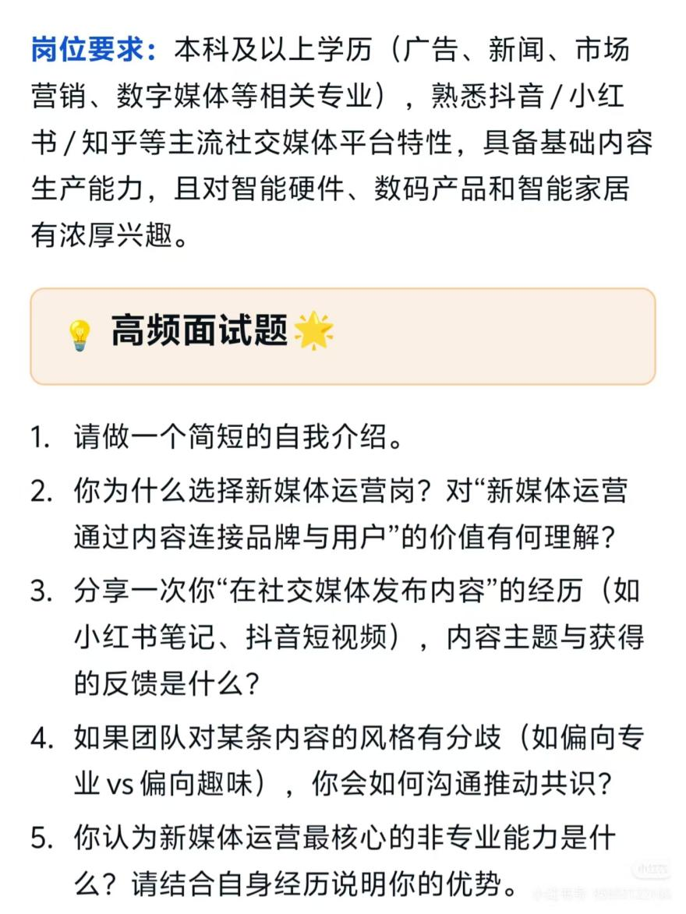

### 待复核项

- 目标岗位：
- 真实问题：
- 参考回答要点：
- 考察能力：
- 难度：
- 审核状态：

### OCR/清洗文本

岗位要求：广告、新闻、市场营销、数字媒体等相关专业；熟悉抖音、小红书、知乎等平台；具备基础内容生产能力。高频题包括自我介绍、为什么选择新媒体运营、社交媒体内容发布经历、团队内容风格分歧沟通、核心非专业能力。

## 图片 60: 01_2_image_060_9aaf720862.jpeg

- 来源：`D:\apps\ai-interview_archive\2026-05-23\面试经历(2).docx`
- SHA256：`9aaf720862bd852f3e3286d0d71eda41c6beaa2135dc0650ff686e3134297716`
- OCR 状态：`ocr_unavailable`
- OCR 置信度：``
- 当前岗位：待人工确认
- 当前审核状态：待核验
- 是否进入 package：False
- 图片：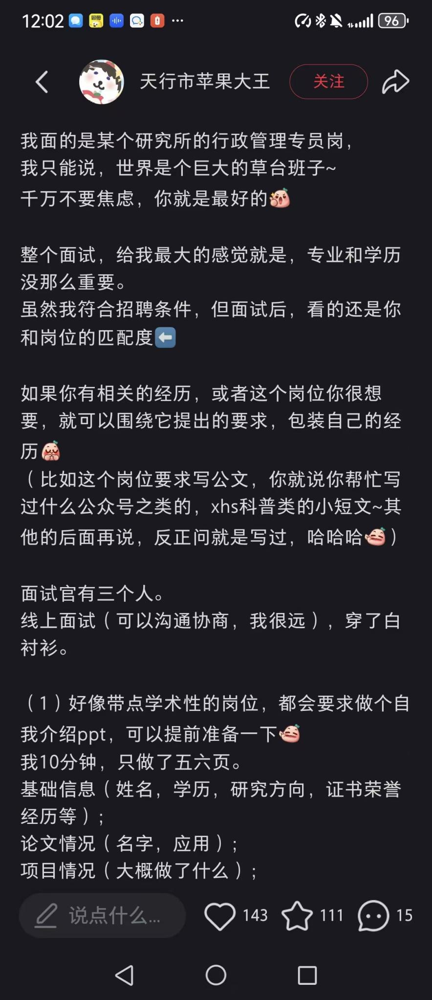

### 待复核项

- 目标岗位：
- 真实问题：
- 参考回答要点：
- 考察能力：
- 难度：
- 审核状态：

### OCR/清洗文本

（无可用 OCR 文本）

## 图片 61: 01_2_image_061_a425323f7e.jpeg

- 来源：`D:\apps\ai-interview_archive\2026-05-23\面试经历(2).docx`
- SHA256：`a425323f7e4afadd85d629b3a608b7ff0efe84746d3d6857baafedfaccb28913`
- OCR 状态：`manual_visual_review`
- OCR 置信度：``
- 当前岗位：行政管理助理
- 当前审核状态：可入库
- 是否进入 package：True
- 图片：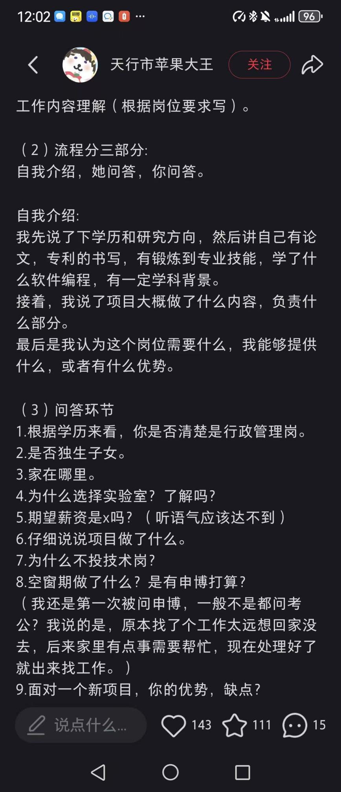

### 待复核项

- 目标岗位：
- 真实问题：
- 参考回答要点：
- 考察能力：
- 难度：
- 审核状态：

### OCR/清洗文本

研究所行政岗面经：流程包括自我介绍、提问、候选人问答。问题涉及是否清楚行政管理岗、是否独生子女、家庭情况、为什么选择实验室、期望薪资、组织项目经历、技术岗理解、空窗期、面对新项目的优势缺点。

## 图片 62: 01_2_image_062_21e4e66437.jpeg

- 来源：`D:\apps\ai-interview_archive\2026-05-23\面试经历(2).docx`
- SHA256：`21e4e66437ceadb0274a06689625f7192fc0f2cda1cb3e60630d449394fb8fa6`
- OCR 状态：`manual_visual_review`
- OCR 置信度：``
- 当前岗位：行政管理助理
- 当前审核状态：可入库
- 是否进入 package：True
- 图片：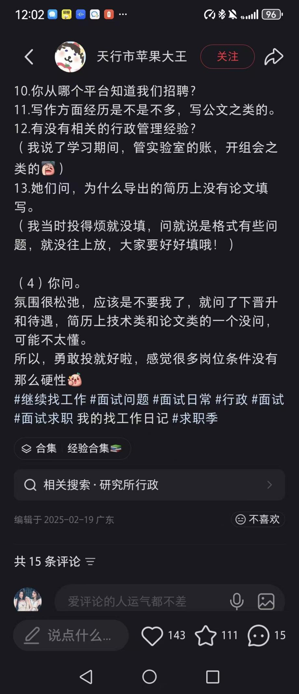

### 待复核项

- 目标岗位：
- 真实问题：
- 参考回答要点：
- 考察能力：
- 难度：
- 审核状态：

### OCR/清洗文本

研究所行政岗续页：问题包括从哪知道招聘、写作方面是否多、公文相关经验、为什么简历没有论文填写；复盘提到岗位专业性要求不高但更看匹配度。

## 图片 63: 01_2_image_063_09ab56224f.jpeg

- 来源：`D:\apps\ai-interview_archive\2026-05-23\面试经历(2).docx`
- SHA256：`09ab56224f943d288acd65237de0d78520b41686f710c582bd887f87155c2458`
- OCR 状态：`ocr_unavailable`
- OCR 置信度：``
- 当前岗位：待人工确认
- 当前审核状态：待核验
- 是否进入 package：False
- 图片：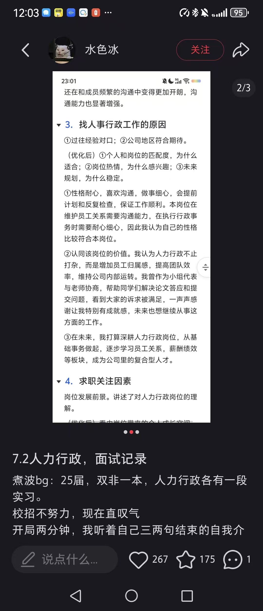

### 待复核项

- 目标岗位：
- 真实问题：
- 参考回答要点：
- 考察能力：
- 难度：
- 审核状态：

### OCR/清洗文本

（无可用 OCR 文本）

## 图片 64: 01_2_image_064_a29f10597a.jpeg

- 来源：`D:\apps\ai-interview_archive\2026-05-23\面试经历(2).docx`
- SHA256：`a29f10597a46529d888a3837d56e208097e08ffdfcee9f396d4e90bd3bb93d27`
- OCR 状态：`ocr_unavailable`
- OCR 置信度：``
- 当前岗位：待人工确认
- 当前审核状态：待核验
- 是否进入 package：False
- 图片：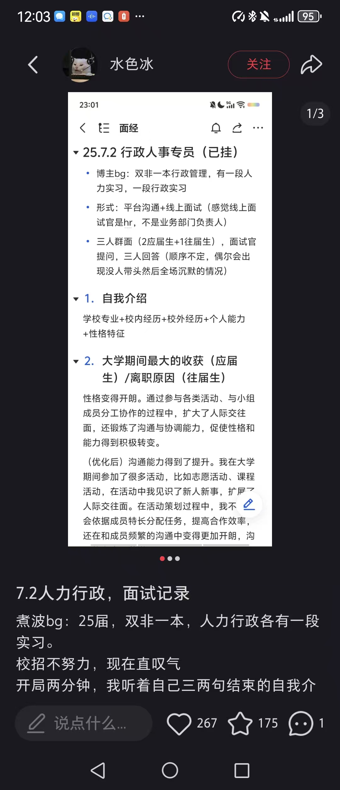

### 待复核项

- 目标岗位：
- 真实问题：
- 参考回答要点：
- 考察能力：
- 难度：
- 审核状态：

### OCR/清洗文本

（无可用 OCR 文本）

## 图片 65: 01_2_image_065_304bd7ff5e.jpeg

- 来源：`D:\apps\ai-interview_archive\2026-05-23\面试经历(2).docx`
- SHA256：`304bd7ff5ebc6831ec20dd09ce5202431aa5e4e40416278f18cd41a77e8d1710`
- OCR 状态：`ocr_unavailable`
- OCR 置信度：``
- 当前岗位：待人工确认
- 当前审核状态：待核验
- 是否进入 package：False
- 图片：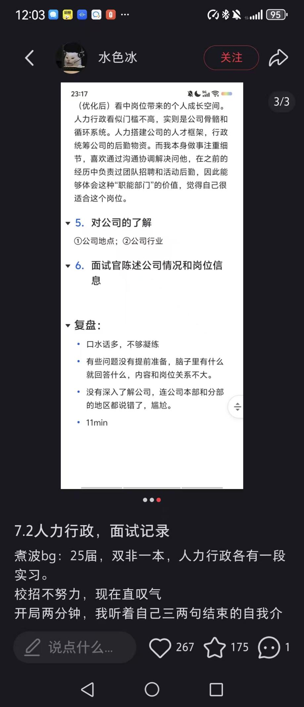

### 待复核项

- 目标岗位：
- 真实问题：
- 参考回答要点：
- 考察能力：
- 难度：
- 审核状态：

### OCR/清洗文本

（无可用 OCR 文本）

## 图片 66: 01_2_image_066_fbac40130d.jpeg

- 来源：`D:\apps\ai-interview_archive\2026-05-23\面试经历(2).docx`
- SHA256：`fbac40130dd07c62636f1597df41d11f1f0faff5c9f343156cb74344c7441578`
- OCR 状态：`manual_visual_review`
- OCR 置信度：``
- 当前岗位：行政管理助理
- 当前审核状态：仅参考
- 是否进入 package：True
- 图片：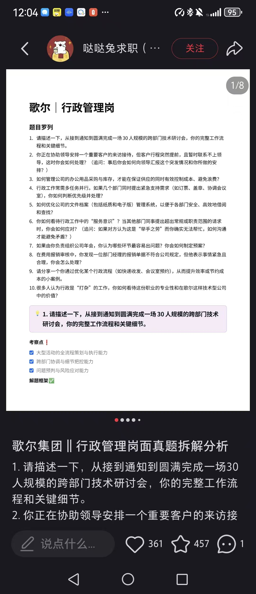

### 待复核项

- 目标岗位：
- 真实问题：
- 参考回答要点：
- 考察能力：
- 难度：
- 审核状态：

### OCR/清洗文本

歌尔集团行政管理岗面真题拆解：题目示例包括接到通知组织30人规模内部技术研讨会的完整流程和关键细节，以及协助领导安排重要客户来访接待。

## 图片 68: 01_2_image_068_526c69b3dd.jpeg

- 来源：`D:\apps\ai-interview_archive\2026-05-23\面试经历(2).docx`
- SHA256：`526c69b3dda3f2e4155e42568ac0a159371ba15b7df5632e32044c8f0b07d958`
- OCR 状态：`ocr_unavailable`
- OCR 置信度：``
- 当前岗位：待人工确认
- 当前审核状态：待核验
- 是否进入 package：False
- 图片：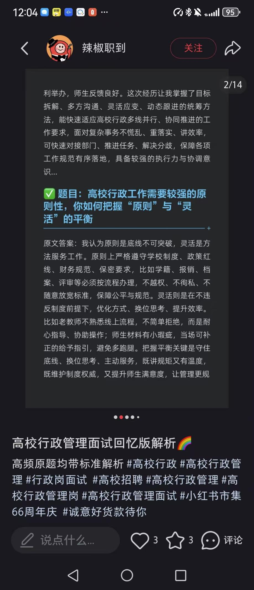

### 待复核项

- 目标岗位：
- 真实问题：
- 参考回答要点：
- 考察能力：
- 难度：
- 审核状态：

### OCR/清洗文本

（无可用 OCR 文本）

## 图片 69: 01_2_image_069_ecd675518c.jpeg

- 来源：`D:\apps\ai-interview_archive\2026-05-23\面试经历(2).docx`
- SHA256：`ecd675518c318344d1087c8b54faa737bc160c134835d7a8c4dbffbccf808a32`
- OCR 状态：`manual_visual_review`
- OCR 置信度：``
- 当前岗位：行政管理助理
- 当前审核状态：仅参考
- 是否进入 package：True
- 图片：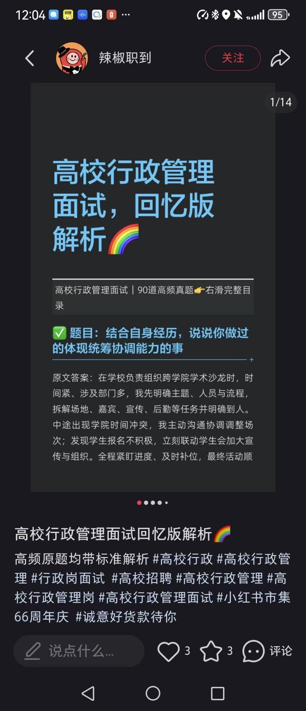

### 待复核项

- 目标岗位：
- 真实问题：
- 参考回答要点：
- 考察能力：
- 难度：
- 审核状态：

### OCR/清洗文本

高校行政管理面试回忆版：题目包括结合自身经历说明做过的体现统筹协调能力的事。

## 图片 70: 01_2_image_070_806d79f516.jpeg

- 来源：`D:\apps\ai-interview_archive\2026-05-23\面试经历(2).docx`
- SHA256：`806d79f516b76a59bfa380e2605a82b6994d1a32f2512058e91c4cd3bb754754`
- OCR 状态：`ocr_unavailable`
- OCR 置信度：``
- 当前岗位：待人工确认
- 当前审核状态：待核验
- 是否进入 package：False
- 图片：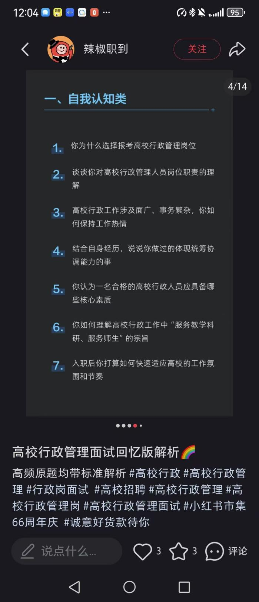

### 待复核项

- 目标岗位：
- 真实问题：
- 参考回答要点：
- 考察能力：
- 难度：
- 审核状态：

### OCR/清洗文本

（无可用 OCR 文本）

## 图片 71: 01_2_image_071_8541c33e95.jpeg

- 来源：`D:\apps\ai-interview_archive\2026-05-23\面试经历(2).docx`
- SHA256：`8541c33e95f1dd6604105b54b20b73727de9110c50b2653ff6809c3e92d6c297`
- OCR 状态：`ocr_unavailable`
- OCR 置信度：``
- 当前岗位：待人工确认
- 当前审核状态：待核验
- 是否进入 package：False
- 图片：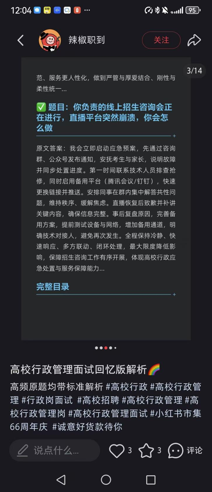

### 待复核项

- 目标岗位：
- 真实问题：
- 参考回答要点：
- 考察能力：
- 难度：
- 审核状态：

### OCR/清洗文本

（无可用 OCR 文本）

## 图片 72: 01_2_image_072_b3a0fbc54f.jpeg

- 来源：`D:\apps\ai-interview_archive\2026-05-23\面试经历(2).docx`
- SHA256：`b3a0fbc54ff82ca6a34615ac249fc1c5e160ecc180fc0aca42c2e39823bdcd1b`
- OCR 状态：`manual_visual_review`
- OCR 置信度：``
- 当前岗位：行政管理助理
- 当前审核状态：仅参考
- 是否进入 package：True
- 图片：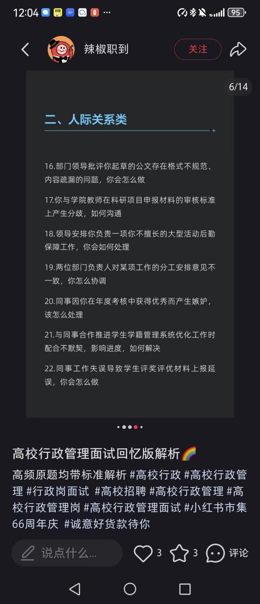

### 待复核项

- 目标岗位：
- 真实问题：
- 参考回答要点：
- 考察能力：
- 难度：
- 审核状态：

### OCR/清洗文本

高校行政管理面试回忆版：人际关系类问题包括部门领导批评内容不规范、学生家长频繁查材料、高要求领导催办等场景。

## 图片 73: 01_2_image_073_e7fb74b7dc.jpeg

- 来源：`D:\apps\ai-interview_archive\2026-05-23\面试经历(2).docx`
- SHA256：`e7fb74b7dc7046c9111f1dd7bdca88657c9f61e8dd5e291e7b7c88df9c3b8ab9`
- OCR 状态：`ocr_unavailable`
- OCR 置信度：``
- 当前岗位：待人工确认
- 当前审核状态：待核验
- 是否进入 package：False
- 图片：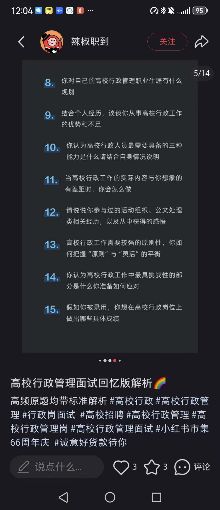

### 待复核项

- 目标岗位：
- 真实问题：
- 参考回答要点：
- 考察能力：
- 难度：
- 审核状态：

### OCR/清洗文本

（无可用 OCR 文本）

## 图片 74: 01_2_image_074_9e89381351.jpeg

- 来源：`D:\apps\ai-interview_archive\2026-05-23\面试经历(2).docx`
- SHA256：`9e89381351cd6b44da6dec227ebcf7fa419c40f7460174bab0fd70bef73d3b8e`
- OCR 状态：`ocr_unavailable`
- OCR 置信度：``
- 当前岗位：待人工确认
- 当前审核状态：待核验
- 是否进入 package：False
- 图片：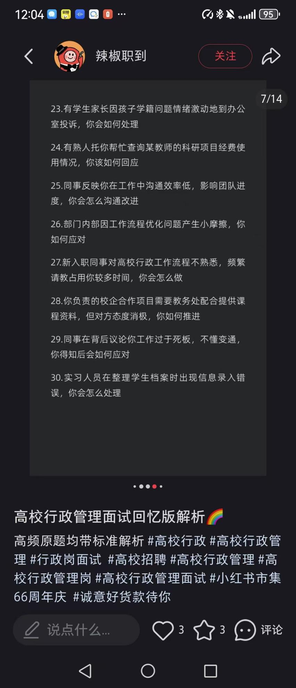

### 待复核项

- 目标岗位：
- 真实问题：
- 参考回答要点：
- 考察能力：
- 难度：
- 审核状态：

### OCR/清洗文本

（无可用 OCR 文本）

## 图片 75: 01_2_image_075_f330cbd7bb.jpeg

- 来源：`D:\apps\ai-interview_archive\2026-05-23\面试经历(2).docx`
- SHA256：`f330cbd7bb4e4e471c95849030886bf464966b7579846bffecf316f038a56b5a`
- OCR 状态：`manual_visual_review`
- OCR 置信度：``
- 当前岗位：行政管理助理
- 当前审核状态：仅参考
- 是否进入 package：True
- 图片：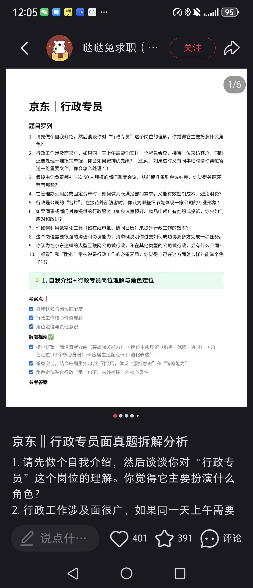

### 待复核项

- 目标岗位：
- 真实问题：
- 参考回答要点：
- 考察能力：
- 难度：
- 审核状态：

### OCR/清洗文本

京东行政专员面真题拆解：题目涉及行政专员角色理解、一天上午多个任务并行时如何安排、跨部门协调、办公用品盘点、紧急会议室安排等。

## 图片 76: 01_2_image_076_92f7dbda55.jpeg

- 来源：`D:\apps\ai-interview_archive\2026-05-23\面试经历(2).docx`
- SHA256：`92f7dbda554c1069ee6645806a6b77085f46376bc07e3168f7b4216d3737f75d`
- OCR 状态：`manual_visual_review`
- OCR 置信度：``
- 当前岗位：行政管理助理
- 当前审核状态：仅参考
- 是否进入 package：True
- 图片：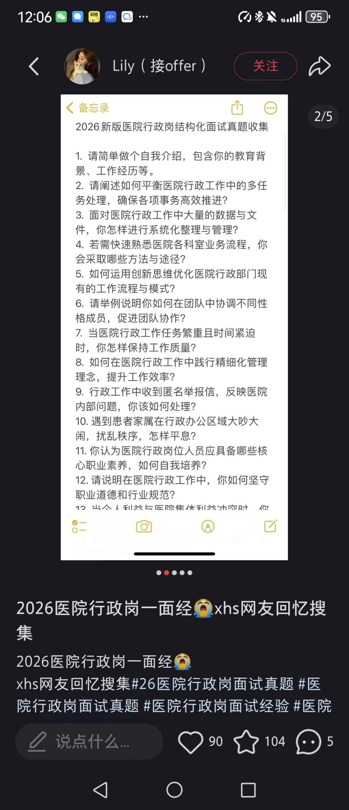

### 待复核项

- 目标岗位：
- 真实问题：
- 参考回答要点：
- 考察能力：
- 难度：
- 审核状态：

### OCR/清洗文本

医院行政岗面试题：涉及信息整合、医院行政多任务处理、文档管理和系统化整理、跨部门协作、突发任务、档案管理等。

## 图片 77: 01_2_image_077_e53c0dcaed.jpeg

- 来源：`D:\apps\ai-interview_archive\2026-05-23\面试经历(2).docx`
- SHA256：`e53c0dcaeded0422f4b1e63e73962724cf64b1ad0d5b96490f94d3fd0bd31fdb`
- OCR 状态：`ocr_unavailable`
- OCR 置信度：``
- 当前岗位：待人工确认
- 当前审核状态：待核验
- 是否进入 package：False
- 图片：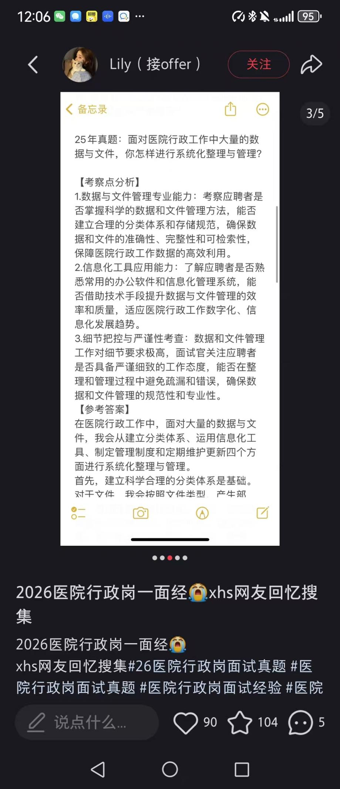

### 待复核项

- 目标岗位：
- 真实问题：
- 参考回答要点：
- 考察能力：
- 难度：
- 审核状态：

### OCR/清洗文本

（无可用 OCR 文本）

## 图片 79: 01_2_image_079_804c0f7fa5.jpeg

- 来源：`D:\apps\ai-interview_archive\2026-05-23\面试经历(2).docx`
- SHA256：`804c0f7fa5e10c51c0b2ae9b4b7a216693121a1dd92ef28a63588cc08e1da171`
- OCR 状态：`ocr_unavailable`
- OCR 置信度：``
- 当前岗位：待人工确认
- 当前审核状态：待核验
- 是否进入 package：False
- 图片：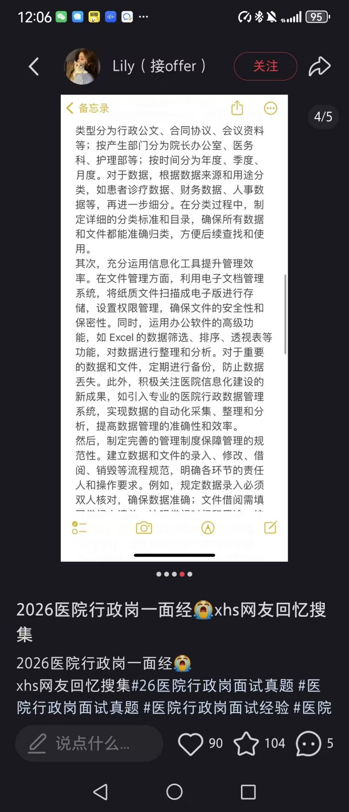

### 待复核项

- 目标岗位：
- 真实问题：
- 参考回答要点：
- 考察能力：
- 难度：
- 审核状态：

### OCR/清洗文本

（无可用 OCR 文本）

## 图片 80: 01_2_image_080_efc93f0a95.jpeg

- 来源：`D:\apps\ai-interview_archive\2026-05-23\面试经历(2).docx`
- SHA256：`efc93f0a9519e81a3c92a683ad5226b85853f46affebf2f538506e7b9ce74103`
- OCR 状态：`manual_visual_review`
- OCR 置信度：``
- 当前岗位：行政管理助理
- 当前审核状态：仅参考
- 是否进入 package：True
- 图片：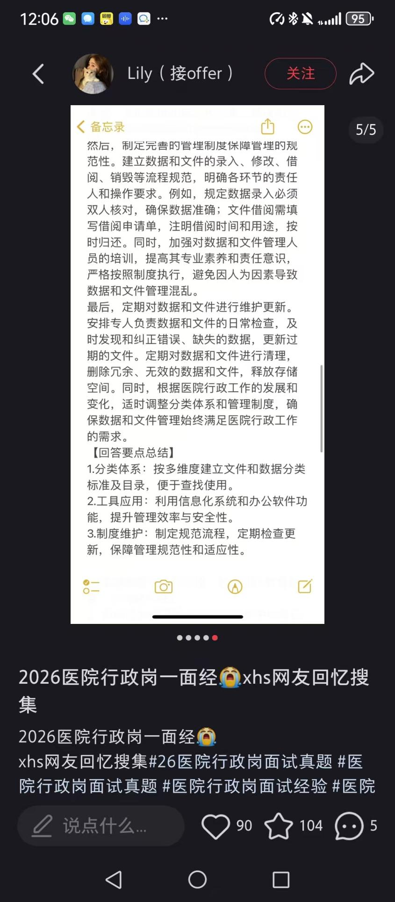

### 待复核项

- 目标岗位：
- 真实问题：
- 参考回答要点：
- 考察能力：
- 难度：
- 审核状态：

### OCR/清洗文本

医院行政岗答案页：提到文件分类、电子化归档、权限管理、数据录入校验、定期更新、培训指导和跨科室沟通。

## 图片 81: 01_2_image_081_deb00073e5.jpeg

- 来源：`D:\apps\ai-interview_archive\2026-05-23\面试经历(2).docx`
- SHA256：`deb00073e5062aded61d310b141cde09fe026206776f453018cba656fe2b61a7`
- OCR 状态：`manual_visual_review`
- OCR 置信度：``
- 当前岗位：招聘助理
- 当前审核状态：仅参考
- 是否进入 package：True
- 图片：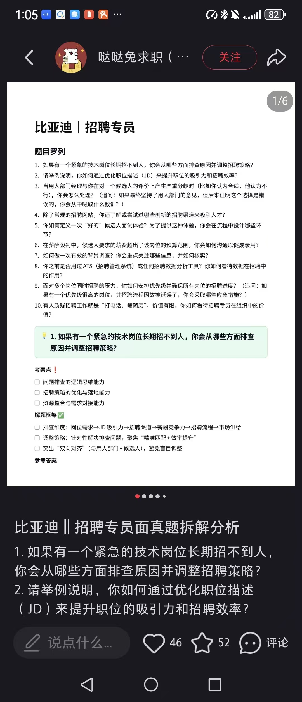

### 待复核项

- 目标岗位：
- 真实问题：
- 参考回答要点：
- 考察能力：
- 难度：
- 审核状态：

### OCR/清洗文本

比亚迪招聘专员面真题拆解：题目包括紧急技术岗位长期招不到人，如何判断原因并调整策略；如何优化职位描述提升简历投递效率。

## 图片 82: 01_2_image_082_96eb60ed89.jpeg

- 来源：`D:\apps\ai-interview_archive\2026-05-23\面试经历(2).docx`
- SHA256：`96eb60ed8937cb3f4db928b4063db5297981f8484e3f1aad1ef037f356527fbd`
- OCR 状态：`manual_visual_review`
- OCR 置信度：``
- 当前岗位：人力资源专员
- 当前审核状态：可入库
- 是否进入 package：True
- 图片：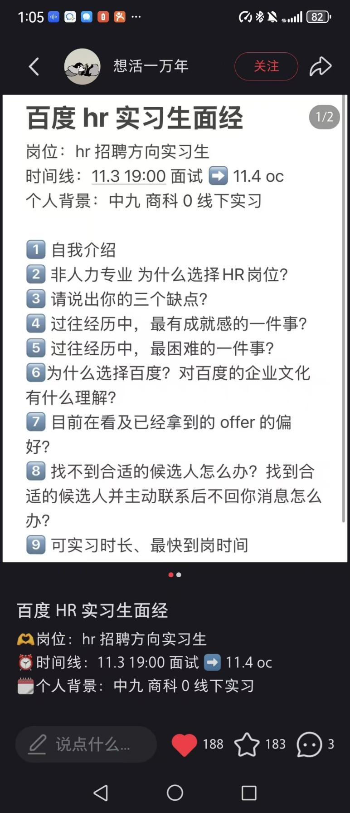

### 待复核项

- 目标岗位：
- 真实问题：
- 参考回答要点：
- 考察能力：
- 难度：
- 审核状态：

### OCR/清洗文本

百度 HR 实习生面经：岗位为 HR 招聘方向实习生，问题包括自我介绍、非人力专业为什么选择 HR、优缺点、最有成就感的一件事、困难事件、为什么选择百度、offer 偏好、找不到候选人或候选人不回复怎么办、可实习时长。

## 图片 83: 01_2_image_083_8e1d11ce3c.jpeg

- 来源：`D:\apps\ai-interview_archive\2026-05-23\面试经历(2).docx`
- SHA256：`8e1d11ce3c3c3c290a0eb7a03247f7337f381635e5f44f511a4736f4b7ac6539`
- OCR 状态：`ocr_unavailable`
- OCR 置信度：``
- 当前岗位：待人工确认
- 当前审核状态：待核验
- 是否进入 package：False
- 图片：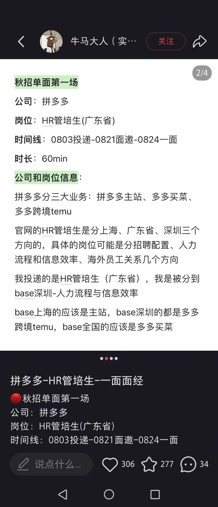

### 待复核项

- 目标岗位：
- 真实问题：
- 参考回答要点：
- 考察能力：
- 难度：
- 审核状态：

### OCR/清洗文本

（无可用 OCR 文本）

## 图片 84: 01_2_image_084_ecccb998ac.jpeg

- 来源：`D:\apps\ai-interview_archive\2026-05-23\面试经历(2).docx`
- SHA256：`ecccb998ac448c04a263df385c0c59bbc81f60a8b9c38faf9ba15df775c23717`
- OCR 状态：`manual_visual_review`
- OCR 置信度：``
- 当前岗位：人力资源专员
- 当前审核状态：可入库
- 是否进入 package：True
- 图片：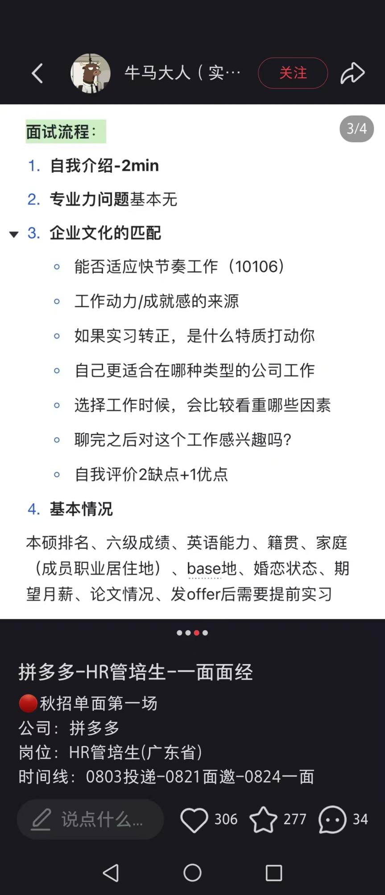

### 待复核项

- 目标岗位：
- 真实问题：
- 参考回答要点：
- 考察能力：
- 难度：
- 审核状态：

### OCR/清洗文本

拼多多 HR 管培生一面流程：自我介绍、专业问题、企业文化匹配、能否适应快节奏、工作动力、最打动的事、如何看待 HR 工作、选择工作看重因素、反问。

## 图片 85: 01_2_image_085_5f0b33b350.jpeg

- 来源：`D:\apps\ai-interview_archive\2026-05-23\面试经历(2).docx`
- SHA256：`5f0b33b350de6a22e6d93afec48c79d791ee780500df2c898ab31117c51b2761`
- OCR 状态：`ocr_unavailable`
- OCR 置信度：``
- 当前岗位：待人工确认
- 当前审核状态：待核验
- 是否进入 package：False
- 图片：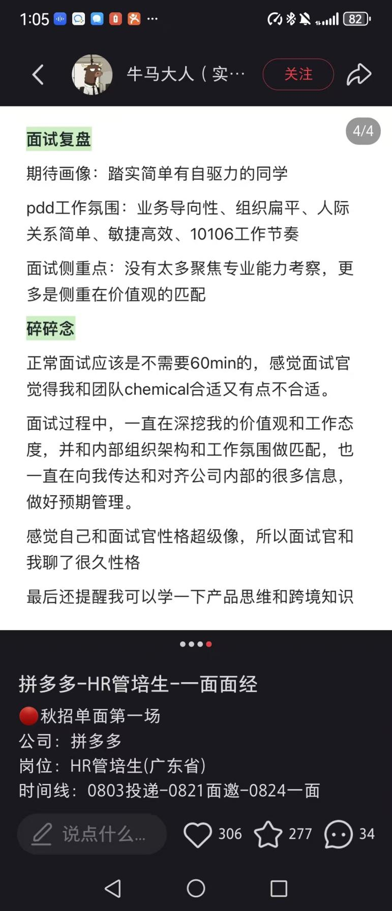

### 待复核项

- 目标岗位：
- 真实问题：
- 参考回答要点：
- 考察能力：
- 难度：
- 审核状态：

### OCR/清洗文本

（无可用 OCR 文本）

## 图片 86: 01_2_image_086_9815a2dcae.jpeg

- 来源：`D:\apps\ai-interview_archive\2026-05-23\面试经历(2).docx`
- SHA256：`9815a2dcaeea72af0e3ce7aebc91ad76d06329da0390caf6d06302d60a282d89`
- OCR 状态：`ocr_unavailable`
- OCR 置信度：``
- 当前岗位：待人工确认
- 当前审核状态：待核验
- 是否进入 package：False
- 图片：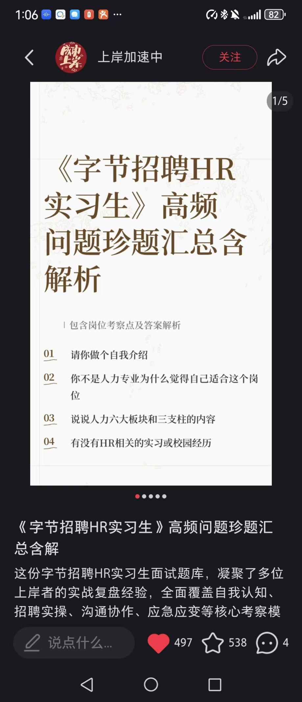

### 待复核项

- 目标岗位：
- 真实问题：
- 参考回答要点：
- 考察能力：
- 难度：
- 审核状态：

### OCR/清洗文本

（无可用 OCR 文本）

## 图片 87: 01_2_image_087_3e1e657ad0.jpeg

- 来源：`D:\apps\ai-interview_archive\2026-05-23\面试经历(2).docx`
- SHA256：`3e1e657ad041ea0b467a3b9603d9f8414bc2e9b3a01549610fdc7a211bcc6a24`
- OCR 状态：`manual_visual_review`
- OCR 置信度：``
- 当前岗位：招聘助理
- 当前审核状态：仅参考
- 是否进入 package：True
- 图片：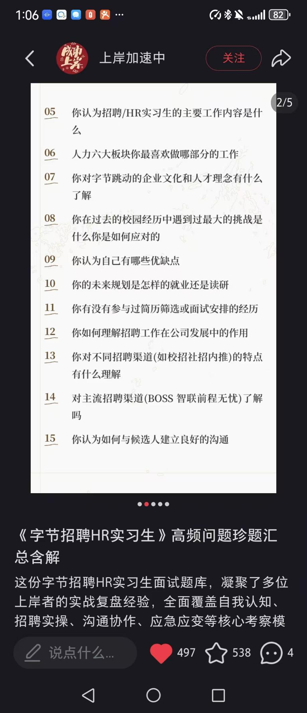

### 待复核项

- 目标岗位：
- 真实问题：
- 参考回答要点：
- 考察能力：
- 难度：
- 审核状态：

### OCR/清洗文本

字节招聘 HR 实习生高频题：为什么想做招聘、从六大模块角度看招聘工作、如何筛选简历、如何做好招聘沟通、怎么看待实习中的压力等。

## 图片 88: 01_2_image_088_693ffb2bbd.jpeg

- 来源：`D:\apps\ai-interview_archive\2026-05-23\面试经历(2).docx`
- SHA256：`693ffb2bbd13fe6e9751d9fae6cadfbe2bab86c5f4165134e39ad3a7c22657a2`
- OCR 状态：`ocr_unavailable`
- OCR 置信度：``
- 当前岗位：待人工确认
- 当前审核状态：待核验
- 是否进入 package：False
- 图片：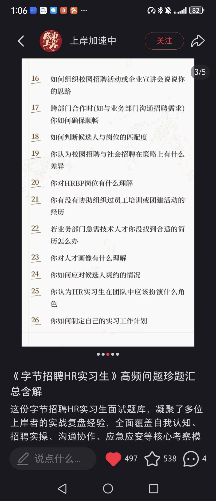

### 待复核项

- 目标岗位：
- 真实问题：
- 参考回答要点：
- 考察能力：
- 难度：
- 审核状态：

### OCR/清洗文本

（无可用 OCR 文本）

## 图片 90: 01_2_image_090_0669864600.jpeg

- 来源：`D:\apps\ai-interview_archive\2026-05-23\面试经历(2).docx`
- SHA256：`06698646005d31298b1f686268b090ae19c200a094cea4a9e6a95a9f6aff9bf1`
- OCR 状态：`ocr_unavailable`
- OCR 置信度：``
- 当前岗位：待人工确认
- 当前审核状态：待核验
- 是否进入 package：False
- 图片：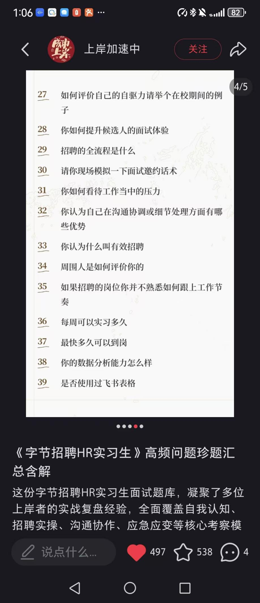

### 待复核项

- 目标岗位：
- 真实问题：
- 参考回答要点：
- 考察能力：
- 难度：
- 审核状态：

### OCR/清洗文本

（无可用 OCR 文本）

## 图片 91: 01_2_image_091_0a4a404128.jpeg

- 来源：`D:\apps\ai-interview_archive\2026-05-23\面试经历(2).docx`
- SHA256：`0a4a404128839a5bfb0e3cecc80afbea4e859391d3ad9fb747b0f6e3ba0c39f9`
- OCR 状态：`ocr_unavailable`
- OCR 置信度：``
- 当前岗位：待人工确认
- 当前审核状态：待核验
- 是否进入 package：False
- 图片：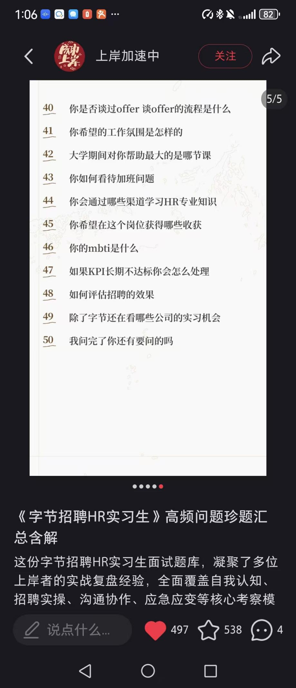

### 待复核项

- 目标岗位：
- 真实问题：
- 参考回答要点：
- 考察能力：
- 难度：
- 审核状态：

### OCR/清洗文本

（无可用 OCR 文本）

## 图片 92: 01_2_image_092_239287ebc7.jpeg

- 来源：`D:\apps\ai-interview_archive\2026-05-23\面试经历(2).docx`
- SHA256：`239287ebc7ef6de19842d191c0df305d5ccecb208a92a5f1404c609265a1e769`
- OCR 状态：`manual_visual_review`
- OCR 置信度：``
- 当前岗位：招聘助理
- 当前审核状态：可入库
- 是否进入 package：True
- 图片：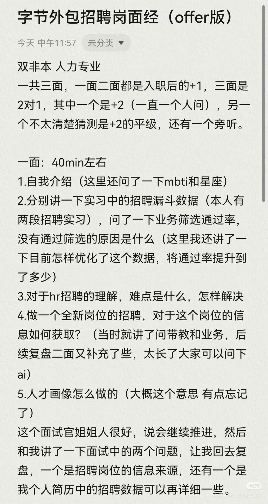

### 待复核项

- 目标岗位：
- 真实问题：
- 参考回答要点：
- 考察能力：
- 难度：
- 审核状态：

### OCR/清洗文本

字节外包招聘岗面经：一面约40分钟，问题包括招聘漏斗数据、业务筛选通过率、HR 招聘理解、招聘信息来源、人才画像等。

## 图片 93: 01_2_image_093_229630ac09.jpeg

- 来源：`D:\apps\ai-interview_archive\2026-05-23\面试经历(2).docx`
- SHA256：`229630ac09f5f79731d3226b80076f64bbb6c12131ac5a78ea247092c2a65755`
- OCR 状态：`manual_visual_review`
- OCR 置信度：``
- 当前岗位：招聘助理
- 当前审核状态：可入库
- 是否进入 package：True
- 图片：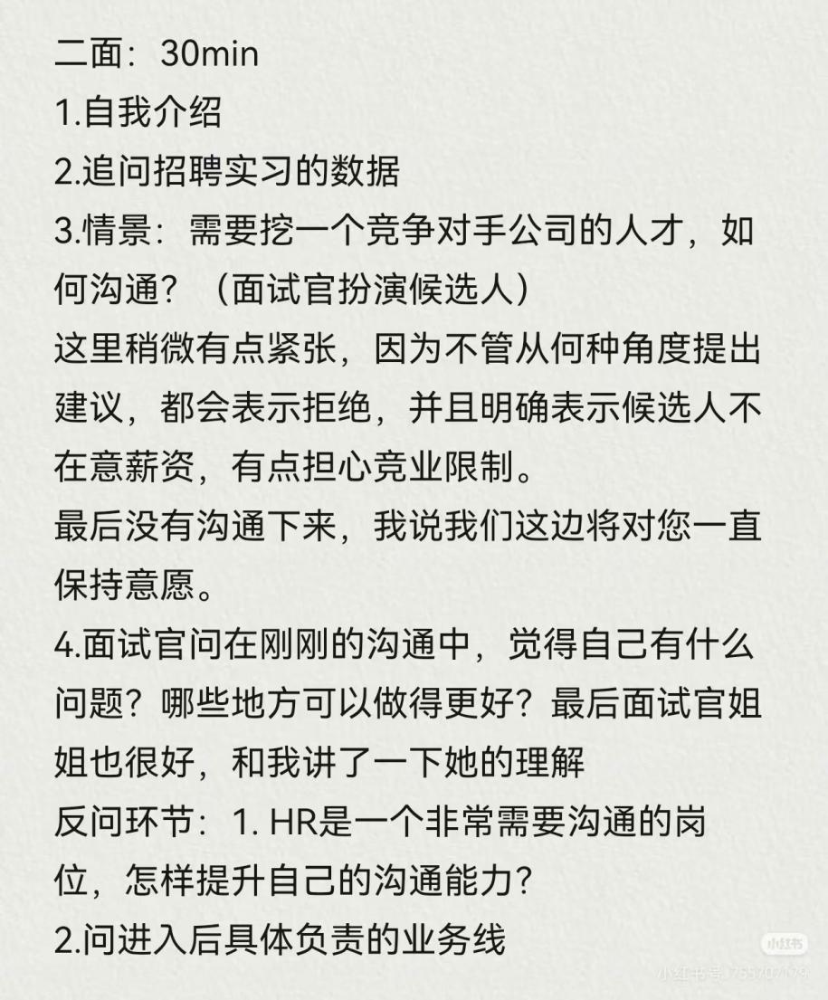

### 待复核项

- 目标岗位：
- 真实问题：
- 参考回答要点：
- 考察能力：
- 难度：
- 审核状态：

### OCR/清洗文本

字节外包招聘岗二面：追问招聘实习数据；情景题为需要挖竞争对手公司人才，如何沟通，候选人顾虑薪资和竞业限制；反问 HR 沟通能力提升。

## 图片 94: 01_2_image_094_758c76b025.jpeg

- 来源：`D:\apps\ai-interview_archive\2026-05-23\面试经历(2).docx`
- SHA256：`758c76b02566cd7a02ca72c7559b1d38d4ded8fbb7c0d9c9714940f1105bf932`
- OCR 状态：`ocr_unavailable`
- OCR 置信度：``
- 当前岗位：待人工确认
- 当前审核状态：待核验
- 是否进入 package：False
- 图片：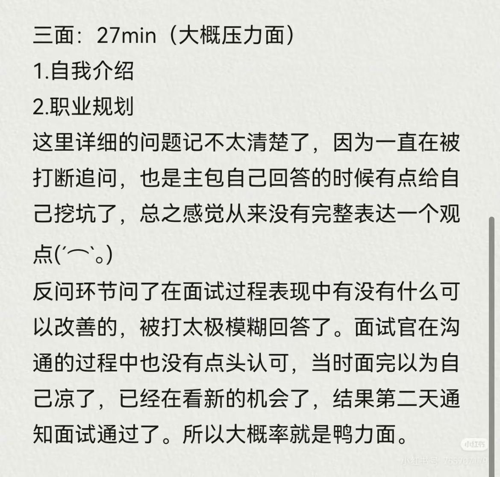

### 待复核项

- 目标岗位：
- 真实问题：
- 参考回答要点：
- 考察能力：
- 难度：
- 审核状态：

### OCR/清洗文本

（无可用 OCR 文本）

## 图片 95: 01_2_image_095_b0dcb6ee75.jpeg

- 来源：`D:\apps\ai-interview_archive\2026-05-23\面试经历(2).docx`
- SHA256：`b0dcb6ee75c479d52dc90352a03fcb658ed05de2f0b8c0720d55c59121aecb8e`
- OCR 状态：`manual_visual_review`
- OCR 置信度：``
- 当前岗位：招聘助理
- 当前审核状态：可入库
- 是否进入 package：True
- 图片：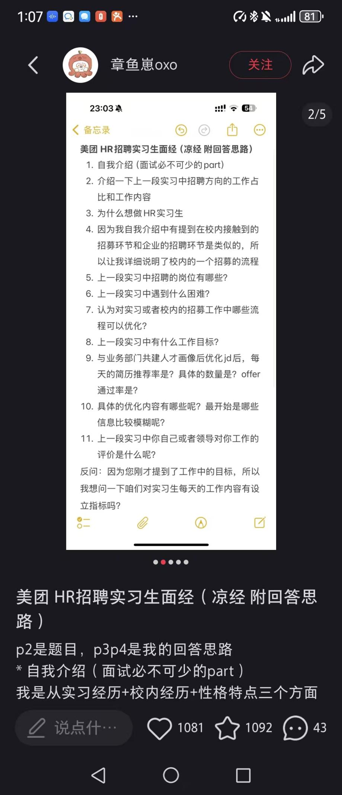

### 待复核项

- 目标岗位：
- 真实问题：
- 参考回答要点：
- 考察能力：
- 难度：
- 审核状态：

### OCR/清洗文本

美团 HR 招聘实习生面经：问题包括自我介绍、介绍上一段实习中招聘方向工作占比、为什么想做 HR 实习生、上段实习中招聘岗位有哪些、怎么筛选简历、招聘渠道、是否接受加班、上手时间等。

## 图片 96: 01_2_image_096_abdb901659.jpeg

- 来源：`D:\apps\ai-interview_archive\2026-05-23\面试经历(2).docx`
- SHA256：`abdb9016591985cf1301b10d36545b9e1b0f04bc4f2e0d2b852569c2e0e986ba`
- OCR 状态：`ocr_unavailable`
- OCR 置信度：``
- 当前岗位：待人工确认
- 当前审核状态：待核验
- 是否进入 package：False
- 图片：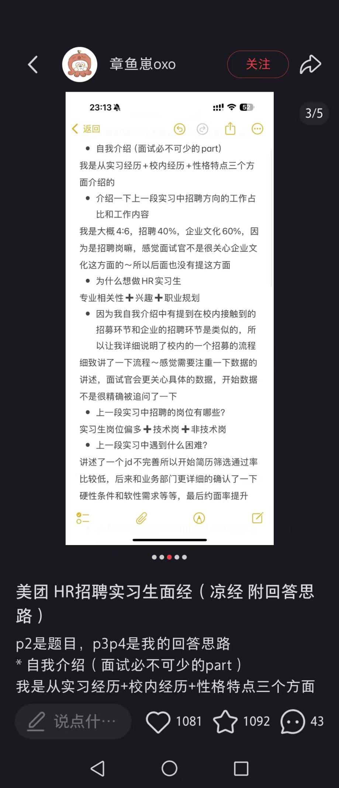

### 待复核项

- 目标岗位：
- 真实问题：
- 参考回答要点：
- 考察能力：
- 难度：
- 审核状态：

### OCR/清洗文本

（无可用 OCR 文本）

## 图片 97: 01_2_image_097_243206b3c3.jpeg

- 来源：`D:\apps\ai-interview_archive\2026-05-23\面试经历(2).docx`
- SHA256：`243206b3c34a38dfe5f511501b9ff14187e2d3deab8b44576489795a852a34bd`
- OCR 状态：`ocr_unavailable`
- OCR 置信度：``
- 当前岗位：待人工确认
- 当前审核状态：待核验
- 是否进入 package：False
- 图片：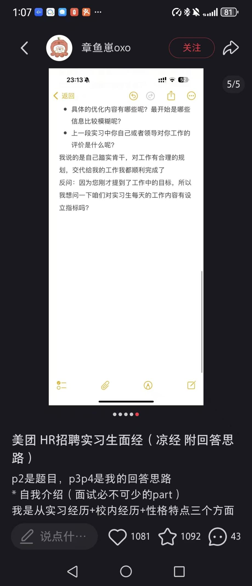

### 待复核项

- 目标岗位：
- 真实问题：
- 参考回答要点：
- 考察能力：
- 难度：
- 审核状态：

### OCR/清洗文本

（无可用 OCR 文本）

## 图片 98: 01_2_image_098_aec8d83cd4.jpeg

- 来源：`D:\apps\ai-interview_archive\2026-05-23\面试经历(2).docx`
- SHA256：`aec8d83cd4d92386c032f0260c162e89ed5acc5ce80e697c5ff0f5e9a0ce013d`
- OCR 状态：`manual_visual_review`
- OCR 置信度：``
- 当前岗位：招聘助理
- 当前审核状态：可入库
- 是否进入 package：True
- 图片：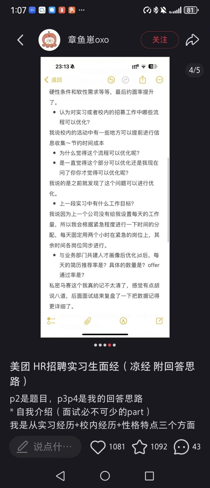

### 待复核项

- 目标岗位：
- 真实问题：
- 参考回答要点：
- 考察能力：
- 难度：
- 审核状态：

### OCR/清洗文本

美团 HR 招聘实习生答案思路：提到提升招聘效率、筛选流程优化、联系候选人和老师推荐，后续需要复盘工作流程。
